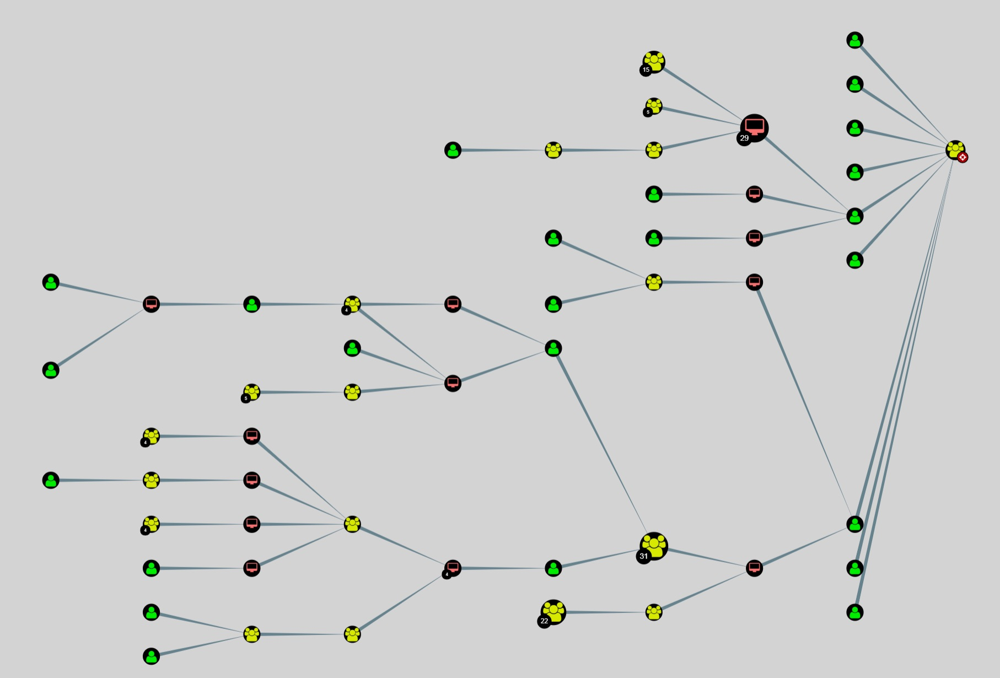
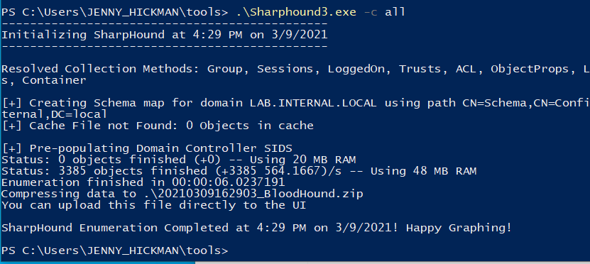
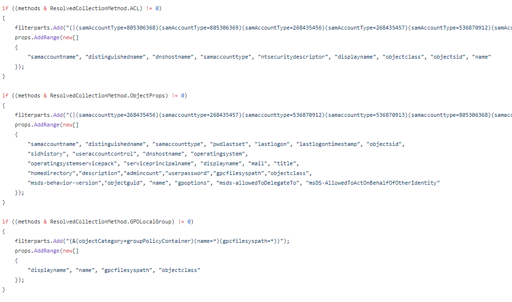
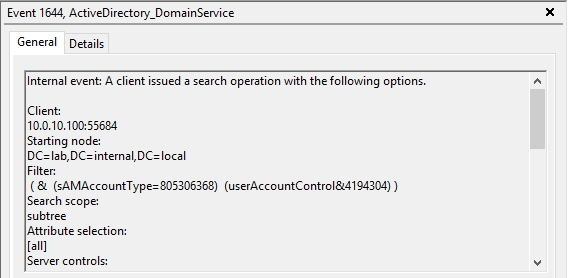
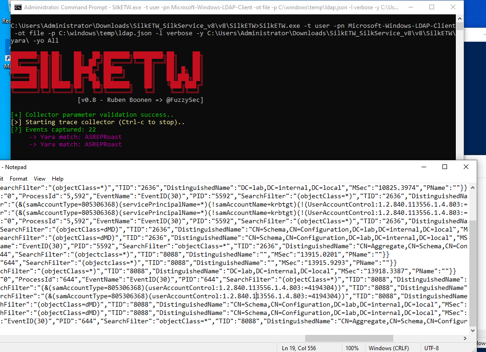
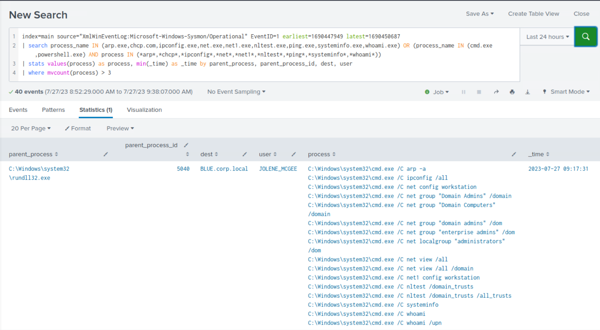
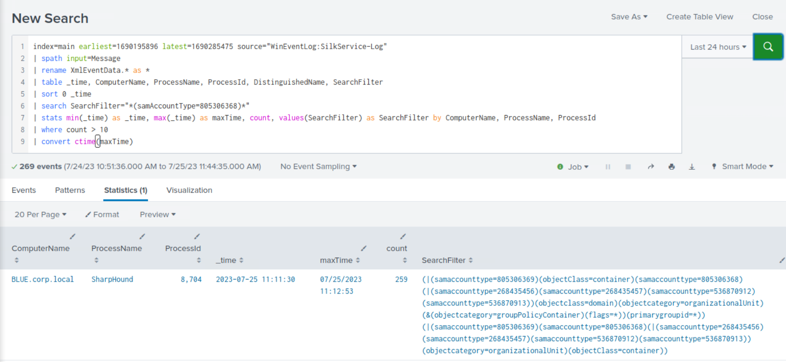

# Detecting Common User/Domain Recon (Phát hiện các hoạt động trinh sát user/domain phổ biến)

## Trinh sát domain (Domain Reconnaissance)

`Active Directory (AD) domain reconnaissance` là một giai đoạn then chốt trong vòng đời của một cuộc tấn công mạng. Trong giai đoạn này, kẻ tấn công cố gắng thu thập thông tin về môi trường mục tiêu, tìm cách nắm được kiến trúc, topology mạng, các biện pháp bảo mật và những lỗ hổng tiềm ẩn của môi trường đó.

Khi tiến hành trinh sát domain AD, kẻ tấn công tập trung xác định các thành phần quan trọng như Domain Controller, tài khoản người dùng, group, quan hệ tin cậy (trust relationship), organizational unit (OU), group policy và các object quan trọng khác. Khi đã có cái nhìn sâu về môi trường AD, kẻ tấn công có thể xác định chính xác các mục tiêu giá trị cao, leo thang đặc quyền (privilege escalation) và di chuyển ngang (lateral movement) trong mạng.

#### Trinh sát user/domain bằng các file thực thi có sẵn của Windows

Một ví dụ về trinh sát domain AD là khi kẻ tấn công chạy lệnh `net group` để lấy danh sách `Domain Administrators`.


Các công cụ/lệnh có sẵn thường được dùng để trinh sát domain gồm:

* `whoami /all`
* `wmic computersystem get domain`
* `net user /domain`
* `net group "Domain Admins" /domain`
* `arp -a`
* `nltest /domain_trusts`

Về phía phát hiện, quản trị viên có thể dùng PowerShell để giám sát các script hoặc cmdlet bất thường, đồng thời giám sát command-line của process.

#### Trinh sát user/domain bằng BloodHound/SharpHound

[BloodHound](https://github.com/SpecterOps/BloodHound) là một công cụ trinh sát domain mã nguồn mở, được tạo ra để phân tích và trực quan hoá môi trường Active Directory (AD). Kẻ tấn công thường dùng nó để tìm ra các attack path (đường tấn công) và các rủi ro bảo mật tiềm ẩn trong hạ tầng AD của một tổ chức. BloodHound tận dụng lý thuyết đồ thị và việc ánh xạ quan hệ để làm rõ các quan hệ tin cậy, quyền (permission) và tư cách thành viên group trong domain AD.



[Sharphound](https://github.com/BloodHoundAD/SharpHound) là bộ thu thập dữ liệu (data collector) viết bằng C# cho BloodHound. Một ví dụ sử dụng là kẻ tấn công chạy Sharphound với tất cả các phương thức thu thập (`-c all`).



#### Cơ hội phát hiện BloodHound

Ở tầng bên dưới, collector của BloodHound thực thi rất nhiều LDAP query nhắm tới Domain Controller nhằm thu thập thông tin về domain.



Tuy nhiên, giám sát LDAP query có thể là một thách thức. Mặc định, Windows Event Log không ghi lại chúng. Lựa chọn tốt nhất mà Windows có thể đưa ra là dùng `Event 1644` — log giám sát hiệu năng LDAP. Ngay cả khi đã bật log này, BloodHound vẫn có thể không tạo ra nhiều event như mong đợi.



Một cách đáng tin cậy hơn là dùng ETW provider `Microsoft-Windows-LDAP-Client` của Windows. Như đã trình bày trước đây trong path `SOC Analyst`, [SilkETW & SilkService](https://github.com/mandiant/SilkETW) là các wrapper C# linh hoạt cho ETW, được thiết kế để đơn giản hoá sự phức tạp của ETW, mang lại một giao diện dễ tiếp cận cho việc nghiên cứu và quan sát nội tại (introspection). `SilkService` hỗ trợ xuất ra Windows Event Log, giúp việc thu nạp log trở nên đơn giản hơn. Một tính năng hữu ích khác là khả năng dùng rule `Yara` để hunting các LDAP query đáng ngờ.



Ngoài ra, nhóm ATP của Microsoft đã tổng hợp một [danh sách các LDAP filter thường được các công cụ trinh sát sử dụng](https://techcommunity.microsoft.com/t5/microsoft-defender-for-endpoint/hunting-for-reconnaissance-activities-using-ldap-search-filters/ba-p/824726).


Có trong tay danh sách LDAP filter này, hoạt động của BloodHound có thể được phát hiện hiệu quả hơn.

<div class="card bg-light">
    <div class="card-body">
				 <p class="mb-0">Bây giờ hãy kéo xuống cuối section này và bấm vào "Click here to spawn the target system!". Sau đó, truy cập giao diện Splunk tại http://[Target IP]:8000 và mở ứng dụng Search & Reporting của Splunk. Phần lớn các search được trình bày từ đây đến cuối section này đều có thể thực hiện lại trên target, giúp nắm vững hơn các chủ đề được trình bày. </p>
    </div>
</div>

## Phát hiện trinh sát user/domain bằng Splunk

<div class="card bg-light">
    <div class="card-body">
				 <p class="mb-0">Bạn sẽ thấy mỗi cuộc tấn công đều được xác định trong một khoảng thời gian (timeframe) cụ thể. Việc này nhằm tập trung vào các event liên quan, tránh bị ngợp bởi khối lượng lớn các event không liên quan. </p>
    </div>
</div>

Bây giờ hãy cùng tìm hiểu cách dùng Splunk để nhận diện các kỹ thuật trinh sát đã bàn ở trên.

#### Phát hiện trinh sát bằng cách nhắm vào các file thực thi có sẵn của Windows

**Timeframe**: `earliest=1690447949 latest=1690450687`

```shell-session
index=main source="XmlWinEventLog:Microsoft-Windows-Sysmon/Operational" EventID=1 earliest=1690447949 latest=1690450687
| search process_name IN (arp.exe,chcp.com,ipconfig.exe,net.exe,net1.exe,nltest.exe,ping.exe,systeminfo.exe,whoami.exe) OR (process_name IN (cmd.exe,powershell.exe) AND process IN (*arp*,*chcp*,*ipconfig*,*net*,*net1*,*nltest*,*ping*,*systeminfo*,*whoami*))
| stats values(process) as process, min(_time) as _time by parent_process, parent_process_id, dest, user
| where mvcount(process) > 3
```



**Phân tích search**:

- `Filtering by Index and Source`: Search bắt đầu bằng việc chọn các event từ index main có source là `XmlWinEventLog:Microsoft-Windows-Sysmon/Operational`, tức Windows Event Log định dạng XML dành cho các event của Sysmon (System Monitor). Sysmon là một service và device driver ghi lại hoạt động của hệ thống vào event log.
- `EventID Filter`: Search được lọc tiếp để chỉ chọn các event có `Event ID` là `1`. Trong Sysmon, Event ID 1 tương ứng với các event `Process Creation`, ghi lại dữ liệu về các process mới được tạo.
- `Time Range Filter`: Search giới hạn phạm vi thời gian của event trong khoảng giữa hai Unix timestamp 1690447949 và 1690450687. Hai timestamp này biểu thị thời điểm sớm nhất và muộn nhất mà các event xảy ra.
- `Process Name Filter`: Sau đó search lọc event để chỉ giữ những event mà field process_name là một trong danh sách các tên process cụ thể (vd: `arp.exe`, `chcp.com`, `ipconfig.exe`, v.v.), hoặc những event mà field `process_name` là `cmd.exe` hay `powershell.exe` và field process chứa một số chuỗi con nhất định. Bước này tìm các event liên quan tới một số lệnh hệ thống hoặc lệnh liên quan đến mạng, cũng như các event mà những lệnh này được chạy từ một phiên Command Prompt hoặc PowerShell.
- `Statistics`: Lệnh stats được dùng để gộp (aggregate) event theo các field `parent_process`, `parent_process_id`, `dest` và `user`. Với mỗi tổ hợp giá trị duy nhất của các field này, search tính các thống kê sau:
	- `values(process) as process`: Lấy tất cả giá trị duy nhất của `process field` thành một field đa trị (multivalue) tên là `process`.
	- `min(_time) as _time`: Lấy thời điểm sớm nhất (`_time`) mà một event xảy ra trong mỗi nhóm.
- `Filtering by Process Count`: Lệnh where được dùng để lọc kết quả, chỉ giữ những kết quả mà số lượng giá trị của field process lớn hơn `3`. Bước này tìm các trường hợp có nhiều process (hơn ba) được thực thi bởi cùng một parent process.

#### Phát hiện trinh sát bằng cách nhắm vào BloodHound

**Timeframe**: `earliest=1690195896 latest=1690285475`

```shell-session
index=main earliest=1690195896 latest=1690285475 source="WinEventLog:SilkService-Log"
| spath input=Message 
| rename XmlEventData.* as * 
| table _time, ComputerName, ProcessName, ProcessId, DistinguishedName, SearchFilter
| sort 0 _time
| search SearchFilter="*(samAccountType=805306368)*"
| stats min(_time) as _time, max(_time) as maxTime, count, values(SearchFilter) as SearchFilter by ComputerName, ProcessName, ProcessId
| where count > 10
| convert ctime(maxTime)
```



**Phân tích search**: 

- `Filtering by Index and Source`: Search bắt đầu bằng việc chọn các event từ index main có source là `WinEventLog:SilkService-Log`. Source này biểu thị dữ liệu Windows Event Log do `SilkETW` thu thập.
- `Time Range Filter`: Search giới hạn phạm vi thời gian của event trong khoảng giữa hai Unix timestamp 1690195896 và 1690285475. Hai timestamp này biểu thị thời điểm sớm nhất và muộn nhất mà các event xảy ra.
- `Path Extraction`: Lệnh `spath` được dùng để trích xuất field từ field `Message`, field này nhiều khả năng chứa dữ liệu có cấu trúc như `XML` hoặc `JSON`. Lệnh `spath` tự động nhận diện và trích xuất field dựa trên cấu trúc dữ liệu.
- `Field Renaming`: Lệnh `rename` được dùng để đổi tên các field bắt đầu bằng `XmlEventData.` thành tên field tương ứng không có tiền tố `XmlEventData.`. Việc này giúp tham chiếu tới các field dễ hơn ở các bước sau của search.
- `Tabulating Results`: Lệnh `table` được dùng để hiển thị kết quả dạng bảng với các cột sau: `_time`, `ComputerName`, `ProcessName`, `ProcessId`, `DistinguishedName` và `SearchFilter`. Lệnh `table` chỉ đưa các field này vào output.
- `Sorting`: Lệnh `sort` được dùng để sắp xếp kết quả theo field `_time` theo thứ tự tăng dần (từ cũ nhất đến mới nhất). Tham số `0` nghĩa là không giới hạn số lượng kết quả được sắp xếp.
- `Search Filter`: Lệnh search được dùng để lọc kết quả, chỉ giữ các event mà field `SearchFilter` chứa chuỗi `*(samAccountType=805306368)*`. Bước này tìm các event liên quan tới LDAP query có một điều kiện filter cụ thể.
- `Statistics`: Lệnh `stats` được dùng để gộp event theo các field `ComputerName`, `ProcessName` và `ProcessId`. Với mỗi tổ hợp giá trị duy nhất của các field này, search tính các thống kê sau:
	- `min(_time) as _time`: Thời điểm sớm nhất (`_time`) mà một event xảy ra trong mỗi nhóm.
	- `max(_time) as maxTime`: Thời điểm muộn nhất (`_time`) mà một event xảy ra trong mỗi nhóm.
	- `count`: Số lượng event trong mỗi nhóm.
	- `values(SearchFilter) as SearchFilter`: Tất cả giá trị duy nhất của field `SearchFilter` trong mỗi nhóm.
- `Filtering by Event Count`: Lệnh `where` được dùng để lọc kết quả, chỉ giữ những kết quả mà field `count` lớn hơn `10`. Bước này tìm các trường hợp cùng một process trên cùng một máy đã thực hiện hơn mười search query với điều kiện filter đã chỉ định.
- `Time Conversion`: Lệnh `convert` được dùng để chuyển field `maxTime` từ định dạng Unix timestamp sang định dạng dễ đọc với con người (`ctime`).
