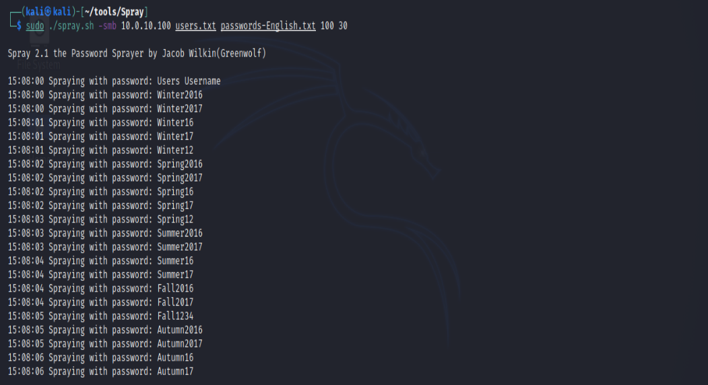
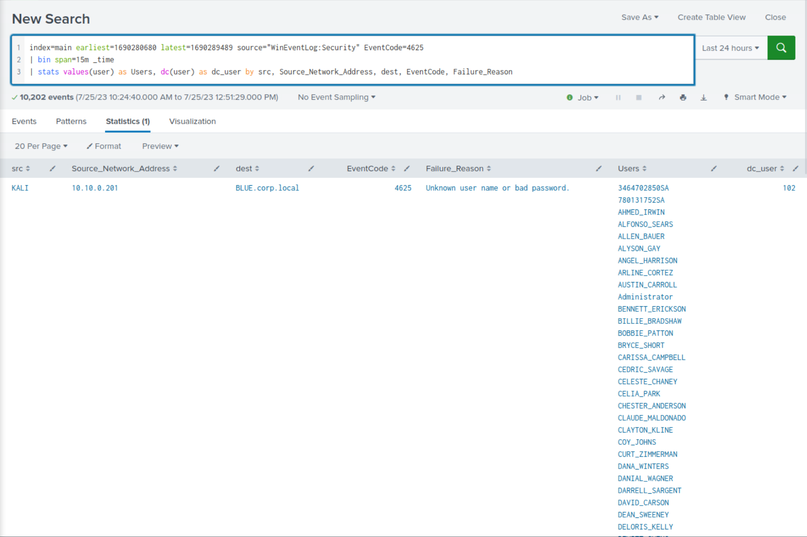

# Detecting Password Spraying (Phát hiện Password Spraying)

## Password Spraying

Khác với tấn công brute-force truyền thống, trong đó kẻ tấn công thử rất nhiều mật khẩu cho một tài khoản người dùng duy nhất, `password spraying` dàn trải cuộc tấn công ra nhiều tài khoản, dùng một tập hạn chế các mật khẩu phổ biến hoặc dễ đoán. Mục tiêu chính là né các chính sách khoá tài khoản (account lockout policy) mà các tổ chức thường áp dụng. Các chính sách này thường khoá một tài khoản sau một số lần đăng nhập thất bại nhất định để ngăn tấn công brute-force vào từng tài khoản. Tuy nhiên, password spraying làm giảm khả năng kích hoạt khoá tài khoản, vì mỗi tài khoản chỉ bị thử vài mật khẩu, khiến cuộc tấn công khó bị chú ý hơn.

Dưới đây là ví dụ password spraying bằng công cụ [Spray](https://github.com/Greenwolf/Spray).



#### Cơ hội phát hiện Password Spraying

Phát hiện password spraying qua log Windows đòi hỏi phân tích và giám sát các event log cụ thể để nhận diện những pattern và bất thường đặc trưng của kiểu tấn công này. Một pattern phổ biến là nhiều lần đăng nhập thất bại với `Event ID 4625 - Failed Logon` từ các tài khoản người dùng khác nhau nhưng xuất phát từ cùng một địa chỉ IP nguồn trong một khoảng thời gian ngắn.

Các event log khác có thể hỗ trợ phát hiện password spraying gồm:
* `4768 and ErrorCode 0x6 - Kerberos Invalid Users`
* `4768 and ErrorCode 0x12 - Kerberos Disabled Users`
* `4776 and ErrorCode 0xC0000064 - NTLM Invalid Users`
* `4776 and ErrorCode 0xC000006A - NTLM Wrong Password`
* `4648 - Authenticate Using Explicit Credentials`
* `4771 - Kerberos Pre-Authentication Failed`

<div class="card bg-light">
    <div class="card-body">
				 <p class="mb-0">Bây giờ hãy kéo xuống cuối section này và bấm vào "Click here to spawn the target system!". Sau đó, truy cập giao diện Splunk tại http://[Target IP]:8000 và mở ứng dụng Search & Reporting của Splunk. Phần lớn các search được trình bày từ đây đến cuối section này đều có thể thực hiện lại trên target, giúp nắm vững hơn các chủ đề được trình bày. </p>
    </div>
</div>

## Phát hiện Password Spraying bằng Splunk

Bây giờ hãy cùng tìm hiểu cách dùng Splunk để nhận diện các nỗ lực password spraying.

**Timeframe**: `earliest=1690280680 latest=1690289489`

```shell-session
index=main earliest=1690280680 latest=1690289489 source="WinEventLog:Security" EventCode=4625
| bin span=15m _time
| stats values(user) as Users, dc(user) as dc_user by src, Source_Network_Address, dest, EventCode, Failure_Reason
```



**Phân tích search**:

- `Filtering by Index, Source, and EventCode`: Search bắt đầu bằng việc chọn các event từ index main có source là `WinEventLog:Security` và `EventCode` là `4625`. EventCode này biểu thị các lần đăng nhập thất bại trong Windows Security Event Log.
- `Time Range Filter`: Search giới hạn phạm vi thời gian của event trong khoảng giữa hai Unix timestamp 1690280680 và 1690289489. Hai timestamp này biểu thị thời điểm sớm nhất và muộn nhất mà các event xảy ra.
- `Time Binning`: Lệnh `bin` được dùng để chia mỗi event vào các `time buckets of 15 minutes` (khung thời gian 15 phút) dựa trên field `_time`. Bước này nhóm các event thành các khoảng 15 phút, hữu ích cho việc phân tích pattern hoặc xu hướng theo thời gian.
- `Statistics`: Lệnh `stats` được dùng để gộp (aggregate) event theo các field `src`, `Source_Network_Address`, `dest`, `EventCode` và `Failure_Reason`. Với mỗi tổ hợp giá trị duy nhất của các field này, search tính các thống kê sau:
	- `values(user) as Users`: Tất cả giá trị duy nhất của field `user` trong mỗi nhóm.
	- `dc(user) as dc_user`: Số lượng giá trị phân biệt (distinct count) của field `user` trong mỗi nhóm. Giá trị này biểu thị số user khác nhau gắn với các lần đăng nhập thất bại trong mỗi nhóm.
