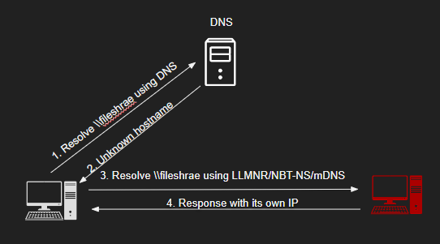
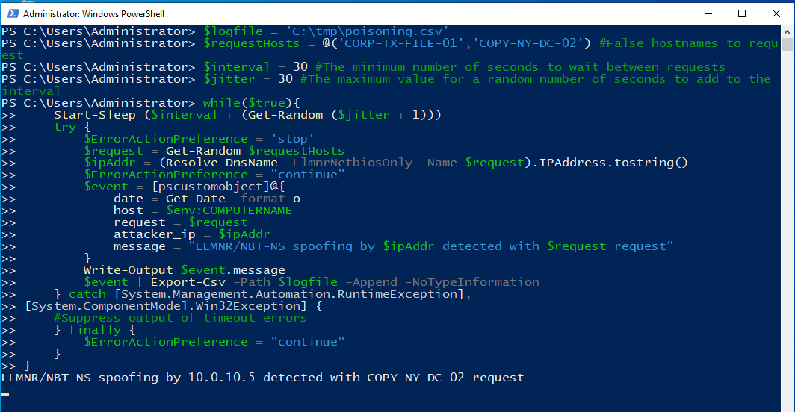
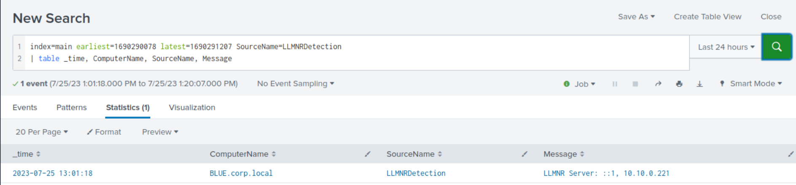
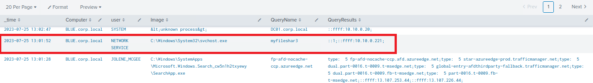

# Detecting Responder-like Attacks (Phát hiện các cuộc tấn công kiểu Responder)

## LLMNR/NBT-NS/mDNS Poisoning

`LLMNR (Link-Local Multicast Name Resolution) and NBT-NS (NetBIOS Name Service) poisoning`, còn gọi là NBNS spoofing, là các cuộc tấn công ở tầng mạng khai thác những điểm yếu của các giao thức phân giải tên này. Cả `LLMNR` và `NBT-NS` đều được dùng để phân giải hostname thành địa chỉ IP trong mạng nội bộ khi việc phân giải tên miền đầy đủ (FQDN – fully qualified domain name) thất bại. Tuy nhiên, việc thiếu các cơ chế bảo mật tích hợp khiến chúng dễ bị tấn công spoofing và poisoning.

Thông thường, kẻ tấn công dùng công cụ [Responder](https://github.com/lgandx/Responder) để thực hiện LLMNR, NBT-NS hoặc mDNS poisoning.

#### Các bước tấn công:
- Thiết bị nạn nhân gửi một truy vấn phân giải tên cho một hostname bị gõ sai (vd: `fileshrae`).
- DNS không phân giải được hostname gõ sai đó.
- Thiết bị nạn nhân gửi truy vấn phân giải tên cho hostname gõ sai bằng LLMNR/NBT-NS.
- Máy của kẻ tấn công phản hồi traffic LLMNR (UDP 5355)/NBT-NS (UDP 137), giả vờ biết danh tính của host được yêu cầu. Việc này thực chất là đầu độc (poison) dịch vụ, khiến nạn nhân giao tiếp với hệ thống do kẻ tấn công kiểm soát.



Kết quả của một cuộc tấn công thành công là lấy được NetNTLM hash của nạn nhân; hash này có thể bị crack hoặc relay nhằm giành quyền truy cập vào các hệ thống mà thông tin đăng nhập đó hợp lệ.

#### Cơ hội phát hiện Responder

Phát hiện LLMNR, NBT-NS và mDNS poisoning có thể khá khó khăn. Tuy nhiên, các tổ chức có thể giảm thiểu rủi ro bằng cách triển khai các biện pháp sau:

- Triển khai các giải pháp giám sát mạng để phát hiện các pattern traffic LLMNR và NBT-NS bất thường, chẳng hạn khối lượng yêu cầu phân giải tên tăng cao từ một nguồn duy nhất.
- Áp dụng cách tiếp cận honeypot — việc phân giải tên cho các host không tồn tại lẽ ra phải thất bại. Nếu có kẻ tấn công đang hiện diện và spoof các phản hồi LLMNR/NBT-NS/mDNS, việc phân giải tên sẽ thành công. [https://www.praetorian.com/blog/a-simple-and-effective-way-to-detect-broadcast-name-resolution-poisoning-bnrp/](https://www.praetorian.com/blog/a-simple-and-effective-way-to-detect-broadcast-name-resolution-poisoning-bnrp/)



Một script PowerShell tương tự như trên có thể được tự động hoá để chạy dưới dạng scheduled task nhằm hỗ trợ phát hiện. Việc ghi log hoạt động này có thể là một thách thức, nhưng có thể dùng cmdlet PowerShell `New-EventLog`.

```powershell-session
PS C:\Users\Administrator> New-EventLog -LogName Application -Source LLMNRDetection
```

Để tạo một event, cần dùng cmdlet `Write-EventLog`:
```powershell-session
PS C:\Users\Administrator> Write-EventLog -LogName Application -Source LLMNRDetection -EventId 19001 -Message $msg -EntryType Warning
```

<div class="card bg-light">
    <div class="card-body">
				 <p class="mb-0">Bây giờ hãy kéo xuống cuối section này và bấm vào "Click here to spawn the target system!". Sau đó, truy cập giao diện Splunk tại http://[Target IP]:8000 và mở ứng dụng Search & Reporting của Splunk. Phần lớn các search được trình bày từ đây đến cuối section này đều có thể thực hiện lại trên target, giúp nắm vững hơn các chủ đề được trình bày. </p>
    </div>
</div>

## Phát hiện các cuộc tấn công kiểu Responder bằng Splunk

Bây giờ hãy cùng tìm hiểu cách nhận diện các cuộc tấn công kiểu Responder đã bàn ở trên, bằng Splunk và log từ một script PowerShell tương tự script ở trên.

**Timeframe**: `earliest=1690290078 latest=1690291207`

```shell-session
index=main earliest=1690290078 latest=1690291207 SourceName=LLMNRDetection
| table _time, ComputerName, SourceName, Message
```



---

[Sysmon Event ID 22](https://www.ultimatewindowssecurity.com/securitylog/encyclopedia/event.aspx?eventid=90022) cũng có thể được dùng để theo dõi các DNS query liên quan đến những file share không tồn tại/bị gõ sai.

**Timeframe**: `earliest=1690290078 latest=1690291207`

```shell-session
index=main earliest=1690290078 latest=1690291207 EventCode=22 
| table _time, Computer, user, Image, QueryName, QueryResults
```



---

Ngoài ra, hãy nhớ rằng [Event 4648](https://learn.microsoft.com/en-us/windows/security/threat-protection/auditing/event-4648) có thể được dùng để phát hiện các lần đăng nhập bằng thông tin đăng nhập tường minh (explicit logon) vào các file share giả mạo (rogue) mà kẻ tấn công có thể dùng để thu thập thông tin đăng nhập hợp lệ của người dùng.

**Timeframe**: `earliest=1690290814 latest=1690291207`

```shell-session
index=main earliest=1690290814 latest=1690291207 EventCode IN (4648) 
| table _time, EventCode, source, name, user, Target_Server_Name, Message
| sort 0 _time
```


