# Detecting Kerberoasting/AS-REProasting (Phát hiện Kerberoasting/AS-REProasting)

## Kerberoasting

`Kerberoasting` là một kỹ thuật nhắm vào các service account trong môi trường Active Directory để trích xuất và crack password hash của chúng. Cuộc tấn công khai thác cách service ticket của Kerberos được mã hoá, cùng với việc service account dùng mật khẩu yếu hoặc dễ crack. Khi đã crack thành công password hash, kẻ tấn công có thể truy cập trái phép vào các service account mục tiêu và có khả năng di chuyển ngang (lateral movement) trong mạng.

Một ví dụ về tấn công Kerberoasting là dùng module `kerberoast` của [Rubeus](https://github.com/GhostPack/Rubeus).

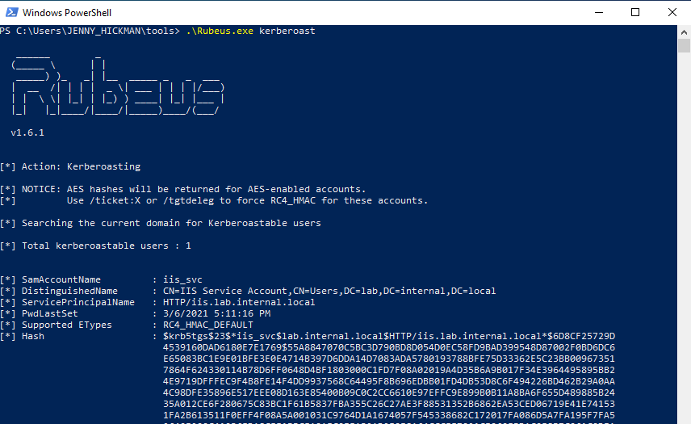

#### Các bước tấn công:

- `Identify Target Service Accounts`: Kẻ tấn công enumerate Active Directory để xác định các service account có đặt `Service Principal Names (SPNs)`. Service account thường gắn với các dịch vụ chạy trên mạng, như SQL Server, Exchange hoặc các ứng dụng khác. Dưới đây là một đoạn code từ `Rubeus` liên quan đến bước này.
	
- `Request TGS Tickets`: Kẻ tấn công dùng các service account đã xác định để yêu cầu ticket `Ticket Granting Service (TGS)` từ `Key Distribution Center (KDC)`. Các ticket TGS này chứa password hash của service account ở dạng đã mã hoá. Dưới đây là một đoạn code từ `Rubeus` liên quan đến bước này.
	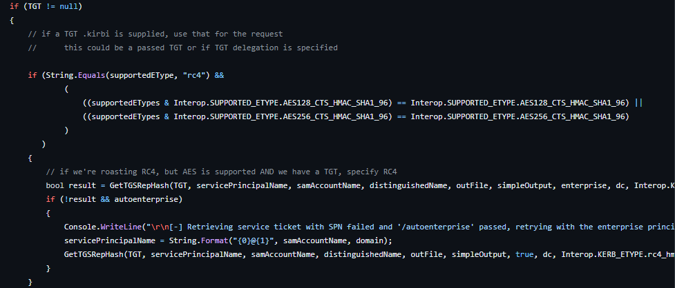
- `Offline Brute-Force Attack`: Kẻ tấn công dùng các kỹ thuật brute-force offline, sử dụng công cụ crack mật khẩu như `Hashcat` hoặc `John the Ripper`, để cố crack các password hash đã mã hoá.

#### Quy trình truy cập service hợp lệ & các event liên quan

Khi một user kết nối tới cơ sở dữ liệu `MSSQL (Microsoft SQL Server)` bằng một service account có `SPN`, các bước sau diễn ra trong quá trình xác thực Kerberos:

- `TGT Request`: User (client) bắt đầu quá trình xác thực bằng cách yêu cầu một Ticket Granting Ticket (TGT) từ Key Distribution Center (KDC), thường là một phần của domain controller Active Directory.
- `TGT Issue`: KDC xác minh danh tính của user (thường thông qua password hash) và cấp một TGT được mã hoá bằng key của krbtgt, kèm theo một session key được mã hoá bằng password hash của user. TGT có hiệu lực trong một khoảng thời gian nhất định và cho phép user yêu cầu service ticket mà không cần xác thực lại.
- `Service Ticket Request`: Client gửi yêu cầu service ticket (TGS-REQ) tới KDC cho SPN của MSSQL server, dùng TGT có được ở bước trước.
- `Service Ticket Issue`: KDC xác thực TGT của client và, nếu thành công, cấp một service ticket (TGS) được mã hoá bằng secret key của service account, chứa danh tính của client và một session key. Sau đó client nhận TGS.
- `Client Connection`: Client kết nối tới MSSQL server và gửi TGS tới server như một phần của quá trình xác thực.
- `MSSQL Server Validates the TGS`: MSSQL server giải mã TGS bằng secret key của chính nó để lấy session key và danh tính client. Nếu TGS hợp lệ và session key đúng, MSSQL server chấp nhận kết nối của client và cấp quyền truy cập vào các tài nguyên được yêu cầu.
	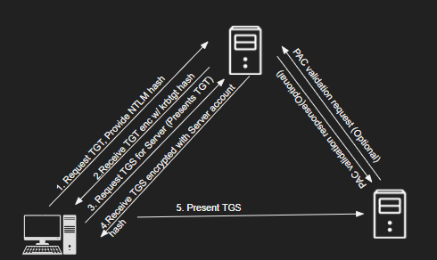
	
Lưu ý rằng các bước nêu trên cũng có thể quan sát được khi phân tích network traffic:

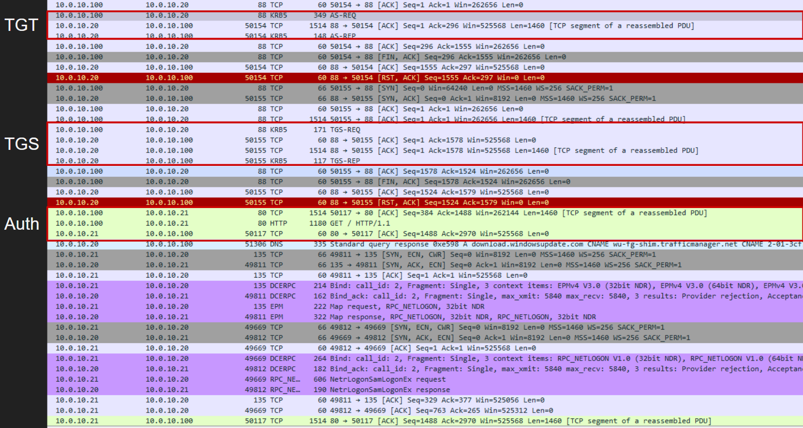

Trong quá trình xác thực Kerberos, khi một user kết nối tới MSSQL server, một số event liên quan đến bảo mật được tạo ra trong Windows Event Log:

- `Event ID 4768 (Kerberos TGT Request)`: Xảy ra khi máy trạm client yêu cầu TGT từ KDC; event này được tạo trong Security log trên domain controller.
- `Event ID 4769 (Kerberos Service Ticket Request)`: Được tạo sau khi client nhận TGT và yêu cầu TGS cho SPN của MSSQL server.
- `Event ID 4624 (Logon)`: Được ghi trong Security log trên MSSQL server, cho biết đăng nhập thành công khi client khởi tạo kết nối tới MSSQL server và đăng nhập bằng service account có SPN để thiết lập kết nối.
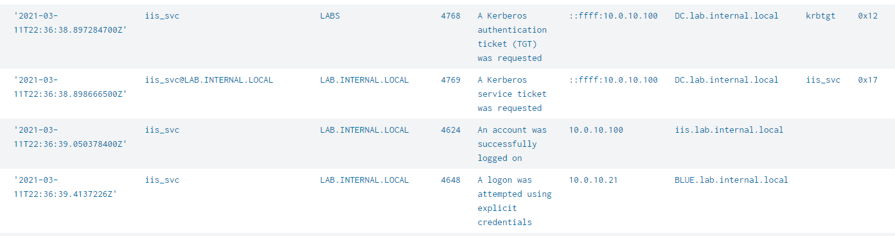

#### Cơ hội phát hiện Kerberoasting

Vì giai đoạn đầu của Kerberoasting là xác định các service account mục tiêu, việc giám sát hoạt động LDAP, như đã giải thích ở section trinh sát domain, có thể giúp nhận diện các LDAP query đáng ngờ.

Một cách tiếp cận khác tập trung vào sự khác biệt giữa truy cập service hợp lệ và một cuộc tấn công Kerberoasting. Trong cả hai trường hợp, ticket TGS cho service đều được yêu cầu, nhưng chỉ trong trường hợp truy cập service hợp lệ thì user mới kết nối tới server và trình ticket TGS.

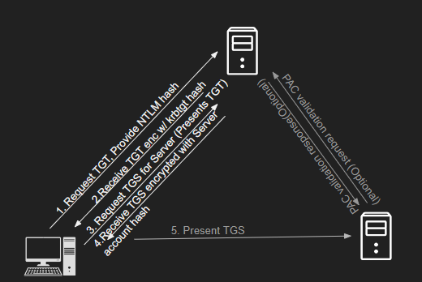

Logic phát hiện gồm việc tìm tất cả các event yêu cầu TGS và các event logon của cùng một user, sau đó xác định những trường hợp có yêu cầu TGS nhưng không có event logon theo sau. Trong trường hợp truy cập service IIS bằng service account có SPN, một event `4648 (A logon was attempted using explicit credentials)` bổ sung sẽ được tạo ra như một event logon.

<div class="card bg-light">
    <div class="card-body">
				 <p class="mb-0">Bây giờ hãy kéo xuống cuối section này và bấm vào "Click here to spawn the target system!". Sau đó, truy cập giao diện Splunk tại http://[Target IP]:8000 và mở ứng dụng Search & Reporting của Splunk. Phần lớn các search được trình bày từ đây đến cuối section này đều có thể thực hiện lại trên target, giúp nắm vững hơn các chủ đề được trình bày. </p>
    </div>
</div>

## Phát hiện Kerberoasting bằng Splunk

Bây giờ hãy cùng tìm hiểu cách dùng Splunk để nhận diện Kerberoasting.

#### Các yêu cầu TGS hợp lệ

Trước tiên, hãy xem một số yêu cầu TGS hợp lệ trong Splunk.

**Timeframe**: `earliest=1690388417 latest=1690388630`

```shell-session
index=main earliest=1690388417 latest=1690388630 EventCode=4648 OR (EventCode=4769 AND service_name=iis_svc) 
| dedup RecordNumber 
| rex field=user "(?<username>[^@]+)"
| table _time, ComputerName, EventCode, name, username, Account_Name, Account_Domain, src_ip, service_name, Ticket_Options, Ticket_Encryption_Type, Target_Server_Name, Additional_Information
```

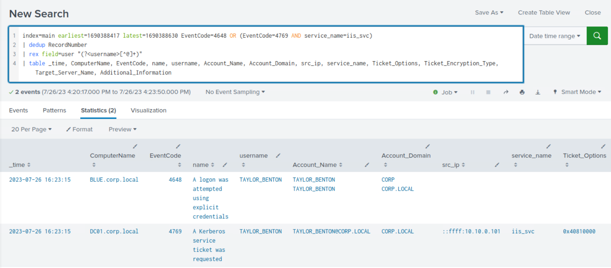

**Phân tích search**:

- `index=main earliest=1690388417 latest=1690388630`: Lọc search để chỉ bao gồm các event từ index main xảy ra trong khoảng giữa hai epoch timestamp earliest và latest đã chỉ định.
- `EventCode=4648 OR (EventCode=4769 AND service_name=iis_svc)`: Lọc tiếp search để chỉ bao gồm các event có `EventCode` là `4648` `or` các event có `EventCode` là `4769` với `service_name` là `iis_svc`.
- `| dedup RecordNumber`: Loại bỏ các event trùng lặp dựa trên field `RecordNumber`.
- `| rex field=user "(?<username>[^@]+)"`: Trích xuất phần `username` của field `user` bằng biểu thức chính quy (regular expression) và lưu vào một field mới tên là `username`.
- `| table _time, ComputerName, EventCode, name, username, Account_Name, Account_Domain, src_ip, service_name, Ticket_Options, Ticket_Encryption_Type, Target_Server_Name, Additional_Information`: Hiển thị các field đã chỉ định dưới dạng bảng.

#### Phát hiện Kerberoasting - Truy vấn SPN (SPN Querying)

**Timeframe**: `earliest=1690448444 latest=1690454437`

```shell-session
index=main earliest=1690448444 latest=1690454437 source="WinEventLog:SilkService-Log" 
| spath input=Message 
| rename XmlEventData.* as * 
| table _time, ComputerName, ProcessName, DistinguishedName, SearchFilter 
| search SearchFilter="*(&(samAccountType=805306368)(servicePrincipalName=*)*"
```

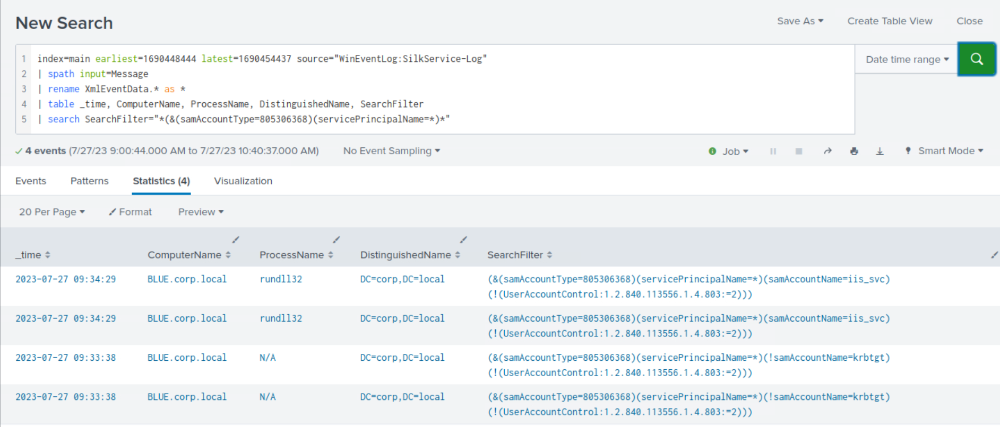

#### Phát hiện Kerberoasting - Yêu cầu TGS

**Timeframe**: `earliest=1690450374 latest=1690450483`

```shell-session
index=main earliest=1690450374 latest=1690450483 EventCode=4648 OR (EventCode=4769 AND service_name=iis_svc)
| dedup RecordNumber
| rex field=user "(?<username>[^@]+)"
| bin span=2m _time 
| search username!=*$ 
| stats values(EventCode) as Events, values(service_name) as service_name, values(Additional_Information) as Additional_Information, values(Target_Server_Name) as Target_Server_Name by _time, username
| where !match(Events,"4648")
```

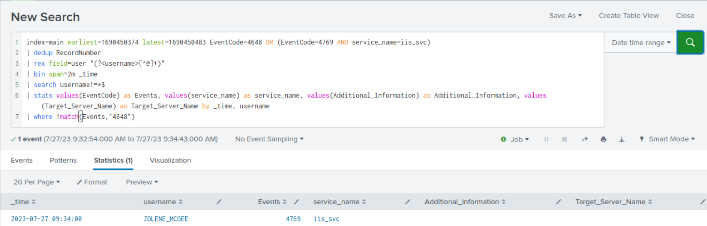

**Phân tích search**:

- `index=main earliest=1690450374 latest=1690450483 EventCode=4648 OR (EventCode=4769 AND service_name=iis_svc)`: Lọc search để chỉ bao gồm các event từ index `main` xảy ra trong khoảng giữa hai epoch timestamp earliest và latest đã chỉ định. Sau đó lọc tiếp để chỉ bao gồm các event có `EventCode` là `4648` hoặc `EventCode` là `4769` với `service_name` là `iis_svc`.
- `| dedup RecordNumber`: Loại bỏ các event trùng lặp dựa trên field `RecordNumber`.
- `| rex field=user "(?<username>[^@]+)"`: Trích xuất phần `username` của field `user` bằng regular expression và lưu vào một field mới tên là `username`.
- `| bin span=2m _time`: Chia các event vào các khoảng 2 phút dựa trên field `_time`.
- `| search username!=*$`: Loại bỏ các event mà field `username` kết thúc bằng `$`.
- `| stats values(EventCode) as Events, values(service_name) as service_name, values(Additional_Information) as Additional_Information, values(Target_Server_Name) as Target_Server_Name by _time, username`: Nhóm các event theo field `_time` và `username`, đồng thời tạo các field mới chứa các giá trị `unique` (duy nhất) của các field `EventCode`, `service_name`, `Additional_Information` và `Target_Server_Name` trong mỗi nhóm.
- `| where !match(Events,"4648")`: Loại bỏ các event có giá trị `4648` trong field Events.

#### Phát hiện Kerberoasting bằng transaction - Yêu cầu TGS

**Timeframe**: `earliest=1690450374 latest=1690450483`

```shell-session
index=main earliest=1690450374 latest=1690450483 EventCode=4648 OR (EventCode=4769 AND service_name=iis_svc)
| dedup RecordNumber
| rex field=user "(?<username>[^@]+)"
| search username!=*$ 
| transaction username keepevicted=true maxspan=5s endswith=(EventCode=4648) startswith=(EventCode=4769) 
| where closed_txn=0 AND EventCode = 4769
| table _time, EventCode, service_name, username
```

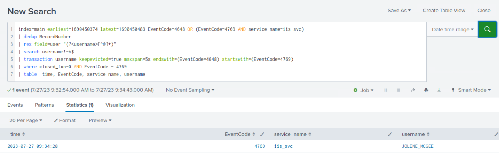

**Phân tích search**:

Câu search Splunk này khác với query trước chủ yếu ở việc dùng lệnh `transaction`, lệnh này nhóm các event thành các transaction dựa trên các field và tiêu chí được chỉ định.

- `index=main earliest=1690450374 latest=1690450483 EventCode=4648 OR (EventCode=4769 AND service_name=iis_svc)`: Lọc search để chỉ bao gồm các event từ index `main` xảy ra trong khoảng giữa hai epoch timestamp earliest và latest đã chỉ định. Sau đó lọc tiếp để chỉ bao gồm các event có `EventCode` là `4648` hoặc `EventCode` là `4769` với `service_name` là `iis_svc`.
- `| dedup RecordNumber`: Loại bỏ các event trùng lặp dựa trên field `RecordNumber`.
- `| rex field=user "(?<username>[^@]+)"`: Trích xuất phần `username` của field `user` bằng regular expression và lưu vào một field mới tên là `username`.
- `| search username!=*$`: Loại bỏ các event mà field `username` kết thúc bằng `$`.
- `| transaction username keepevicted=true maxspan=5s endswith=(EventCode=4648) startswith=(EventCode=4769)`: Nhóm các event thành các `transactions` dựa trên field `username`. Tuỳ chọn `keepevicted=true` giữ lại cả các event không thoả tiêu chí của transaction. Tuỳ chọn `maxspan=5s` đặt thời lượng tối đa của một transaction là 5 giây. Các tuỳ chọn `endswith=(EventCode=4648)` và `startswith=(EventCode=4769)` chỉ định rằng transaction phải bắt đầu bằng một event có `EventCode 4769` và kết thúc bằng một event có `EventCode 4648`.
- `| where closed_txn=0 AND EventCode = 4769`: Lọc kết quả để chỉ giữ các transaction chưa đóng (`closed_txn=0`) và có `EventCode` là `4769`.
- `| table _time, EventCode, service_name, username`: Hiển thị các event còn lại dưới dạng bảng với các field đã chỉ định.

Query này tập trung xác định các event có `EventCode` là `4769` thuộc một transaction chưa hoàn tất (tức là chúng không kết thúc bằng một event có `EventCode 4648` trong cửa sổ `5` giây).

## AS-REPRoasting
`ASREPRoasting` là một kỹ thuật dùng trong môi trường Active Directory nhằm vào các tài khoản người dùng không bật pre-authentication. Trong Kerberos, pre-authentication (xác thực trước) là một tính năng bảo mật yêu cầu user chứng minh danh tính trước khi TGT được cấp. Tuy nhiên, một số tài khoản người dùng, chẳng hạn những tài khoản có unconstrained delegation, không bật pre-authentication, khiến chúng dễ bị tấn công ASREPRoasting.

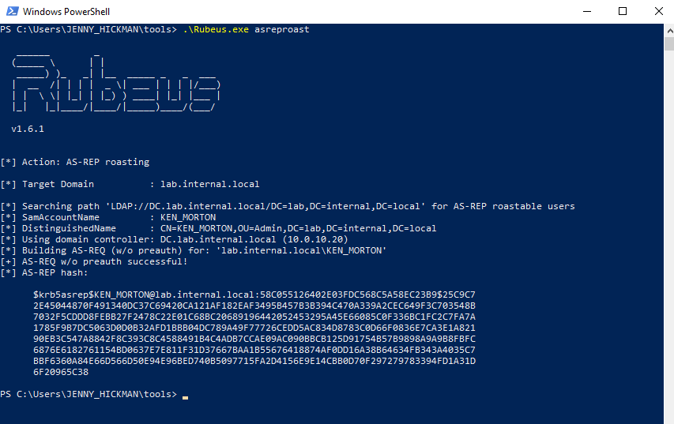

#### Các bước tấn công:

- `Identify Target User Accounts`: Kẻ tấn công xác định các tài khoản người dùng không bật pre-authentication. Dưới đây là một đoạn code từ `Rubeus` liên quan đến bước này.
	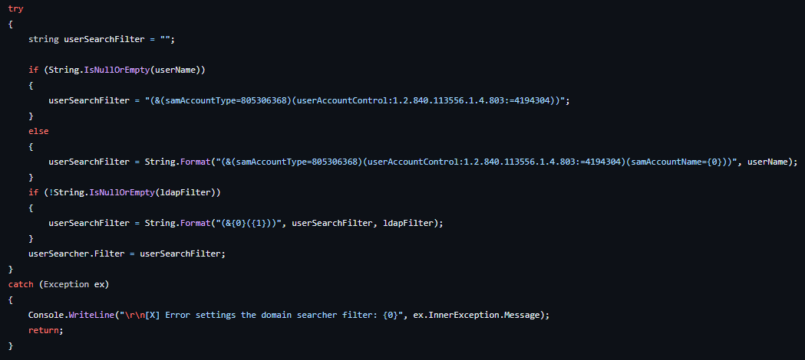
- `Request AS-REQ Service Tickets`: Kẻ tấn công khởi tạo yêu cầu service ticket AS-REQ cho từng tài khoản người dùng mục tiêu đã xác định. Dưới đây là một đoạn code từ `Rubeus` liên quan đến bước này.
	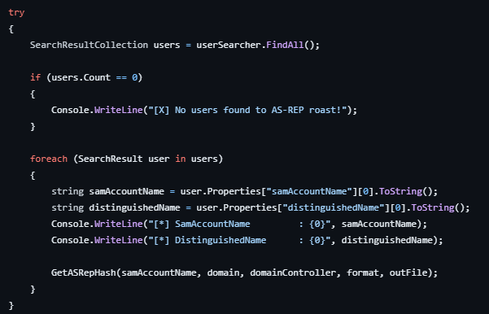
- `Offline Brute-Force Attack`: Kẻ tấn công thu lấy các TGT đã mã hoá và dùng các kỹ thuật brute-force offline để cố crack password hash.

#### Kerberos Pre-Authentication

`Kerberos pre-authentication` là một cơ chế bảo mật bổ sung trong giao thức xác thực Kerberos, giúp tăng cường bảo vệ thông tin đăng nhập của user trong quá trình xác thực. Khi user cố truy cập một tài nguyên hoặc service trên mạng, client gửi một yêu cầu xác thực AS-REQ tới KDC.

Nếu pre-authentication được bật, yêu cầu này còn chứa một timestamp đã mã hoá (`pA-ENC-TIMESTAMP`). KDC cố giải mã timestamp này bằng password hash của user và, nếu thành công, cấp TGT cho user.

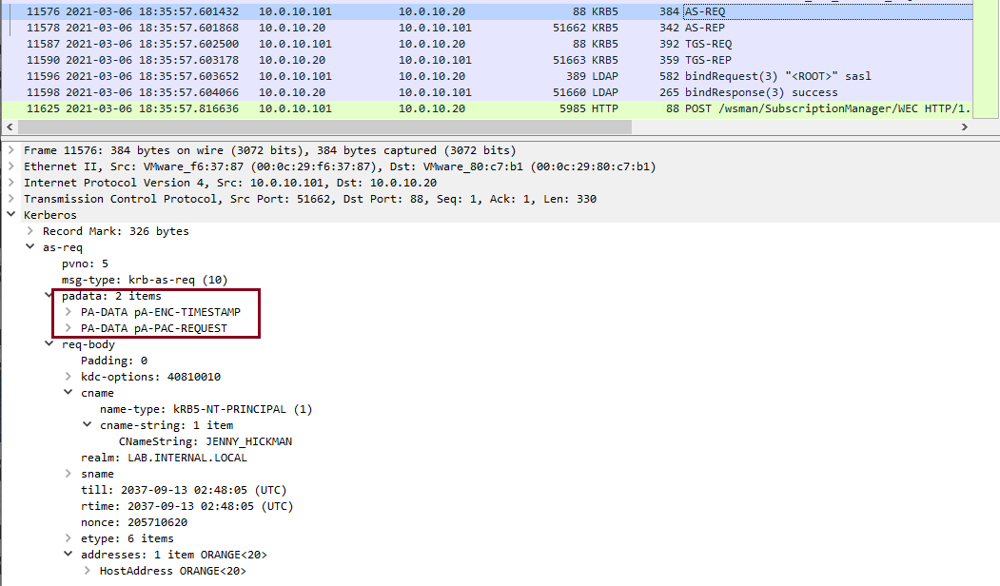

Khi pre-authentication bị tắt, KDC không kiểm tra timestamp, cho phép yêu cầu ticket TGT mà không cần biết mật khẩu của user.

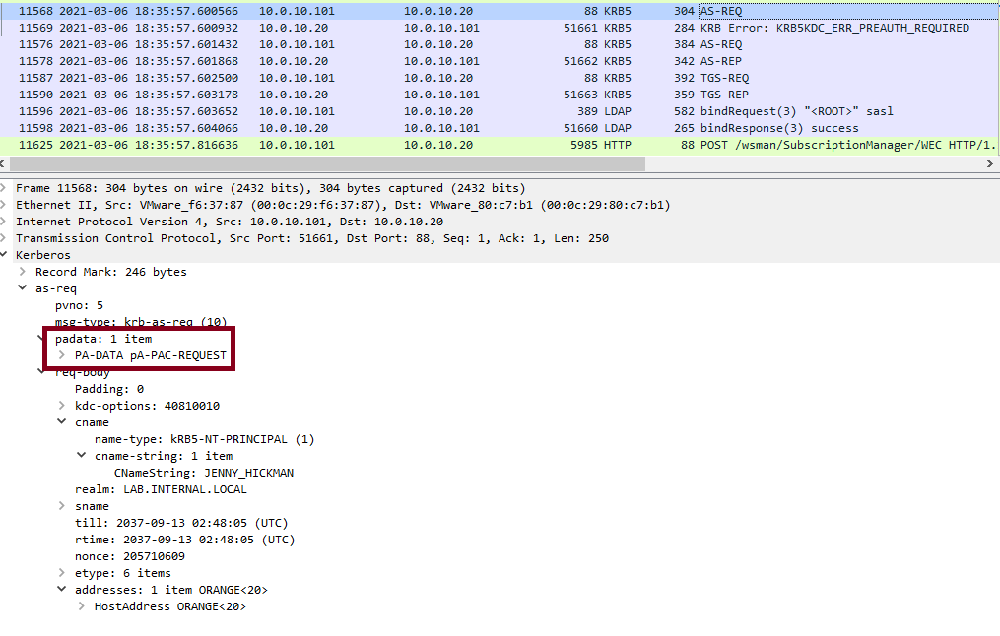

#### Cơ hội phát hiện AS-REPRoasting

Tương tự Kerberoasting, giai đoạn đầu của AS-REPRoasting là xác định các tài khoản người dùng bật unconstrained delegation hoặc các tài khoản không có pre-authentication; việc này có thể được phát hiện bằng cách giám sát LDAP.

Event xác thực Kerberos `Event ID 4768 (TGT Request)` chứa thuộc tính `PreAuthType` trong phần thông tin bổ sung (additional information) của event, cho biết pre-authentication có được bật cho tài khoản hay không.

## Phát hiện AS-REPRoasting bằng Splunk

Bây giờ hãy cùng tìm hiểu cách dùng Splunk để nhận diện AS-REPRoasting.

#### Phát hiện AS-REPRoasting - Truy vấn các tài khoản tắt Pre-Auth

**Timeframe**: `earliest=1690392745 latest=1690393283`

```shell-session
index=main earliest=1690392745 latest=1690393283 source="WinEventLog:SilkService-Log" 
| spath input=Message 
| rename XmlEventData.* as * 
| table _time, ComputerName, ProcessName, DistinguishedName, SearchFilter 
| search SearchFilter="*(samAccountType=805306368)(userAccountControl:1.2.840.113556.1.4.803:=4194304)*"
```

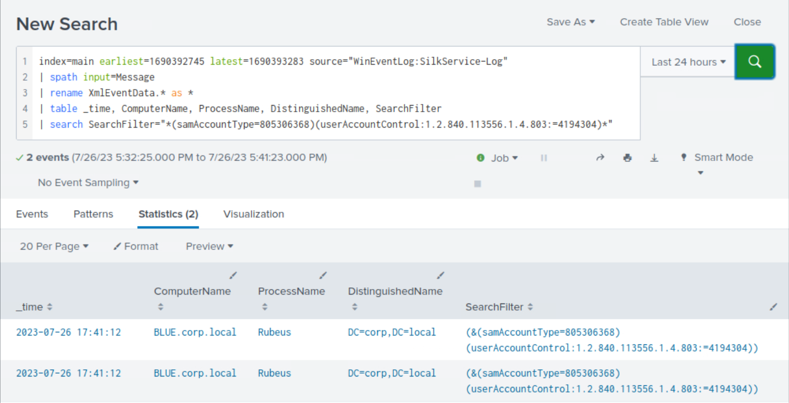

#### Phát hiện AS-REPRoasting - Yêu cầu TGT cho các tài khoản tắt Pre-Auth

**Timeframe**: `earliest=1690392745 latest=1690393283`

```shell-session
index=main earliest=1690392745 latest=1690393283 source="WinEventLog:Security" EventCode=4768 Pre_Authentication_Type=0
| rex field=src_ip "(\:\:ffff\:)?(?<src_ip>[0-9\.]+)"
| table _time, src_ip, user, Pre_Authentication_Type, Ticket_Options, Ticket_Encryption_Type
```


**Phân tích search**:

- `index=main earliest=1690392745 latest=1690393283 source="WinEventLog:Security" EventCode=4768 Pre_Authentication_Type=0`: Lọc search để chỉ bao gồm các event từ index `main` xảy ra trong khoảng giữa hai epoch timestamp earliest và latest đã chỉ định. Sau đó lọc tiếp để chỉ bao gồm các event có source là `WinEventLog:Security`, `EventCode` là `4768` và `Pre_Authentication_Type` là `0`.
- `| rex field=src_ip "(\:\:ffff\:)?(?<src_ip>[0-9\.]+)"`: Dùng regular expression để trích xuất field `src_ip` (địa chỉ IP nguồn). Biểu thức khớp với tiền tố `"::ffff:"` (tuỳ chọn), theo sau là một địa chỉ IP dạng thập phân có dấu chấm. Bước này xử lý các địa chỉ IPv6 ánh xạ IPv4 (IPv4-mapped IPv6) bằng cách trích xuất phần IPv4.
- `| table _time, src_ip, user, Pre_Authentication_Type, Ticket_Options, Ticket_Encryption_Type`: Hiển thị các event còn lại dưới dạng bảng với các field đã chỉ định.
