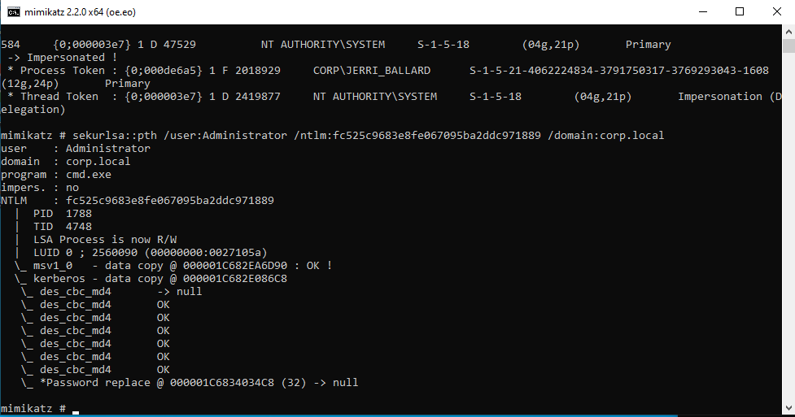
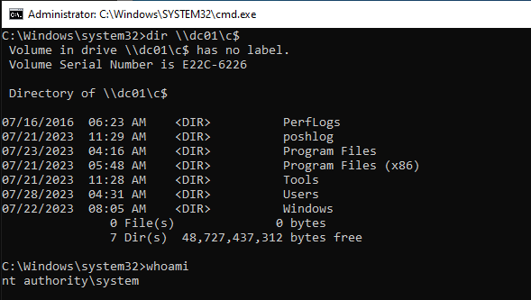
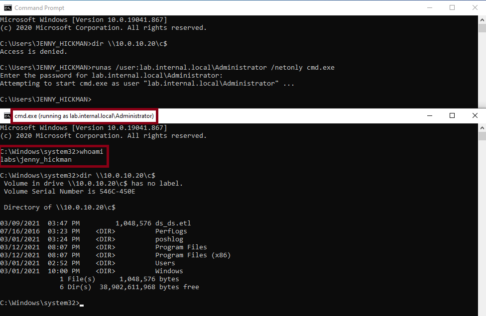
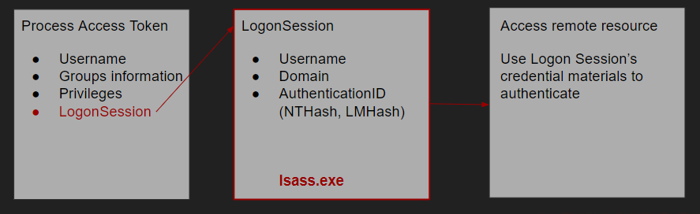
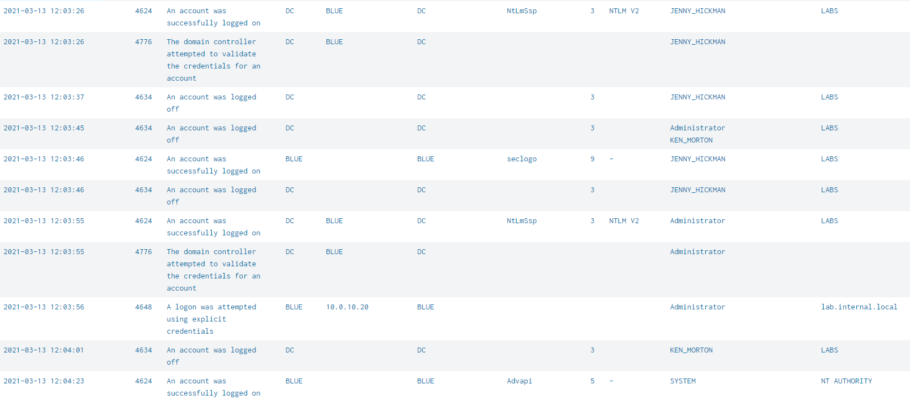
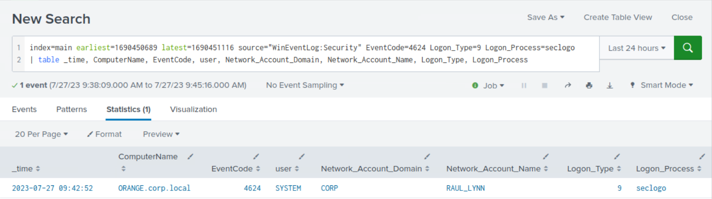

# Detecting Pass-the-Hash (Phát hiện Pass-the-Hash)

## Pass-the-Hash

`Pass-the-Hash` là kỹ thuật mà kẻ tấn công dùng để xác thực vào một hệ thống trong mạng bằng hash `NTLM` của mật khẩu người dùng thay vì mật khẩu dạng plaintext. Cuộc tấn công lợi dụng cách Windows lưu hash mật khẩu trong bộ nhớ, cho phép kẻ tấn công có quyền quản trị lấy được hash và dùng lại nó để lateral movement (di chuyển ngang) trong mạng.

#### Các bước tấn công:

- Kẻ tấn công dùng các công cụ như `Mimikatz` để trích xuất hash `NTLM` của một người dùng đang đăng nhập trên hệ thống bị xâm nhập. Lưu ý rằng cần có quyền local administrator trên hệ thống để trích xuất hash của người dùng.
	
- Có trong tay hash `NTLM`, kẻ tấn công có thể xác thực với tư cách người dùng mục tiêu trên các hệ thống hoặc tài nguyên mạng khác mà không cần biết mật khẩu thật.
	
- Dùng session đã xác thực, kẻ tấn công có thể di chuyển ngang trong mạng, giành quyền truy cập trái phép vào các hệ thống và tài nguyên khác.
	

#### Windows Access Token & Alternate Credentials

`access token` là một cấu trúc dữ liệu xác định security context (ngữ cảnh bảo mật) của một process hoặc thread. Nó chứa thông tin về danh tính và đặc quyền của tài khoản người dùng liên quan. Khi người dùng đăng nhập, hệ thống kiểm tra mật khẩu bằng cách so sánh với thông tin lưu trong cơ sở dữ liệu bảo mật. Nếu mật khẩu được xác thực, hệ thống sẽ tạo ra một access token. Sau đó, mọi process được thực thi thay mặt người dùng đó đều mang một bản sao của access token này. (**Nguồn**: [https://learn.microsoft.com/en-us/windows/win32/secauthz/access-tokens](https://learn.microsoft.com/en-us/windows/win32/secauthz/access-tokens))

`Alternate Credentials` cung cấp cách để đưa vào thông tin đăng nhập khác (username và password) cho những hành động hoặc process cụ thể mà không thay đổi session đăng nhập chính của người dùng. Nhờ đó người dùng hoặc process có thể thực thi một số lệnh hay truy cập tài nguyên với tư cách người dùng khác mà không cần đăng xuất hay chuyển tài khoản. Lệnh `runas` là công cụ dòng lệnh của Windows cho phép người dùng thực thi lệnh với tư cách người dùng khác. Khi lệnh `runas` được thực thi, một access token mới được tạo ra, có thể kiểm chứng bằng lệnh `whoami`.


Lệnh `runas` còn có một flag đáng chú ý là `/netonly`. Flag này cho biết thông tin người dùng được chỉ định chỉ dùng cho truy cập từ xa. Dù lệnh `whoami` trả về username gốc, `cmd.exe` được tạo ra vẫn có thể truy cập thư mục gốc của Domain Controller.



Mỗi `access token` tham chiếu tới một `LogonSession` được tạo ra khi người dùng đăng nhập. Cấu trúc bảo mật `LogonSession` này chứa các thông tin như Username, Domain và AuthenticationID (`NTHash/LMHash`), và được dùng khi process cố truy cập tài nguyên từ xa. Khi dùng flag `netonly`, process có cùng `access token` nhưng khác `LogonSession`.



#### Cơ hội phát hiện Pass-the-Hash

Từ góc độ Windows Event Log, các log sau được tạo ra khi lệnh `runas` được thực thi:

- Khi lệnh `runas` được thực thi không có flag `/netonly` - `Event ID 4624 (Logon)` với `LogonType 2 (interactive)`.
	
- Khi lệnh `runas` được thực thi có flag `/netonly` - `Event ID 4624 (Logon)` với `LogonType 9 (NewCredentials)`.
	

Cách phát hiện đơn giản là tìm `Event ID 4624` với `LogonType 9`, nhưng như đã nói, có thể xuất hiện một số false positive liên quan đến việc dùng `runas`.

Khác biệt chính giữa `runas` với flag `netonly` và tấn công `Pass-the-Hash` là ở trường hợp sau, `Mimikatz` sẽ truy cập bộ nhớ process `LSASS` để thay đổi credential material (dữ liệu thông tin đăng nhập) của `LogonSession`. Vì vậy, cách phát hiện ban đầu có thể được nâng cao bằng cách tương quan (correlate) các event `User Logon with NewCredentials` với `Sysmon Process Access Event Code 10`.

<div class="card bg-light">
    <div class="card-body">
				 <p class="mb-0">Giờ hãy kéo xuống cuối section này và bấm "Click here to spawn the target system!". Sau đó truy cập giao diện Splunk tại http://[Target IP]:8000 và mở ứng dụng Search & Reporting của Splunk. Phần lớn các search được trình bày từ đây đến cuối section này đều có thể thực hiện lại trên target, giúp nắm chắc hơn các chủ đề đã trình bày. </p>
    </div>
</div>

## Phát hiện Pass-the-Hash bằng Splunk

Giờ hãy cùng tìm hiểu cách nhận diện Pass-the-Hash bằng Splunk.

Trước khi xem xét các search, hãy tham khảo nguồn [này](https://blog.netwrix.com/2021/11/30/how-to-detect-pass-the-hash-attacks) để hiểu rõ hơn phần search `Logon_Process=seclogo` bắt nguồn từ đâu.

**Khung thời gian**: `earliest=1690450689 latest=1690451116`

```shell-session
index=main earliest=1690450708 latest=1690451116 source="WinEventLog:Security" EventCode=4624 Logon_Type=9 Logon_Process=seclogo
| table _time, ComputerName, EventCode, user, Network_Account_Domain, Network_Account_Name, Logon_Type, Logon_Process
```



---

Như đã nói, ta có thể nâng cao search ở trên bằng cách đưa thêm việc truy cập bộ nhớ LSASS vào như sau.


```shell-session
index=main earliest=1690450689 latest=1690451116 (source="XmlWinEventLog:Microsoft-Windows-Sysmon/Operational" EventCode=10 TargetImage="C:\\Windows\\system32\\lsass.exe" SourceImage!="C:\\ProgramData\\Microsoft\\Windows Defender\\platform\\*\\MsMpEng.exe") OR (source="WinEventLog:Security" EventCode=4624 Logon_Type=9 Logon_Process=seclogo)
| sort _time, RecordNumber
| transaction host maxspan=1m endswith=(EventCode=4624) startswith=(EventCode=10)
| stats count by _time, Computer, SourceImage, SourceProcessId, Network_Account_Domain, Network_Account_Name, Logon_Type, Logon_Process
| fields - count
```


**Phân tích search**:

- `index=main earliest=1690450689 latest=1690451116`: Lọc search để chỉ lấy các event trong index `main` xảy ra giữa hai mốc epoch timestamp earliest và latest đã chỉ định.
- `(source="XmlWinEventLog:Microsoft-Windows-Sysmon/Operational" EventCode=10 TargetImage="C:\\Windows\\system32\\lsass.exe" SourceImage!="C:\\ProgramData\\Microsoft\\Windows Defender\\platform\\*\\MsMpEng.exe")`: Lọc search để chỉ lấy các event log operational của `Sysmon` có `EventCode` là `10` (Process Access). Nó tiếp tục thu hẹp kết quả về các event có `TargetImage` là `C:\Windows\system32\lsass.exe` (cho thấy process `lsass.exe` đang bị truy cập) và `SourceImage` không phải là một process hợp lệ đã biết trong thư mục Windows Defender.
- `OR (source="WinEventLog:Security" EventCode=4624 Logon_Type=9 Logon_Process=seclogo)`: Lọc search để lấy thêm cả các event trong Security event log có `EventCode` là `4624` (Logon), `Logon_Type` là `9` (NewCredentials) và `Logon_Process` là `seclogo`.
- `| sort _time, RecordNumber`: Sắp xếp các event theo field `_time` rồi đến field `RecordNumber`.
- `| transaction host maxspan=1m endswith=(EventCode=4624) startswith=(EventCode=10)`: Gom nhóm các event liên quan dựa trên field `host`, với khoảng thời gian tối đa là `1` phút giữa event bắt đầu và event kết thúc. Lệnh này được dùng để liên kết các event truy cập process nhắm vào `lsass.exe` với các event logon từ xa.
- `| stats count by _time, Computer, SourceImage, SourceProcessId, Network_Account_Domain, Network_Account_Name, Logon_Type, Logon_Process`: Tổng hợp các event theo các field đã chỉ định, đếm số lần xuất hiện của từng tổ hợp giá trị field.
- `| fields - count`: Loại bỏ field `count` khỏi kết quả.
