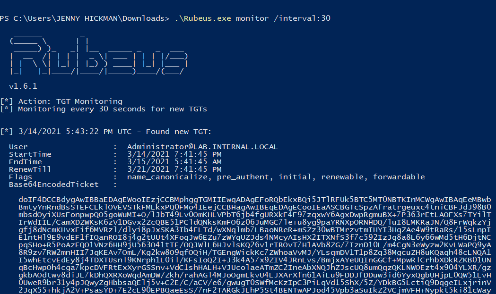
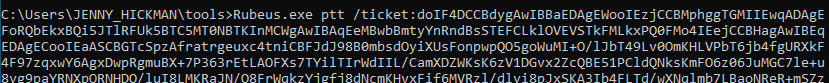
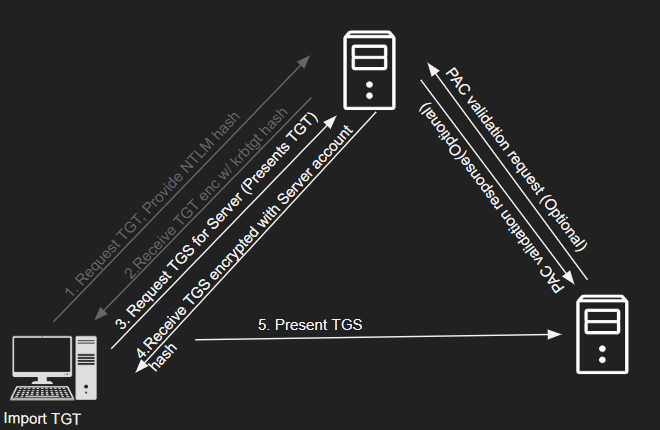

# Detecting Pass-the-Ticket (Phát hiện Pass-the-Ticket)

## Pass-the-Ticket

`Pass-the-Ticket (PtT)` là một kỹ thuật lateral movement (di chuyển ngang) mà kẻ tấn công dùng để di chuyển trong mạng bằng cách lạm dụng ticket Kerberos TGT (Ticket Granting Ticket) và TGS (Ticket Granting Service). Thay vì dùng hash NTLM, PtT tận dụng Kerberos ticket để xác thực vào các hệ thống khác và truy cập tài nguyên mạng mà không cần biết mật khẩu của người dùng. Kỹ thuật này cho phép kẻ tấn công di chuyển ngang và giành quyền truy cập trái phép trên nhiều hệ thống.

#### Các bước tấn công:

- Kẻ tấn công giành được quyền quản trị trên một hệ thống, thông qua lần xâm nhập ban đầu hoặc privilege escalation (leo thang đặc quyền).
- Kẻ tấn công dùng các công cụ như `Mimikatz` hoặc `Rubeus` để trích xuất ticket TGT hoặc TGS hợp lệ từ bộ nhớ của hệ thống bị xâm nhập.
	
- Kẻ tấn công nạp (submit) ticket đã trích xuất vào logon session hiện tại. Giờ đây kẻ tấn công có thể xác thực vào các hệ thống và tài nguyên mạng khác mà không cần mật khẩu plaintext.
	
	

#### Quá trình xác thực Kerberos

`Kerberos` là một giao thức xác thực mạng dùng để xác thực an toàn người dùng và dịch vụ trong môi trường Windows Active Directory (AD). Quá trình xác thực Kerberos diễn ra theo các bước sau:

- Người dùng (client) khởi tạo quá trình xác thực bằng cách yêu cầu một Ticket Granting Ticket (TGT) từ Key Distribution Center (KDC), thường là một phần của domain controller Active Directory.
- KDC xác minh danh tính người dùng (thường thông qua mật khẩu) và cấp một TGT được mã hoá bằng secret key của người dùng. TGT có hiệu lực trong một khoảng thời gian nhất định và cho phép người dùng yêu cầu service ticket mà không cần xác thực lại.
- Client gửi yêu cầu service ticket (TGS-REQ) tới KDC cho dịch vụ cần truy cập, dùng TGT nhận được ở bước trước.
- KDC kiểm tra TGT của client và, nếu hợp lệ, cấp một service ticket (TGS) được mã hoá bằng secret key của service account, chứa danh tính của client và một session key. Sau đó client nhận service ticket (TGS) từ KDC.
- Client kết nối tới server và gửi TGS cho server như một phần của quá trình xác thực.


#### Các Windows Security Event liên quan

Khi người dùng truy cập tài nguyên mạng, nhiều Windows Event Log được tạo ra để ghi lại quá trình logon và các hoạt động liên quan.

- `Event ID 4648 (Explicit Credential Logon Attempt)`: Event này được ghi khi thông tin đăng nhập tường minh (explicit credentials, vd: username và password) được cung cấp trong quá trình logon.
- `Event ID 4624 (Logon)`: Event này cho biết người dùng đã đăng nhập thành công vào hệ thống.
- `Event ID 4672 (Special Logon)`: Event này được ghi khi lần logon của người dùng có kèm đặc quyền đặc biệt, chẳng hạn chạy ứng dụng với quyền administrator.
- `Event ID 4768 (Kerberos TGT Request)`: Event này được ghi khi client yêu cầu Ticket Granting Ticket (TGT) trong quá trình xác thực Kerberos.
- `Event ID 4769 (Kerberos Service Ticket Request)`: Khi client yêu cầu Service Ticket (TGS Ticket) để truy cập một dịch vụ từ xa trong quá trình xác thực Kerberos, Event ID 4769 sẽ được tạo ra.


#### Cơ hội phát hiện Pass-the-Ticket

Phát hiện tấn công Pass-the-Ticket có thể khá khó, vì kẻ tấn công đang dùng Kerberos ticket hợp lệ thay vì các credential hash truyền thống. Điểm khác biệt then chốt là khi tấn công Pass-the-Ticket được thực hiện, quá trình xác thực Kerberos sẽ chỉ diễn ra một phần. Ví dụ, kẻ tấn công import một TGT ticket vào một logon session và yêu cầu TGS ticket cho một dịch vụ từ xa. Từ góc nhìn của Domain Controller, TGT được import chưa từng được yêu cầu trước đó từ hệ thống của kẻ tấn công, nên sẽ không có Event ID 4768 tương ứng.



Cách tiếp cận này có thể chuyển thành detection Splunk như sau: Tìm `Event ID 4769 (Kerberos Service Ticket Request)` `or` `Event ID 4770 (Kerberos Service Ticket was renewed)` mà không có `Event ID 4768 (Kerberos TGT Request)` nào trước đó từ cùng hệ thống trong một khung thời gian nhất định.

Một cách tiếp cận khác là tìm sự không khớp giữa Service và Host ID (trong `Event ID 4769`) với Source và Destination IP thực tế (trong `Event ID 3`). Lưu ý rằng sẽ có khá nhiều trường hợp không khớp hợp lệ, nhưng các hostname hoặc dịch vụ bất thường cần được điều tra thêm.

Ngoài ra, trong trường hợp kẻ tấn công import một TGS ticket vào logon session, cần xem xét `Event ID 4771 (Kerberos Pre-Authentication Failed)` để tìm sự không khớp giữa Pre-Authentication type và Failure Code. Ví dụ, `Pre-Authentication type 2 (Encrypted Timestamp)` đi kèm `Failure Code 0x18 (Pre-authentication information was invalid)` cho thấy client đã gửi một Kerberos AS-REQ với timestamp pre-authentication đã mã hoá, nhưng KDC không giải mã được.

Cần hiểu rằng các cơ hội phát hiện này nên được tăng cường bằng behavior-based detection (phát hiện dựa trên hành vi). Nói cách khác, ngữ cảnh là yếu tố sống còn. Chỉ tìm các Event ID `4769`, `4770` hoặc `4771` đơn lẻ nhiều khả năng sẽ sinh ra rất nhiều false positive. Hãy tương quan các event log với các mẫu hành vi của người dùng và hệ thống, và xem xét liệu có hoạt động đáng ngờ nào gắn với người dùng hoặc hệ thống xuất hiện trong log hay không.

<div class="card bg-light">
    <div class="card-body">
				 <p class="mb-0">Giờ hãy kéo xuống cuối section này và bấm "Click here to spawn the target system!". Sau đó truy cập giao diện Splunk tại http://[Target IP]:8000 và mở ứng dụng Search & Reporting của Splunk. Phần lớn các search được trình bày từ đây đến cuối section này đều có thể thực hiện lại trên target, giúp nắm chắc hơn các chủ đề đã trình bày. </p>
    </div>
</div>

## Phát hiện Pass-the-Ticket bằng Splunk

Giờ hãy cùng tìm hiểu cách nhận diện Pass-the-Ticket bằng Splunk.

**Khung thời gian**: `earliest=1690451665 latest=1690451745`

```shell-session
index=main earliest=1690392405 latest=1690451745 source="WinEventLog:Security" user!=*$ EventCode IN (4768,4769,4770) 
| rex field=user "(?<username>[^@]+)"
| rex field=src_ip "(\:\:ffff\:)?(?<src_ip_4>[0-9\.]+)"
| transaction username, src_ip_4 maxspan=10h keepevicted=true startswith=(EventCode=4768)
| where closed_txn=0
| search NOT user="*$@*"
| table _time, ComputerName, username, src_ip_4, service_name, category
```


**Phân tích search**:

- `index=main earliest=1690392405 latest=1690451745 source="WinEventLog:Security" user!=*$ EventCode IN (4768,4769,4770)`: Lệnh này lọc các event từ index `main` nằm trong khoảng thời gian đã chỉ định. Nó chọn các event từ source `WinEventLog:Security`, trong đó field `user` không kết thúc bằng ký tự đô la (`$`) và `EventCode` là một trong `4768`, `4769` hoặc `4770`.
- `| rex field=user "(?<username>[^@]+)"`: Lệnh này trích xuất `username` từ field `user` bằng regular expression. Giá trị trích xuất được gán vào một field mới tên là `username`.
- `| rex field=src_ip "(\:\:ffff\:)?(?<src_ip_4>[0-9\.]+)"`: Lệnh này trích xuất địa chỉ IPv4 từ field `src_ip`, kể cả khi ban đầu nó được ghi dưới dạng địa chỉ IPv6. Giá trị trích xuất được gán vào một field mới tên là `src_ip_4`.
- `| transaction username, src_ip_4 maxspan=10h keepevicted=true startswith=(EventCode=4768)`: Lệnh này gom các event thành các transaction dựa trên field `username` và `src_ip_4`. Một transaction bắt đầu bằng event có `EventCode` là `4768`. Tham số `maxspan=10h` đặt thời lượng tối đa của một transaction là `10` giờ. Tham số `keepevicted=true` đảm bảo các transaction còn mở (không có event kết thúc) vẫn được đưa vào kết quả.
- `| where closed_txn=0`: Lệnh này lọc kết quả để chỉ giữ lại các transaction còn mở, tức là không có event kết thúc.
- `| search NOT user="*$@*"`: Lệnh này loại bỏ các kết quả mà field `user` kết thúc bằng dấu sao (`*`) và có chứa ký tự at (`@`).
- `| table _time, ComputerName, username, src_ip_4, service_name, category`: Lệnh này hiển thị các field đã chỉ định dưới dạng bảng.
