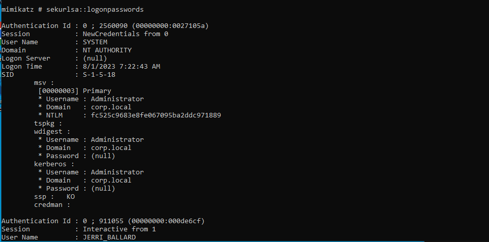
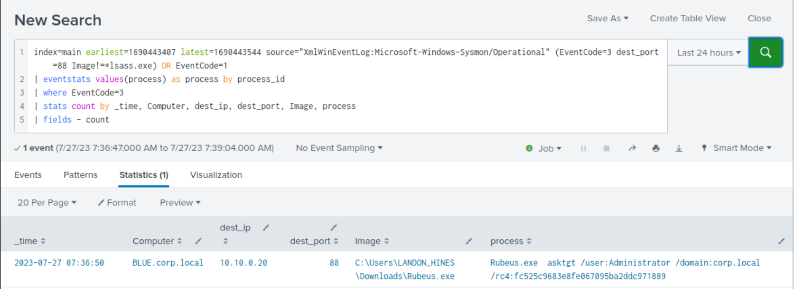

# Detecting Overpass-the-Hash (Phát hiện Overpass-the-Hash)

## Overpass-the-Hash

Kẻ tấn công có thể dùng kỹ thuật `Overpass-the-Hash` để lấy Kerberos TGT bằng cách tận dụng các password hash đánh cắp được, nhằm di chuyển ngang (lateral movement) trong môi trường hoặc vượt qua các cơ chế kiểm soát truy cập hệ thống thông thường. Overpass-the-Hash (còn gọi là `Pass-the-Key`) cho phép việc xác thực diễn ra qua Kerberos thay vì NTLM. Cả hash NTLM lẫn AES key đều có thể dùng làm cơ sở để yêu cầu Kerberos TGT.

#### Các bước tấn công:

- Kẻ tấn công dùng các công cụ như Mimikatz để trích xuất hash NTLM của một người dùng đang đăng nhập trên hệ thống bị xâm nhập. Kẻ tấn công phải có ít nhất quyền local administrator trên hệ thống mới có thể trích xuất được hash của người dùng.
	
- Kẻ tấn công dùng một công cụ như Rubeus để tạo một yêu cầu AS-REQ thô (raw) cho một người dùng cụ thể nhằm yêu cầu TGT ticket. Bước này không đòi hỏi đặc quyền nâng cao trên host để yêu cầu TGT, khiến nó trở thành cách tiếp cận lén lút hơn so với tấn công Pass-the-Hash bằng Mimikatz.
	
- Tương tự kỹ thuật Pass-the-Ticket, kẻ tấn công nạp (submit) ticket vừa yêu cầu vào logon session hiện tại.

#### Cơ hội phát hiện Overpass-the-Hash

Tấn công Overpass-the-Hash của `Mimikatz` để lại các artifact giống như tấn công Pass-the-Hash, và có thể được phát hiện bằng cùng các chiến lược.

Tuy nhiên, `Rubeus` lại tạo ra một kịch bản hơi khác. Trừ khi TGT được yêu cầu được dùng trên một host khác, các cơ chế phát hiện Pass-the-Ticket có thể không hiệu quả, vì Rubeus gửi yêu cầu AS-REQ trực tiếp tới Domain Controller (DC), sinh ra `Event ID 4768 (Kerberos TGT Request)`. Dù vậy, việc giao tiếp với DC  (`TCP/UDP port 88`) từ một process bất thường có thể là dấu hiệu (indicator) của một cuộc tấn công Overpass-the-Hash tiềm tàng.

<div class="card bg-light">
    <div class="card-body">
				 <p class="mb-0">Giờ hãy kéo xuống cuối section này và bấm "Click here to spawn the target system!". Sau đó truy cập giao diện Splunk tại http://[Target IP]:8000 và mở ứng dụng Search & Reporting của Splunk. Phần lớn các search được trình bày từ đây đến cuối section này đều có thể thực hiện lại trên target, giúp nắm chắc hơn các chủ đề đã trình bày. </p>
    </div>
</div>

## Phát hiện Overpass-the-Hash bằng Splunk (nhắm vào Rubeus)

Giờ hãy cùng tìm hiểu cách nhận diện Overpass-the-Hash bằng Splunk.

**Khung thời gian**: `earliest=1690443407 latest=1690443544`

```shell-session
index=main earliest=1690443407 latest=1690443544 source="XmlWinEventLog:Microsoft-Windows-Sysmon/Operational" (EventCode=3 dest_port=88 Image!=*lsass.exe) OR EventCode=1
| eventstats values(process) as process by process_id
| where EventCode=3
| stats count by _time, Computer, dest_ip, dest_port, Image, process
| fields - count
```


