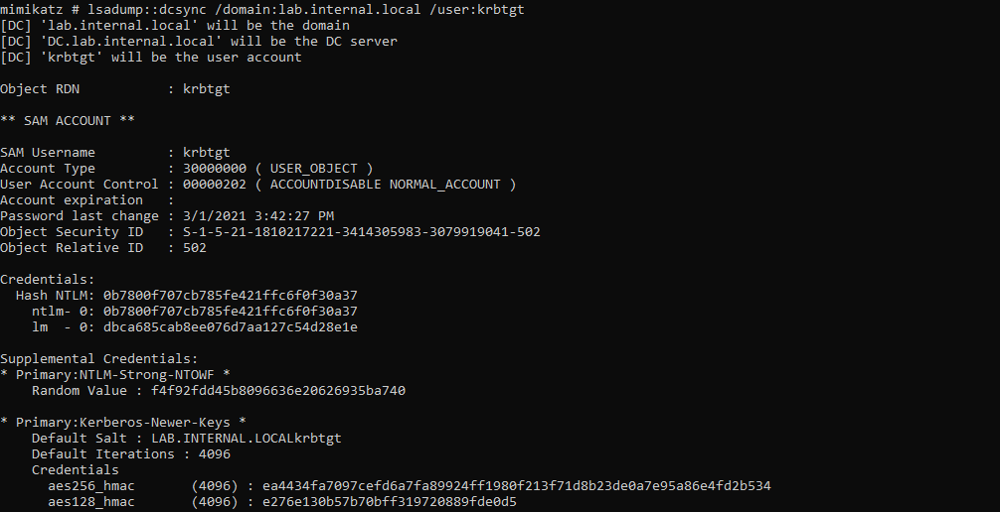
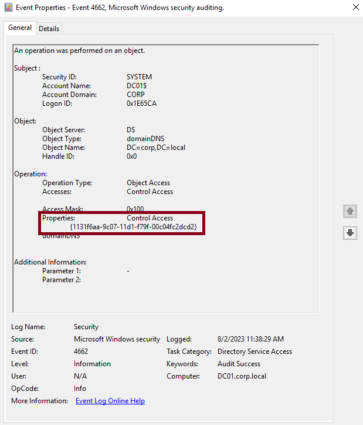
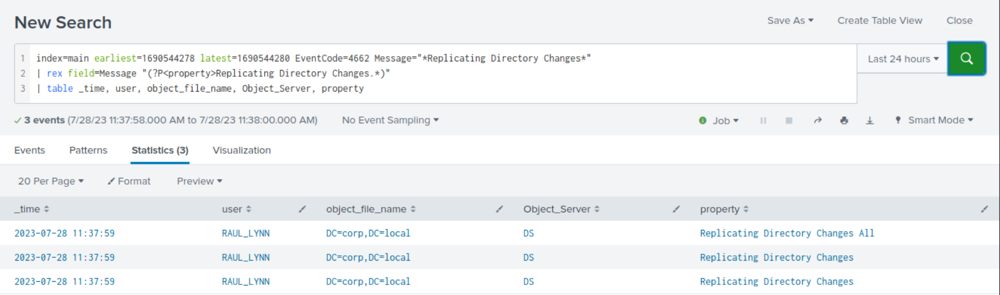
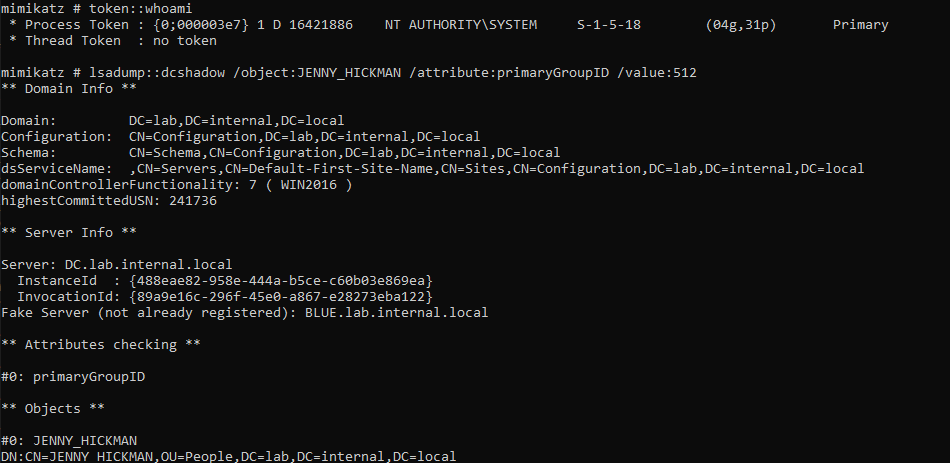
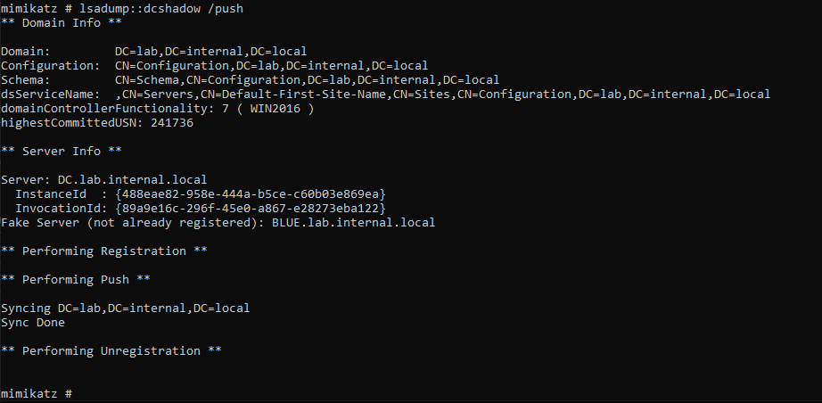
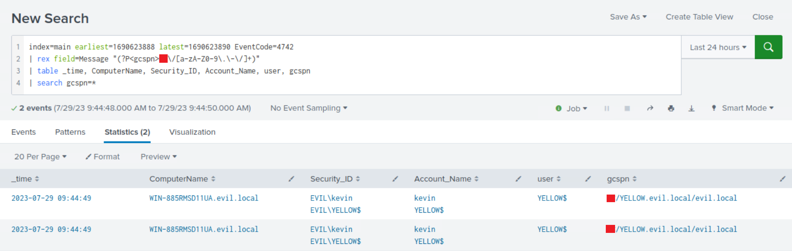

# Detecting DCSync/DCShadow (Phát hiện DCSync/DCShadow)

## DCSync

`DCSync` là kỹ thuật mà kẻ tấn công khai thác để trích xuất password hash từ các Domain Controller (DC) của Active Directory. Phương pháp này lợi dụng quyền `Replication Directory Changes` vốn thường được cấp cho các domain controller, cho phép chúng đọc mọi thuộc tính của object, kể cả password hash. Thành viên của các nhóm Administrators, Domain Admins và Enterprise Admin, hoặc các computer account trên domain controller, đều có khả năng thực thi DCSync để trích xuất dữ liệu mật khẩu từ Active Directory. Dữ liệu này có thể bao gồm cả hash hiện tại lẫn hash lịch sử của các tài khoản có giá trị cao, như KRBTGT và Administrators.

#### Các bước tấn công:

- Kẻ tấn công giành được quyền quản trị trên một hệ thống đã join domain hoặc leo thang đặc quyền để có được các quyền cần thiết nhằm yêu cầu dữ liệu replication (sao chép).
- Dùng các công cụ như Mimikatz, kẻ tấn công yêu cầu dữ liệu replication của domain thông qua giao diện DRSGetNCChanges, qua đó giả dạng một domain controller hợp lệ.
	
- Sau đó kẻ tấn công có thể tạo Golden Ticket, Silver Ticket, hoặc chọn thực hiện tấn công Pass-the-Hash/Overpass-the-Hash.

#### Cơ hội phát hiện DCSync

Các thao tác `DS-Replication-Get-Changes` có thể được ghi lại bằng `Event ID 4662`. Tuy nhiên, cần cấu hình thêm `Audit Policy Configuration` vì nó không được bật mặc định (Computer Configuration/Windows Settings/Security Settings/Advanced Audit Policy Configuration/DS Access).



Hãy tìm các event chứa thuộc tính `{1131f6aa-9c07-11d1-f79f-00c04fc2dcd2}`, tương ứng với `DS-Replication-Get-Changes`, vì Event `4662` chỉ gồm các GUID.

<div class="card bg-light">
    <div class="card-body">
				 <p class="mb-0">Giờ hãy kéo xuống cuối section này và bấm "Click here to spawn the target system!". Sau đó truy cập giao diện Splunk tại http://[Target IP]:8000 và mở ứng dụng Search & Reporting của Splunk. Phần lớn các search được trình bày từ đây đến cuối section này đều có thể thực hiện lại trên target, giúp nắm chắc hơn các chủ đề đã trình bày. </p>
    </div>
</div>

## Phát hiện DCSync bằng Splunk

Giờ hãy cùng tìm hiểu cách nhận diện DCSync bằng Splunk.

**Khung thời gian**: `earliest=1690544278 latest=1690544280`

```shell-session
index=main earliest=1690544278 latest=1690544280 EventCode=4662 Message="*Replicating Directory Changes*"
| rex field=Message "(?P<property>Replicating Directory Changes.*)"
| table _time, user, object_file_name, Object_Server, property
```



## DCShadow

`DCShadow` là một chiến thuật nâng cao mà kẻ tấn công dùng để thực hiện các thay đổi trái phép đối với object trong Active Directory, bao gồm việc tạo hoặc sửa đổi object mà không sinh ra các security log thông thường. Cuộc tấn công lợi dụng quyền `Directory Replicator (Replicating Directory Changes)`, vốn thường được cấp cho các domain controller để thực hiện tác vụ replication. DCShadow là một kỹ thuật lén lút, cho phép kẻ tấn công thao túng dữ liệu Active Directory và thiết lập persistence trong mạng. Việc đăng ký một DC giả mạo (rogue DC) đòi hỏi phải tạo các object server mới và object `nTDSDSA` trong Configuration partition của AD schema, việc này cần quyền Administrator (Domain Admin hoặc local admin trên DC) hoặc hash `KRBTGT`.

#### Các bước tấn công:

- Kẻ tấn công giành được quyền quản trị trên một hệ thống đã join domain hoặc leo thang đặc quyền để có được các quyền cần thiết nhằm yêu cầu dữ liệu replication.
- Kẻ tấn công đăng ký một domain controller giả mạo trong domain, tận dụng quyền `Directory Replicator`, và thực hiện thay đổi đối với các object AD, chẳng hạn sửa nhóm của người dùng thành nhóm Domain Administrator.
	
- Domain controller giả mạo khởi tạo replication với các domain controller hợp lệ, phát tán các thay đổi ra toàn domain.
	

#### Cơ hội phát hiện DCShadow

Để giả lập một Domain Controller, DCShadow phải thực hiện một số thay đổi cụ thể trong Active Directory:

- `Add a new nTDSDSA object`
- `Append a global catalog ServicePrincipalName to the computer object`

`Event ID 4742 (Computer account was changed)` ghi lại các thay đổi liên quan đến computer object, bao gồm `ServicePrincipalName`.

## Phát hiện DCShadow bằng Splunk

Giờ hãy cùng tìm hiểu cách nhận diện DCShadow bằng Splunk.

**Khung thời gian**: `earliest=1690623888 latest=1690623890`

```shell-session
index=main earliest=1690623888 latest=1690623890 EventCode=4742 
| rex field=Message "(?P<gcspn>XX\/[a-zA-Z0-9\.\-\/]+)" 
| table _time, ComputerName, Security_ID, Account_Name, user, gcspn 
| search gcspn=*
```


