# Creating Custom Splunk Applications (Tạo ứng dụng Splunk tùy chỉnh)

## Cách tạo một ứng dụng Splunk tùy chỉnh

1. `Access Splunk Web`: Mở trình duyệt web và truy cập Splunk Web.
2. `Go to Manage Apps`: Từ thanh menu phía trên cùng, chọn `Apps` rồi chọn `Manage Apps`.
	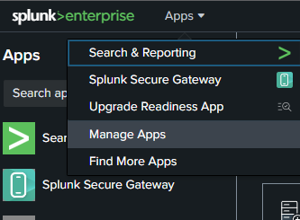
3. `Create a New App`: Trên trang `Apps`, bấm vào `Create app`.
4. `Enter App Details`: Trên trang `Add new`, điền các thuộc tính cho app mới:
	- `Name`: Nhập tên cho app, ví dụ `<Your app name>`.
	- `Folder name`: Chỉ định tên thư mục, nên tương tự `<App_name>`. Tên này sẽ tương ứng với thư mục của app trong `$SPLUNK_HOME/etc/apps/`.
	- `Version`: Nhập "1.0.0".
	- `Description`: Nhập mô tả cho app, ví dụ `<App description>`.
	- `Template`: Chọn `barebones` trong menu thả xuống.
	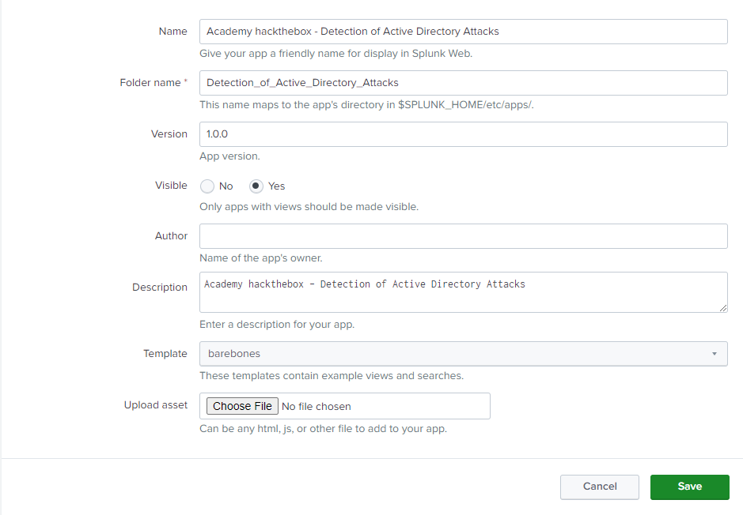
5. `Save the App`: Bấm `Save`. Bạn có thể kiểm tra app đã được tạo chưa bằng cách vào menu `Apps` — app mới lúc này sẽ nằm trong danh sách ở đó. Ngoài ra, nếu vào trang chủ Splunk Web, bạn sẽ thấy app của mình trong danh sách `Apps` với tên `Academy hackthebox - Detection of Active Directory Attacks`.
	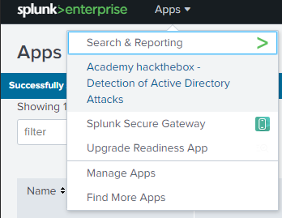
	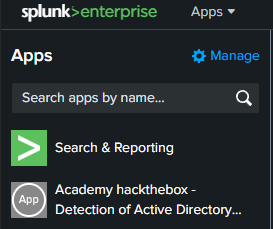
6. `Explore the Directory Structure`: Dùng trình quản lý file để đi tới `$SPLUNK_HOME/etc/apps`. Tại đây bạn sẽ thấy thư mục app của mình, gồm các thư mục sau:
	- `/bin`: Nơi lưu các script.
	- `/default`: Thư mục này chứa các file cấu hình, view, dashboard và điều hướng (navigation) của app.
  	- `/local`: Thư mục này chứa các phiên bản do người dùng chỉnh sửa của các file cấu hình, view, dashboard và điều hướng của app.
	- `/metadata`: Thư mục này chứa các file phân quyền (permissions).
	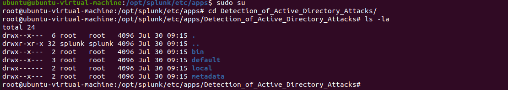
7. `View the Navigation File`: File cấu hình điều hướng là một file XML. Dùng trình soạn thảo văn bản mở `$SPLUNK_HOME/etc/apps/<your app>/default/data/ui/nav/default.xml`. Tại đây bạn sẽ thấy định nghĩa điều hướng mặc định của một app:
	```xml
	  <nav search_view="search">
	  <view name="search" default='true' />
 	  <view name="analytics_workspace" />
	  <view name="datasets" />
	  <view name="reports" />
 	  <view name="alerts" />
	  <view name="dashboards" />
      </nav>
  	```
	Trong XML này, thẻ nav ở cấp cao nhất đóng vai trò thẻ cha. Thuộc tính `search_view` chỉ định view mặc định cho các search. Ở đây dùng view `search`, được kế thừa từ app `Search & Reporting`. Cấp tiếp theo trong cây XML tương ứng với các mục hiển thị trên thanh app (app bar). Danh sách các thẻ view cho biết những view khác nhau sẽ được hiển thị. Mỗi view tương ứng với một view của app Search & Reporting. Thuộc tính `default='true'` cho biết view được dùng làm trang chủ của app – ở đây view `search` đóng vai trò trang chủ.
8. `Create Your First Dashboard`: Vào `dashboards` và bấm `Create New Dashboard`. Nhập tên dashboard, thêm mô tả nếu cần, thiết lập quyền (permissions) và chọn `Classic Dashboards`.
	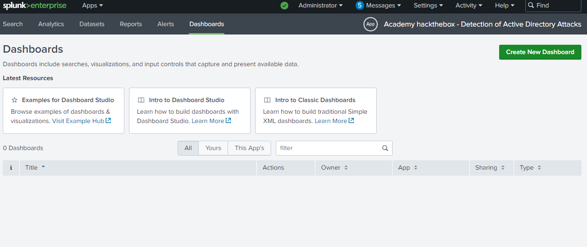
	
	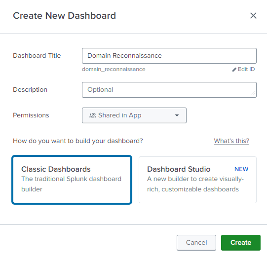
9. `Configure the Dashboard`: Lúc này bạn sẽ thấy trang chỉnh sửa dashboard, nơi có thể cấu hình panel, input, v.v. để hỗ trợ quá trình giám sát. Thêm time input cho dashboard và điều chỉnh khoảng thời gian mặc định cho phù hợp với nhu cầu. Tiếp theo, thêm một panel dạng bảng thống kê (statistical table), chọn khoảng thời gian cho Shared Time Picker, thêm Content Title (vd: `"<Panel name>"`) và nhập Search String. Để dùng input trong search, đặt token của input giữa hai dấu đô la, như `$user$`. Bấm `Add to Dashboard` khi đã sẵn sàng. Lưu các thay đổi.
	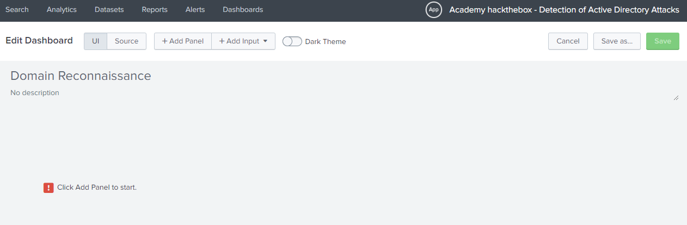
	
	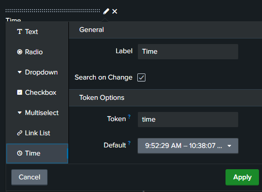
	
	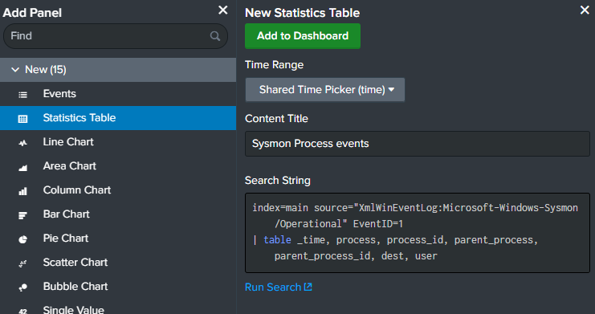
	
	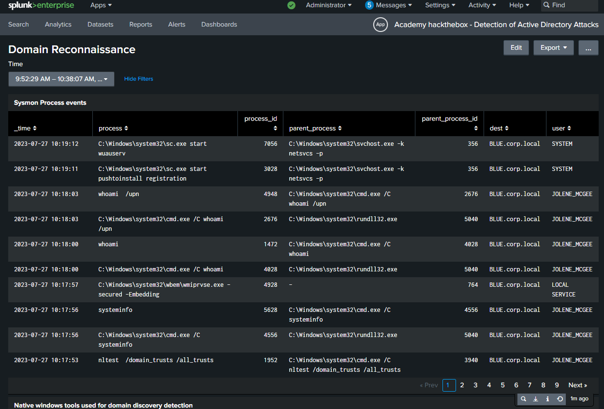
10. `Dashboard Storage`: Mọi dashboard bạn tạo trong app đều được lưu tại `"<AppPath>/local/data/ui/views/dashboard_title.xml"`. Để thêm dashboard vào thanh điều hướng, chỉ cần thêm tên dashboard vào file XML điều hướng mặc định: `"<AppPath>/local/data/ui/nav/default.xml"`.
	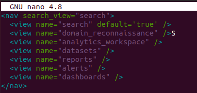
11. `Restart Splunk`: Khởi động lại instance Splunk. Sau khi khởi động lại, bạn sẽ thấy dashboard của mình trên thanh điều hướng.
	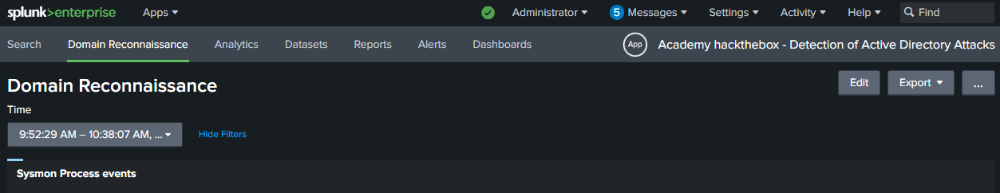
12. `Grouping Dashboards`: Nếu muốn nhóm nhiều dashboard dưới một mục duy nhất trên thanh điều hướng, hãy dùng thẻ collection.
	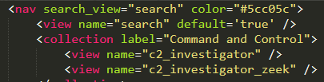
	
## Cập nhật & khám phá ứng dụng Splunk "Academy hackthebox - Detection of Active Directory Attacks"

`Detection-of-Active-Directory-Attacks.tar.gz.tar` có thể được tải về từ mục `Resources` của module này (góc trên bên phải) và dùng để cập nhật ứng dụng Splunk `Academy hackthebox - Detection of Active Directory Attacks` hiện có bằng cách bấm `Apps` -> `Manage Apps` -> `Install app from file` -> `Browse` -> ✓ `Upgrade app. Checking this will overwrite the app if it already exists.` -> `Upload`.

Bây giờ, hãy dành chút thời gian khám phá ứng dụng Splunk tùy chỉnh này và xem nó có thể cải thiện đáng kể khả năng giám sát của chúng ta như thế nào.
