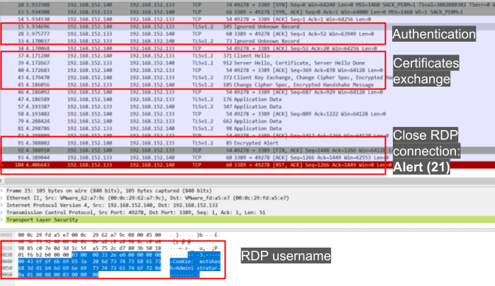
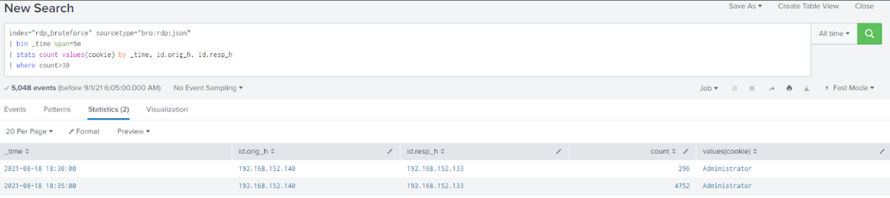

# Detecting RDP Brute Force Attacks (Phát hiện tấn công brute force RDP)

Chúng ta thường xuyên gặp `Remote Desktop Protocol (RDP) brute force attacks` — một vector ưa thích của kẻ tấn công để giành chỗ đứng ban đầu (initial foothold) trong mạng. Khái niệm tấn công brute force RDP khá đơn giản: kẻ tấn công cố đăng nhập vào một phiên Remote Desktop bằng cách đoán và thử lần lượt các mật khẩu khác nhau một cách có hệ thống cho tới khi tìm ra mật khẩu đúng. Phương pháp này lợi dụng thực tế là nhiều người dùng thường đặt mật khẩu yếu hoặc mật khẩu mặc định, dễ đoán.

#### Lưu lượng RDP trông như thế nào



<div class="card bg-light">
    <div class="card-body">
				 <p class="mb-0">Bây giờ hãy kéo xuống cuối section này và bấm vào "Click here to spawn the target system!". Sau đó, truy cập giao diện Splunk tại https://[Target IP]:8000 và mở ứng dụng Splunk Search & Reporting. Phần lớn các search được trình bày từ đây cho tới cuối section này có thể được thực hiện lại bên trong target, giúp nắm bắt các chủ đề được trình bày một cách toàn diện hơn. </p>
    </div>
</div>

<div class="card bg-light">
    <div class="card-body">
				 <p class="mb-0">Ngoài ra, ta có thể truy cập target đã khởi tạo qua RDP như hướng dẫn dưới đây. Mọi file, log và file PCAP liên quan đến các cuộc tấn công được đề cập đều nằm trong các thư mục /home/htb-student và /home/htb-student/module_files. </p>
    </div>
</div>

```shell-session
[!bash!]$ xfreerdp /u:htb-student /p:'HTB_@cademy_stdnt!' /v:[Target IP] /dynamic-resolution
```

#### Bằng chứng liên quan

- **Thư mục liên quan**: `/home/htb-student/module_files/rdp_bruteforce`
- **Splunk Index liên quan**: `rdp_bruteforce`
- **Splunk Sourcetype liên quan**: `bro:rdp:json`

---

## Phát hiện tấn công brute force RDP bằng Splunk & Zeek log

Bây giờ hãy cùng tìm hiểu cách nhận diện tấn công brute force RDP bằng Splunk và Zeek log.

```shell-session
index="rdp_bruteforce" sourcetype="bro:rdp:json"
| bin _time span=5m
| stats count values(cookie) by _time, id.orig_h, id.resp_h
| where count>30
```



Hiểu biết về cách phát hiện tấn công brute force giúp xây dựng logic phát hiện (detection logic) và alert. Tấn công brute force tập trung vào việc tìm các dịch vụ chấp nhận thông tin đăng nhập; kẻ tấn công có thể thử dùng một username mặc định kết hợp với mật khẩu mặc định, hoặc thực hiện trinh sát thông qua thu thập thông tin thụ động (passive information gathering) bằng cách quan sát định dạng email như một vector ban đầu để tìm ra định dạng username hợp lệ. Trong section này, ta tập trung phát hiện tấn công brute force nhắm vào RDP — một trong những giao thức mà các tác nhân đe dọa (threat actor) sẽ tấn công. Trong bài tập, ta sẽ được đặt vào vị trí phải phát hiện SSH brute-forcing, vốn có thể được triển khai trên các host Windows, dựa trên phương pháp tìm hiểu những dịch vụ nào đang chạy trong tổ chức và phát triển quy trình thích ứng trong nhiều tình huống khác nhau.
