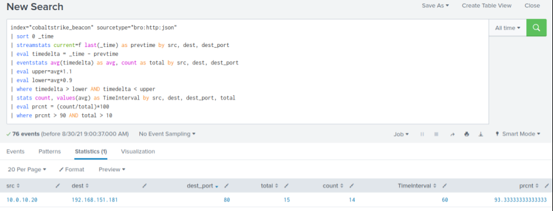

# Detecting Beaconing Malware (Phát hiện malware beaconing)

`Malware beaconing` là một kỹ thuật chúng ta thường xuyên gặp trong các cuộc điều tra an ninh mạng. Nó chỉ việc các hệ thống bị nhiễm malware chủ động liên lạc định kỳ với máy chủ command and control (C2) tương ứng. Các beacon, thường là những gói dữ liệu nhỏ, được gửi đi theo các khoảng thời gian đều đặn, giống như ngọn hải đăng phát tín hiệu đều đặn.

Khi phân tích hành vi beaconing, ta thường quan sát thấy một vài mẫu (pattern) khác biệt. Khoảng thời gian beacon có thể cố định, có jitter (dao động nhẹ quanh một mẫu cố định), hoặc theo một lịch phức tạp hơn tùy vào mục tiêu cụ thể của malware. Chúng ta đã gặp những malware dùng nhiều giao thức khác nhau để beacon, gồm HTTP/HTTPS, DNS và thậm chí cả ICMP (ping).

Trong section này, ta sẽ tập trung phát hiện hành vi beaconing gắn với một framework Command and Control (C2) được biết đến rộng rãi là `Cobalt Strike` (ở cấu hình mặc định).

<div class="card bg-light">
    <div class="card-body">
				 <p class="mb-0">Bây giờ hãy kéo xuống cuối section này và bấm vào "Click here to spawn the target system!". Sau đó, truy cập giao diện Splunk tại https://[Target IP]:8000 và mở ứng dụng Splunk Search & Reporting. Phần lớn các search được trình bày từ đây cho tới cuối section này có thể được thực hiện lại bên trong target, giúp nắm bắt các chủ đề được trình bày một cách toàn diện hơn. </p>
    </div>
</div>

<div class="card bg-light">
    <div class="card-body">
				 <p class="mb-0">Ngoài ra, ta có thể truy cập target đã khởi tạo qua RDP như hướng dẫn dưới đây. Mọi file, log và file PCAP liên quan đến các cuộc tấn công được đề cập đều nằm trong các thư mục /home/htb-student và /home/htb-student/module_files. </p>
    </div>
</div>

```shell-session
[!bash!]$ xfreerdp /u:htb-student /p:'HTB_@cademy_stdnt!' /v:[Target IP] /dynamic-resolution
```

#### Bằng chứng liên quan

- **Thư mục liên quan**: `/home/htb-student/module_files/cobaltstrike_beacon`
- **Splunk Index liên quan**: `cobaltstrike_beacon`
- **Splunk Sourcetype liên quan**: `bro:http:json`

---

## Phát hiện malware beaconing bằng Splunk & Zeek log

Bây giờ hãy cùng tìm hiểu cách nhận diện beaconing bằng Splunk và Zeek log.

```shell-session
index="cobaltstrike_beacon" sourcetype="bro:http:json" 
| sort 0 _time
| streamstats current=f last(_time) as prevtime by src, dest, dest_port
| eval timedelta = _time - prevtime
| eventstats avg(timedelta) as avg, count as total by src, dest, dest_port
| eval upper=avg*1.1
| eval lower=avg*0.9
| where timedelta > lower AND timedelta < upper
| stats count, values(avg) as TimeInterval by src, dest, dest_port, total
| eval prcnt = (count/total)*100
| where prcnt > 90 AND total > 10
```



**Phân tích search**:

- `index="cobaltstrike_beacon" sourcetype="bro:http:json"`:
Chọn dữ liệu từ index `cobaltstrike_beacon` và lọc các event thuộc loại `bro:http:json`, tức là Zeek HTTP log.
- `| sort 0 _time`: Sắp xếp các event theo thứ tự tăng dần dựa trên timestamp (`_time`).
- `| streamstats current=f last(_time) as prevtime by src, dest, dest_port`:
Với mỗi event, tính timestamp của event trước đó (`prevtime`), nhóm theo IP nguồn (`src`), IP đích (`dest`) và cổng đích (`dest_port`).
- `| eval timedelta = _time - prevtime`: Tính chênh lệch thời gian (`timedelta`) giữa timestamp của event hiện tại và event trước đó.
- `| eventstats avg(timedelta) as avg, count as total by src, dest, dest_port`: Tính chênh lệch thời gian trung bình (`avg`) và tổng số event (`total`) cho mỗi tổ hợp `src`, `dest` và `dest_port`.
- `| eval upper=avg*1.1`: Đặt giới hạn trên cho chênh lệch thời gian bằng cách cộng thêm biên độ `10%` vào giá trị trung bình.
- `| eval lower=avg*0.9`: Đặt giới hạn dưới cho chênh lệch thời gian bằng cách trừ đi biên độ `10%` khỏi giá trị trung bình.
- `| where timedelta > lower AND timedelta < upper`: Lọc các event có chênh lệch thời gian nằm trong khoảng giới hạn trên và dưới đã định.
- `| stats count, values(avg) as TimeInterval by src, dest, dest_port, total`:
Đếm số event và lấy ra khoảng thời gian trung bình cho mỗi tổ hợp `src`, `dest`, `dest_port` và `total`.
- `| eval prcnt = (count/total)*100`: Tính tỷ lệ phần trăm (`prcnt`) các event nằm trong giới hạn khoảng thời gian đã định.
- `| where prcnt > 90 AND total > 10`: Lọc kết quả, chỉ giữ những trường hợp có hơn `90%` event nằm trong giới hạn khoảng thời gian đã định và tổng số event nhiều hơn `10`.
