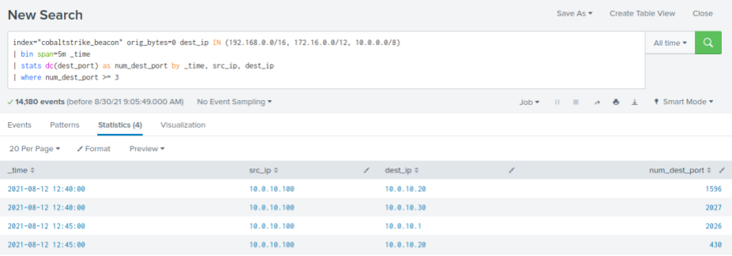

# Detecting Nmap Port Scanning

`Port scanning with Nmap` is a key technique in the toolkit of attackers and penetration testers alike. In essence, what we're doing with Nmap is probing networked systems for open ports - these are the 'gates' through which data passes in and out of a system. Open ports can be likened to doors that might be unlocked in a building - doors that attackers could potentially use to gain access.

When we use Nmap for port scanning, we're basically initiating a series of connection requests. We systematically attempt to establish a TCP handshake with each port in the target's address space. If the connection is successful, it indicates that the port is open. This is where it gets interesting. When we connect to an open port, the service listening on that port might send back a "banner" - this is essentially a little bit of data that tells us what service is running, and maybe even what version it's running.

But let's clear up a misconception - when we're talking about Nmap sending data to the scanning port, we're not actually sending any real data. Aside from the actual TCP handshake itself, the payload of the packets Nmap sends is zero. We're not sending any extra data; we're just trying to initiate a connection.

<div class="card bg-light">
    <div class="card-body">
				 <p class="mb-0">Let's now navigate to the bottom of this section and click on "Click here to spawn the target system!". Then, access the Splunk interface at https://[Target IP]:8000 and launch the Search & Reporting Splunk application. The vast majority of searches covered from this point up to end of this section can be replicated inside the target, offering a more comprehensive grasp of the topics presented. </p>
    </div>
</div>

<div class="card bg-light">
    <div class="card-body">
				 <p class="mb-0">Additionally, we can access the spawned target via RDP as outlined below. All files, logs, and PCAP files related to the covered attacks can be found in the /home/htb-student and /home/htb-student/module_files directories. </p>
    </div>
</div>

```shell-session
[!bash!]$ xfreerdp /u:htb-student /p:'HTB_@cademy_stdnt!' /v:[Target IP] /dynamic-resolution
```

#### Related Evidence

- **Related Directory**: `/home/htb-student/module_files/cobaltstrike_beacon`
- **Related Splunk Index**: `cobaltstrike_beacon`
- **Related Splunk Sourcetype**: `bro:conn:json`

---

## Detecting Nmap Port Scanning With Splunk & Zeek Logs

Now let's explore how we can identify Nmap port scanning, using Splunk and Zeek logs.

```shell-session
index="cobaltstrike_beacon" sourcetype="bro:conn:json" orig_bytes=0 dest_ip IN (192.168.0.0/16, 172.16.0.0/12, 10.0.0.0/8) 
| bin span=5m _time 
| stats dc(dest_port) as num_dest_port by _time, src_ip, dest_ip 
| where num_dest_port >= 3
```



**Search Breakdown**:

- `index="cobaltstrike_beacon`": This restricts the search to logs stored in the `cobaltstrike_beacon` index.
- `orig_bytes=0`: This part of the search filter focuses on network events where the original bytes sent are `zero`. 
- `dest_ip IN (192.168.0.0/16, 172.16.0.0/12, 10.0.0.0/8)`: This restricts the search to network events where the destination IP address is within the private IP address ranges, which are commonly used in internal networks.
- `| bin span=5m _time`: This command bins the events into `5`-minute intervals based on the `_time` field, which is the timestamp of each event.
- `| stats dc(dest_port) as num_dest_port by _time, src_ip, dest_ip`: The `stats` command is used to aggregate data. The `dc(dest_port)` function counts the distinct number of destination ports accessed for each combination of `_time`, `src_ip`, and `dest_ip`. The result is stored in a new field called `num_dest_port`.
- `| where num_dest_port >= 3`: This part of the search filters the results to only show those records where the distinct count of destination ports (`num_dest_port`) is `three` or greater. This is based on the assumption that scanning three or more ports within a short time frame is a potential indicator of a port scan.
