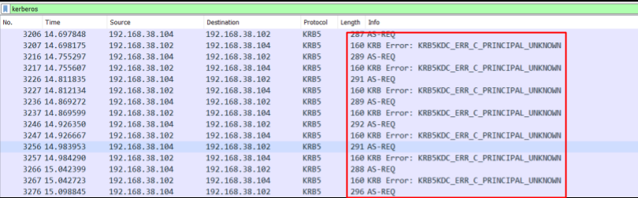
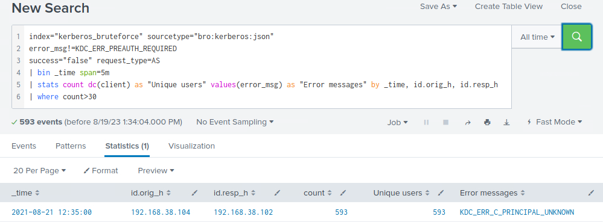

# Detecting Kerberos Brute Force Attacks

When adversaries perform `Kerberos-based user enumeration`, they send an AS-REQ (Authentication Service Request) message to the Key Distribution Center (KDC), which is responsible for handling Kerberos authentication. This message includes the username they're trying to validate. They pay close attention to the response they receive, as it reveals valuable information about the existence of the specified user account.

A valid username will prompt the server to `return a TGT` or raise an error like `KRB5KDC_ERR_PREAUTH_REQUIRED`, indicating that preauthentication is required. On the other hand, an invalid username will be met with a Kerberos error code `KRB5KDC_ERR_C_PRINCIPAL_UNKNOWN` in the AS-REP (Authentication Service Response) message. By examining the responses to their AS-REQ messages, adversaries can quickly determine which usernames are valid on the target system.

#### How Kerberos Brute Force Attacks Look Like On The Wire



<div class="card bg-light">
    <div class="card-body">
				 <p class="mb-0">Let's now navigate to the bottom of this section and click on "Click here to spawn the target system!". Then, access the Splunk interface at https://[Target IP]:8000 and launch the Search & Reporting Splunk application. The vast majority of searches covered from this point up to end of this section can be replicated inside the target, offering a more comprehensive grasp of the topics presented. </p>
    </div>
</div>

<div class="card bg-light">
    <div class="card-body">
				 <p class="mb-0">Additionally, we can access the spawned target via RDP as outlined below. All files, logs, and PCAP files related to the covered attacks can be found in the /home/htb-student and /home/htb-student/module_files directories. </p>
    </div>
</div>

```shell-session
[!bash!]$ xfreerdp /u:htb-student /p:'HTB_@cademy_stdnt!' /v:[Target IP] /dynamic-resolution
```

#### Related Evidence

- **Related Directory**: `/home/htb-student/module_files/kerberos_bruteforce`
- **Related Splunk Index**: `kerberos_bruteforce`
- **Related Splunk Sourcetype**: `bro:kerberos:json`

---

## Detecting Kerberos Brute Force Attacks With Splunk & Zeek Logs

Now let's explore how we can identify Kerberos brute force attacks, using Splunk and Zeek logs.

```shell-session
index="kerberos_bruteforce" sourcetype="bro:kerberos:json"
error_msg!=KDC_ERR_PREAUTH_REQUIRED
success="false" request_type=AS
| bin _time span=5m
| stats count dc(client) as "Unique users" values(error_msg) as "Error messages" by _time, id.orig_h, id.resp_h
| where count>30
```


