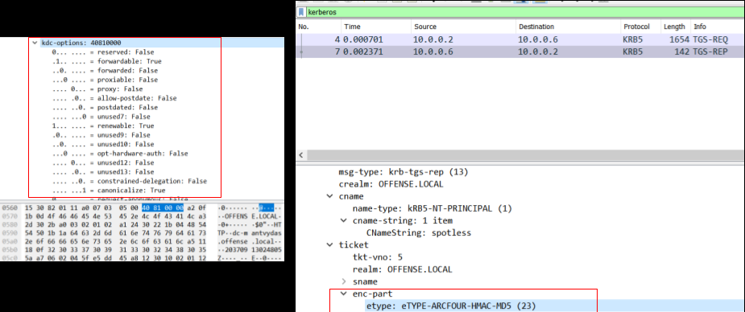
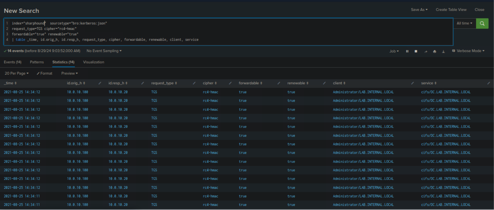

# Detecting Kerberoasting (Phát hiện Kerberoasting)

Năm 2016, hàng loạt bài blog và bài viết xuất hiện bàn về tactic truy vấn các tài khoản Service Principal Name (SPN) cùng các ticket tương ứng của chúng — một kiểu tấn công về sau được biết đến với tên `Kerberoasting`. Chỉ cần sở hữu một tài khoản người dùng hợp lệ cùng mật khẩu của nó, kẻ tấn công đã có thể lấy được các SPN ticket và thử bẻ khóa chúng offline.

Sau khi xem xét nhiều tài liệu về kerberoasting, có thể thấy rõ rằng `RC4` được dùng để mã hóa ticket ở phía sau. Trong section này, ta sẽ tận dụng nền tảng đó làm điểm phát hiện (detection point).

**Nguồn bằng chứng**: [https://www.ired.team/offensive-security-experiments/active-directory-kerberos-abuse/t1208-kerberoasting](https://www.ired.team/offensive-security-experiments/active-directory-kerberos-abuse/t1208-kerberoasting)

#### Lưu lượng Kerberoasting trông như thế nào



<div class="card bg-light">
    <div class="card-body">
				 <p class="mb-0">Bây giờ hãy kéo xuống cuối section này và bấm vào "Click here to spawn the target system!". Sau đó, truy cập giao diện Splunk tại https://[Target IP]:8000 và mở ứng dụng Splunk Search & Reporting. Phần lớn các search được trình bày từ đây cho tới cuối section này có thể được thực hiện lại bên trong target, giúp nắm bắt các chủ đề được trình bày một cách toàn diện hơn. </p>
    </div>
</div>

<div class="card bg-light">
    <div class="card-body">
				 <p class="mb-0">Ngoài ra, ta có thể truy cập target đã khởi tạo qua RDP như hướng dẫn dưới đây. Mọi file, log và file PCAP liên quan đến các cuộc tấn công được đề cập đều nằm trong các thư mục /home/htb-student và /home/htb-student/module_files. </p>
    </div>
</div>

```shell-session
[!bash!]$ xfreerdp /u:htb-student /p:'HTB_@cademy_stdnt!' /v:[Target IP] /dynamic-resolution
```

#### Bằng chứng liên quan

- **Thư mục liên quan**: `/home/htb-student/module_files/sharphound`
- **Splunk Index liên quan**: `sharphound`
- **Splunk Sourcetype liên quan**: `bro:kerberos:json`

---

## Phát hiện Kerberoasting bằng Splunk & Zeek log

Bây giờ hãy cùng tìm hiểu cách nhận diện Kerberoasting bằng Splunk và Zeek log.

```shell-session
index="sharphound" sourcetype="bro:kerberos:json"
request_type=TGS cipher="rc4-hmac" 
forwardable="true" renewable="true"
| table _time, id.orig_h, id.resp_h, request_type, cipher, forwardable, renewable, client, service
```


