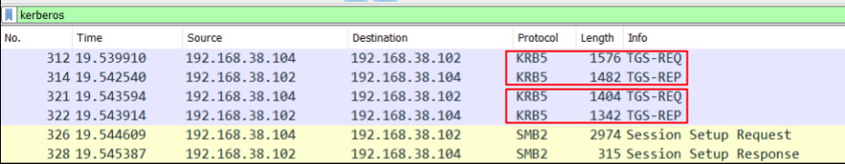
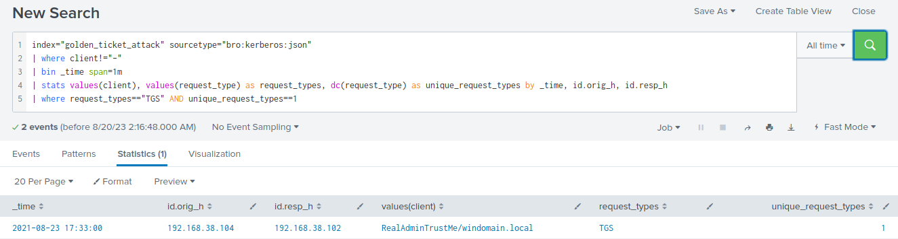

# Detecting Golden Tickets

Previously in this section, we covered `Golden Tickets`. Unfortunately, Zeek lacks the ability to trustworthily identify Golden Tickets. Therefore, we will concentrate our Splunk search on uncovering anomalies in Kerberos ticket creation.

In a Golden Ticket or Pass-the-Ticket attack, the attacker bypasses the usual Kerberos authentication process, which involves the AS-REQ and AS-REP messages.

In a typical Kerberos authentication process, a client begins by sending an AS-REQ (Authentication Service Request) message to the Key Distribution Center (KDC), specifically the Authentication Service (AS), requesting a Ticket Granting Ticket (TGT). The KDC responds with an AS-REP (Authentication Service Response) message, which includes the TGT if the client's credentials are valid. The client can then use the TGT to request service tickets (Ticket Granting Service tickets, or TGS) for specific services on the network.

- In a Golden Ticket attack, the attacker generates a forged TGT, which grants them access to any service on the network without having to authenticate with the KDC. Since the attacker has a forged TGT, they can directly request TGS tickets without going through the AS-REQ and AS-REP process.
- In a Pass-the-Ticket attack, the attacker steals a valid TGT or TGS ticket from a legitimate user (for example, by compromising their machine) and then uses that ticket to access services on the network as if they were the legitimate user. Again, since the attacker already has a valid ticket, they can bypass the AS-REQ and AS-REP process.

#### How Golden Ticket Traffic Looks Like



<div class="card bg-light">
    <div class="card-body">
				 <p class="mb-0">Let's now navigate to the bottom of this section and click on "Click here to spawn the target system!". Then, access the Splunk interface at https://[Target IP]:8000 and launch the Search & Reporting Splunk application. The vast majority of searches covered from this point up to end of this section can be replicated inside the target, offering a more comprehensive grasp of the topics presented. </p>
    </div>
</div>

<div class="card bg-light">
    <div class="card-body">
				 <p class="mb-0">Additionally, we can access the spawned target via RDP as outlined below. All files, logs, and PCAP files related to the covered attacks can be found in the /home/htb-student and /home/htb-student/module_files directories. </p>
    </div>
</div>

```shell-session
[!bash!]$ xfreerdp /u:htb-student /p:'HTB_@cademy_stdnt!' /v:[Target IP] /dynamic-resolution
```

#### Related Evidence

- **Related Directory**: `/home/htb-student/module_files/golden_ticket_attack`
- **Related Splunk Index**: `golden_ticket_attack`
- **Related Splunk Sourcetype**: `bro:kerberos:json`

---

## Detecting Golden Tickets With Splunk & Zeek Logs

Now let's explore how we can identify Golden Tickets, using Splunk and Zeek logs.

```shell-session
index="golden_ticket_attack" sourcetype="bro:kerberos:json"
| where client!="-"
| bin _time span=1m 
| stats values(client), values(request_type) as request_types, dc(request_type) as unique_request_types by _time, id.orig_h, id.resp_h
| where request_types=="TGS" AND unique_request_types==1
```



**Search Breakdown**:

- `index="golden_ticket_attack" sourcetype="bro:kerberos:json"`: This line specifies the data source the query is searching. It's looking for events in the `golden_ticket_attack` index where the `sourcetype` (data format) is `bro:kerberos:json`.
- `| where client!="-"`: This line filters out events where the `client` field is equal to `-`. This is to remove noise from the data by excluding events where the client information is not available.
- `| bin _time span=1m`: This line divides the data into `one-minute` intervals based on the `_time` field, which is the timestamp of each event. This is used to analyze patterns of activity within each one-minute window.
- `| stats values(client), values(request_type) as request_types, dc(request_type) as unique_request_types by _time, id.orig_h, id.resp_h`: This line aggregates the data by the minute, source IP address (`id.orig_h`), and destination IP address (`id.resp_h`). It calculates the following for each combination of these grouping fields:
	- `values(client)`: All the unique client values associated with the events.
	- `values(request_type) as request_types`: All the unique request types associated with the events.
	- `dc(request_type) as unique_request_types`: The distinct count of request types.
- `| where request_types=="TGS" AND unique_request_types==1`: This line filters the results to only show those where the only request type is `TGS` (Ticket Granting Service), and there's only one unique request type.
