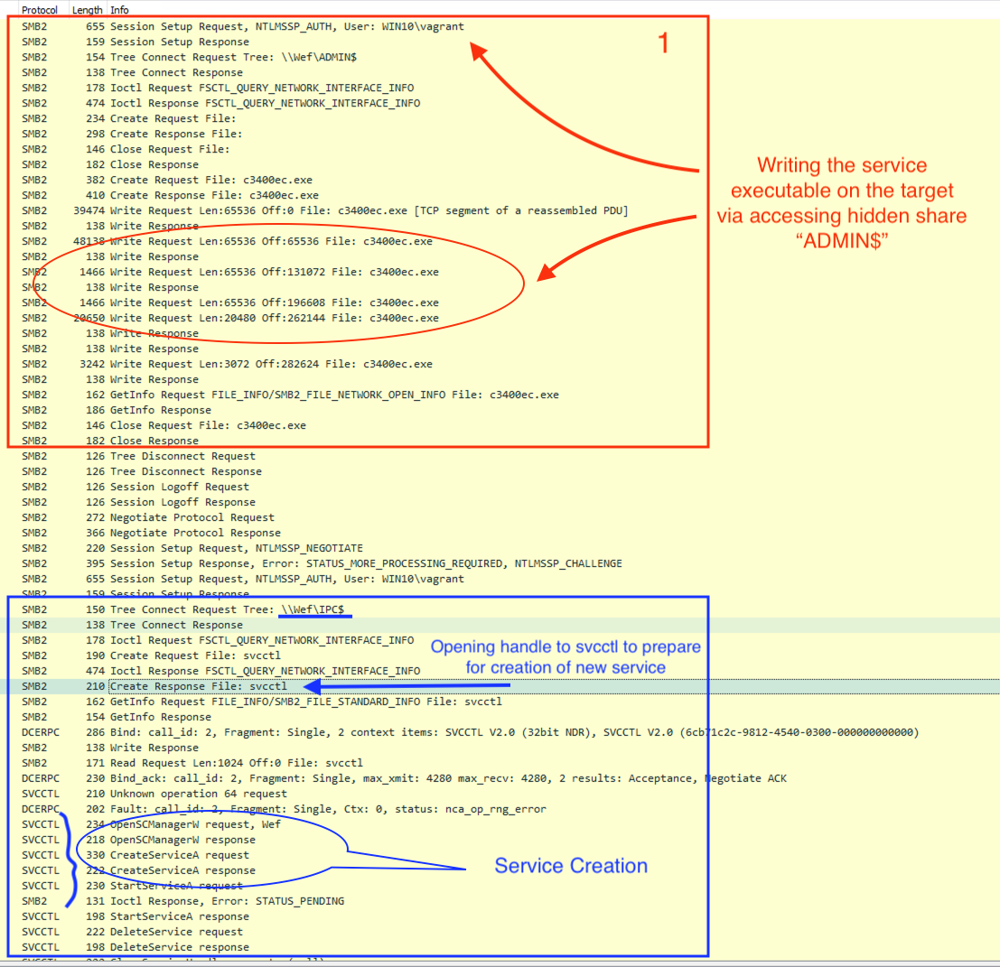
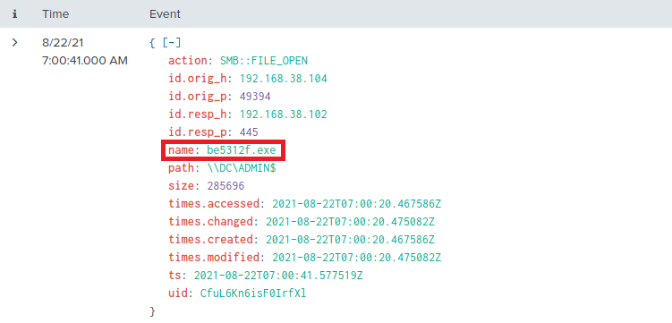

# Detecting Cobalt Strike's PSExec (Phát hiện PSExec của Cobalt Strike)

Lệnh `psexec` của Cobalt Strike là một bản hiện thực của công cụ PsExec phổ biến — một phần của bộ Sysinternals Suite của Microsoft. Đây là một công cụ nhẹ thay thế telnet, cho phép thực thi process trên các hệ thống khác. Phiên bản của Cobalt Strike được dùng để thực thi payload trên các hệ thống từ xa, như một phần của quá trình post-exploitation (hậu khai thác).

Khi lệnh `psexec` được gọi trong Cobalt Strike, các bước sau sẽ diễn ra:

- `Service Creation`: Đầu tiên, công cụ tạo một service mới trên hệ thống mục tiêu. Service này chịu trách nhiệm thực thi payload mong muốn. Service thường được tạo với tên ngẫu nhiên để tránh bị phát hiện dễ dàng.
- `File Transfer`: Sau đó Cobalt Strike chuyển payload sang hệ thống mục tiêu, thường là vào share `ADMIN$`. Việc này thường được thực hiện bằng giao thức SMB.
- `Service Execution`: Service vừa tạo sau đó được khởi động, và service này sẽ thực thi payload. Payload có thể là shellcode, một file thực thi hoặc bất kỳ loại file nào khác có thể thực thi được.
- `Service Removal`: Sau khi payload đã được thực thi, service bị dừng và bị xoá khỏi hệ thống mục tiêu để giảm thiểu dấu vết của cuộc xâm nhập.
- `Communication`: Nếu payload là một beacon hoặc một loại backdoor khác, nó thường sẽ thiết lập kết nối ngược về team server của Cobalt Strike, cho phép gửi và thực thi thêm các lệnh khác trên hệ thống bị xâm nhập.

`psexec` của Cobalt Strike hoạt động qua cổng 445 (SMB) và yêu cầu quyền local administrator trên hệ thống mục tiêu. Vì vậy, nó thường được dùng sau khi đã có initial access và đã leo thang đặc quyền (privilege escalation).

#### Traffic PSExec của Cobalt Strike trông như thế nào



**Nguồn ảnh**: [https://thedfirreport.com/2021/08/29/cobalt-strike-a-defenders-guide/](https://thedfirreport.com/2021/08/29/cobalt-strike-a-defenders-guide/)

<div class="card bg-light">
    <div class="card-body">
				 <p class="mb-0">Giờ hãy kéo xuống cuối section này và bấm vào "Click here to spawn the target system!". Sau đó, truy cập giao diện Splunk tại https://[Target IP]:8000 và mở ứng dụng Search & Reporting của Splunk. Phần lớn các tìm kiếm được trình bày từ đây cho đến cuối section này có thể được thực hiện lại bên trong target, giúp nắm vững hơn các chủ đề được trình bày. </p>
    </div>
</div>

<div class="card bg-light">
    <div class="card-body">
				 <p class="mb-0">Ngoài ra, ta có thể truy cập target đã spawn qua RDP như hướng dẫn bên dưới. Toàn bộ file, log và file PCAP liên quan đến các cuộc tấn công được đề cập có thể tìm thấy trong các thư mục /home/htb-student và /home/htb-student/module_files. </p>
    </div>
</div>

```shell-session
[!bash!]$ xfreerdp /u:htb-student /p:'HTB_@cademy_stdnt!' /v:[Target IP] /dynamic-resolution
```

#### Bằng chứng liên quan

- **Thư mục liên quan**: `/home/htb-student/module_files/cobalt_strike_psexec`
- **Splunk Index liên quan**: `cobalt_strike_psexec`
- **Splunk Sourcetype liên quan**: `bro:smb_files:json`

---

## Phát hiện PSExec của Cobalt Strike bằng Splunk & Zeek Logs

Giờ hãy cùng tìm hiểu cách nhận diện PSExec của Cobalt Strike bằng Splunk và Zeek logs.

```shell-session
index="cobalt_strike_psexec"
sourcetype="bro:smb_files:json"
action="SMB::FILE_OPEN" 
name IN ("*.exe", "*.dll", "*.bat")
path IN ("*\\c$", "*\\ADMIN$")
size>0
```


