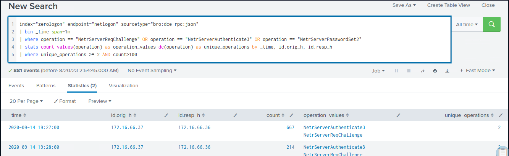

# Detecting Zerologon

The `Zerologon` vulnerability, also known as CVE-2020-1472, is a critical flaw in the implementation of the Netlogon Remote Protocol, specifically in the cryptographic algorithm used by the protocol. The vulnerability can be exploited by an attacker to impersonate any computer, including the domain controller, and execute remote procedure calls on their behalf. Let's dive into the technical details of this flaw.

At the heart of Zerologon is the cryptographic issue in the way Microsoft's Netlogon Remote Protocol authenticates users and machines in a Windows domain. When a client wants to authenticate against the domain controller, it uses a protocol called MS-NRPC, a part of Netlogon, to establish a secure channel.

During this process, the client and the server generate a session key, which is computed from the machine account's password. This key is then used to derive an initialization vector (IV) for the AES-CFB8 encryption mode. In a secure configuration, the IV should be unique and random for each encryption operation. However, due to the flawed implementation in the Netlogon protocol, the IV is set to a fixed value of all zeros.

The attacker can exploit this cryptographic weakness by attempting to authenticate against the domain controller using a session key consisting of all zeros, effectively bypassing the authentication process. This allows the attacker to establish a secure channel with the domain controller without knowing the machine account's password.

Once this channel is established, the attacker can utilize the NetrServerPasswordSet2 function to change the computer account's password to any value, including a blank password. This effectively gives the attacker full control over the domain controller and, by extension, the entire Active Directory domain.

The Zerologon vulnerability is particularly dangerous due to its simplicity and the level of access it provides to attackers. Exploiting this flaw requires only a few Netlogon messages, and it can be executed within seconds.

#### How Zerologon Looks Like From A Network Perspective


**Image Source**: [https://www.trendmicro.com/en_us/what-is/zerologon.html](https://www.trendmicro.com/en_us/what-is/zerologon.html)

<div class="card bg-light">
    <div class="card-body">
				 <p class="mb-0">Let's now navigate to the bottom of this section and click on "Click here to spawn the target system!". Then, access the Splunk interface at https://[Target IP]:8000 and launch the Search & Reporting Splunk application. The vast majority of searches covered from this point up to end of this section can be replicated inside the target, offering a more comprehensive grasp of the topics presented. </p>
    </div>
</div>

<div class="card bg-light">
    <div class="card-body">
				 <p class="mb-0">Additionally, we can access the spawned target via RDP as outlined below. All files, logs, and PCAP files related to the covered attacks can be found in the /home/htb-student and /home/htb-student/module_files directories. </p>
    </div>
</div>

```shell-session
[!bash!]$ xfreerdp /u:htb-student /p:'HTB_@cademy_stdnt!' /v:[Target IP] /dynamic-resolution
```

#### Related Evidence

- **Related Directory**: `/home/htb-student/module_files/zerologon`
- **Related Splunk Index**: `zerologon`
- **Related Splunk Sourcetype**: `bro:dce_rpc:json`

---

## Detecting Zerologon With Splunk & Zeek Logs

Now let's explore how we can identify Zerologon, using Splunk and Zeek logs.

```shell-session
index="zerologon" endpoint="netlogon" sourcetype="bro:dce_rpc:json"
| bin _time span=1m
| where operation == "NetrServerReqChallenge" OR operation == "NetrServerAuthenticate3" OR operation == "NetrServerPasswordSet2"
| stats count values(operation) as operation_values dc(operation) as unique_operations by _time, id.orig_h, id.resp_h
| where unique_operations >= 2 AND count>100
```


