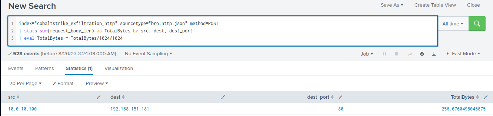

# Detecting Exfiltration (HTTP) (Phát hiện exfiltration qua HTTP)

`Data exfiltration` (tuồn dữ liệu ra ngoài) trong phần body của POST là một kỹ thuật mà kẻ tấn công dùng để trích xuất thông tin nhạy cảm từ một hệ thống bị xâm nhập bằng cách ngụy trang nó thành traffic web hợp lệ. Kỹ thuật này truyền dữ liệu đánh cắp được từ hệ thống bị xâm nhập tới một server bên ngoài do kẻ tấn công kiểm soát bằng các HTTP POST request. Vì POST request thường được dùng cho các mục đích hợp lệ như gửi form và upload file, phương pháp exfiltration này có thể khó phát hiện. 

Để exfiltrate dữ liệu, kẻ tấn công gửi nó dưới dạng body của một HTTP POST request tới server command and control (C2) của chúng. Chúng thường dùng các URL và header trông có vẻ vô hại để ngụy trang thêm cho traffic độc hại. C2 server nhận POST request, trích xuất dữ liệu từ body, rồi decode hoặc giải mã nó để phân tích và khai thác tiếp.

Để phát hiện data exfiltration qua POST body, ta có thể dùng các công cụ giám sát và phân tích mạng để tổng hợp toàn bộ dữ liệu được gửi tới các địa chỉ IP và cổng cụ thể. Bằng cách phân tích dữ liệu đã tổng hợp, ta có thể nhận ra các mẫu (pattern) và bất thường (anomaly) có thể là dấu hiệu của các nỗ lực exfiltration.

Trong section này, ta sẽ giám sát khối lượng traffic đi ra từ mạng của mình tới các địa chỉ IP và cổng cụ thể. Nếu quan sát thấy các lần truyền dữ liệu lớn hoặc dày đặc bất thường tới một đích cụ thể, đó có thể là dấu hiệu của data exfiltration.

<div class="card bg-light">
    <div class="card-body">
				 <p class="mb-0">Giờ hãy kéo xuống cuối section này và bấm vào "Click here to spawn the target system!". Sau đó, truy cập giao diện Splunk tại https://[Target IP]:8000 và mở ứng dụng Search & Reporting của Splunk. Phần lớn các tìm kiếm được trình bày từ đây cho đến cuối section này có thể được thực hiện lại bên trong target, giúp nắm vững hơn các chủ đề được trình bày. </p>
    </div>
</div>

<div class="card bg-light">
    <div class="card-body">
				 <p class="mb-0">Ngoài ra, ta có thể truy cập target đã spawn qua RDP như hướng dẫn bên dưới. Toàn bộ file, log và file PCAP liên quan đến các cuộc tấn công được đề cập có thể tìm thấy trong các thư mục /home/htb-student và /home/htb-student/module_files. </p>
    </div>
</div>

```shell-session
[!bash!]$ xfreerdp /u:htb-student /p:'HTB_@cademy_stdnt!' /v:[Target IP] /dynamic-resolution
```

#### Bằng chứng liên quan

- **Thư mục liên quan**: `/home/htb-student/module_files/cobaltstrike_exfiltration_http`
- **Splunk Index liên quan**: `cobaltstrike_exfiltration_http`
- **Splunk Sourcetype liên quan**: `bro:http:json`

---

## Phát hiện HTTP Exfiltration bằng Splunk & Zeek Logs

Giờ hãy cùng tìm hiểu cách nhận diện HTTP exfiltration bằng Splunk và Zeek logs.

```shell-session
index="cobaltstrike_exfiltration_http" sourcetype="bro:http:json" method=POST
| stats sum(request_body_len) as TotalBytes by src, dest, dest_port
| eval TotalBytes = TotalBytes/1024/1024
```


