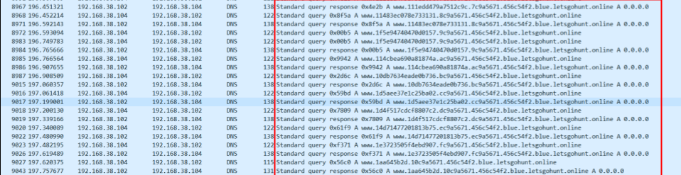
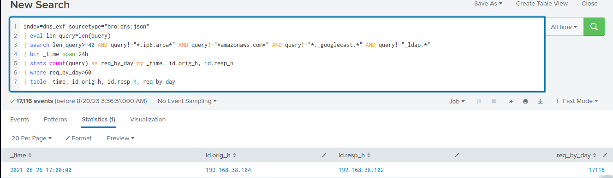

# Detecting Exfiltration (DNS) (Phát hiện exfiltration qua DNS)

Kẻ tấn công dùng `DNS-based exfiltration` (exfiltration dựa trên DNS) vì tính tin cậy, tính lén lút, và vì traffic DNS thường được cho phép mặc định trong các rule tường lửa mạng. Bằng cách nhúng dữ liệu vào trong DNS query và response, kẻ tấn công có thể vượt qua các biện pháp kiểm soát bảo mật và exfiltrate dữ liệu một cách kín đáo. Dưới đây là giải thích chi tiết về kỹ thuật này và các phương pháp phát hiện:

#### DNS Exfiltration hoạt động như thế nào:

- `Initial Compromise`: Kẻ tấn công giành được quyền truy cập vào mạng của nạn nhân, thường qua malware, phishing hoặc khai thác lỗ hổng.
- `Data Identification and Preparation`: Kẻ tấn công xác định vị trí dữ liệu muốn exfiltrate và chuẩn bị để truyền đi. Việc này thường bao gồm encode hoặc mã hoá dữ liệu và chia nó thành các phần (chunk) nhỏ.
- `Exfiltration via DNS`: Kẻ tấn công gửi dữ liệu trong các subdomain của DNS query, sử dụng các kỹ thuật như DNS tunneling hoặc fast flux. Chúng thường dùng một domain do chúng kiểm soát hoặc một domain đã bị chiếm quyền cho mục đích này. DNS server của kẻ tấn công nhận các query, trích xuất dữ liệu và ghép nó lại.
- `Data Retrieval and Analysis`: Sau khi exfiltrate, kẻ tấn công decode hoặc giải mã dữ liệu và phân tích nó.

#### Traffic DNS Exfiltration trông như thế nào



<div class="card bg-light">
    <div class="card-body">
				 <p class="mb-0">Giờ hãy kéo xuống cuối section này và bấm vào "Click here to spawn the target system!". Sau đó, truy cập giao diện Splunk tại https://[Target IP]:8000 và mở ứng dụng Search & Reporting của Splunk. Phần lớn các tìm kiếm được trình bày từ đây cho đến cuối section này có thể được thực hiện lại bên trong target, giúp nắm vững hơn các chủ đề được trình bày. </p>
    </div>
</div>

<div class="card bg-light">
    <div class="card-body">
				 <p class="mb-0">Ngoài ra, ta có thể truy cập target đã spawn qua RDP như hướng dẫn bên dưới. Toàn bộ file, log và file PCAP liên quan đến các cuộc tấn công được đề cập có thể tìm thấy trong các thư mục /home/htb-student và /home/htb-student/module_files. </p>
    </div>
</div>

```shell-session
[!bash!]$ xfreerdp /u:htb-student /p:'HTB_@cademy_stdnt!' /v:[Target IP] /dynamic-resolution
```

#### Bằng chứng liên quan

- **Thư mục liên quan**: `/home/htb-student/module_files/dns_exf`
- **Splunk Index liên quan**: `dns_exf`
- **Splunk Sourcetype liên quan**: `bro:dns:json`

---

## Phát hiện DNS Exfiltration bằng Splunk & Zeek Logs

Giờ hãy cùng tìm hiểu cách nhận diện DNS exfiltration bằng Splunk và Zeek logs.

```shell-session
index=dns_exf sourcetype="bro:dns:json"
| eval len_query=len(query)
| search len_query>=40 AND query!="*.ip6.arpa*" AND query!="*amazonaws.com*" AND query!="*._googlecast.*" AND query!="_ldap.*"
| bin _time span=24h
| stats count(query) as req_by_day by _time, id.orig_h, id.resp_h
| where req_by_day>60
| table _time, id.orig_h, id.resp_h, req_by_day
```


