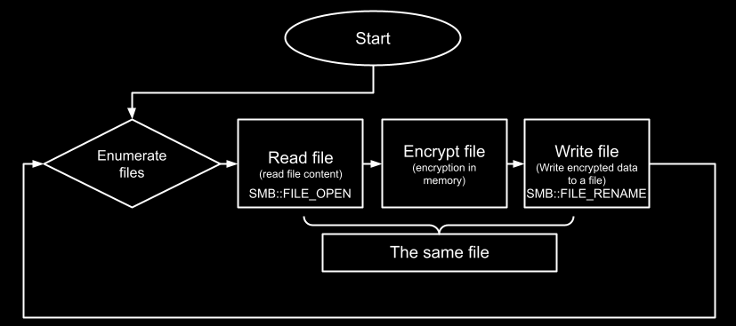
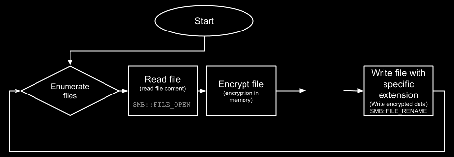
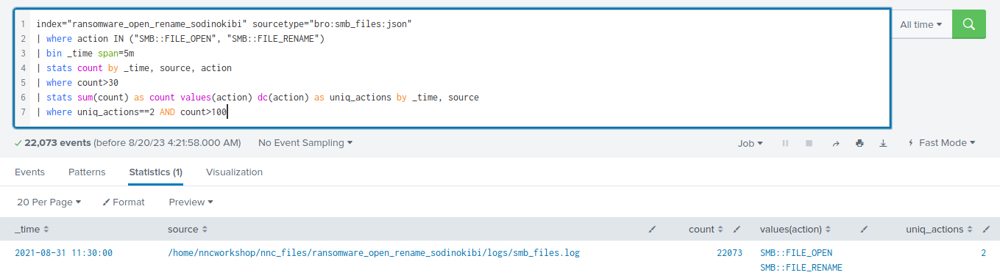
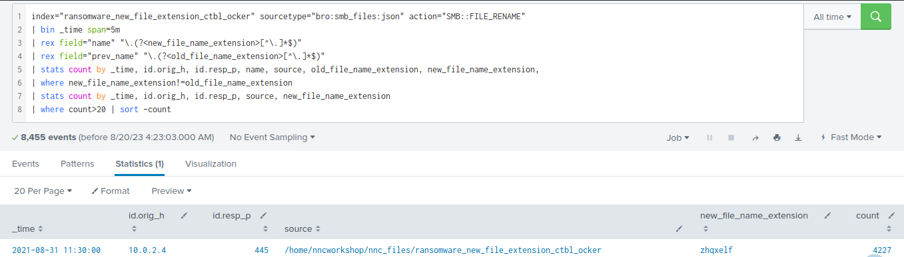

# Detecting Ransomware

`Ransomware` leverage an array of techniques to accomplish their goals. In the following analysis, we'll explore two of these methods, examining their inner workings and explaining how to detect them through network monitoring efforts.

1. `File Overwrite Approach`: Ransomware employs this tactic by accessing files through the SMB protocol, encrypting them, and then directly overwriting the original files with their encrypted versions (again through the SMB protocol). The malicious actors behind ransomware prefer this method for its efficiency, as it requires fewer actions and leaves less trace of their activity. To detect this approach, security teams should look for excessive file overwrite operations on the system.
	

2. `File Renaming Approach`: In this approach, ransomware actors use the SMB protocol to read files, they then encrypt them and they finally rename the encrypted files by appending a unique extension (again through the SMB protocol), often indicative of the ransomware strain. The renaming signals that the files have been held hostage, making it easier for analysts and administrators to recognize an attack. Detection involves monitoring for an unusual number of files being renamed with the same extension, particularly those associated with known ransomware variants.
	

<div class="card bg-light">
    <div class="card-body">
				 <p class="mb-0">Let's now navigate to the bottom of this section and click on "Click here to spawn the target system!". Then, access the Splunk interface at https://[Target IP]:8000 and launch the Search & Reporting Splunk application. The vast majority of searches covered from this point up to end of this section can be replicated inside the target, offering a more comprehensive grasp of the topics presented. </p>
    </div>
</div>

<div class="card bg-light">
    <div class="card-body">
				 <p class="mb-0">Additionally, we can access the spawned target via RDP as outlined below. All files, logs, and PCAP files related to the covered attacks can be found in the /home/htb-student and /home/htb-student/module_files directories. </p>
    </div>
</div>

```shell-session
[!bash!]$ xfreerdp /u:htb-student /p:'HTB_@cademy_stdnt!' /v:[Target IP] /dynamic-resolution
```

#### Related Evidence

- **Related Directory**: `/home/htb-student/module_files/ransomware_open_rename_sodinokibi`
- **Related Splunk Index**: `ransomware_open_rename_sodinokibi`
- **Related Splunk Sourcetype**: `bro:smb_files:json`

---

- **Related Directory**: `/home/htb-student/module_files/ransomware_new_file_extension_ctbl_ocker`
- **Related Splunk Index**: `ransomware_new_file_extension_ctbl_ocker`
- **Related Splunk Sourcetype**: `bro:smb_files:json`

---

## Detecting Ransomware With Splunk & Zeek Logs (Excessive Overwriting)

Now let's explore how we can identify ransomware, using Splunk and Zeek logs.

```shell-session
index="ransomware_open_rename_sodinokibi" sourcetype="bro:smb_files:json" 
| where action IN ("SMB::FILE_OPEN", "SMB::FILE_RENAME")
| bin _time span=5m
| stats count by _time, source, action
| where count>30 
| stats sum(count) as count values(action) dc(action) as uniq_actions by _time, source
| where uniq_actions==2 AND count>100
```



---

## Detecting Ransomware With Splunk & Zeek Logs (Excessive Renaming With The Same Extension)

Now let's explore how we can identify ransomware, using Splunk and Zeek logs.

```shell-session
index="ransomware_new_file_extension_ctbl_ocker" sourcetype="bro:smb_files:json" action="SMB::FILE_RENAME" 
| bin _time span=5m
| rex field="name" "\.(?<new_file_name_extension>[^\.]*$)"
| rex field="prev_name" "\.(?<old_file_name_extension>[^\.]*$)"
| stats count by _time, id.orig_h, id.resp_p, name, source, old_file_name_extension, new_file_name_extension,
| where new_file_name_extension!=old_file_name_extension
| stats count by _time, id.orig_h, id.resp_p, source, new_file_name_extension
| where count>20
| sort -count
```



**Search Breakdown**:

- `index="ransomware_new_file_extension_ctbl_ocker" sourcetype="bro:smb_files:json" action="SMB::FILE_RENAME"`: This line filters the events based on the index `ransomware_new_file_extension_ctbl_ocker`, a specific sourcetype `bro:smb_files:json`, and the action `SMB::FILE_RENAME`. This effectively narrows the search to SMB file rename actions in the specified index.
- `| bin _time span=5m`: This line groups the events into `5`-minute time bins.
- `| rex field="name" "\.(?<new_file_name_extension>[^\.]*$)"`: This line uses the regular expression (regex) to extract the file extension from the `name` field and assigns it to the new field `new_file_name_extension`.
- `| rex field="prev_name" "\.(?<old_file_name_extension>[^\.]*$)"`: Similarly, this line extracts the file extension from the `prev_name` field and assigns it to the new field `old_file_name_extension`.
- `| stats count by _time, id.orig_h, id.resp_p, name, source, old_file_name_extension, new_file_name_extension`: This line aggregates the events and counts the occurrences based on several fields, including time, originating host, responding port, file name, source, old file extension, and new file extension.
- `| where new_file_name_extension!=old_file_name_extension`: This line filters out events where the new file extension is the same as the old file extension.
- `| stats count by _time, id.orig_h, id.resp_p, source, new_file_name_extension`: This line counts the remaining events by time, originating host, responding port, source, and new file extension.
- `| where count>20`: This line filters out any results with fewer than `21` file renames within a `5`-minute time bin.
- `| sort -count`: This line sorts the results in descending order based on the count of file renames.

---

**Note**: Known ransomware-related extensions can be found in the resources below.

- [https://docs.google.com/spreadsheets/d/e/2PACX-1vRCVzG9JCzak3hNqqrVCTQQIzH0ty77BWiLEbDu-q9oxkhAamqnlYgtQ4gF85pF6j6g3GmQxivuvO1U/pubhtml](https://docs.google.com/spreadsheets/d/e/2PACX-1vRCVzG9JCzak3hNqqrVCTQQIzH0ty77BWiLEbDu-q9oxkhAamqnlYgtQ4gF85pF6j6g3GmQxivuvO1U/pubhtml)
- [https://github.com/corelight/detect-ransomware-filenames](https://github.com/corelight/detect-ransomware-filenames)
- [https://fsrm.experiant.ca/](https://fsrm.experiant.ca/)
