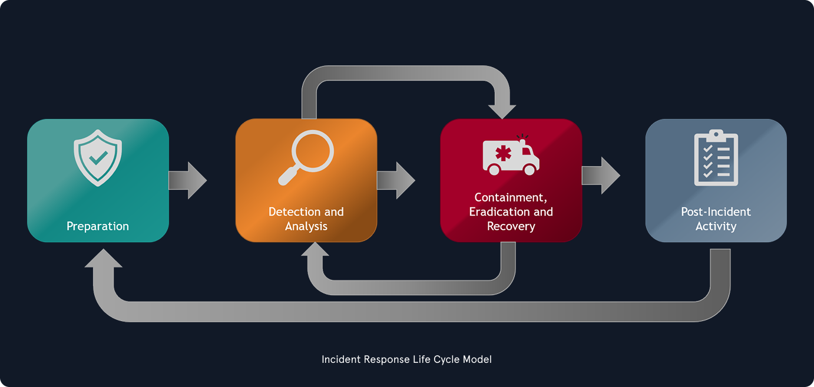
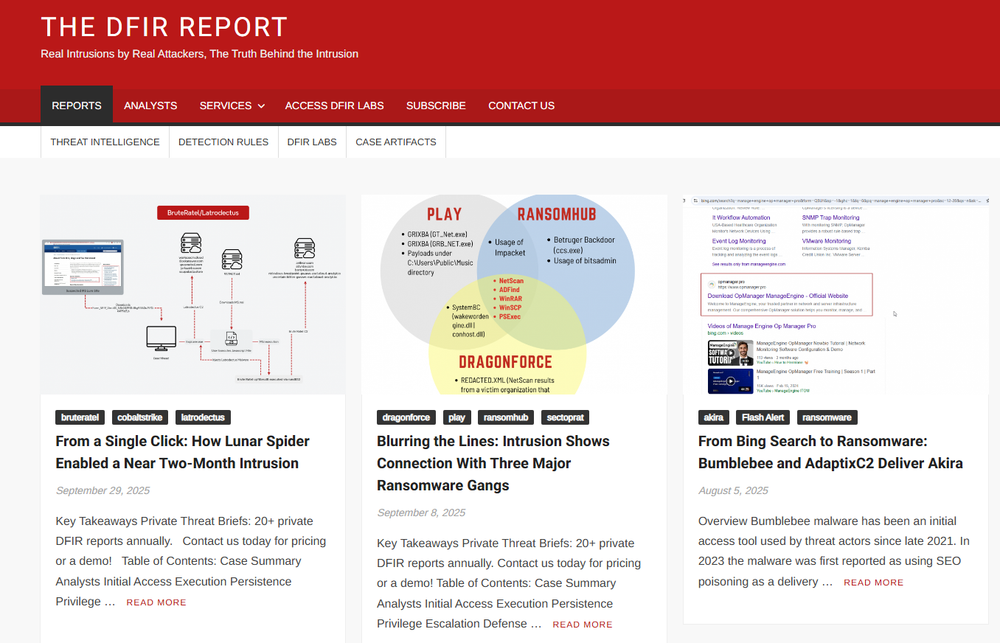

# Incident Handling (Xử lý sự cố)

## Định nghĩa & phạm vi của Incident Handling

**Incident handling** (IH – xử lý sự cố) đã trở thành một phần quan trọng trong năng lực phòng thủ của tổ chức trước tội phạm mạng. Dù các biện pháp bảo vệ liên tục được triển khai để ngăn chặn hoặc giảm số lượng sự cố bảo mật, năng lực xử lý sự cố vẫn là điều không thể thiếu với bất kỳ tổ chức nào không thể chấp nhận việc tính bảo mật (confidentiality), toàn vẹn (integrity) hoặc sẵn sàng (availability) của dữ liệu bị xâm phạm. Có tổ chức tự xây dựng năng lực này trong nội bộ, có tổ chức lại dựa vào nhà cung cấp bên thứ ba hỗ trợ — thường xuyên hoặc khi cần. Trước khi đi sâu vào thế giới sự cố bảo mật, hãy định nghĩa một số thuật ngữ và thống nhất cách hiểu về chúng.

Một `event` (sự kiện) là một hành động xảy ra trong hệ thống hoặc mạng. Ví dụ về event:

- Một người dùng gửi email.
- Một cú click chuột.
- Firewall cho phép một yêu cầu kết nối.

Một `incident` (sự cố) là một event gây ra hậu quả tiêu cực. Ví dụ: hệ thống bị sập (crash), hoặc truy cập trái phép vào dữ liệu nhạy cảm. Incident cũng có thể xảy ra do thiên tai, mất điện, v.v.

Không có một định nghĩa duy nhất về IT security incident (sự cố an ninh CNTT), vì vậy mỗi tổ chức định nghĩa một khác. Ở đây, IT security incident được định nghĩa là một event có chủ đích rõ ràng gây hại, được thực hiện nhắm vào một hệ thống máy tính. Ví dụ về incident:

- Đánh cắp dữ liệu.
- Đánh cắp tiền.
- Truy cập trái phép vào dữ liệu.
- Cài đặt và sử dụng malware và công cụ truy cập từ xa (remote access tools).

`Incident handling` là một tập hợp quy trình được xác định rõ ràng để quản lý và phản ứng với các sự cố bảo mật trong môi trường máy tính hoặc mạng.

Cần lưu ý rằng incident handling không chỉ giới hạn ở các sự cố xâm nhập (intrusion).

Các loại sự cố khác — như do người trong nội bộ có ý đồ xấu (malicious insider), sự cố về tính sẵn sàng (availability), hay mất tài sản trí tuệ — cũng thuộc phạm vi của incident handling. Một kế hoạch xử lý sự cố toàn diện cần bao quát nhiều loại sự cố và đưa ra biện pháp phù hợp để nhận diện (identify), ngăn chặn (contain), loại bỏ (eradicate) và khôi phục (recover), nhằm đưa hoạt động kinh doanh trở lại bình thường nhanh và hiệu quả nhất có thể.

Hãy nhớ rằng có thể chưa xác định ngay được một event có phải là incident hay không cho tới khi thực hiện điều tra ban đầu (initial investigation). Dù vậy, có một số event đáng ngờ nên được xem là incident cho tới khi chứng minh được điều ngược lại.

## Giá trị của Incident Handling & các lưu ý chung

Sự cố an ninh CNTT thường liên quan tới việc dữ liệu cá nhân và dữ liệu doanh nghiệp bị xâm phạm, vì vậy phản ứng nhanh và hiệu quả là điều sống còn. Có sự cố chỉ ảnh hưởng vài thiết bị, có sự cố khiến phần lớn môi trường bị xâm nhập. Lợi ích lớn khi có một đội xử lý sự cố (thường gọi là "incident response team") xử lý các event là đội ngũ được đào tạo sẽ phản ứng một cách có hệ thống, nhờ đó các hành động phù hợp sẽ được thực hiện. Thực tế, mục tiêu của các đội này là giảm thiểu việc thông tin bị đánh cắp hoặc dịch vụ bị gián đoạn do sự cố gây ra. Điều đó đạt được thông qua điều tra và các bước khắc phục (remediation), sẽ được bàn kỹ hơn ở phần sau. Nhìn chung, các quyết định đưa ra trước, trong và sau sự cố đều ảnh hưởng tới mức độ tác động của nó.

Vì mỗi sự cố có mức tác động khác nhau lên tổ chức, ta cần hiểu tầm quan trọng của việc ưu tiên hoá (prioritization). Sự cố có mức độ nghiêm trọng (severity) cao hơn cần được chú ý và phân bổ nguồn lực ngay lập tức, trong khi các sự cố được đánh giá thấp hơn vẫn có thể cần điều tra ban đầu để xác định đó có thực sự là sự cố an ninh CNTT hay không.

Đội xử lý sự cố do một **incident manager** dẫn dắt. Vai trò này thường được giao cho SOC manager, CISO/CIO, hoặc một nhà cung cấp bên thứ ba (đáng tin cậy), và người này thường có quyền điều phối cả các bộ phận kinh doanh khác. Incident manager phải lấy được thông tin, hoặc có thẩm quyền yêu cầu bất kỳ nhân viên nào trong tổ chức thực hiện một việc kịp thời khi cần. Incident manager là đầu mối liên lạc duy nhất (single point of communication), theo dõi các hoạt động đã thực hiện trong quá trình điều tra và trạng thái hoàn thành của chúng.

Một trong những tài liệu được dùng rộng rãi nhất về incident handling là [Computer Security Incident Handling Guide của NIST](https://www.nist.gov/publications/computer-security-incident-handling-guide). Tài liệu này nhằm giúp tổ chức giảm thiểu rủi ro từ các sự cố an ninh máy tính bằng cách đưa ra hướng dẫn thực tế để phản ứng với sự cố một cách hiệu quả.

## Các loại sự cố trong thực tế

### Lộ thông tin đăng nhập (Leaked Credentials)

- **Vụ ransomware Colonial Pipeline:** Colonial Pipeline, một hệ thống đường ống dẫn dầu lớn của Mỹ, đã trở thành nạn nhân của một cuộc tấn công ransomware. Cuộc tấn công bắt nguồn từ mật khẩu cá nhân bị lộ của một nhân viên, nhiều khả năng được tìm thấy trên dark web, chứ không phải tấn công trực tiếp vào mạng của công ty. Kẻ tấn công truy cập hệ thống bằng mật khẩu bị lộ của một tài khoản VPN (Virtual Private Network) không còn sử dụng và không bật xác thực đa yếu tố (MFA).

### Thông tin đăng nhập mặc định / yếu (Default / Weak Credentials)

- **Mirai Botnet (2016):** Mirai quét các thiết bị IoT dùng thông tin đăng nhập mặc định của nhà sản xuất (vd: `admin/admin`) và biến chúng thành một botnet DDoS khổng lồ. Hậu quả là các đợt DDoS quy mô lớn ảnh hưởng tới các công ty như Dyn và OVH, với hàng trăm nghìn thiết bị bị lây nhiễm. Nguyên nhân gốc là thiết bị được xuất xưởng với thông tin đăng nhập mặc định không được đổi và bảo mật truy cập từ xa kém.
- **Sự cố LogicMonitor (2023):** Một số khách hàng của LogicMonitor bị xâm nhập vì nhà cung cấp cấp mật khẩu mặc định yếu cho tài khoản khách hàng. Các khách hàng bị ảnh hưởng sau đó gặp ransomware hoặc bị truy cập trái phép. Nguyên nhân gốc là thông tin đăng nhập yếu/mặc định do nhà cung cấp cấp và việc chậm bắt buộc tăng cường độ mạnh mật khẩu.

### Phần mềm lỗi thời / hệ thống chưa vá (Outdated Software / Unpatched Systems)

- **Vụ rò rỉ Equifax (2017):** Kẻ tấn công khai thác một lỗ hổng đã biết của Apache Struts (`CVE-2017-5638`) trong ứng dụng web của Equifax. Vụ việc làm lộ dữ liệu cá nhân của khoảng 143–147 triệu người, kéo theo hậu quả lớn về pháp lý và quản lý. Nguyên nhân là không áp dụng kịp thời bản vá đã được công bố.
- **WannaCry (2017):** Ransomware WannaCry lây lan như một con worm nhờ exploit SMB EternalBlue, ảnh hưởng hơn 200.000 hệ thống tại hơn 150 quốc gia, trong đó có các bệnh viện và doanh nghiệp lớn. Nguyên nhân là các hệ thống Windows chưa được vá, dù bản vá `MS17-010` đã có trước khi dịch bùng phát.

### Nhân viên phản bội / mối đe doạ nội bộ (Rogue Employee / Insider Threat)

- **Cash App / Block Inc. (công bố 2021; thông báo công khai 2022):** Một cựu nhân viên đã truy cập thông tin cá nhân của hàng triệu người dùng Cash App, theo công bố của công ty. Khoảng 8,2 triệu khách hàng hiện tại và cũ có thể bị ảnh hưởng, dẫn tới sự giám sát của cơ quan quản lý và các khoản dàn xếp. Nguyên nhân gốc là lạm dụng quyền truy cập hợp lệ của nhân viên cùng với kiểm soát và giám sát nội bộ không đầy đủ.

### Phishing / Social Engineering

- **Xu hướng ngành & số liệu tiêu biểu:** Phishing là vector phổ biến để lấy thông tin đăng nhập, phát tán malware hoặc lừa người dùng bật truy cập từ xa. Nó thường dẫn tới chiếm đoạt tài khoản, gian lận và tạo chỗ đứng (foothold) trong mạng. Một phần đáng kể các vụ rò rỉ qua nhiều năm có liên quan tới phishing.
- **Vụ phishing tại Bộ Nội vụ Mỹ (U.S. Interior Department):** Kẻ tấn công dùng kỹ thuật "evil twin" để lừa người dùng kết nối vào mạng Wi-Fi giả, từ đó đánh cắp thông tin đăng nhập và truy cập vào mạng. Sự cố cho thấy hạ tầng mạng không dây thiếu an toàn và các biện pháp bảo mật chưa đủ, bao gồm xác thực người dùng yếu và kiểm thử mạng không đầy đủ.
- **Vụ chiếm tài khoản Twitter năm 2020:** Năm 2020, nhiều tài khoản Twitter nổi tiếng bị bên ngoài chiếm quyền để quảng bá một vụ lừa đảo bitcoin. Kẻ tấn công truy cập được công cụ quản trị của Twitter, cho phép chỉnh sửa tài khoản và đăng tweet trực tiếp. Có vẻ chúng đã dùng social engineering nhắm vào nhân viên Twitter để có quyền truy cập các công cụ này.

### Tấn công chuỗi cung ứng (Supply-Chain Attack)

- **SolarWinds Orion (2020):** Các nhóm tấn công cấp quốc gia (nation-state) xâm nhập môi trường build/release của SolarWinds và chèn backdoor độc hại vào các bản cập nhật Orion, được phân phối tới hàng nghìn khách hàng. Hậu quả là hoạt động gián điệp và truy cập trái phép trên diện rộng ở cả khu vực nhà nước lẫn tư nhân, với quá trình phát hiện và khắc phục kéo dài.

## Ví dụ về báo cáo sự cố (Incident Report)

Chúng ta cần có khả năng ghi lại một sự cố bảo mật thực tế theo trình tự, từng giai đoạn một, bám theo các framework như Cyber Kill Chain (giải thích ở section sau) và MITRE ATT&CK (tức là đi từ initial access tới impact) — giống như các báo cáo chuyên nghiệp của Mandiant, Palo Alto Unit 42, Proofpoint, v.v.

Một ví dụ về báo cáo sự cố của DFIR Labs:

- [Confluence Exploit Leads to LockBit Ransomware](https://thedfirreport.com/2025/02/24/confluence-exploit-leads-to-lockbit-ransomware/)

Báo cáo này ghi lại các phát hiện theo trình tự. Mỗi phần tương ứng với một giai đoạn riêng trong hoạt động của kẻ tấn công, tức là từ Initial Access và Execution cho tới Exfiltration và Impact. Qua đó thấy được cuộc tấn công đã lan rộng trong môi trường như thế nào.

Nền tảng DFIR Labs còn nhiều báo cáo sự cố khác, bạn có thể xem [tại đây](https://thedfirreport.com/).

Một ví dụ khác là báo cáo sự cố của Cybereason:

- [CHAES: Novel Malware Targeting Latin American E-Commerce](https://www.cybereason.com/blog/chaes-novel-malware-targeting-latin-american-e-commerce)

Đây là các báo cáo theo từng sự cố (incident-specific), tập trung vào một event hoặc một đợt bùng phát cụ thể. Ví dụ, báo cáo kiểu "Confluence Exploit Leads to LockBit Ransomware" đi từng bước qua những gì đã xảy ra trong cuộc tấn công đó: kẻ tấn công vào bằng cách nào, đã làm gì, bị phát hiện ra sao, tác động là gì, v.v. Mục tiêu là đưa ra một câu chuyện forensic chi tiết và các phát hiện có thể hành động được, riêng cho sự cố đó.

Ngoài ra còn có các báo cáo incident response toàn cầu (như báo cáo Unit 42 năm 2025), tổng hợp dữ liệu từ hàng trăm sự cố thuộc nhiều ngành, khu vực và nhóm tấn công khác nhau. Mục tiêu của chúng là xác định xu hướng, khuôn mẫu, các mối đe doạ mới nổi, đồng thời đưa ra số liệu thống kê và khuyến nghị tổng quát cho bên phòng thủ.

Ví dụ, báo cáo Unit 42 năm 2025 nêu:

> "Năm 2024, 86% sự cố mà Unit 42 phản ứng có liên quan tới gián đoạn kinh doanh — gồm ngừng hoạt động, tổn hại danh tiếng, hoặc cả hai."
>
> Ngoài ra, "Các cuộc tấn công vào chuỗi cung ứng phần mềm và cloud đang tăng cả về tần suất lẫn mức độ tinh vi. Trong một chiến dịch, kẻ tấn công đã quét hơn 230 triệu mục tiêu riêng biệt để tìm thông tin nhạy cảm."

Báo cáo của Palo Alto Unit 42 về các sự cố trên toàn cầu:

- [Global Incident Response Report](https://www.paloaltonetworks.com/resources/research/unit-42-incident-response-report-2025)

## Kịch bản sự cố (Incident Scenario)

Xuyên suốt module này, chúng ta sẽ dùng một kịch bản sự cố để hiểu những thách thức mà người xử lý sự cố gặp phải. Sự cố này là ví dụ cho các khuôn mẫu lặp đi lặp lại trong thực tế. Nạn nhân trong kịch bản là `Insight Nexus`, một công ty nghiên cứu thị trường toàn cầu, nắm giữ dữ liệu cạnh tranh nhạy cảm của các khách hàng lớn trong ngành IT. Công ty trở thành mục tiêu của hai nhóm tấn công khác nhau, cùng hoạt động song song trong môi trường của họ.

Sơ đồ dưới đây cho thấy tổng quan về nạn nhân và các nhóm tấn công.

Dựa trên thông tin thu thập được, nhóm tấn công thứ nhất xâm nhập được do quản trị viên hệ thống quên đổi mật khẩu mặc định `admin/admin` trên một ứng dụng public ra Internet là ManageEngine ADManager Plus, sau một lần cập nhật sản phẩm. Lợi dụng điều này, kẻ tấn công đăng nhập thành công, thực hiện trinh sát (reconnaissance), lập bản đồ người dùng và máy tính, rồi tạo các tài khoản Active Directory mới có đặc quyền. Dùng một trong các tài khoản mới tạo, chúng pivot sâu hơn vào môi trường và phát hiện một dịch vụ RDP bị public ra ngoài do cấu hình sai. Khai thác điểm vào đó, chúng mở rộng quyền kiểm soát và cuối cùng dùng Group Policy Objects (GPO) để triển khai spyware bằng gói MSI lên nhiều endpoint.

Ở section tiếp theo, chúng ta sẽ tìm hiểu hai framework Cyber Kill Chain và MITRE ATT&CK. Các giai đoạn trong những framework này phản ánh vòng đời của kẻ tấn công và các hành động có thể quan sát được ở mỗi giai đoạn.
