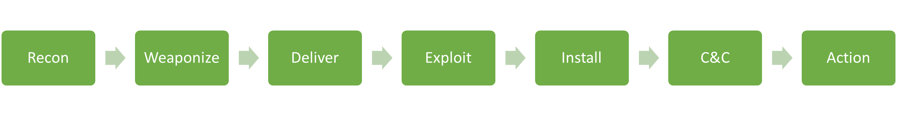
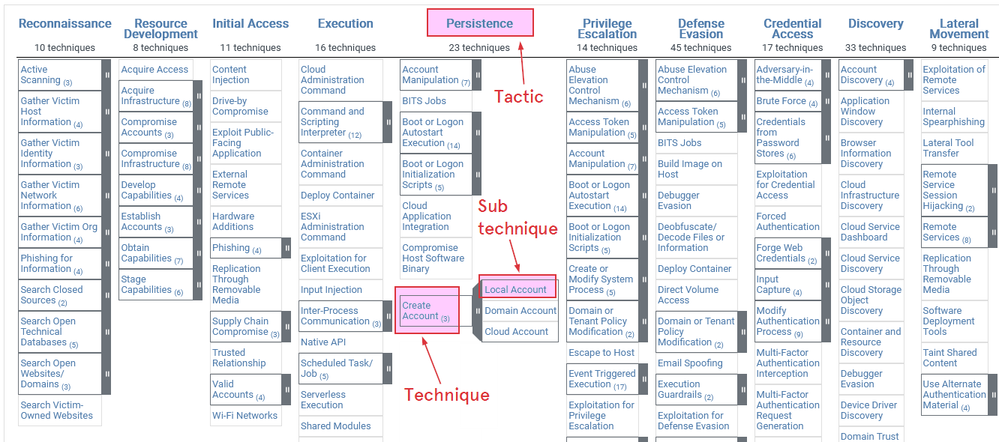
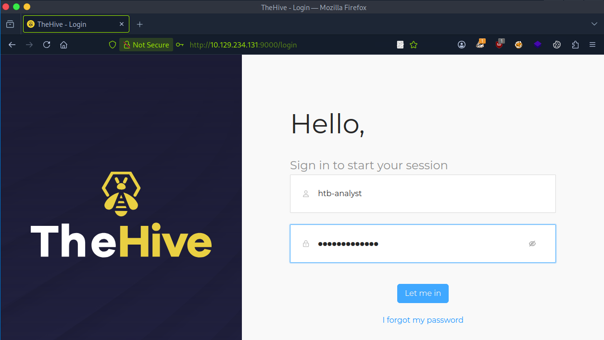

# Cyber Kill Chain

## Cyber Kill Chain là gì?

Trước khi bàn về xử lý sự cố, ta cần hiểu vòng đời của một cuộc tấn công (attack lifecycle, còn gọi là cyber kill chain). Vòng đời này mô tả cách các cuộc tấn công diễn ra. Hiểu nó sẽ giúp ta nắm được kẻ tấn công đã vào sâu tới đâu trong mạng và có thể đã truy cập được những gì trong giai đoạn điều tra sự cố.

Cyber kill chain gồm bảy giai đoạn khác nhau, như hình dưới đây:

## Các giai đoạn của Cyber Kill Chain

Giai đoạn **Recon** (Reconnaissance – trinh sát) là giai đoạn đầu tiên, khi kẻ tấn công chọn mục tiêu. Kẻ tấn công cũng thu thập thông tin để hiểu rõ hơn về mục tiêu, gom càng nhiều dữ liệu hữu ích càng tốt — dữ liệu này dùng được không chỉ ở giai đoạn này mà cả các giai đoạn sau trong chuỗi. Có kẻ tấn công thích thu thập thông tin thụ động (passive) từ các nguồn trên web như LinkedIn, Instagram, hoặc từ tài liệu trên các trang web của tổ chức mục tiêu. Tin tuyển dụng và đối tác của công ty thường để lộ thông tin về công nghệ mà tổ chức đang dùng, có thể rất cụ thể về phần mềm antivirus, hệ điều hành và công nghệ mạng. Một số kẻ tấn công còn đi xa hơn: chúng bắt đầu "chọc thử" và chủ động quét (active scan) các ứng dụng web và địa chỉ IP public của tổ chức mục tiêu.

Ở giai đoạn **Weaponize** (vũ khí hoá), malware dùng cho initial access được phát triển và nhúng vào một dạng exploit hoặc payload có thể phát tán. Malware này được làm cực kỳ nhẹ và không bị antivirus hay công cụ phát hiện nhận ra. Nhiều khả năng kẻ tấn công đã thu thập thông tin để biết tổ chức mục tiêu đang dùng antivirus hoặc EDR nào. Nhìn tổng thể, mục đích duy nhất của giai đoạn đầu này là có được quyền truy cập từ xa vào một máy bị xâm nhập trong môi trường mục tiêu, có khả năng tồn tại qua các lần khởi động lại (persist) và triển khai thêm công cụ, chức năng khi cần.

Ở giai đoạn **Delivery** (phát tán), exploit hoặc payload được đưa tới nạn nhân. Cách truyền thống là email phishing có file đính kèm độc hại hoặc link tới một trang web. Trang web đó có thể dùng cho hai mục đích: chứa exploit, hoặc lưu payload độc hại để tránh phải gửi qua các công cụ quét email. Có trường hợp trang web còn giả mạo một website hợp lệ mà tổ chức mục tiêu đang dùng, nhằm lừa nạn nhân nhập thông tin đăng nhập để thu thập. Có kẻ tấn công gọi điện cho nạn nhân với một kịch bản social engineering để thuyết phục họ chạy payload. Trong những trường hợp lấy lòng tin như vậy, payload được đặt trên website do kẻ tấn công kiểm soát, giả mạo một website quen thuộc với nạn nhân (vd: bản sao website của chính tổ chức mục tiêu). Rất hiếm khi payload đòi hỏi nạn nhân làm gì hơn ngoài double-click một file thực thi hoặc script (trên Windows có thể là `.bat`, `.cmd`, `.vbs`, `.js`, `.hta` và các định dạng khác). Cuối cùng, có trường hợp dùng tương tác vật lý để phát tán payload qua USB hoặc thiết bị lưu trữ tương tự được cố tình để rơi xung quanh.

Giai đoạn **Exploitation** (khai thác) là thời điểm exploit hoặc payload đã phát tán được kích hoạt. Trong giai đoạn này, kẻ tấn công thường cố gắng thực thi code trên hệ thống mục tiêu để giành quyền truy cập hoặc kiểm soát.

Ở giai đoạn **Installation** (cài đặt), stager ban đầu được thực thi và đang chạy trên máy bị xâm nhập. Như đã nói, giai đoạn này có thể thực hiện theo nhiều cách, tuỳ mục tiêu của kẻ tấn công và tính chất của vụ xâm nhập. Một số kỹ thuật phổ biến ở giai đoạn installation:

- **Droppers:** Kẻ tấn công có thể dùng dropper để đưa malware lên hệ thống mục tiêu. Dropper là một đoạn code nhỏ được thiết kế để cài malware lên hệ thống và thực thi nó. Dropper có thể được phát tán qua nhiều cách như file đính kèm email, website độc hại hoặc social engineering.
- **Backdoors:** Backdoor là loại malware giúp kẻ tấn công duy trì quyền truy cập vào hệ thống bị xâm nhập. Backdoor có thể được cài ở giai đoạn exploitation hoặc được đưa vào qua dropper. Khi đã cài xong, backdoor có thể dùng để thực hiện các cuộc tấn công tiếp theo hoặc đánh cắp dữ liệu.
- **Rootkits:** Rootkit là loại malware được thiết kế để che giấu sự hiện diện của nó trên hệ thống bị xâm nhập. Rootkit thường được dùng ở giai đoạn installation để né antivirus và các công cụ bảo mật khác. Rootkit có thể được cài ở giai đoạn exploitation hoặc được đưa vào qua dropper.

Ở giai đoạn **Command and Control** (C&C – điều khiển và chỉ huy), kẻ tấn công thiết lập khả năng truy cập từ xa vào máy bị xâm nhập. Như đã nói, việc dùng một stager ban đầu dạng module, tải thêm script "on-the-fly", là khá phổ biến. Tuy nhiên, các nhóm tấn công cao cấp sẽ dùng nhiều công cụ riêng biệt để đảm bảo có nhiều biến thể malware cùng tồn tại trong mạng bị xâm nhập; nếu một biến thể bị phát hiện và ngăn chặn, chúng vẫn còn cách quay lại môi trường.

Giai đoạn cuối của chuỗi là **Action** — mục tiêu của cuộc tấn công. Mục tiêu mỗi vụ có thể khác nhau: có kẻ muốn tuồn (exfiltrate) dữ liệu mật ra ngoài, có kẻ muốn giành quyền truy cập cao nhất có thể trong mạng để triển khai ransomware. Ransomware là loại malware khiến toàn bộ dữ liệu trên endpoint và server không dùng được hoặc không truy cập được, trừ khi trả tiền chuộc trong thời hạn nhất định (không khuyến khích trả).

Cần hiểu rằng kẻ tấn công không hành động theo đường thẳng (như Cyber Kill Chain gợi ý). Một số giai đoạn trước sẽ bị lặp lại nhiều lần. Ví dụ, sau giai đoạn Installation của một vụ xâm nhập thành công, bước tiếp theo hợp lý của kẻ tấn công là quay lại giai đoạn Recon để tìm thêm mục tiêu và lỗ hổng để khai thác, từ đó đi sâu hơn vào mạng và cuối cùng đạt được mục tiêu tấn công.

Mục tiêu của chúng ta là chặn kẻ tấn công tiến xa hơn trong kill chain, tốt nhất là ở một trong những giai đoạn sớm nhất.

## MITRE ATT&CK Framework

Một framework khác để hiểu hành vi kẻ tấn công là MITRE ATT&CK. Đây là một cơ sở tri thức chi tiết hơn, dạng ma trận (matrix), về các tactic và technique mà kẻ tấn công dùng để đạt các mục tiêu cụ thể. Giới chuyên môn an ninh mạng dùng cả hai framework để hiểu và phòng thủ trước các cuộc tấn công.

MITRE ATT&CK Enterprise Matrix là cơ sở tri thức ghi lại hành vi của kẻ tấn công được quan sát trong thực tế, nhắm vào môi trường IT doanh nghiệp (Windows, Linux, macOS, cloud, network, mobile, v.v.). Nó được trình bày dạng ma trận: mỗi cột là một mục tiêu của kẻ tấn công (tactic), mỗi ô là một technique kẻ tấn công dùng để đạt mục tiêu đó. Framework giúp bên phòng thủ hiểu, mô hình hoá, phát hiện và phản ứng với hành vi kẻ tấn công một cách có cấu trúc.

Ảnh dưới đây là ví dụ về [MITRE ATT&CK Enterprise Matrix](https://attack.mitre.org/matrices/enterprise/):

### Tactic

Tactic là mục tiêu cấp cao của kẻ tấn công trong một vụ xâm nhập (điều chúng muốn đạt được ở giai đoạn đó). Ví dụ:

- Initial Access.
- Persistence.
- Privilege Escalation.

### Technique

Technique là phương pháp cụ thể mà kẻ tấn công dùng để đạt một tactic. Technique mô tả hành vi cụ thể của kẻ tấn công (công cụ, lệnh, API, giao thức, v.v.).

Technique có ID dạng `T1105` (Ingress Tool Transfer) hoặc `T1021` (Remote Services). Ví dụ:

- **T1105 Ingress Tool Transfer:** Chỉ việc kẻ tấn công tải công cụ về bằng các tiện ích như `wget`, `curl`, v.v. — thường là lệnh/công cụ có sẵn trong hệ điều hành.
- **T1021 Remote Services:** Chỉ việc kẻ tấn công dùng các giao thức như SSH, RDP và SMB để lateral movement (di chuyển ngang).

### Sub-technique

Sub-technique là technique con, mô tả một cách triển khai hoặc một mục tiêu cụ thể. ID của sub-technique mở rộng từ technique cha: `T1003.001` (Credential Dumping -> LSASS Memory), `T1021.002` (Remote Services -> SMB/Windows Admin Shares). Ví dụ:

- **T1003.001 - OS Credentials: LSASS Memory:** Chỉ việc kẻ tấn công dump thông tin đăng nhập trực tiếp từ bộ nhớ tiến trình LSASS khi đã có đủ quyền cần thiết.
- **T1021.002 - Remote Services: SMB/Windows Admin Shares:** Chỉ việc kẻ tấn công tương tác với các share bằng thông tin đăng nhập hợp lệ.

Nhờ vậy việc phát hiện, quy kết (attribution) và báo cáo trở nên chính xác (ta có thể nói "Đã phát hiện T1003.001 — LSASS memory dumping" thay vì chỉ T1003).

## Pyramid of Pain

Trong sơ đồ dưới đây, Pyramid of Pain (kim tự tháp nỗi đau) cho thấy kẻ tấn công phải bỏ ra bao nhiêu công sức để thay đổi cách làm khi bên phòng thủ phát hiện và chặn các loại indicator khác nhau. Ở đáy kim tự tháp là các indicator đơn giản như hash, địa chỉ IP và tên miền — kẻ tấn công thay đổi chúng rất dễ (ít "đau").

Ví dụ, chặn một IP độc hại trong tình huống "Command and Control" (`T1071`) của MITRE ATT&CK chỉ làm kẻ tấn công chậm lại đôi chút vì chúng có thể nhanh chóng chuyển sang C2 server mới. Lên cao hơn, các artifact trên mạng và trên host (như registry key, tên mutex hay tên file) tương ứng với các technique cụ thể trong ATT&CK (vd: `T1547.001` – Registry Run Keys/Startup Folder). Những thứ này tốn nhiều công sức hơn để thay đổi, nên là indicator bền vững hơn cho bên phòng thủ.

Trên đỉnh kim tự tháp là Tools, Tactics, Techniques và Procedures (TTP) — gắn trực tiếp với phần lõi của MITRE ATT&CK. Phát hiện và phá vỡ chúng (vd: nhận diện việc lạm dụng PowerShell theo `T1059` hoặc process injection theo `T1055`) buộc kẻ tấn công phải thay đổi tận gốc cách hoạt động — gây "đau" nhiều nhất.

Tóm lại:

- Phát hiện dựa trên hash/IP = dễ bị né.
- Phát hiện dựa trên hành vi TTP (theo MITRE) = khó né, tốn kém hơn cho kẻ tấn công, và thể hiện mức độ trưởng thành phòng thủ cao hơn.

Analyst ánh xạ (map) các event và indicator quan sát được sang technique và tactic của ATT&CK để nhanh chóng hiểu ý đồ của kẻ tấn công và các bước tiếp theo có thể xảy ra. Thông thường, việc này cũng dùng để ưu tiên alert theo các technique nhắm vào tài sản giá trị cao. Ngoài ra, nó còn dùng để tham chiếu các biện pháp giảm thiểu (mitigation) và hành động containment/eradication nhằm phá vỡ kill chain của kẻ tấn công.

## Tích hợp MITRE ATT&CK trong TheHive

TheHive là nền tảng quản lý case (case management) dành cho đội an ninh mạng, giúp xử lý sự cố hiệu quả thông qua việc xử lý alert. Người dùng có thể tạo case và liên kết nhiều alert liên quan vào case đó. Nền tảng đóng vai trò trung tâm thu thập và quản lý mọi alert bảo mật từ nhiều thiết bị trên cùng một trang. Ngoài ra, TheHive có thể import toàn bộ Tactics, Techniques và Procedures (TTP) của MITRE ATT&CK vào hệ thống quản lý alert. Việc tích hợp này làm giàu phân tích sự cố bằng cách gắn các mẫu tấn công phát hiện được với alert.

Để truy cập TheHive, mở `http://TARGET_IP:9000` và đăng nhập bằng:

- Username: `htb-analyst`
- Password: `P3n#31337@LOG`

Sau khi đăng nhập, dashboard sẽ hiển thị. Ta có thể xem trang alert như ảnh dưới đây để xem và quản lý alert hiệu quả.

## Ví dụ mapping MITRE ATT&CK

Bảng dưới đây liệt kê một số technique (MITRE ATT&CK) được quan sát trong sự cố.

| Tactic | Technique | ID | Mô tả |
|---|---|---|---|
| Initial Access | Exploit Public-Facing Application | `T1190` | Khai thác CVE của Confluence |
| Execution | Command and Scripting Interpreter: PowerShell | `T1059.001` | Dùng PowerShell để tải payload |
| Persistence | Windows Service | `T1543.003` | Dùng Windows Service để duy trì truy cập |
| Credential Access | LSASS Memory Dumping | `T1003.001` | Trích xuất thông tin đăng nhập |
| Lateral Movement | Remote Desktop Protocol | `T1021.001` | Di chuyển ngang qua RDP |
| Impact | Data Encrypted for Impact | `T1486` | Ransomware LockBit |
