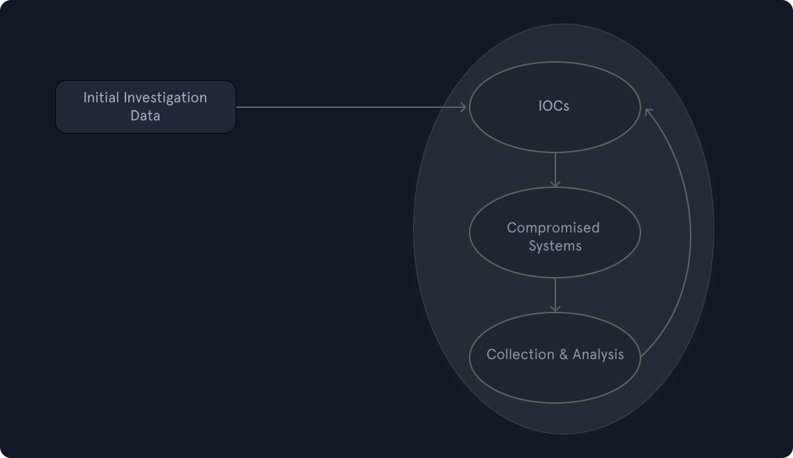

# Detection & Analysis Stage (Part 2) (Giai đoạn phát hiện và phân tích – Phần 2)

Khi bắt đầu một cuộc điều tra, mục tiêu của ta là hiểu `what happened` (chuyện gì đã xảy ra) và `how it happened` (nó đã xảy ra như thế nào). Để phân tích dữ liệu liên quan đến incident một cách đúng đắn và hiệu quả, các thành viên đội xử lý sự cố cần có kiến thức kỹ thuật sâu và kinh nghiệm trong lĩnh vực này. Có người sẽ hỏi: "Tại sao phải quan tâm incident đã xảy ra như thế nào? Sao không đơn giản là dựng lại các hệ thống bị ảnh hưởng rồi coi như chưa từng có chuyện gì?"

Nếu không biết incident đã xảy ra như thế nào hay những gì đã bị ảnh hưởng, thì mọi bước khắc phục ta thực hiện đều không đảm bảo được rằng kẻ tấn công không thể lặp lại hành động để giành lại quyền truy cập. Ngược lại, nếu biết chính xác kẻ tấn công đã vào bằng cách nào, dùng những công cụ gì và hệ thống nào bị ảnh hưởng, ta có thể lên kế hoạch khắc phục (remediation) để đảm bảo đường tấn công (attack path) này không thể bị lặp lại.

---

## Quá trình điều tra

Việc điều tra bắt đầu dựa trên thông tin thu thập ban đầu (và còn hạn chế), chứa những gì ta biết về incident cho tới thời điểm đó. Với dữ liệu ban đầu này, ta sẽ bắt đầu một quy trình vòng lặp 3 bước, được lặp đi lặp lại khi cuộc điều tra tiến triển. Quy trình này gồm:

- Tạo và sử dụng các indicator of compromise (IOC – dấu hiệu xâm nhập).
- Xác định các manh mối (lead) mới và các hệ thống bị ảnh hưởng.
- Thu thập và phân tích dữ liệu từ các manh mối mới và các hệ thống bị ảnh hưởng.



Giờ hãy đi sâu hơn vào quy trình được mô tả ở trên.

---

### Dữ liệu điều tra ban đầu

Để đi tới kết luận, cuộc điều tra phải dựa trên các manh mối hợp lệ được phát hiện không chỉ trong giai đoạn ban đầu này mà trong suốt toàn bộ quá trình điều tra. Đội xử lý sự cố cần liên tục đưa ra manh mối mới và không chỉ tập trung vào một phát hiện cụ thể, chẳng hạn một công cụ độc hại đã biết. Thu hẹp cuộc điều tra vào một hoạt động cụ thể thường dẫn đến phát hiện hạn chế, kết luận vội vàng và hiểu biết không đầy đủ về tác động tổng thể.

---

### Tạo và sử dụng IOC

Indicator of compromise (IOC) là `sign that an incident has occurred` (dấu hiệu cho thấy một incident đã xảy ra). IOC được ghi lại theo cách có cấu trúc, thể hiện các `artifacts` (dấu vết) của vụ xâm nhập. Ví dụ về IOC có thể là địa chỉ IP, giá trị hash của file và tên file. Thực tế, vì IOC rất quan trọng đối với một cuộc điều tra, người ta đã phát triển các ngôn ngữ chuyên dụng như `OpenIOC` để ghi lại và chia sẻ chúng theo cách chuẩn hoá. Một chuẩn IOC khác được dùng rộng rãi là `YARA`. Có nhiều công cụ miễn phí có thể dùng để tạo hoặc chỉnh sửa IOC, chẳng hạn `IOC Editor` của Mandiant. Với các ngôn ngữ này, ta có thể mô tả và sử dụng các artifact phát hiện được trong quá trình điều tra incident. Ta thậm chí có thể lấy IOC từ bên thứ ba nếu kẻ tấn công hoặc cuộc tấn công đã được biết đến. Ví dụ, CISA công bố IOC theo một định dạng gọi là `STIX` (`Structured Threat Information eXpression`). STIX là một ngôn ngữ và định dạng tuần tự hoá (serialization format) mã nguồn mở, máy có thể đọc được, chủ yếu ở dạng JSON, dùng để trao đổi thông tin tình báo mối đe doạ (cyber threat intelligence – CTI) một cách chuẩn hoá và nhất quán.

Ví dụ, trong [báo cáo này](https://www.cisa.gov/news-events/alerts/2025/08/06/cisa-releases-malware-analysis-report-associated-microsoft-sharepoint-vulnerabilities), ta có thể xem mục "Downloadable copy of IOCs associated with this malware" để lấy file STIX, chứa các IOC ở định dạng JSON.

```json
...SNIP...
        {
            "type": "file",
            "spec_version": "2.1",
            "id": "file--474454e8-d393-5a4f-9069-19631ea9d397",
            "hashes": {
                "MD5": "40e609840ef3f7fea94d53998ec9f97f",
                "SHA-1": "141af6bcefdcf6b627425b5b2e02342c081e8d36",
                "SHA-256": "3461da3a2ddcced4a00f87dcd7650af48f97998a3ac9ca649d7ef3b7332bd997",
                "SHA-512": "deaed6b7657cc17261ae72ebc0459f8a558baf7b724df04d8821c7a5355e037a05c991433e48d36a5967ae002459358678873240e252cdea4dcbcd89218ce5c2",
                "SSDEEP": "384:cMQLQ5VU1DcZugg2YBAxeFMxeFAReF9ReFj4U0QiKy8Mg3AxeFaxeFAReFLxTYma:ElHh1gtX10u5A"
            },
            "size": 13373,
            "name": "osvmhdfl.dll",
            "object_marking_refs": [
                "marking-definition--94868c89-83c2-464b-929b-a1a8aa3c8487",
                "marking-definition--d896763f-3f6f-4917-86e8-1a4b043d9771"
            ],
            "extensions": {
                "windows-pebinary-ext": {
                    "pe_type": "dll",
                    "number_of_sections": 4,
                    "time_date_stamp": "2025-07-22T08:33:22Z",
                    "size_of_optional_header": 512,
                    "sections": [
                        {
                            "name": "header",
                            "size": 512,
                            "entropy": 2.545281,
                            "hashes": {
                                "MD5": "2a11da5809d47c180a7aa559605259b5"
                            }
                        },
                        {
                            "name": ".text",
                            "size": 4608,
                            "entropy": 4.532967,
                            "hashes": {
                                "MD5": "531ff1038e010be3c55de9cf1f212b56"
                            }
                        },
                        {
                            "name": ".rsrc",
                            "size": 1024,
                            "entropy": 2.170401,
                            "hashes": {
                                "MD5": "ef6793ef1a2f938cddc65b439e44ea07"
                            }
                        },
                        {
                            "name": ".reloc",
                            "size": 512,
                            "entropy": 0.057257,
                            "hashes": {
                                "MD5": "403090c0870bb56c921d82a159dca5a3"
                            }
                        }
                    ]
                }
            }
        },
...SNIP...
```

Trong TheHive, ta có thể thêm IOC trong mục observables của một alert.


Để tận dụng IOC, ta sẽ cần triển khai một `IOC-obtaining/IOC-searching tool` (công cụ thu thập/tìm kiếm IOC — có sẵn hoặc của bên thứ ba, và có thể ở quy mô lớn). Một cách phổ biến là dùng `WMI` hoặc `PowerShell` cho các thao tác liên quan đến IOC trong môi trường Windows.

Một lời cảnh báo! Trong quá trình điều tra, ta phải đặc biệt cẩn thận để tránh việc thông tin đăng nhập (credentials) của (các) user có đặc quyền cao bị lưu đệm (cache) khi kết nối tới các hệ thống (có khả năng) đã bị xâm nhập (hoặc thực ra là bất kỳ hệ thống nào). Cụ thể hơn, ta cần đảm bảo chỉ dùng những giao thức kết nối và công cụ không cache thông tin đăng nhập sau khi đăng nhập thành công (chẳng hạn `WinRM`). Các lần đăng nhập Windows với `logon type 3 (Network Logon)` thường không cache thông tin đăng nhập trên hệ thống từ xa. Ví dụ điển hình nhất cho câu "hiểu rõ công cụ của mình" (know your tools) là "PsExec". Khi "PsExec" được dùng với thông tin đăng nhập chỉ định rõ (explicit credentials), thông tin đăng nhập đó sẽ bị cache trên máy từ xa. Khi "PsExec" được dùng không kèm thông tin đăng nhập, thông qua phiên của user đang đăng nhập hiện tại, thông tin đăng nhập sẽ không bị cache trên máy từ xa. Đây là ví dụ rất hay cho thấy cùng một công cụ có thể để lại những dấu vết khác nhau, nên ta phải nắm rõ điều này.

---

### Xác định manh mối mới và hệ thống bị ảnh hưởng

Sau khi tìm kiếm IOC, ta kỳ vọng sẽ có một số kết quả khớp (hit) cho thấy các hệ thống khác có cùng dấu hiệu bị xâm nhập. Những hit này có thể không liên quan trực tiếp đến incident đang điều tra. Ví dụ, IOC của ta có thể quá chung chung. Ta cần xác định và `eliminate false positives` (loại bỏ các false positive – cảnh báo sai). Ta cũng có thể rơi vào tình huống gặp một lượng lớn hit. Khi đó, ta nên ưu tiên chọn những hit sẽ tập trung vào, lý tưởng nhất là những hit có thể mang lại manh mối mới sau khi được phân tích forensic.

---

### Thu thập và phân tích dữ liệu từ manh mối mới và hệ thống bị ảnh hưởng

Khi đã xác định được các hệ thống có chứa IOC của ta, ta sẽ muốn `collect and preserve the state` (thu thập và bảo toàn trạng thái) của các hệ thống đó để phân tích sâu hơn, nhằm tìm ra manh mối mới và/hoặc trả lời các câu hỏi điều tra về incident. Tuỳ hệ thống, có nhiều cách tiếp cận khác nhau về việc thu thập dữ liệu như thế nào và thu thập những gì. Đôi khi ta muốn thực hiện '`live response`' (thu thập dữ liệu trực tiếp) trên hệ thống khi nó đang chạy, trong khi ở trường hợp khác, ta có thể muốn tắt hệ thống rồi mới tiến hành phân tích. Live response là cách tiếp cận phổ biến nhất, trong đó ta thu thập một tập dữ liệu định sẵn, thường giàu artifact có thể giải thích chuyện gì đã xảy ra với hệ thống. Tắt hệ thống không phải là một quyết định dễ dàng khi cần bảo toàn thông tin có giá trị, vì trong nhiều trường hợp, phần lớn artifact chỉ tồn tại trong RAM của máy và sẽ mất nếu máy bị tắt. Dù chọn cách thu thập nào, điều cốt yếu là phải đảm bảo tương tác tối thiểu với hệ thống để tránh làm thay đổi bất kỳ bằng chứng hay artifact nào.

Khi đã thu thập xong dữ liệu, đến lúc phân tích. Đây thường là quá trình tốn thời gian nhất trong một incident. Malware analysis (phân tích malware) và disk forensics (điều tra số trên ổ đĩa) là hai loại kiểm tra phổ biến nhất. Mọi manh mối mới được phát hiện và đã xác thực đều được thêm vào timeline, vốn được cập nhật liên tục. Cũng lưu ý rằng memory forensics (điều tra số trên bộ nhớ) là năng lực ngày càng phổ biến và cực kỳ quan trọng khi đối phó với các cuộc tấn công tinh vi.

Hãy nhớ rằng trong quá trình thu thập dữ liệu, ta cần theo dõi `chain of custody` (chuỗi lưu giữ bằng chứng) để đảm bảo dữ liệu được kiểm tra có thể được toà án chấp nhận nếu có hành động pháp lý đối với kẻ tấn công.

---

### Ứng dụng AI trong phát hiện mối đe doạ

Trí tuệ nhân tạo (Artificial Intelligence – AI) đang thay đổi cách các tổ chức phát hiện, phân loại (triage) và ứng phó với các sự cố bảo mật. Trong quy trình IR truyền thống, analyst phải xem xét thủ công log, alert và báo cáo. Quá trình này thường mất hàng giờ hoặc hàng ngày. AI `automates much of this analysis` (tự động hoá phần lớn việc phân tích này), rút ngắn thời gian phản ứng và tăng độ chính xác nhờ học từ các incident trong quá khứ và `identifying behavioral anomalies` (nhận diện bất thường về hành vi) nhanh hơn con người.

Ví dụ: tính năng "`Attack Discovery`" của Elastic Security dùng generative AI để phân tích event từ hàng nghìn detection, tóm tắt và gom nhóm các alert liên quan thành một câu chuyện tấn công (attack story).

AI Attack Discovery tận dụng `LLMs` (large language models – mô hình ngôn ngữ lớn) để phân tích các alert trong môi trường và xác định mối đe doạ. Bản tóm tắt đại diện cho một cuộc tấn công và thể hiện mối liên hệ giữa nhiều alert, giúp ta xác định những user và host nào có liên quan. Nó cũng hiển thị mapping MITRE ATT&CK. Dưới đây là ví dụ về giao diện của attack discovery:

![Trang detection của Elastic có tiêu đề “BPFDoor Linux backdoor deployment” (trạng thái Open, 4 alert). Tóm tắt: Trên host SRVNIX05, backdoor BPFDoor đã bị giải nén, sao chép và thực thi bởi user root. Phần chi tiết cho thấy root giải nén file “74ef6cc38f5a1a80148752b63c117e6846984debd2af806c65887195a8eecc56” vào /home/ubuntu/..., sau đó một shell bash sao chép nó tới /dev/shm/kdmtmpflush, đặt chmod 755 và chạy nó với quyền nâng cao; bước dọn dẹp xoá file gốc. File được nhận diện là Linux.Trojan.BPFDoor. Phần Justification ghi chú rằng tất cả alert đều gắn với host SRVNIX05 và user root, theo một trình tự rõ ràng từ giải nén tới thực thi và bị phát hiện. Timeline Attack Chain làm nổi bật Initial Access, Execution, Persistence và Defense Evasion. Các nút: View in AI Assistant, Investigate in Timeline.](images/ai-attack.png)

Trong discovery này, AI đã hỗ trợ bằng cách rà qua nhiều alert và tạo ra một bản tổng quan toàn diện về cuộc tấn công, xác định các hoạt động chính đã diễn ra trong incident. AI cũng có thể hỗ trợ trong incident response (ứng phó sự cố). Một số use case gồm:

- Tự động triage và ưu tiên hoá alert
- Tương quan (correlation) incident và tái dựng timeline
- Playbook ứng phó tự động
- AI hỗ trợ phân tích và rút kinh nghiệm sau sự cố

### Tóm tắt

Trong hai phần vừa qua, ta đã đi qua các bước đầu tiên của giai đoạn Detection and Analysis, quản lý các quy trình thiết yếu và ghi chép lại từng bước cần thiết trong một incident. Giữ sự tập trung và ngăn nắp là một trong những điều then chốt cần duy trì để thực hiện tốt giai đoạn này.

Hãy cuộn xuống cuối phần này và bấm vào "`Click here to spawn the target system!`". Sau đó, mở trang web TheHive tại "Target IP:9000" trên cổng 9000 bằng thông tin đăng nhập được cung cấp để xem các alert.
