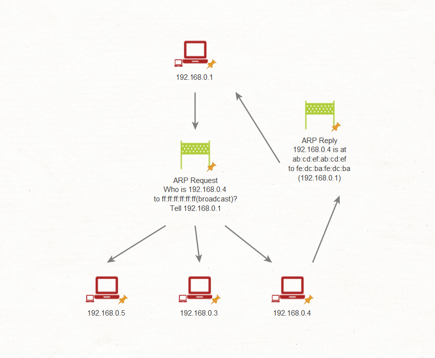
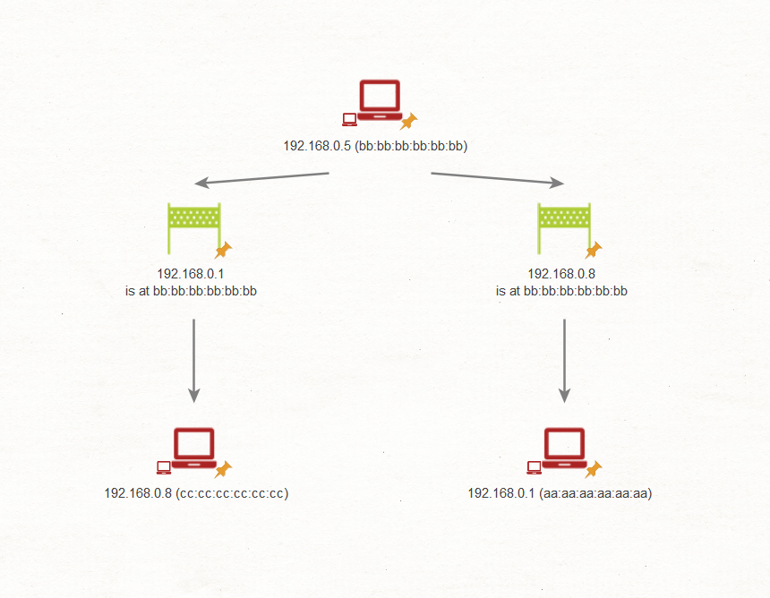
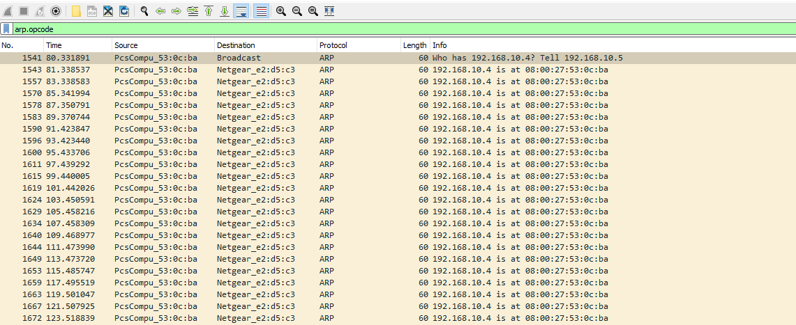
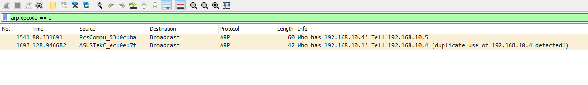
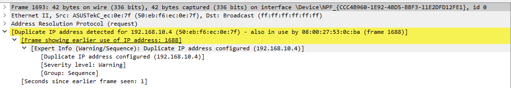
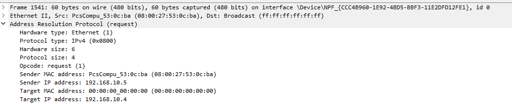
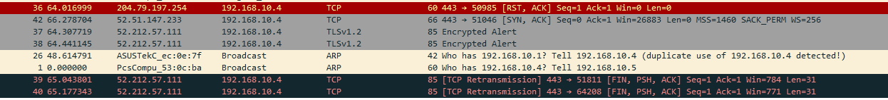

# ARP Spoofing & Abnormality Detection (ARP Spoofing và phát hiện bất thường)

**Tệp PCAP liên quan**: 
* `ARP_Spoof.pcapng`

---

`Address Resolution Protocol (ARP)` từ lâu đã là một tiện ích bị kẻ tấn công lợi dụng để tiến hành các cuộc tấn công man-in-the-middle và denial-of-service, cùng nhiều kiểu tấn công khác. Vì mức độ phổ biến này, ARP trở thành tâm điểm khi ta phân tích traffic, và thường là giao thức đầu tiên ta xem xét kỹ. Nhiều cuộc tấn công dựa trên ARP được phát quảng bá (broadcast) chứ không nhắm riêng vào từng host, nên dễ bị phát hiện hơn bằng các kỹ thuật packet sniffing (bắt gói tin) của ta.

## Cách Address Resolution Protocol hoạt động

Trước khi nhận diện các bất thường của ARP, ta cần hiểu giao thức này hoạt động thế nào ở chế độ chuẩn, hay còn gọi là chế độ 'vanilla'.



Trong mạng, các host phải biết địa chỉ vật lý (MAC address) mà chúng cần gửi dữ liệu tới. Nhu cầu này đã khai sinh ra ARP. Hãy làm rõ điều này qua quy trình từng bước.


|**Bước**|**Mô tả**|
|-|-|
|`1`|Hãy hình dung máy tính thứ nhất, Host A, cần gửi dữ liệu tới máy tính thứ hai, Host B. Để truyền thành công, Host A phải xác định được địa chỉ vật lý của Host B.|
|`2`|Host A bắt đầu bằng việc tra danh sách các địa chỉ đã biết của nó, tức ARP cache, để xem đã có địa chỉ vật lý này hay chưa.|
|`3`|Nếu địa chỉ ứng với IP cần tìm không có trong ARP cache, Host A broadcast một ARP request tới tất cả các máy trong subnet, hỏi: "Ai đang giữ IP x.x.x.x?"|
|`4`|Host B trả lời thông điệp này bằng một ARP reply: "Chào Host A, IP của tôi là x.x.x.x và được ánh xạ tới địa chỉ MAC aa:aa:aa:aa:aa:aa."|
|`5`|Khi nhận được phản hồi này, Host A cập nhật ARP cache với ánh xạ IP-to-MAC mới.|
|`6`|Đôi khi, một host có thể được lắp interface mới, hoặc địa chỉ IP trước đó cấp cho host có thể hết hạn, đòi hỏi phải cập nhật và ánh xạ lại ARP cache. Những trường hợp như vậy có thể gây phức tạp khi ta phân tích network traffic.|

---

## ARP Poisoning & Spoofing

Trong kịch bản lý tưởng, sẽ có các biện pháp kiểm soát (control) vững chắc để ngăn chặn những cuộc tấn công này, nhưng trên thực tế điều đó không phải lúc nào cũng khả thi. Để hiểu các Indicators of Compromise (IOC – dấu hiệu xâm nhập) hiệu quả hơn, hãy đi sâu vào hành vi của các cuộc tấn công ARP Poisoning và Spoofing.



Việc phát hiện các cuộc tấn công này có thể khó khăn, vì chúng bắt chước cấu trúc giao tiếp của ARP traffic thông thường. Tuy vậy, một số ARP request và reply nhất định có thể để lộ bản chất độc hại của chúng. Hãy minh hoạ cách các cuộc tấn công này hoạt động, giúp ta nhận diện chúng tốt hơn khi phân tích traffic.

|**Bước**|**Mô tả**|
|-|-|
|`1`| Xét một mạng có ba máy: máy tính của nạn nhân, router và máy của kẻ tấn công.|
|`2`| Kẻ tấn công khởi động kế hoạch đầu độc ARP cache (ARP cache poisoning) bằng cách gửi các thông điệp ARP giả mạo tới cả máy nạn nhân lẫn router.|
|`3`| Thông điệp gửi tới máy nạn nhân khẳng định rằng địa chỉ IP của gateway (router) tương ứng với địa chỉ vật lý của máy kẻ tấn công.|
|`4`| Ngược lại, thông điệp gửi tới router khẳng định rằng địa chỉ IP của máy nạn nhân ánh xạ tới địa chỉ vật lý của máy kẻ tấn công.|
|`5`| Khi thực hiện thành công các request này, kẻ tấn công có thể làm hỏng ARP cache trên cả máy nạn nhân lẫn router, khiến toàn bộ dữ liệu bị chuyển nhầm tới máy kẻ tấn công.|
|`6`| Nếu kẻ tấn công cấu hình chuyển tiếp traffic (traffic forwarding), chúng có thể nâng tình huống từ denial-of-service lên thành tấn công man-in-the-middle. |
|`7`| Khi xem xét các tầng khác trong mô hình mạng, ta có thể phát hiện thêm các cuộc tấn công khác. Kẻ tấn công có thể thực hiện DNS spoofing để chuyển hướng web request tới một trang giả mạo, hoặc thực hiện SSL stripping nhằm chặn bắt dữ liệu nhạy cảm đang được truyền.|

Phát hiện các cuộc tấn công này là một chuyện, nhưng ngăn chặn chúng lại là một thách thức hoàn toàn khác. Ta có thể chống lại các cuộc tấn công này bằng những biện pháp kiểm soát như:

1. `Static ARP Entries`: Bằng cách không cho phép dễ dàng ghi đè và đầu độc ARP cache, ta có thể cản trở các cuộc tấn công này. Tuy nhiên, việc này đòi hỏi tăng thêm công sức bảo trì và giám sát trong môi trường mạng.

2. `Switch and Router Port Security`: Triển khai các biện pháp kiểm soát network profile và những biện pháp khác có thể đảm bảo chỉ các thiết bị được cấp phép mới kết nối được vào những port cụ thể trên thiết bị mạng, qua đó chặn hiệu quả các máy đang cố thực hiện ARP spoofing/poisoning.

---

## Cài đặt & khởi chạy TCPDump

Để bắt được traffic này một cách hiệu quả, đặc biệt khi chưa có phần mềm giám sát mạng được cấu hình, ta có thể dùng các công cụ như `tcpdump` và `Wireshark`, hoặc đơn giản là `Wireshark` đối với host Windows.

Thông thường `tcpdump` nằm ở `/usr/sbin/tcpdump`. Tuy nhiên, nếu công cụ chưa được cài, có thể cài bằng lệnh phù hợp, được cung cấp tuỳ theo yêu cầu cụ thể của hệ thống.

#### TCPDump
```shell-session
[!bash!]$ sudo apt install tcpdump -y
```

Để bắt đầu bắt traffic, ta có thể dùng công cụ dòng lệnh `tcpdump`, chỉ định network interface bằng switch `-i` và đặt tên file capture đầu ra bằng switch `-w`.

```shell-session
[!bash!]$ sudo tcpdump -i eth0 -w filename.pcapng
```

## Tìm ARP Spoofing

Để phát hiện các cuộc tấn công ARP Spoofing, ta cần mở file capture traffic liên quan (`ARP_Spoof.pcapng`) trong phần tài nguyên của module này bằng Wireshark.

```shell-session
[!bash!]$ wireshark ARP_Spoof.pcapng
```

Sau khi vào Wireshark, ta có thể thu gọn khung nhìn để chỉ tập trung vào ARP request và reply bằng filter `arp.opcode`.



Một dấu hiệu đáng ngờ (red flag) quan trọng cần theo dõi là bất kỳ bất thường nào trong traffic phát ra từ một host cụ thể. Ví dụ, một host liên tục broadcast ARP request và reply tới một host khác có thể là dấu hiệu rõ ràng của ARP spoofing.

Trong tình huống như vậy, ta có thể nhận ra rằng địa chỉ MAC `08:00:27:53:0C:BA is behaving suspiciously` (đang có hành vi đáng ngờ).

Để khẳng định điều này, ta có thể tinh chỉnh phân tích để chỉ xem xét các tương tác — cả request lẫn reply — giữa máy kẻ tấn công, máy nạn nhân và router. Chức năng opcode trong `Wireshark` có thể giúp đơn giản hoá quá trình này.

1. `Opcode == 1`: Đại diện cho mọi loại ARP Request
2. `Opcode == 2`: Biểu thị mọi loại ARP Reply

Bước đầu tiên, ta có thể xem xét kỹ các request đã được gửi đi bằng filter sau.

- `arp.opcode == 1`



Gần như ngay lập tức, ta sẽ nhận thấy một red flag – một địa chỉ bị trùng lặp, kèm theo thông báo cảnh báo. Nếu đi sâu vào chi tiết thông báo lỗi trong Wireshark, ta có thể trích xuất thêm thông tin.



Ngay khi kiểm tra, ta có thể nhận ra một địa chỉ IP được ánh xạ tới hai địa chỉ MAC khác nhau. Ta có thể xác minh điều này trên hệ thống Linux bằng cách chạy các lệnh phù hợp.

#### ARP
```shell-session
[!bash!]$ arp -a | grep 50:eb:f6:ec:0e:7f

? (192.168.10.4) at 50:eb:f6:ec:0e:7f [ether] on eth0
```

```shell-session
[!bash!]$ arp -a | grep 08:00:27:53:0c:ba

? (192.168.10.4) at 08:00:27:53:0c:ba [ether] on eth0
```

Trong tình huống này, ta có thể xác định rằng ARP cache của mình thực ra chứa cả hai địa chỉ MAC được gán cho cùng một địa chỉ IP – một bất thường cần được chú ý ngay lập tức.

Để lọc ra thêm các bản ghi trùng lặp, ta có thể dùng filter Wireshark sau.

- `arp.duplicate-address-detected && arp.opcode == 2`

---

## Xác định các địa chỉ IP ban đầu

Một câu hỏi then chốt ta cần đặt ra là: địa chỉ IP ban đầu của các thiết bị này là gì? Hiểu được điều này giúp ta xác định thiết bị nào đã thay đổi địa chỉ IP thông qua MAC spoofing. Suy cho cùng, nếu cuộc tấn công này chỉ được thực hiện qua ARP, địa chỉ IP của máy nạn nhân sẽ giữ nguyên. Ngược lại, máy kẻ tấn công có thể từng có một địa chỉ IP khác trước đó.

Ta có thể tìm ra thông tin này trong một ARP request và đẩy nhanh quá trình tìm kiếm bằng filter Wireshark này.

- `(arp.opcode) && ((eth.src == 08:00:27:53:0c:ba) || (eth.dst == 08:00:27:53:0c:ba))`



Trong trường hợp này, ta có thể nhận ra ngay rằng địa chỉ MAC `08:00:27:53:0c:ba` ban đầu gắn với địa chỉ IP `192.168.10.5`, nhưng gần đây đã chuyển sang `192.168.10.4`. Sự chuyển đổi này cho thấy một nỗ lực có chủ đích nhằm ARP spoofing hoặc cache poisoning.

Ngoài ra, việc xem xét traffic từ các địa chỉ MAC này bằng filter Wireshark sau cũng có thể mang lại nhiều thông tin hữu ích:

- `eth.addr == 50:eb:f6:ec:0e:7f or eth.addr ==  08:00:27:53:0c:ba`



Ngay từ đầu, ta có thể nhận thấy một số điểm bất nhất trong các kết nối TCP. Nếu các kết nối TCP liên tục bị rớt, đó là dấu hiệu cho thấy kẻ tấn công không chuyển tiếp traffic giữa nạn nhân và router.

Nếu kẻ tấn công thực sự đang chuyển tiếp traffic và hoạt động như một man-in-the-middle, ta có thể quan sát thấy các lượt truyền giống hệt hoặc gần như đối xứng từ nạn nhân tới kẻ tấn công và từ kẻ tấn công tới router.
