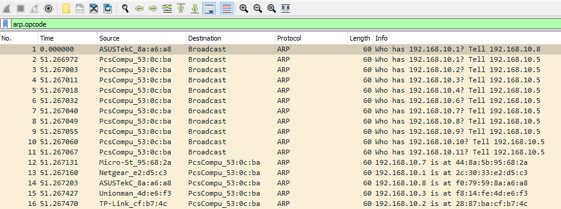
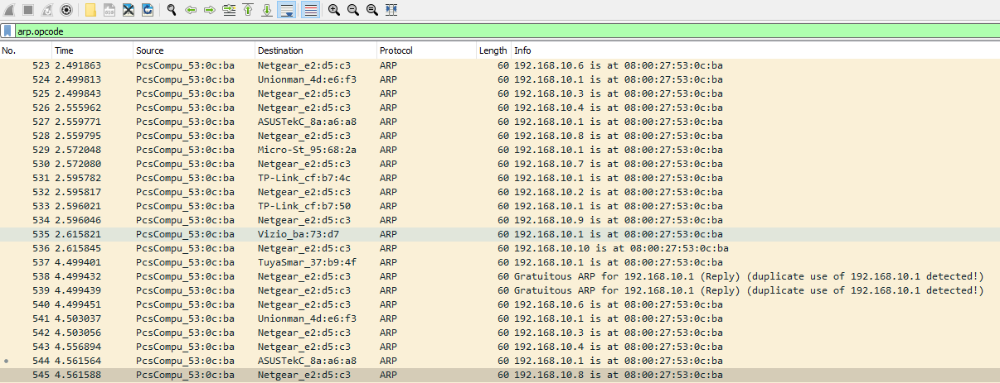
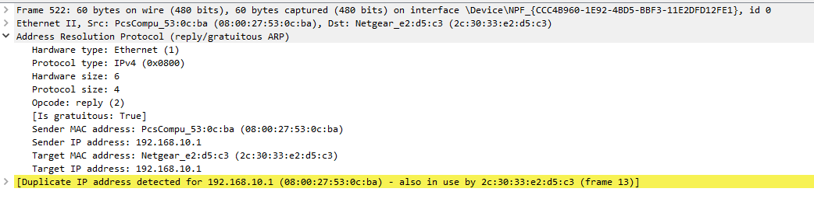

# ARP Scanning & Denial-of-Service (Quét ARP và từ chối dịch vụ)

Ta có thể nhận ra thêm những hành vi bất thường khác trong các ARP request và reply. Ai cũng biết rằng poisoning và spoofing là cốt lõi của hầu hết các cuộc tấn công `denial-of-service (DoS)` và `man-in-the-middle (MITM)` dựa trên ARP. Tuy nhiên, kẻ tấn công cũng có thể lợi dụng ARP để thu thập thông tin. May mắn là ta có đủ kỹ năng để phát hiện và đánh giá các chiến thuật này theo những quy trình tương tự.

## Dấu hiệu của ARP Scanning

**Tệp PCAP liên quan**: 
* `ARP_Scan.pcapng`

Một số red flag (dấu hiệu đáng ngờ) điển hình cho thấy ARP scanning là:

1. `Broadcast ARP requests sent to sequential IP addresses (.1,.2,.3,...)` (ARP request broadcast tới các địa chỉ IP liên tiếp)

2. `Broadcast ARP requests sent to non-existent hosts` (ARP request broadcast tới các host không tồn tại)

3. `Potentially, an unusual volume of ARP traffic originating from a malicious or compromised host` (có thể có lượng ARP traffic lớn bất thường phát ra từ một host độc hại hoặc đã bị xâm nhập)

## Tìm ARP Scanning

Không chần chừ, nếu mở file capture traffic liên quan (`ARP_Scan.pcapng`) trong Wireshark và áp dụng filter `arp.opcode`, ta có thể thấy như sau:

Có thể phát hiện rằng đúng là các ARP request đang được một host duy nhất phát tán tới mọi địa chỉ IP theo thứ tự tuần tự. Pattern này là triệu chứng của ARP scanning và là đặc điểm thường thấy ở các scanner phổ biến như `Nmap`.

Hơn nữa, ta có thể nhận thấy các host đang hoạt động phản hồi những request này bằng ARP reply của chúng. Điều này có thể báo hiệu kẻ tấn công đã thực hiện thành công chiến thuật thu thập thông tin.

---
## Xác định Denial-of-Service

**Tệp PCAP liên quan**: 
* `ARP_Poison.pcapng`

Kẻ tấn công có thể lợi dụng ARP scanning để lập danh sách các host đang hoạt động (live host). Sau khi có được danh sách này, kẻ tấn công có thể thay đổi chiến lược để từ chối dịch vụ đối với tất cả các máy đó. Về cơ bản, chúng sẽ cố gắng đầu độc toàn bộ một subnet và thao túng càng nhiều ARP cache càng tốt. Chiến lược này cũng khả thi với kẻ tấn công muốn chiếm vị trí man-in-the-middle.

Ngay lập tức, ta có thể nhận thấy ARP traffic của kẻ tấn công có thể chuyển trọng tâm sang việc khai báo địa chỉ vật lý mới cho tất cả các địa chỉ IP đang hoạt động. Ý đồ ở đây là làm hỏng ARP cache của router.

Ngược lại, ta có thể chứng kiến việc `192.168.10.1` bị gán trùng lặp cho các thiết bị client. Điều này cho thấy kẻ tấn công đang cố làm hỏng ARP cache của các thiết bị nạn nhân này với ý định chặn traffic theo cả hai chiều.

## Ứng phó với các cuộc tấn công ARP

Khi đã xác định được bất kỳ bất thường nào liên quan tới ARP như trên, ta có thể băn khoăn đâu là hướng hành động phù hợp để đối phó với các mối đe doạ này. Dưới đây là một vài khả năng:

1. `Tracing and Identification`: Trước hết và quan trọng nhất, máy của kẻ tấn công là một thực thể vật lý nằm ở đâu đó. Nếu xác định được vị trí của nó, ta có thể chặn đứng hoạt động của nó. Đôi khi, ta có thể phát hiện ra chính chiếc máy điều phối cuộc tấn công cũng đã bị xâm nhập và đang bị điều khiển từ xa.

2. `Containment`: Để ngăn kẻ tấn công tiếp tục tuồn (exfiltrate) thông tin ra ngoài, ta có thể cân nhắc ngắt kết nối hoặc cô lập khu vực bị ảnh hưởng ở cấp switch hoặc router. Hành động này có thể chấm dứt hiệu quả một cuộc tấn công DoS hoặc MITM ngay tại nguồn.

Các cuộc tấn công ở tầng liên kết (link layer) thường lọt khỏi tầm chú ý. Dù việc xác định và điều tra chúng có vẻ không đáng kể, phát hiện được chúng có thể đóng vai trò then chốt trong việc ngăn chặn dữ liệu bị tuồn ra ngoài từ các tầng cao hơn của mô hình OSI.
