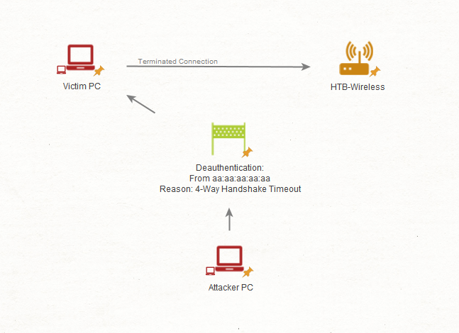
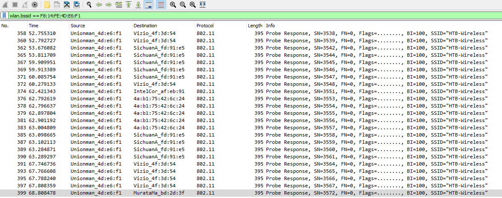
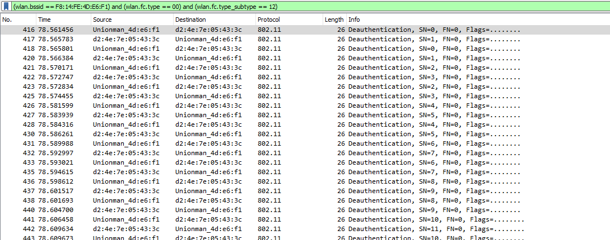
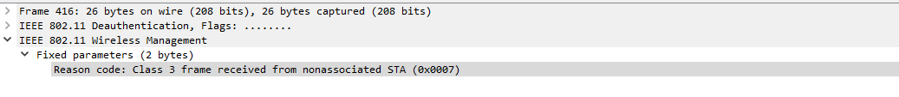
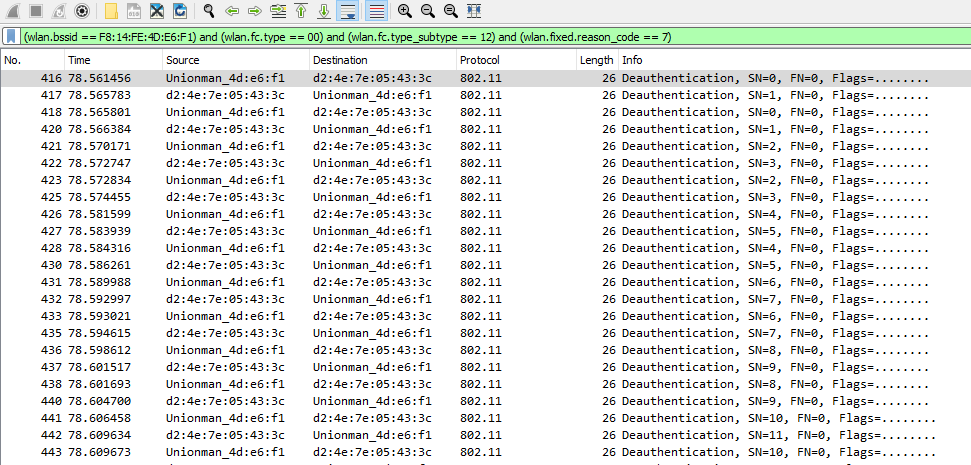
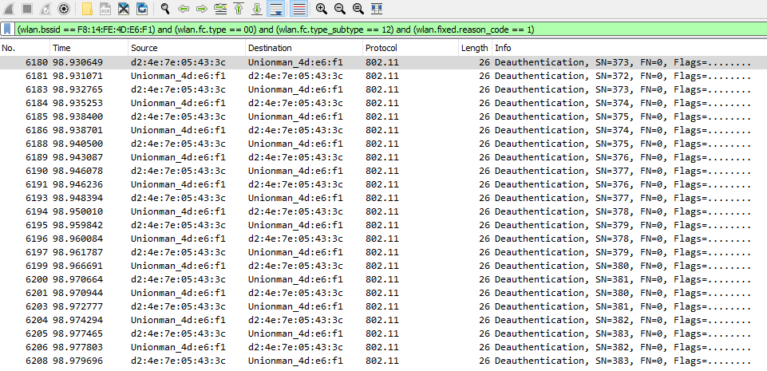
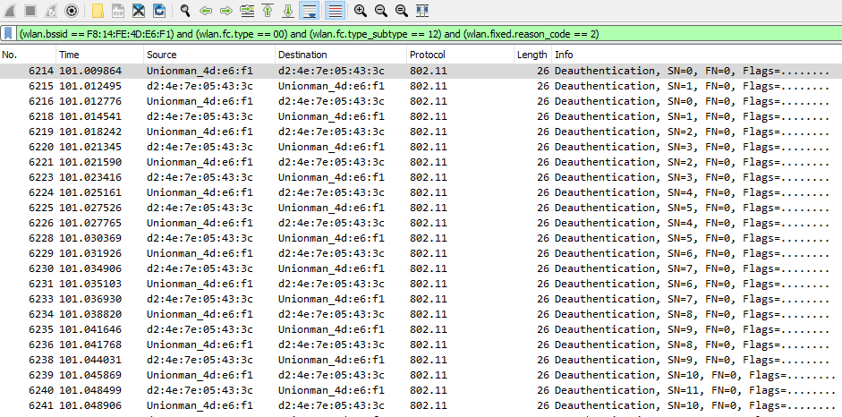
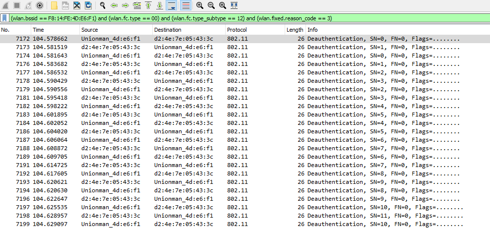
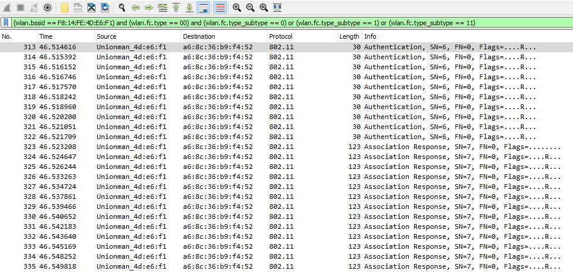

# 802.11 Denial of Service (Từ chối dịch vụ 802.11)

**Tệp PCAP liên quan**: 
* `deauthandbadauth.cap`

----

Trong lĩnh vực phân tích traffic, việc xem xét kỹ mọi khía cạnh của các giao thức và giao tiếp ở tầng liên kết (link layer) luôn luôn quan trọng. Một kiểu tấn công link-layer nổi bật là kiểu nhắm vào `802.11 (Wi-Fi)`. Hướng tấn công (attack vector) này thường dễ bị ta bỏ qua, nhưng vì lỗi con người có thể khiến lớp bảo mật vành đai (perimeter security) thất bại, nên điều thiết yếu là ta phải liên tục kiểm tra (audit) các mạng không dây của mình.

## Bắt traffic 802.11

Để xem xét raw traffic 802.11, ta cần một hệ thống `WIDS`/`WIPS` hoặc một wireless interface hỗ trợ monitor mode. Tương tự promiscuous mode trong Wireshark, monitor mode cho phép ta xem các raw frame 802.11 và các loại gói tin khác mà nếu không thì sẽ không nhìn thấy được.

Giả sử ta có một Wi-Fi interface hỗ trợ monitor mode. Ta có thể liệt kê các wireless interface trên Linux bằng lệnh sau:

#### Wireless Interfaces
```shell-session
[!bash!]$ iwconfig

wlan0     IEEE 802.11  ESSID:off/any  
          Mode:Managed  Access Point: Not-Associated   Tx-Power=20 dBm   
          Retry short  long limit:2   RTS thr:off   Fragment thr:off
          Power Management:off
```

Ta có một vài cách để chuyển interface sang monitor mode. Cách thứ nhất, dùng `airodump-ng`, ta có thể chạy lệnh sau:

#### Airmon-NG
```shell-session
[!bash!]$ sudo airmon-ng start wlan0

Found 2 processes that could cause trouble.
Kill them using 'airmon-ng check kill' before putting
the card in monitor mode, they will interfere by changing channels
and sometimes putting the interface back in managed mode

    PID Name
    820 NetworkManager
   1389 wpa_supplicant

PHY     Interface       Driver          Chipset

phy0    wlan0           rt2800usb       Ralink Technology, Corp. RT2870/RT3070
                (mac80211 monitor mode vif enabled for [phy0]wlan0 on [phy0]wlan0mon)
                (mac80211 station mode vif disabled for [phy0]wlan0)
```

Cách thứ hai, dùng các tiện ích hệ thống, ta cần tắt interface, thay đổi mode của nó, rồi bật lại.

#### Monitor Mode
```shell-session
[!bash!]$ sudo ifconfig wlan0 down
[!bash!]$ sudo iwconfig wlan0 mode monitor
[!bash!]$ sudo ifconfig wlan0 up
```

Ta có thể kiểm tra interface đã ở `monitor mode` hay chưa bằng tiện ích `iwconfig`.

```shell-session
[!bash!]$ iwconfig

wlan0mon  IEEE 802.11  Mode:Monitor  Frequency:2.457 GHz  Tx-Power=20 dBm   
          Retry short  long limit:2   RTS thr:off   Fragment thr:off
          Power Management:off
```

Có thể interface của ta không theo quy ước tên `wlan0mon`. Thay vào đó, nó có thể mang một cái tên như sau.

```shell-session
[!bash!]$ iwconfig

wlan0     IEEE 802.11  Mode:Monitor  Frequency:2.457 GHz  Tx-Power=20 dBm   
          Retry short  long limit:2   RTS thr:off   Fragment thr:off
          Power Management:off
```

Yếu tố then chốt ở đây là mode phải là "monitor". Tên của interface không thực sự quan trọng, và trong nhiều trường hợp, bản phân phối Linux có thể đặt cho nó một cái tên hoàn toàn khác.

Để bắt đầu bắt traffic từ các client và mạng của mình, ta có thể dùng `airodump-ng`. Ta cần chỉ định channel của AP bằng `-c`, BSSID của nó bằng `--bssid`, và tên file đầu ra bằng `-w`.

```shell-session
[!bash!]$ sudo airodump-ng -c 4 --bssid F8:14:FE:4D:E6:F1 wlan0 -w raw

BSSID              PWR RXQ  Beacons    #Data, #/s  CH   MB   ENC CIPHER  AUTH ESSID
F8:14:FE:4D:E6:F1  -23  64      115        6    0   4  130   WPA2 CCMP   PSK  HTB-Wireless
```

Ta có thể dùng `tcpdump` để đạt kết quả tương tự, nhưng airodump-ng cũng hiệu quả không kém.

---
## Cách các cuộc tấn công Deauthentication hoạt động

Trong số những cuộc tấn công thường gặp hơn mà ta có thể chứng kiến hoặc phát hiện là tấn công deauthentication/dissociation (huỷ xác thực/ngắt liên kết). Đây là một cuộc tấn công mở đầu (precursor) phổ biến ở link layer mà kẻ tấn công có thể dùng vì một số lý do:

1. `To capture the WPA handshake to perform an offline dictionary attack` (để bắt WPA handshake nhằm thực hiện tấn công từ điển offline)

2. `To cause general denial of service conditions` (để gây ra tình trạng từ chối dịch vụ nói chung)

3. `To enforce users to disconnect from our network, and potentially join their network to retrieve information` (để buộc người dùng ngắt kết nối khỏi mạng của ta, và có thể khiến họ kết nối vào mạng của kẻ tấn công nhằm lấy thông tin)

Về bản chất, kẻ tấn công sẽ tạo giả một frame deauthentication 802.11, giả vờ như nó xuất phát từ access point hợp lệ của ta. Bằng cách đó, kẻ tấn công có thể ngắt kết nối một client của ta khỏi mạng. Thường thì client sẽ kết nối lại và đi qua quá trình handshake trong khi kẻ tấn công đang sniff.



Cuộc tấn công này hoạt động bằng cách kẻ tấn công giả mạo hoặc thay đổi địa chỉ MAC của bên gửi frame. Thiết bị client thực sự không thể phân biệt được nếu không có các biện pháp kiểm soát bổ sung như IEEE 802.11w (Management Frame Protection). Mỗi deauthentication request đi kèm một reason code (mã lý do) giải thích vì sao client bị ngắt kết nối.

Trong hầu hết các tình huống, các công cụ cơ bản như `aireplay-ng` và `mdk4` dùng reason `code 7` cho deauthentication.

## Tìm các cuộc tấn công Deauthentication

Để phát hiện các cuộc tấn công tiềm ẩn này, ta có thể mở file capture traffic liên quan (`deauthandbadauth.cap`) như dưới đây.

#### Wireshark
```shell-session
[!bash!]$ sudo wireshark deauthandbadauth.cap
```

Nếu muốn giới hạn khung nhìn chỉ còn traffic từ BSSID (`MAC`) của AP, ta có thể dùng filter Wireshark sau:

- `wlan.bssid == xx:xx:xx:xx:xx:xx`



Giả sử ta muốn xem các frame deauthentication từ BSSID của mình, hoặc từ một kẻ tấn công giả vờ gửi chúng từ BSSID của ta, ta có thể dùng filter Wireshark sau:

- `(wlan.bssid == xx:xx:xx:xx:xx:xx) and (wlan.fc.type == 00) and (wlan.fc.type_subtype == 12)`

Với filter này, ta chỉ định loại frame (`management`) bằng `00` và subtype (`deauthentication`) bằng `12`.



Ta có thể nhận thấy ngay rằng một lượng frame deauthentication quá mức đã được gửi tới một thiết bị client của ta. Đây sẽ là một dấu hiệu (indicator) tức thì của cuộc tấn công này. Ngoài ra, nếu mở các fixed parameter bên dưới phần wireless management, ta có thể thấy reason `code 7` đã được sử dụng.



Như đã nói ở trên, nếu muốn xác minh việc này do kẻ tấn công thực hiện, ta có thể lọc sâu hơn nữa để chỉ lấy các deauthentication request có reason `code 7`. Như đã đề cập, `aireplay-ng` và `mdk4` — những công cụ tấn công phổ biến — mặc định dùng reason code này. Ta có thể làm vậy với filter wireshark sau.

- `(wlan.bssid == F8:14:FE:4D:E6:F1) and (wlan.fc.type == 00) and (wlan.fc.type_subtype == 12) and (wlan.fixed.reason_code == 7)`



---
## Xoay vòng Reason Code

Mặt khác, một kẻ tấn công tinh vi hơn có thể cố né dấu hiệu vốn đã quá rõ ràng này bằng cách xoay vòng các reason code. Nguyên lý ở đây là kẻ tấn công có thể cố né mọi cảnh báo mà chúng có thể kích hoạt trên hệ thống phát hiện xâm nhập không dây (wireless intrusion detection system) bằng cách thỉnh thoảng lại đổi reason code.

Mẹo của kỹ thuật phát hiện này là tăng dần giống như cách một script tấn công sẽ làm. Đầu tiên ta bắt đầu với reason code 1.

- `(wlan.bssid == F8:14:FE:4D:E6:F1) and (wlan.fc.type == 00) and (wlan.fc.type_subtype == 12) and (wlan.fixed.reason_code == 1)`



Sau đó ta chuyển sang reason code 2.

- `(wlan.bssid == F8:14:FE:4D:E6:F1) and (wlan.fc.type == 00) and (wlan.fc.type_subtype == 12) and (wlan.fixed.reason_code == 2)`



Ta sẽ tiếp tục chuỗi này.

- `(wlan.bssid == F8:14:FE:4D:E6:F1) and (wlan.fc.type == 00) and (wlan.fc.type_subtype == 12) and (wlan.fixed.reason_code == 3)`



Như vậy, deauthentication có thể là một vấn đề khó chịu khi xử lý, nhưng ta có một số biện pháp bù đắp (compensating measure) có thể triển khai để ngăn điều này xảy ra trong thời đại ngày nay. Đó là:

1. `Enable IEEE 802.11w (Management Frame Protection) if possible` (bật IEEE 802.11w nếu có thể)
2. `Utilize WPA3-SAE` (sử dụng WPA3-SAE)
3. `Modify our WIDS/WIPS detection rules` (điều chỉnh các detection rule của WIDS/WIPS)

#### Tìm các lần xác thực thất bại

Giả sử một kẻ tấn công cố kết nối vào mạng không dây của ta. Ta có thể nhận thấy một lượng association request quá mức đến từ một thiết bị. Để lọc ra những request này, ta có thể dùng filter sau.

- `(wlan.bssid == F8:14:FE:4D:E6:F1) and (wlan.fc.type == 00) and (wlan.fc.type_subtype == 0) or (wlan.fc.type_subtype == 1) or (wlan.fc.type_subtype == 11)`



Do đó, điều quan trọng là ta phải phân biệt được giữa traffic 802.11 hợp lệ và traffic của kẻ tấn công. Xét từ góc độ này, bảo mật link-layer có thể quyết định ranh giới giữa việc vành đai mạng bị xâm phạm và việc ta giữ được an toàn.
