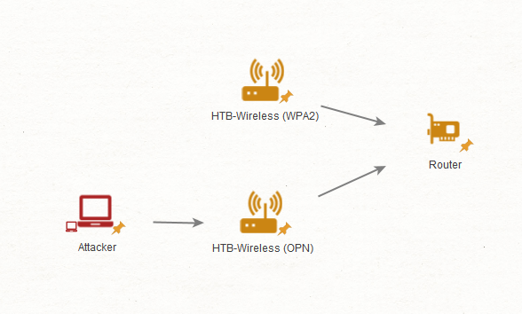
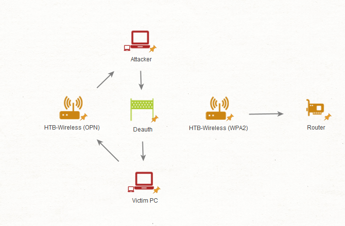
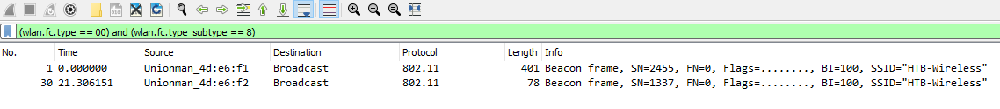
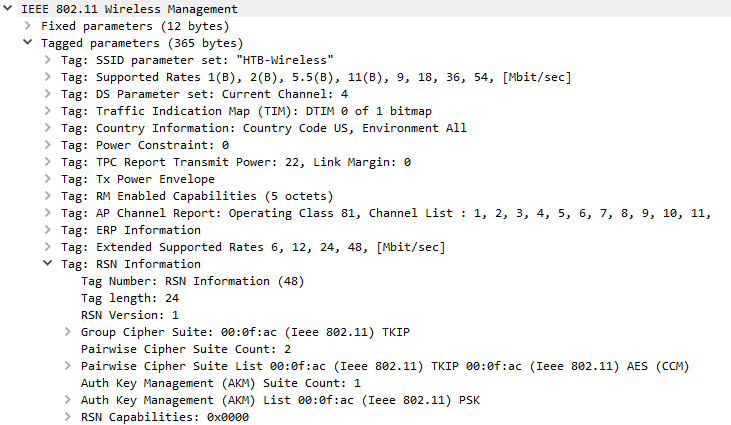
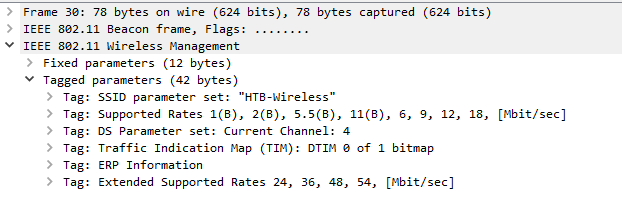
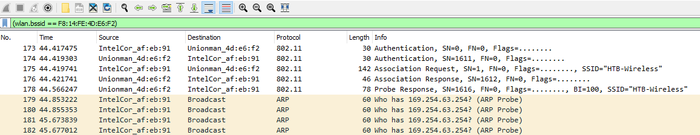

# Rogue Access Point & Evil-Twin Attacks (Tấn công Rogue Access Point và Evil-Twin)

**Tệp PCAP liên quan**:

* `rogueap.cap`

--- 

Xử lý các rogue access point (điểm truy cập trái phép) và các cuộc tấn công evil-twin (điểm truy cập "song sinh độc hại") có thể là một nhiệm vụ khổng lồ do bản chất thường khó nắm bắt của chúng. Tuy nhiên, với các chiến lược phù hợp, những access point bất hợp pháp này có thể được phát hiện và quản lý hiệu quả. Trong phạm vi các access point độc hại, tấn công rogue và evil-twin luôn nổi lên như những mối lo ngại đáng kể.



Rogue access point chủ yếu đóng vai trò công cụ để vượt qua các biện pháp kiểm soát vành đai (perimeter control) đang có. Kẻ tấn công có thể lắp đặt một access point như vậy để lách các biện pháp kiểm soát mạng và các rào cản phân vùng (segmentation), mà trong nhiều trường hợp có thể ở dạng hotspot hoặc kết nối chia sẻ (tethered connection). Những rogue access point này thậm chí từng được biết là đã xâm nhập vào cả các mạng air-gapped (mạng cách ly vật lý). Chức năng chính của chúng là cung cấp quyền truy cập trái phép vào các phần bị hạn chế của mạng. Điểm then chốt cần nhớ ở đây là rogue access point được kết nối trực tiếp vào mạng.

---

## Evil-Twin

Ngược lại, evil-twin được kẻ tấn công dựng lên cho nhiều mục đích khác nhau. Điểm mấu chốt ở đây là trong hầu hết các trường hợp, những access point này không kết nối vào mạng của ta. Thay vào đó, chúng là các access point độc lập, có thể chạy một web server hoặc thứ gì đó khác để đóng vai man-in-the-middle đối với các wireless client.



Kẻ tấn công có thể dựng các access point này để thu thập mật khẩu wireless hoặc mật khẩu domain, cùng nhiều thông tin khác. Thông thường, các cuộc tấn công này cũng có thể bao gồm cả tấn công hostile portal (cổng đăng nhập độc hại).

## Phát hiện bằng Airodump-ng

Ngay lập tức, ta có thể dùng filter ESSID của Airodump-ng để phát hiện các access point kiểu Evil-Twin.

```shell-session
[!bash!]$ sudo airodump-ng -c 4 --essid HTB-Wireless wlan0 -w raw

 CH  4 ][ Elapsed: 1 min ][ 2023-07-13 16:06    
 BSSID              PWR RXQ  Beacons    #Data, #/s  CH   MB   ENC CIPHER  AUTH ESSID
 F8:14:FE:4D:E6:F2   -7 100      470      155    0   4   54   OPN              HTB-Wireless
 F8:14:FE:4D:E6:F1   -5  96      682        0    0   4  324   WPA2 CCMP   PSK  HTB-Wireless 
```

Ví dụ trên cho thấy thực tế kẻ tấn công có thể đã dựng một access point mở (open) có ESSID giống hệt access point của ta. Kẻ tấn công có thể làm vậy để triển khai cái thường được gọi là tấn công hostile portal. Kẻ tấn công dùng tấn công hostile portal nhằm lấy thông tin đăng nhập (credential) của người dùng, cùng nhiều hành vi bất chính khác.

Ta cũng nên cảnh giác với các nỗ lực deauthentication, vì chúng có thể là biện pháp cưỡng ép từ kẻ tấn công đang vận hành access point evil-twin.

Để khẳng định chắc chắn đây là một bất thường hay chỉ là lỗi của Airodump-ng, ta có thể bắt đầu phân tích traffic (`rogueap.cap`). Để lọc các beacon frame, ta có thể dùng filter sau.

- `(wlan.fc.type == 00) and (wlan.fc.type_subtype == 8)`



Phân tích beacon đóng vai trò then chốt trong việc phân biệt access point thật và access point giả mạo. Một trong những chỗ đầu tiên nên bắt đầu là thông tin `Robust Security Network (RSN)`. Dữ liệu này truyền đạt cho client những thông tin giá trị về các cipher được hỗ trợ, cùng nhiều thứ khác.

Giả sử ta muốn xem xét thông tin RSN của access point hợp lệ của mình.



Nó cho thấy WPA2 được hỗ trợ với AES và TKIP, dùng PSK làm cơ chế xác thực. Tuy nhiên, khi chuyển sang thông tin RSN của access point bất hợp pháp, ta có thể thấy nó vắng mặt một cách lộ liễu.



Trong hầu hết các trường hợp, một cuộc tấn công evil-twin thông thường sẽ thể hiện đặc điểm này. Tuy vậy, ta luôn nên dò xét thêm các field khác để tìm điểm bất nhất, đặc biệt khi đối phó với các cuộc tấn công evil-twin tinh vi hơn. Ví dụ, kẻ tấn công có thể dùng chính cipher mà access point của ta đang dùng, khiến việc phát hiện cuộc tấn công này khó khăn hơn.

Trong những trường hợp như vậy, ta có thể tìm hiểu các khía cạnh khác của beacon frame, chẳng hạn thông tin vendor-specific (riêng của nhà sản xuất), vốn nhiều khả năng không có trên access point của kẻ tấn công.

## Tìm người dùng đã sập bẫy

Dù đã được đào tạo nâng cao nhận thức bảo mật (security awareness training) toàn diện, một số người dùng vẫn có thể trở thành nạn nhân của những cuộc tấn công như thế này. May mắn là, với các cuộc tấn công evil-twin kiểu mạng mở (open network), ta có thể xem phần lớn traffic ở tầng cao hơn dưới dạng không mã hoá. Để chỉ lọc riêng access point evil-twin, ta sẽ dùng filter sau.

- `(wlan.bssid == F8:14:FE:4D:E6:F2)`



Nếu phát hiện các ARP request phát ra từ một thiết bị client đang kết nối vào mạng đáng ngờ, ta sẽ xác định đây là một dấu hiệu có thể đã bị xâm nhập (compromise indicator). Trong những trường hợp như vậy, ta nên ghi lại các thông tin liên quan về thiết bị client để phục vụ công tác ứng phó sự cố (incident response).

1. `Its MAC address` (địa chỉ MAC của thiết bị)
2. `Its host name` (host name của thiết bị)

Nhờ đó, ta có thể tiến hành đặt lại mật khẩu (password reset) và các biện pháp phản ứng khác để ngăn môi trường của mình tiếp tục bị xâm phạm.

## Tìm Rogue Access Point

Mặt khác, việc phát hiện rogue access point thường có thể đơn giản là kiểm tra danh sách thiết bị mạng của ta. Với các rogue access point dạng hotspot (chẳng hạn hotspot của Windows), ta có thể rà soát các mạng không dây ngay xung quanh. Nếu gặp một mạng không dây lạ có tín hiệu mạnh, đặc biệt là khi nó không được mã hoá, điều này có thể cho thấy một người dùng đã dựng rogue access point để lách qua các biện pháp kiểm soát vành đai của ta.
