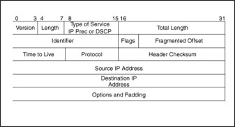
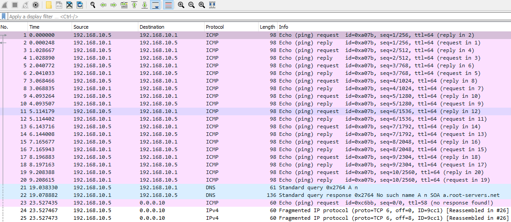
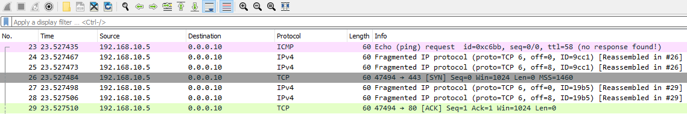
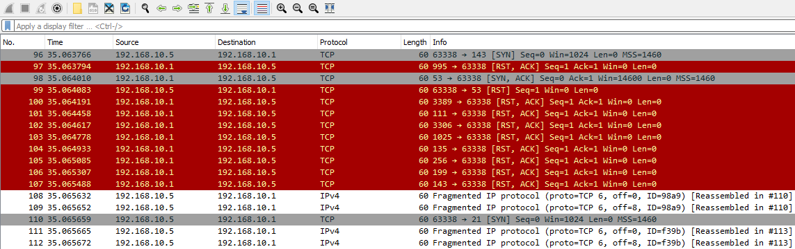

# Fragmentation Attacks (Tấn công phân mảnh)

**File PCAP liên quan**:

* `nmap_frag_fw_bypass.pcapng`

---

Khi bắt đầu tìm kiếm các bất thường trên mạng (network anomaly), ta luôn nên xem xét tầng IP. Nói đơn giản, tầng IP đảm nhiệm việc chuyển packet từ hop này sang hop khác. Tầng này dùng địa chỉ IP nguồn và đích để các host giao tiếp với nhau. Khi xem xét traffic này, ta có thể xác định các địa chỉ IP vì chúng nằm trong IP header của packet.

Tuy nhiên, cần lưu ý rằng tầng này không có cơ chế nào để nhận biết khi packet bị mất, bị drop hay bị can thiệp (tamper) theo cách nào đó. Thay vào đó, ta cần hiểu rằng những sự cố này được xử lý bởi tầng transport hoặc tầng application của dữ liệu đó. Để mổ xẻ các packet này, ta có thể tìm hiểu một số field của chúng:

1. `Length - IP header length`: Field này chứa tổng độ dài của IP header.
2. `Total Length - IP Datagram/Packet Length`: Field này cho biết toàn bộ độ dài của IP packet, bao gồm cả dữ liệu đi kèm.
3. `Fragment Offset`: Trong nhiều trường hợp, khi một packet đủ lớn để bị chia nhỏ, fragmentation offset sẽ được thiết lập để cung cấp chỉ dẫn ráp lại (reassemble) packet khi nó tới host đích.
4. `Source and Destination IP Addresses`: Các field này chứa địa chỉ IP nguồn (nơi xuất phát) và địa chỉ IP đích của hai host đang giao tiếp.



## Các field thường bị lạm dụng

Về bản chất, kẻ tấn công có thể tự chế tạo (craft) các packet này để gây ra sự cố giao tiếp. Theo cách truyền thống, kẻ tấn công có thể cố gắng né tránh các cơ chế kiểm soát của IDS bằng cách làm sai dạng (malformation) hoặc chỉnh sửa packet. Vì vậy, việc đi sâu vào từng field và hiểu cách phát hiện việc chúng bị lạm dụng sẽ trang bị cho ta công cụ để phân tích traffic thành công.

## Lạm dụng fragmentation

Fragmentation (phân mảnh) là cách để các host hợp lệ truyền những khối dữ liệu lớn cho nhau bằng cách chia nhỏ packet rồi ráp lại khi tới nơi. Việc này thường được thực hiện thông qua thiết lập maximum transmission unit (MTU). MTU được dùng làm chuẩn để chia các packet lớn thành những phần có kích thước bằng nhau, đủ chứa toàn bộ dữ liệu truyền đi. Cần lưu ý rằng packet cuối cùng nhiều khả năng sẽ nhỏ hơn. Field này cung cấp chỉ dẫn cho host đích về cách ráp các packet này lại theo đúng thứ tự logic.

Thông thường, kẻ tấn công có thể lạm dụng field này cho các mục đích sau:

1. `IPS/IDS Evasion` - Giả sử các cơ chế phát hiện xâm nhập của ta không ráp lại các packet bị phân mảnh. Nói ngắn gọn, kẻ tấn công có thể phân mảnh lệnh nmap hoặc các kỹ thuật enumeration khác, nhờ đó vượt qua các cơ chế kiểm soát này và được ráp lại tại đích.

2. `Firewall Evasion` - Tương tự, thông qua fragmentation, kẻ tấn công cũng có thể né tránh các cơ chế kiểm soát của firewall. Một lần nữa, nếu firewall không ráp lại các packet này trước khi chuyển tới host đích, nỗ lực enumeration của kẻ tấn công có thể thành công.

3. `Firewall/IPS/IDS Resource Exhaustion` - Giả sử kẻ tấn công thiết kế cuộc tấn công để phân mảnh packet theo MTU rất nhỏ (10, 15, 20, v.v.), cơ chế kiểm soát mạng có thể không ráp lại các packet này do giới hạn tài nguyên, và kẻ tấn công có thể thành công trong việc enumeration.

4. `Denial of Service` - Với các host đời cũ, kẻ tấn công có thể dùng fragmentation để gửi IP packet vượt quá 65535 byte thông qua ping hoặc các lệnh khác. Khi đó, host đích sẽ ráp lại packet độc hại này và gặp vô số sự cố khác nhau. Kết quả là kẻ tấn công thực hiện thành công denial-of-service (từ chối dịch vụ).

Nếu cơ chế mạng của ta hoạt động đúng, nó cần làm như sau:

- `Delayed Reassembly` - IDS/IPS/Firewall nên hành xử giống như host đích, tức là chờ cho tất cả các fragment tới nơi để dựng lại toàn bộ dữ liệu truyền rồi mới thực hiện kiểm tra packet (packet inspection).

## Tìm bất thường trong Fragment Offset

Để hiểu rõ hơn các cơ chế nói trên, ta có thể mở file capture traffic liên quan trong Wireshark.

```shell-session
[!bash!]$ wireshark nmap_frag_fw_bypass.pcapng
```

Trước hết, ta có thể thấy một số ICMP request đi từ một host tới một host khác — đây là dấu hiệu của các request khởi đầu trong một lần quét Nmap thông thường. Đây là bước đầu của quá trình host discovery (dò tìm host). Kẻ tấn công có thể chạy một lệnh như sau.

#### Enumeration của kẻ tấn công
```shell-session
[!bash!]$ nmap <host ip>
```

Khi đó, chúng sẽ tạo ra traffic như sau.



Tiếp theo, kẻ tấn công có thể chỉ định kích thước maximum transmission unit như sau để phân mảnh các packet quét port.

```shell-session
[!bash!]$ nmap -f 10 <host ip>
```

Khi đó, chúng sẽ tạo ra các IP packet có kích thước tối đa là 10. Việc thấy rất nhiều fragmentation từ một host có thể là dấu hiệu của kiểu tấn công này, và nó sẽ trông như sau.



Tuy nhiên, dấu hiệu đáng chú ý hơn của một lần quét phân mảnh, bất kể nó có dùng để né tránh hay không, là hiện tượng một host đơn lẻ kết nối tới nhiều port mà nó tạo ra. Hãy xem ví dụ sau.



Trong trường hợp này, host đích sẽ phản hồi bằng cờ RST cho những port không có dịch vụ nào đang chạy (tức là port đóng). Mẫu hành vi này là dấu hiệu rõ ràng của một lần quét phân mảnh.

Nếu Wireshark không ráp lại packet để ta kiểm tra, ta có thể nhanh chóng thay đổi trong phần preferences của giao thức IPv4.


