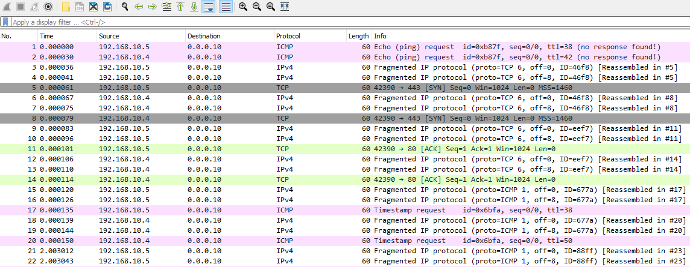
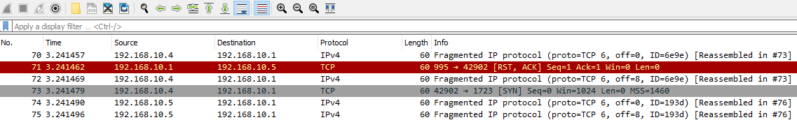
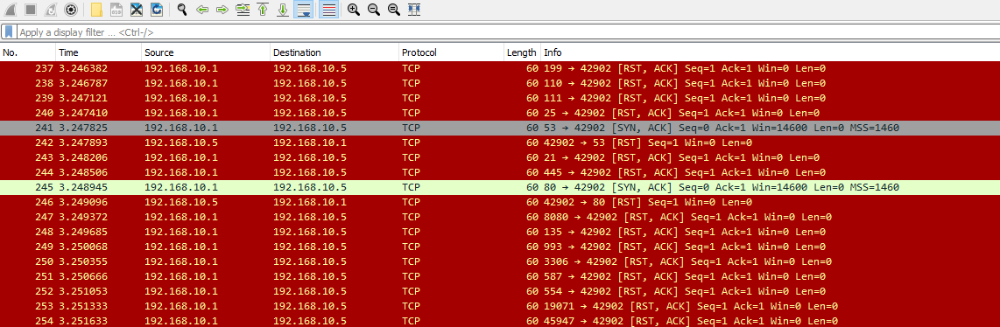
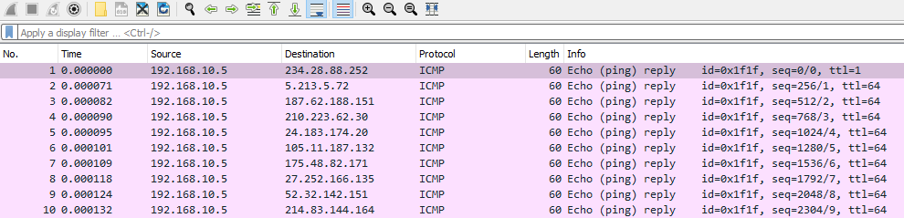
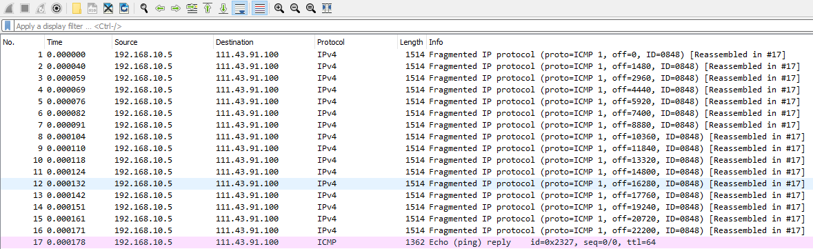
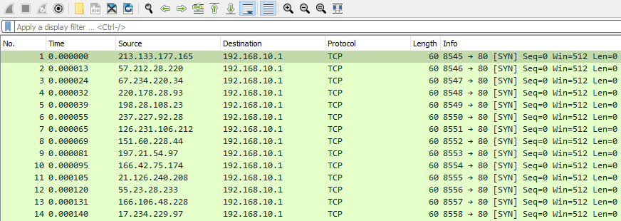
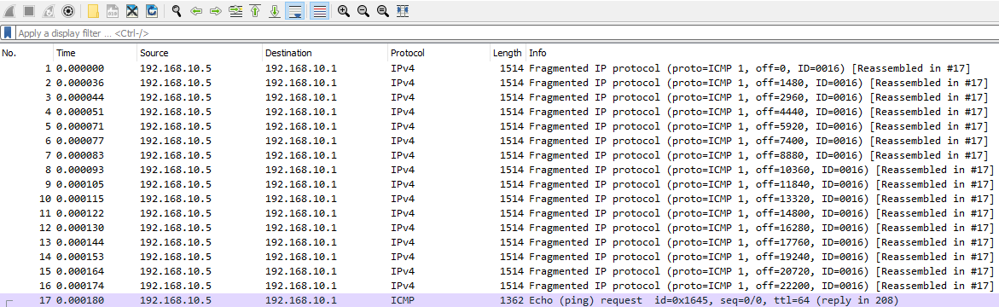
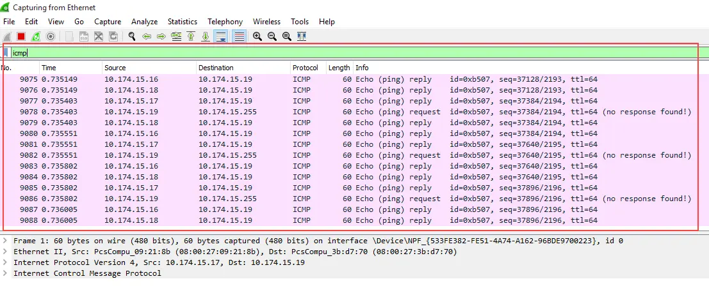
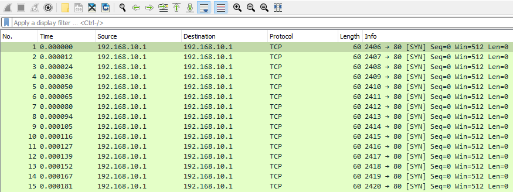

# IP Source & Destination Spoofing Attacks (Tấn công giả mạo IP nguồn và đích)

Có nhiều trường hợp ta có thể thấy traffic bất thường đối với các packet IPv4 và IPv6. Trong nhiều trường hợp như vậy, việc này có thể được thực hiện thông qua các field IP nguồn và IP đích. Khi phân tích các field này trong quá trình phân tích traffic, ta luôn nên cân nhắc những điều sau.

1. `The Source IP Address should always be from our subnet` (địa chỉ IP nguồn luôn phải thuộc subnet của ta) - Nếu ta thấy một packet đi vào có IP nguồn nằm ngoài mạng cục bộ (LAN) của ta, đây có thể là dấu hiệu của việc chế tạo packet (packet crafting).

2. `The Source IP for outgoing traffic should always be from our subnet` (IP nguồn của traffic đi ra luôn phải thuộc subnet của ta) - Nếu IP nguồn thuộc một dải IP khác với mạng cục bộ của ta, đây có thể là dấu hiệu của traffic độc hại xuất phát từ bên trong mạng của ta.

Kẻ tấn công có thể thực hiện các cuộc tấn công chế tạo packet nhắm vào địa chỉ IP nguồn và đích vì nhiều lý do hoặc mục đích khác nhau. Dưới đây là một số kiểu ta có thể tìm kiếm:

1. `Decoy Scanning` - Nhằm vượt qua các giới hạn của firewall, kẻ tấn công có thể thay đổi IP nguồn của packet để thu thập thêm thông tin (enumerate) về một host ở phân đoạn mạng (network segment) khác. Bằng cách đổi IP nguồn thành một địa chỉ nằm cùng subnet với host mục tiêu, kẻ tấn công có thể né tránh firewall thành công.

2. `Random Source Attack DDoS` - Thông qua việc tạo IP nguồn ngẫu nhiên, kẻ tấn công có thể gửi lượng traffic khổng lồ tới cùng một port trên host nạn nhân. Trong nhiều trường hợp, cách này được dùng để làm cạn kiệt tài nguyên của các cơ chế kiểm soát mạng hoặc của host đích.

3. `LAND Attacks` - LAND Attack hoạt động tương tự Random Source denial-of-service ở chỗ địa chỉ nguồn được đặt giống với địa chỉ của host đích. Bằng cách đó, kẻ tấn công có thể làm cạn kiệt tài nguyên mạng hoặc khiến host mục tiêu bị crash.

4. `SMURF Attacks` - Tương tự LAND và Random Source attack, SMURF attack hoạt động bằng cách kẻ tấn công gửi một lượng lớn packet ICMP tới nhiều host khác nhau. Tuy nhiên, trong trường hợp này địa chỉ nguồn được đặt thành địa chỉ của máy nạn nhân, và tất cả các host nhận được packet ICMP này đều phản hồi bằng ICMP reply, gây cạn kiệt tài nguyên tại địa chỉ nguồn bị giả mạo (nạn nhân).

5. `Initialization Vector Generation` - Trong các mạng không dây đời cũ như wired equivalent privacy (WEP), kẻ tấn công có thể bắt, giải mã, chế tạo và inject lại một packet với địa chỉ IP nguồn và đích đã bị sửa đổi nhằm sinh ra các initialization vector (IV), từ đó xây dựng bảng giải mã cho một cuộc tấn công thống kê. Trong thực tế, có thể nhận ra kiểu này qua lượng packet lặp lại quá mức giữa các host.

Cần lưu ý rằng, khác với ARP poisoning, các cuộc tấn công ta tìm hiểu trong phần này bắt nguồn từ giao tiếp ở tầng IP chứ không nhất thiết là ARP poisoning. Tuy nhiên, với phần lớn các hoạt động độc hại, các cuộc tấn công này thường được thực hiện song song với nhau.

---

## Tìm các lần Decoy Scanning

**File PCAP liên quan**:
* `decoy_scanning_nmap.pcapng`

Nói đơn giản, khi muốn thu thập thông tin, kẻ tấn công có thể đổi địa chỉ nguồn của mình thành địa chỉ của một host hợp lệ khác, hoặc trong một số trường hợp là một địa chỉ hoàn toàn khác với bất kỳ host thật nào. Mục đích là cố gắng né tránh các cơ chế kiểm soát của IDS/Firewall, và điều này có thể dễ dàng quan sát được. 

Trong trường hợp decoy scanning (quét mồi nhử), ta sẽ thấy một số hành vi lạ.

1. `Initial Fragmentation from a fake address` (fragmentation ban đầu từ một địa chỉ giả)
2. `Some TCP traffic from the legitimate source address` (một ít traffic TCP từ địa chỉ nguồn hợp lệ)

Thứ hai, trong kiểu tấn công này, kẻ tấn công có thể đang cố che giấu địa chỉ của mình bằng một mồi nhử (decoy), nhưng các phản hồi cho nhiều port đóng vẫn sẽ được gửi về phía chúng với cờ RST của TCP.

Ta chắc chắn sẽ nhận ra điều này khi có một dải port lớn không chạy dịch vụ nào trên host nạn nhân. 

Vì vậy, ngoài việc phát hiện thông qua phân tích traffic, một cách đơn giản khác để ngăn chặn kiểu tấn công này là như sau.

1. `Have our IDS/IPS/Firewall act as the destination host would` (để IDS/IPS/Firewall hành xử như host đích) - Theo nghĩa là việc dựng lại các packet sẽ cho thấy rõ dấu hiệu hoạt động độc hại.

2. `Watch for connections started by one host, and taken over by another` (theo dõi các kết nối do một host khởi tạo nhưng bị một host khác tiếp quản) - Suy cho cùng, kẻ tấn công buộc phải để lộ địa chỉ nguồn thật của mình để biết được một port có đang mở hay không. Đây là hành vi lạ và ta có thể định nghĩa rule để ngăn chặn nó.

## Tìm các Random Source Attack

**File PCAP liên quan**:
* `ICMP_rand_source.pcapng`
* `ICMP_rand_source_larg_data.pcapng`
* `TCP_rand_source_attacks.pcapng`

Ở chiều ngược lại, ta có thể bắt đầu tìm hiểu các cuộc tấn công denial-of-service thông qua giả mạo địa chỉ nguồn và đích. Một trong những ví dụ chính và đáng chú ý là random source attack. Kiểu tấn công này có thể được thực hiện theo nhiều biến thể khác nhau. Tuy nhiên, đáng chú ý là nó có thể được thực hiện như một SMURF attack đảo ngược, trong đó nhiều host sẽ ping tới một host không tồn tại, và host bị ping sẽ ping ngược lại tất cả các host kia mà không nhận được phản hồi nào.

Ta cũng nên cân nhắc rằng kẻ tấn công có thể phân mảnh traffic từ các host ngẫu nhiên này để gây cạn kiệt tài nguyên nhiều hơn. 

Tuy nhiên, trong nhiều trường hợp, giống như LAND attack, kẻ tấn công sẽ dùng các cuộc tấn công này để làm cạn kiệt tài nguyên của một dịch vụ cụ thể trên một port. Thay vì giả mạo địa chỉ nguồn giống với địa chỉ đích, kẻ tấn công có thể tạo ngẫu nhiên chúng. Ta có thể thấy như sau.

Trong trường hợp này, ta có một vài dấu hiệu của hành vi độc hại:

1. `Single Port Utilization from random hosts` (một port duy nhất bị nhiều host ngẫu nhiên sử dụng)
2. `Incremental Base Port with a lack of randomization` (base port tăng dần, thiếu tính ngẫu nhiên)
3. `Identical Length Fields` (các field length giống hệt nhau)

Trong nhiều trường hợp thực tế, chẳng hạn một web server, ta có thể có nhiều người dùng khác nhau cùng sử dụng một port. Tuy nhiên, các request đó trái ngược với các dấu hiệu trên: chúng sẽ có độ dài khác nhau và base port sẽ không thể hiện hành vi như vậy.

## Tìm các Smurf Attack

SMURF Attack là một kiểu tấn công distributed denial-of-service (DDoS) đáng chú ý, ở chỗ nó hoạt động bằng cách khiến các host ngẫu nhiên ping ngược lại host nạn nhân. Nói đơn giản, kẻ tấn công thực hiện như sau:

1. `The attacker will send an ICMP request to live hosts with a spoofed address of the victim host` (kẻ tấn công gửi ICMP request tới các host đang hoạt động với địa chỉ giả mạo là địa chỉ của host nạn nhân)

2. `The live hosts will respond to the legitimate victim host with an ICMP reply` (các host đang hoạt động sẽ phản hồi tới host nạn nhân thật bằng ICMP reply)

3. `This may cause resource exhaustion on the victim host` (việc này có thể gây cạn kiệt tài nguyên trên host nạn nhân)

Một trong những điều ta có thể tìm kiếm trong hành vi traffic là lượng ICMP reply quá mức từ một host đơn lẻ tới host bị ảnh hưởng. Đôi khi kẻ tấn công sẽ thêm fragmentation và dữ liệu vào các ICMP request này để làm lượng traffic lớn hơn.

Ta có thể thấy nhiều host khác nhau cùng ping tới một host duy nhất của ta, và trong trường hợp này nó thể hiện bản chất cơ bản của SMURF attack.

**Nguồn ảnh**: [https://techofide.com/blogs/what-is-smurf-attack-what-is-the-denial-of-service-attack-practical-ddos-attack-step-by-step-guide/](https://techofide.com/blogs/what-is-smurf-attack-what-is-the-denial-of-service-attack-practical-ddos-attack-step-by-step-guide/)

## Tìm các LAND Attack

**File PCAP liên quan**:
* `LAND-DoS.pcapng`

LAND attack hoạt động bằng cách kẻ tấn công giả mạo địa chỉ IP nguồn giống với địa chỉ đích. Các cuộc tấn công denial-of-service này dựa vào lượng traffic khổng lồ và việc tái sử dụng port. Về cơ bản, nếu mọi base port đều bị chiếm dụng, việc thiết lập các kết nối thật tới host bị ảnh hưởng sẽ trở nên khó khăn hơn nhiều.

