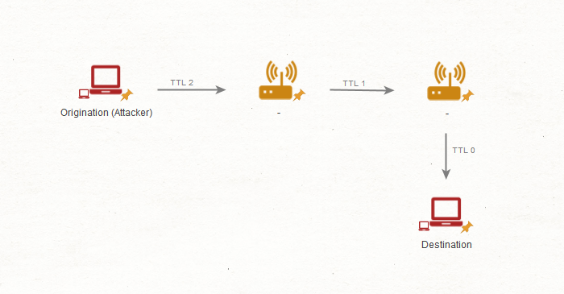
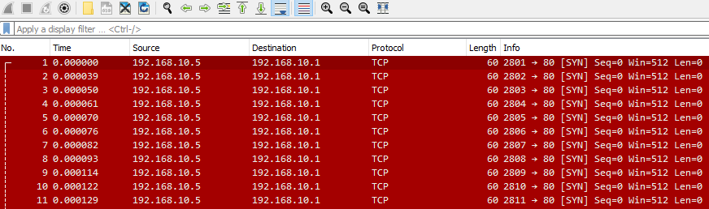
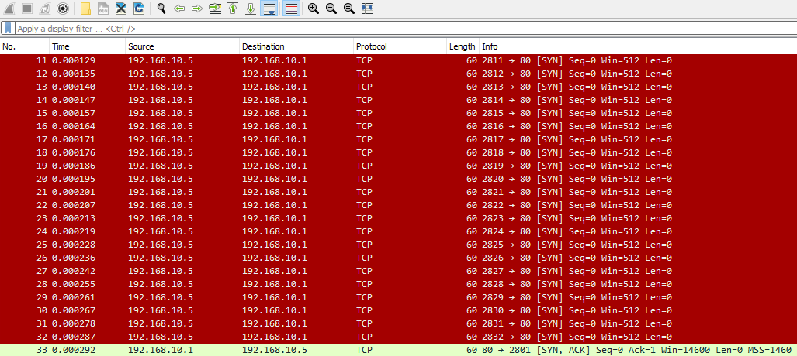
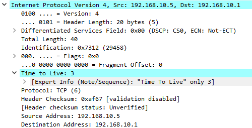

# IP Time-to-Live Attacks (Tấn công lợi dụng IP Time-to-Live)

**File PCAP liên quan**:

* `ip_ttl.pcapng`

---

Time-to-Live attack chủ yếu được kẻ tấn công dùng như một phương thức né tránh (evasion). Về cơ bản, kẻ tấn công sẽ cố tình đặt TTL rất thấp cho các IP packet của mình để cố né tránh firewall, hệ thống IDS và IPS. Chúng hoạt động như sau.

1. Kẻ tấn công sẽ chế tạo một IP packet có giá trị TTL cố tình đặt thấp (1, 2, 3, v.v.).

2. Qua mỗi host mà packet này đi qua, giá trị TTL sẽ bị giảm đi một cho tới khi về 0.

3. Khi về 0, packet này sẽ bị loại bỏ (discard). Kẻ tấn công sẽ cố khiến packet bị loại bỏ trước khi nó tới firewall hoặc hệ thống lọc để tránh bị phát hiện/kiểm soát.

4. Khi các packet hết hạn, các router dọc đường đi sẽ sinh ra thông điệp ICMP Time Exceeded và gửi ngược về địa chỉ IP nguồn.

#### Tìm bất thường trong IP TTL

Trước hết, ta có thể bắt đầu dump traffic và mở nó trong Wireshark. Phát hiện kiểu này khi nó chỉ xuất hiện với số lượng nhỏ có thể khó, nhưng may mắn là phần lớn kẻ tấn công sẽ dùng thao túng TTL trong các lần quét port. Ngay lập tức, ta có thể thấy điều gì đó như sau.

Tuy nhiên, ta cũng có thể thấy một thông điệp SYN, ACK được trả về từ một trong các port dịch vụ hợp lệ trên host bị ảnh hưởng. Như vậy, kẻ tấn công có thể đã né tránh thành công một trong các cơ chế kiểm soát firewall của ta.

Vậy nếu mở một trong các packet này, ta có thể thấy rõ lý do. Giả sử ta mở tab IPv4 trong Wireshark cho bất kỳ packet nào trong số này. Ta có thể thấy TTL rất thấp như sau.

Vì vậy, ta có thể triển khai một cơ chế kiểm soát loại bỏ hoặc lọc các packet không có TTL đủ cao. Bằng cách đó, ta có thể ngăn chặn những dạng tấn công chế tạo IP packet này.
