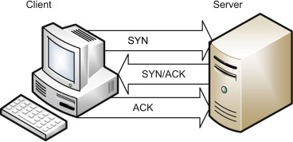
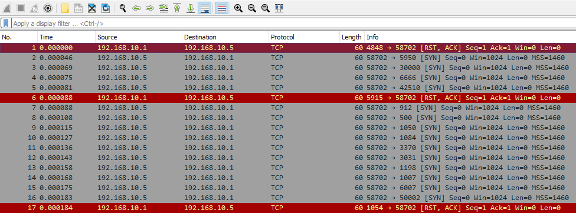
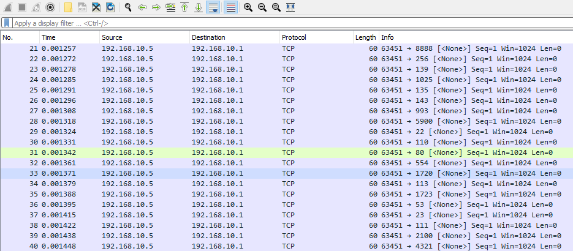
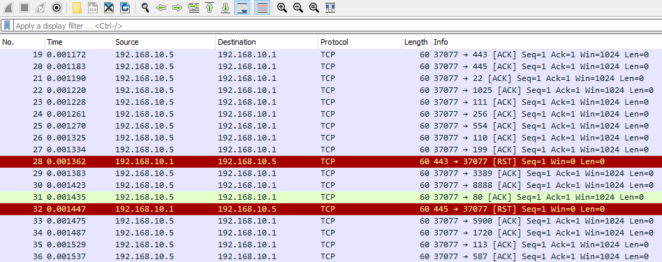
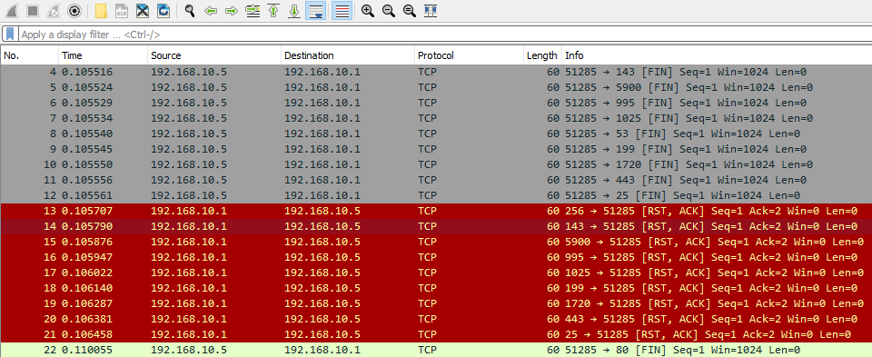
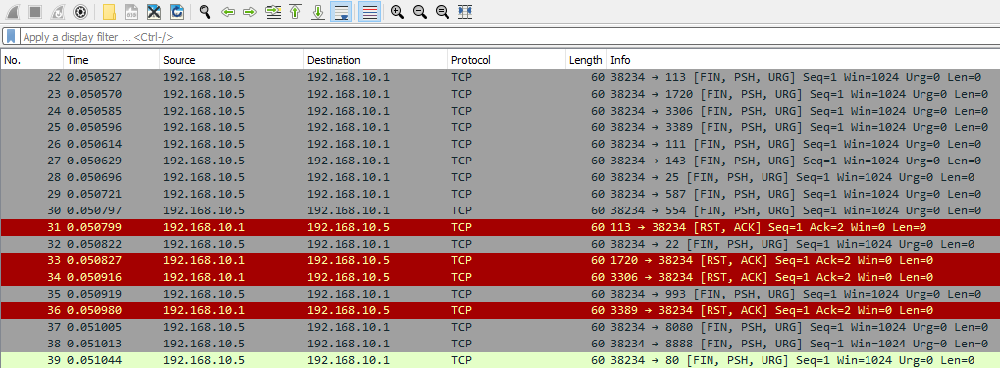

# TCP Handshake Abnormalities (Bất thường trong TCP handshake)

Về bản chất, khi kẻ tấn công thu thập thông tin về các dịch vụ TCP của ta, ta có thể nhận thấy một vài hành vi lạ trong quá trình phân tích traffic. Trước hết, hãy xem các kết nối TCP bình thường hoạt động thế nào với cơ chế bắt tay 3 bước (3-way handshake).

Để khởi tạo một kết nối TCP cho bất kỳ mục đích nào, trước tiên client gửi một TCP SYN request tới máy mà nó đang cố kết nối để bắt đầu kết nối TCP. 

Nếu port này mở và thực sự có thể kết nối được, máy đó sẽ phản hồi bằng TCP SYN/ACK để xác nhận rằng kết nối hợp lệ và có thể sử dụng. Tuy nhiên, ta nên xem xét tất cả các cờ (flag) TCP.

|**Cờ**|**Mô tả**|
|-|-|
| `URG (Urgent)` | Cờ này dùng để đánh dấu tính khẩn cấp của dữ liệu hiện tại trong stream.|
| `ACK (Acknowledgement)` | Cờ này xác nhận đã nhận được dữ liệu.|
| `PSH (Push)` | Cờ này yêu cầu TCP stack chuyển ngay dữ liệu nhận được lên tầng application, bỏ qua bộ đệm (buffering).|
| `RST (Reset)` | Cờ này dùng để chấm dứt kết nối TCP (ta sẽ đi sâu vào hijacking và RST attack ngay sau đây).|
| `SYN (Synchronize)` | Cờ này dùng để thiết lập kết nối ban đầu với TCP.|
| `FIN (Finish)` | Cờ này dùng để đánh dấu kết thúc một kết nối TCP. Nó được dùng khi không còn dữ liệu nào cần gửi.|
| `ECN (Explicit Congestion Notification)` | Cờ này dùng để báo hiệu tắc nghẽn trong mạng, giúp các host biết để tránh truyền lại (re-transmission) không cần thiết.|

Vì vậy, khi phân tích traffic, ta có thể tìm kiếm các tình trạng bất thường sau:

1. `Too many flags of a kind or kinds` (quá nhiều cờ của một hoặc một số loại) - Điều này có thể cho thấy đang có hoạt động quét (scanning) trong mạng của ta.

2. `The usage of different and unusual flags` (sử dụng các cờ khác thường, bất thường) - Đôi khi điều này có thể chỉ ra một TCP RST attack, hijacking, hoặc đơn giản là một dạng né tránh cơ chế kiểm soát khi quét.

3. `Solo host to multiple ports, or solo host to multiple hosts` (một host tới nhiều port, hoặc một host tới nhiều host) - Khá đơn giản, ta có thể phát hiện việc quét như đã làm trước đây bằng cách để ý xem các kết nối này đi đâu từ một host. Trong nhiều trường hợp, ta thậm chí cần cân nhắc cả decoy scan và random source attack.

## Quá nhiều cờ SYN

**File PCAP liên quan**:
* `nmap_syn_scan.pcapng`

Ngay lập tức, một trong những mẫu traffic ta có thể nhận ra là có quá nhiều cờ SYN. Đây là ví dụ điển hình của việc quét bằng nmap. Nói đơn giản, đối thủ (adversary) sẽ gửi các packet TCP SYN tới các port mục tiêu. Trong trường hợp port của ta mở, máy của ta sẽ phản hồi bằng một packet SYN-ACK để tiếp tục handshake, và sau đó sẽ nhận lại một RST từ công cụ quét của kẻ tấn công. Tuy nhiên, ta có thể bị lạc giữa các RST ở đây vì máy của ta cũng sẽ phản hồi RST cho các port đóng.

Tuy nhiên, cần lưu ý rằng có hai kiểu quét chính dùng cờ SYN mà ta có thể phát hiện. Đó là:

1. `SYN Scans` - Trong các lần quét này, hành vi sẽ như ta thấy, nhưng kẻ tấn công sẽ chủ động kết thúc handshake sớm bằng cờ RST.

2. `SYN Stealth Scans` - Trong trường hợp này, kẻ tấn công sẽ cố né tránh phát hiện bằng cách chỉ hoàn tất một phần TCP handshake.

## Không có cờ nào

**File PCAP liên quan**:
* `nmap_null_scan.pcapng`

Ở chiều ngược lại, kẻ tấn công có thể không gửi cờ nào. Đây là kiểu thường được gọi là NULL scan. Trong NULL scan, kẻ tấn công gửi các packet TCP không có cờ nào. Các kết nối TCP sẽ hành xử như sau khi nhận được một packet NULL.

1. `If the port is open` (nếu port mở) - Hệ thống sẽ hoàn toàn không phản hồi vì không có cờ nào. 

2. `If the port is closed` (nếu port đóng) - Hệ thống sẽ phản hồi bằng một packet RST.

Vì vậy, một lần NULL scan có thể trông như sau.

## Quá nhiều ACK

**File PCAP liên quan**:
* `nmap_ack_scan.pcapng`

Mặt khác, ta có thể nhận thấy lượng acknowledgement (ACK) quá mức giữa hai host. Trong trường hợp này, kẻ tấn công có thể đang sử dụng ACK scan. Với ACK scan, các kết nối TCP sẽ hành xử như sau.

1. `If the port is open` (nếu port mở) - Máy bị ảnh hưởng sẽ hoặc không phản hồi, hoặc phản hồi bằng một packet RST.

2. `If the port is closed` (nếu port đóng) - Máy bị ảnh hưởng sẽ phản hồi bằng một packet RST.

Vì vậy, ta có thể thấy traffic như sau, cho thấy đang có một lần ACK scan.

## Quá nhiều FIN

**File PCAP liên quan**:
* `nmap_fin_scan.pcapng`

Lợi dụng một phần khác của handshake, kẻ tấn công có thể dùng FIN scan. Trong trường hợp này, tất cả các packet TCP sẽ được đánh dấu cờ FIN. Ta có thể thấy máy bị ảnh hưởng hành xử như sau.

1. `If the port is open` (nếu port mở) - Máy bị ảnh hưởng đơn giản là sẽ không phản hồi.

2. `If the port is closed` (nếu port đóng) - Máy bị ảnh hưởng sẽ phản hồi bằng một packet RST.

## Đơn giản là quá nhiều cờ

**File PCAP liên quan**:
* `nmap_xmas_scan.pcapng`

Giả sử kẻ tấn công chỉ muốn "thử đại xem cái nào ăn". Khi đó, chúng có thể dùng Xmas tree scan, tức là bật tất cả các cờ TCP trên các packet truyền đi. Tương tự, host bị ảnh hưởng có thể phản hồi như sau khi tất cả các cờ đều được bật.

1. `If the port is open` (nếu port mở) - Máy bị ảnh hưởng sẽ không phản hồi, hoặc ít nhất sẽ phản hồi bằng một packet RST.

2. `If the port is closed` (nếu port đóng) - Máy bị ảnh hưởng sẽ phản hồi bằng một packet RST.

Xmas tree scan khá dễ nhận ra và trông như sau.

