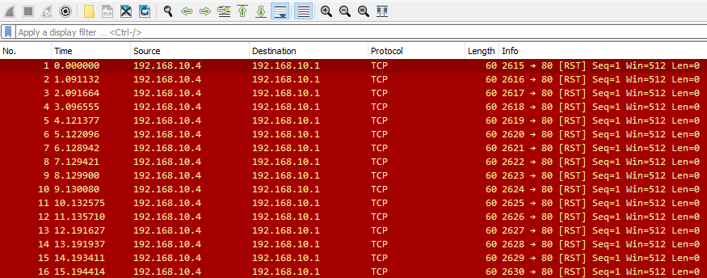
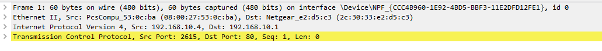
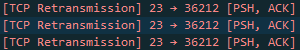

# TCP Connection Resets & Hijacking (Reset và chiếm quyền kết nối TCP)

Đáng tiếc là TCP không cung cấp mức bảo vệ đủ để ngăn các host của ta bị kẻ tấn công chấm dứt hoặc chiếm quyền (hijack) kết nối. Vì vậy, ta có thể thấy một kết nối bị chấm dứt bởi một packet RST, hoặc bị chiếm quyền thông qua connection hijacking.

## Chấm dứt kết nối TCP

**File PCAP liên quan**:
* `RST_Attack.pcapng`

Giả sử một đối thủ muốn gây ra tình trạng denial-of-service trong mạng của ta. Chúng có thể dùng một cuộc tấn công TCP RST Packet injection đơn giản, hay nói đơn giản là chấm dứt kết nối TCP. 

Cuộc tấn công này là sự kết hợp của một vài điều kiện:

1. `The attacker will spoof the source address to be the affected machine's` (kẻ tấn công giả mạo địa chỉ nguồn thành địa chỉ của máy bị ảnh hưởng)

2. `The attacker will modify the TCP packet to contain the RST flag to terminate the connection` (kẻ tấn công sửa packet TCP để chứa cờ RST nhằm chấm dứt kết nối)

3. `The attacker will specify the destination port to be the same as one currently in use by one of our machines.` (kẻ tấn công chỉ định port đích trùng với một port đang được một máy của ta sử dụng)

Vì vậy, ta có thể thấy một lượng packet quá mức đi tới một port.

Một cách để xác minh đây thực sự là TCP RST attack là thông qua địa chỉ vật lý (MAC) của bên truyền các packet TCP RST này. Giả sử địa chỉ IP 192.168.10.4 được đăng ký với aa:aa:aa:aa:aa:aa trong danh sách thiết bị mạng của ta, và ta thấy một địa chỉ MAC hoàn toàn khác đang gửi các packet này như sau.

Điều này cho thấy có hoạt động độc hại trong mạng của ta, và ta có thể kết luận nhiều khả năng đây là một TCP RST Attack. Tuy nhiên, cần lưu ý rằng kẻ tấn công có thể giả mạo địa chỉ MAC của mình để né tránh phát hiện tốt hơn. Trong trường hợp đó, ta có thể nhận thấy các lần truyền lại (retransmission) và các vấn đề khác như đã thấy trong phần ARP poisoning.

---

## Chiếm quyền kết nối TCP

**File PCAP liên quan**:
* `TCP-hijacking.pcap`

Với những kẻ tấn công cao cấp hơn, chúng có thể dùng TCP connection hijacking. Trong trường hợp này, kẻ tấn công sẽ chủ động theo dõi kết nối mục tiêu mà chúng muốn chiếm quyền. 

Sau đó, kẻ tấn công sẽ thực hiện dự đoán sequence number (sequence number prediction) để inject các packet độc hại của mình theo đúng thứ tự. Trong quá trình inject, chúng sẽ giả mạo địa chỉ nguồn giống với địa chỉ của máy bị ảnh hưởng.

Kẻ tấn công cần chặn không cho các ACK tới được máy bị ảnh hưởng để tiếp tục việc chiếm quyền. Chúng làm điều này bằng cách trì hoãn hoặc chặn các packet ACK. Vì vậy, kiểu tấn công này rất thường được dùng cùng với ARP poisoning, và ta có thể thấy như sau khi phân tích traffic.

