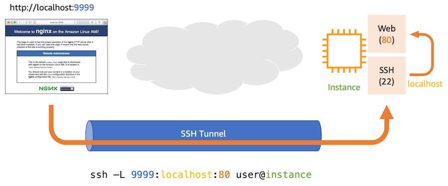
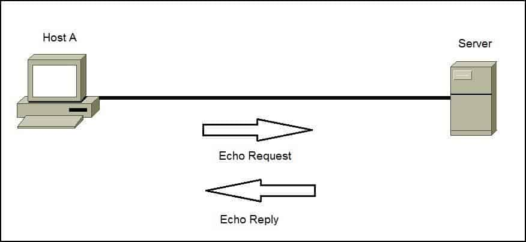
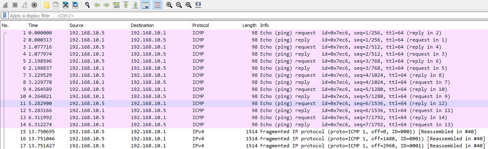
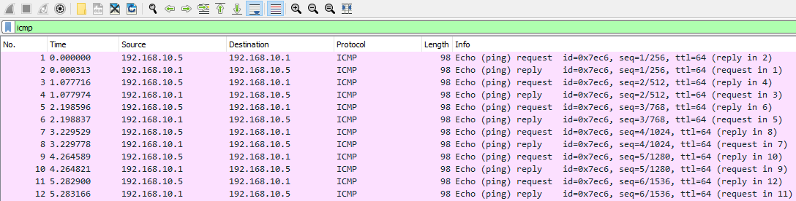
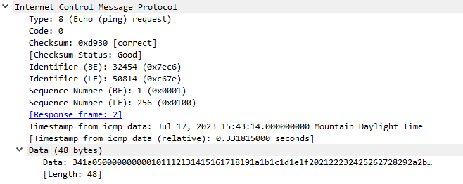
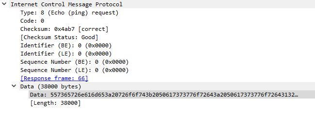
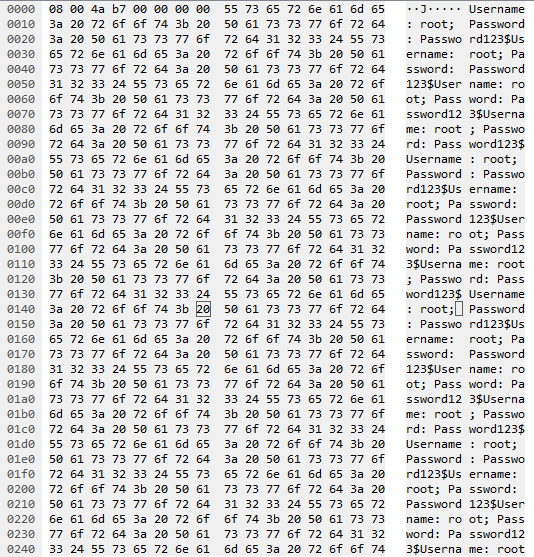
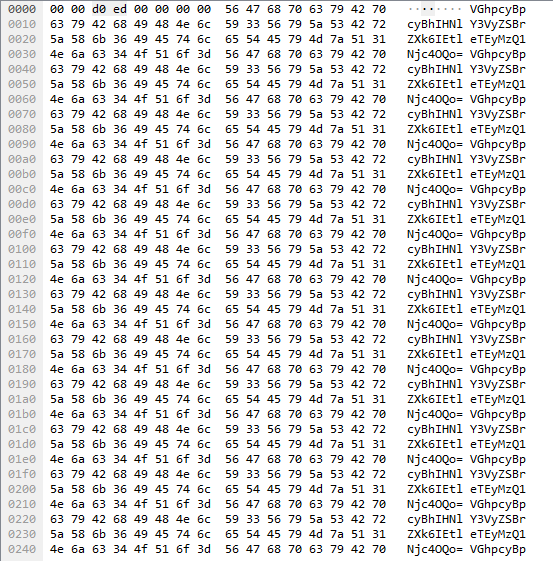

# ICMP Tunneling

**File PCAP liên quan**:
* `icmp_tunneling.pcapng`

---

Tunneling (tạo đường hầm) là kỹ thuật được đối thủ sử dụng để tuồn (exfiltrate) dữ liệu từ nơi này sang nơi khác. Có nhiều loại tunneling khác nhau, và mỗi loại dùng một giao thức khác nhau. Thông thường, kẻ tấn công có thể dùng proxy để vượt qua các cơ chế kiểm soát mạng của ta, hoặc dùng các giao thức mà hệ thống và cơ chế kiểm soát của ta cho phép. 

## Cơ bản về tunneling

Về cơ bản, khi kẻ tấn công muốn truyền dữ liệu tới một host khác, chúng có thể dùng tunneling. Trong nhiều trường hợp, ta có thể nhận ra điều này khi kẻ tấn công đã có quyền command and control trên một trong các máy của ta. Như đã nói, tunneling có thể được thực hiện theo nhiều cách khác nhau. Một trong những loại phổ biến hơn là SSH tunneling. Tuy nhiên, các loại dựa trên proxy, HTTP, HTTPs, DNS và các loại khác cũng có thể được quan sát theo cách tương tự.



Ý tưởng đằng sau tunneling là kẻ tấn công có thể mở rộng khả năng command and control và vượt qua các cơ chế kiểm soát mạng của ta thông qua giao thức mà chúng lựa chọn.

## ICMP Tunneling

Trong trường hợp ICMP tunneling, kẻ tấn công sẽ gắn dữ liệu mà chúng muốn tuồn ra bên ngoài hoặc tới một host khác vào field data của ICMP request. Việc này nhằm giấu dữ liệu trong một loại giao thức phổ biến như ICMP, với hy vọng nó sẽ lẫn vào traffic mạng của ta.



## Tìm ICMP Tunneling 

Vì ICMP tunneling chủ yếu được thực hiện bằng cách kẻ tấn công thêm dữ liệu vào field data của ICMP, ta có thể phát hiện nó bằng cách xem nội dung dữ liệu của từng request và reply.



Ta có thể lọc capture trong Wireshark để chỉ hiển thị các ICMP request và reply bằng cách nhập ICMP vào thanh filter.



Giả sử ta thấy fragmentation xảy ra trong traffic ICMP như ở trên, điều này cho thấy có một lượng lớn dữ liệu đang được truyền qua ICMP. Để hiểu hành vi này, ta nên xem một ICMP request bình thường. Ta có thể thấy dữ liệu có kích thước hợp lý, chẳng hạn 48 byte.



Tuy nhiên, một ICMP request đáng ngờ có thể có độ dài data lớn, chẳng hạn 38000 byte.



Nếu muốn xem dữ liệu đang được truyền, ta có thể nhìn vào phía bên phải màn hình trong Wireshark. Trong trường hợp này, ta có thể thấy những thứ như Username và Password đang được ping tới một host bên ngoài hoặc bên trong. Đây là dấu hiệu trực tiếp của ICMP tunneling.



Mặt khác, những đối thủ cao cấp hơn sẽ dùng encoding hoặc mã hoá khi truyền dữ liệu bị tuồn ra, kể cả trong trường hợp ICMP tunneling. Giả sử ta thấy như sau.



Ta có thể copy giá trị này ra khỏi Wireshark và decode nó trên Linux bằng tiện ích base64.

```shell-session
[!bash!]$ echo 'VGhpcyBpcyBhIHNlY3VyZSBrZXk6IEtleTEyMzQ1Njc4OQo=' | base64 -d
```

Đây cũng là một trường hợp quan sát thấy ICMP tunneling. Trong nhiều trường hợp, nếu độ dài data của ICMP lớn hơn 48 byte, ta biết có điều gì đó mờ ám đang diễn ra và luôn nên kiểm tra kỹ.

## Ngăn chặn ICMP Tunneling

Để ngăn chặn ICMP tunneling, ta có thể thực hiện các hành động sau.

1. `Block ICMP Requests` (chặn ICMP request) - Đơn giản là nếu ICMP không được phép, kẻ tấn công sẽ không thể sử dụng nó.

2. `Inspect ICMP Requests and Replies for Data` (kiểm tra dữ liệu trong ICMP request và reply) - Loại bỏ dữ liệu, hoặc kiểm tra dữ liệu trong các request và reply này để tìm nội dung độc hại, giúp ta có cái nhìn rõ hơn về môi trường của mình và có khả năng ngăn chặn việc tuồn dữ liệu này.
