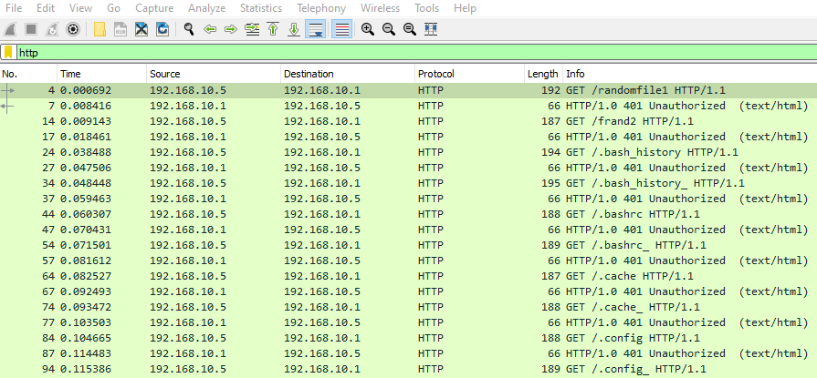
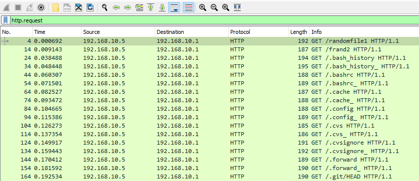
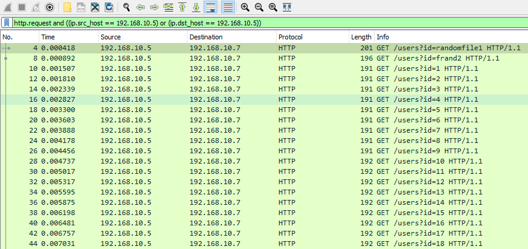
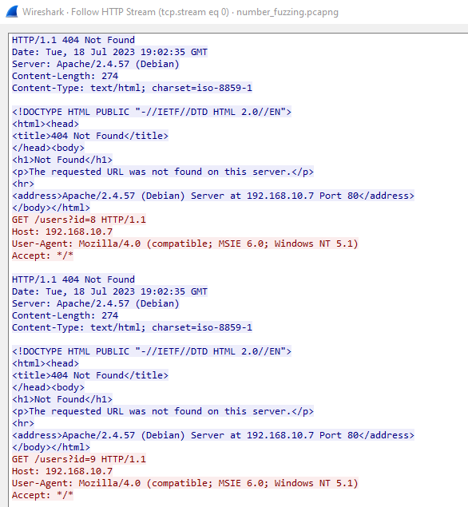

# HTTP/HTTPs Service Enumeration (Liệt kê dịch vụ HTTP/HTTPs)

**File PCAP liên quan**:
* `basic_fuzzing.pcapng`

---

Nhiều khi ta có thể nhận thấy lưu lượng lạ đi tới các web server của mình. Trong một số trường hợp như vậy, ta có thể thấy một host đang tạo ra lượng traffic HTTP hoặc HTTPs quá mức. Kẻ tấn công thường thích lạm dụng tầng transport, vì các ứng dụng chạy trên server của ta có thể bị nhiều kiểu tấn công khác nhau. Vì thế, ta cần hiểu cách nhận diện các bước mà kẻ tấn công sẽ thực hiện để thu thập thông tin, khai thác và lạm dụng web server của ta.

Nói chung, ta có thể phát hiện và xác định các nỗ lực fuzzing (dò thử hàng loạt đầu vào) thông qua những dấu hiệu sau

1. `Excessive HTTP/HTTPs traffic from one host` (Lưu lượng HTTP/HTTPs quá mức từ một host)
2. `Referencing our web server's access logs for the same behavior` (Đối chiếu access log của web server để tìm cùng hành vi đó)

Chủ yếu, kẻ tấn công sẽ cố fuzz server của ta để thu thập thông tin trước khi tiến hành tấn công. Có thể ta đã có sẵn `Web Application Firewall` để ngăn chặn việc này, tuy nhiên trong một số trường hợp thì không, đặc biệt nếu server này là server nội bộ.

## Tìm dấu hiệu directory fuzzing

Directory fuzzing được kẻ tấn công dùng để tìm mọi trang web và vị trí có thể có trong các ứng dụng web của ta. Ta có thể phát hiện điều này khi phân tích traffic bằng cách giới hạn khung nhìn Wireshark chỉ còn traffic http.

- `http`



Tiếp theo, nếu muốn loại bỏ các response từ server, ta chỉ cần chỉ định `http.request`



Directory fuzzing khá dễ phát hiện, vì trong hầu hết trường hợp nó sẽ có các dấu hiệu sau

1. `A host will repeatedly attempt to access files on our web server which do not exist (response 404)`. (Một host liên tục cố truy cập các file không tồn tại trên web server của ta — response 404)

2. `A host will send these in rapid succession`. (Host đó gửi các request này liên tiếp rất nhanh)

Ta cũng luôn có thể đối chiếu traffic này trong access log trên web server. Với Apache, nó sẽ trông như hai ví dụ dưới đây. Để dùng grep, ta có thể lọc như sau:

```shell-session
[!bash!]$ cat access.log | grep "192.168.10.5"

192.168.10.5 - - [18/Jul/2023:12:58:07 -0600] "GET /randomfile1 HTTP/1.1" 404 435 "-" "Mozilla/4.0 (compatible; MSIE 6.0; Windows NT 5.1)"
192.168.10.5 - - [18/Jul/2023:12:58:07 -0600] "GET /frand2 HTTP/1.1" 404 435 "-" "Mozilla/4.0 (compatible; MSIE 6.0; Windows NT 5.1)"
192.168.10.5 - - [18/Jul/2023:12:58:07 -0600] "GET /.bash_history HTTP/1.1" 404 435 "-" "Mozilla/4.0 (compatible; MSIE 6.0; Windows NT 5.1)"
192.168.10.5 - - [18/Jul/2023:12:58:07 -0600] "GET /.bashrc HTTP/1.1" 404 435 "-" "Mozilla/4.0 (compatible; MSIE 6.0; Windows NT 5.1)"
192.168.10.5 - - [18/Jul/2023:12:58:07 -0600] "GET /.cache HTTP/1.1" 404 435 "-" "Mozilla/4.0 (compatible; MSIE 6.0; Windows NT 5.1)"
192.168.10.5 - - [18/Jul/2023:12:58:07 -0600] "GET /.config HTTP/1.1" 404 435 "-" "Mozilla/4.0 (compatible; MSIE 6.0; Windows NT 5.1)"
192.168.10.5 - - [18/Jul/2023:12:58:07 -0600] "GET /.cvs HTTP/1.1" 404 435 "-" "Mozilla/4.0 (compatible; MSIE 6.0; Windows NT 5.1)"
192.168.10.5 - - [18/Jul/2023:12:58:07 -0600] "GET /.cvsignore HTTP/1.1" 404 435 "-" "Mozilla/4.0 (compatible; MSIE 6.0; Windows NT 5.1)"
192.168.10.5 - - [18/Jul/2023:12:58:07 -0600] "GET /.forward HTTP/1.1" 404 435 "-" "Mozilla/4.0 (compatible; MSIE 6.0; Windows NT 5.1)"
...SNIP...
```

Và để dùng awk, ta có thể làm như sau

```shell-session
[!bash!]$ cat access.log | awk '$1 == "192.168.10.5"'

192.168.10.5 - - [18/Jul/2023:12:58:07 -0600] "GET /randomfile1 HTTP/1.1" 404 435 "-" "Mozilla/4.0 (compatible; MSIE 6.0; Windows NT 5.1)"
192.168.10.5 - - [18/Jul/2023:12:58:07 -0600] "GET /frand2 HTTP/1.1" 404 435 "-" "Mozilla/4.0 (compatible; MSIE 6.0; Windows NT 5.1)"
192.168.10.5 - - [18/Jul/2023:12:58:07 -0600] "GET /.bash_history HTTP/1.1" 404 435 "-" "Mozilla/4.0 (compatible; MSIE 6.0; Windows NT 5.1)"
192.168.10.5 - - [18/Jul/2023:12:58:07 -0600] "GET /.bashrc HTTP/1.1" 404 435 "-" "Mozilla/4.0 (compatible; MSIE 6.0; Windows NT 5.1)"
192.168.10.5 - - [18/Jul/2023:12:58:07 -0600] "GET /.cache HTTP/1.1" 404 435 "-" "Mozilla/4.0 (compatible; MSIE 6.0; Windows NT 5.1)"
192.168.10.5 - - [18/Jul/2023:12:58:07 -0600] "GET /.config HTTP/1.1" 404 435 "-" "Mozilla/4.0 (compatible; MSIE 6.0; Windows NT 5.1)"
192.168.10.5 - - [18/Jul/2023:12:58:07 -0600] "GET /.cvs HTTP/1.1" 404 435 "-" "Mozilla/4.0 (compatible; MSIE 6.0; Windows NT 5.1)"
192.168.10.5 - - [18/Jul/2023:12:58:07 -0600] "GET /.cvsignore HTTP/1.1" 404 435 "-" "Mozilla/4.0 (compatible; MSIE 6.0; Windows NT 5.1)"
192.168.10.5 - - [18/Jul/2023:12:58:07 -0600] "GET /.forward HTTP/1.1" 404 435 "-" "Mozilla/4.0 (compatible; MSIE 6.0; Windows NT 5.1)"
192.168.10.5 - - [18/Jul/2023:12:58:07 -0600] "GET /.git/HEAD HTTP/1.1" 404 435 "-" "Mozilla/4.0 (compatible; MSIE 6.0; Windows NT 5.1)"
192.168.10.5 - - [18/Jul/2023:12:58:07 -0600] "GET /.history HTTP/1.1" 404 435 "-" "Mozilla/4.0 (compatible; MSIE 6.0; Windows NT 5.1)"
192.168.10.5 - - [18/Jul/2023:12:58:07 -0600] "GET /.hta HTTP/1.1" 403 438 "-" "Mozilla/4.0 (compatible; MSIE 6.0; Windows NT 5.1)"
...SNIP...
```

## Tìm các kỹ thuật fuzzing khác

Tuy nhiên, còn có những kiểu fuzzing khác mà kẻ tấn công có thể dùng nhắm vào web server của ta. Một số trong đó có thể là fuzzing các thành phần động hoặc tĩnh của trang web, chẳng hạn các field id. Hoặc trong một số trường hợp khác, kẻ tấn công có thể tìm lỗ hổng IDOR trên site của ta, đặc biệt nếu ta có xử lý phân tích cú pháp json (đổi `return=max` thành `return=min`).

Để giới hạn traffic chỉ còn một host, ta có thể dùng filter sau:

- `http.request and ((ip.src_host == <suspected IP>) or (ip.dst_host == <suspected IP>))`



Tiếp theo, ta luôn có thể dựng nên bức tranh tổng thể bằng cách chuột phải vào bất kỳ request nào trong số này, chọn Follow, rồi Follow HTTP Stream.



Giả sử ta nhận thấy có rất nhiều request được gửi liên tiếp rất nhanh, điều này cho thấy một nỗ lực fuzzing, và ta nên tiến hành điều tra thêm đối với host đó.

Tuy nhiên, đôi khi kẻ tấn công sẽ làm những việc sau để tránh bị phát hiện

1. `Stagger these responses across a longer period of time.` (Rải các request này ra trong một khoảng thời gian dài hơn.)

2. `Send these responses from multiple hosts or source addresses.` (Gửi các request này từ nhiều host hoặc nhiều địa chỉ nguồn.)

## Ngăn chặn các nỗ lực fuzzing

Ta có thể hướng tới việc ngăn chặn các nỗ lực fuzzing từ kẻ tấn công bằng cách thực hiện các hành động sau.

1. `Maintain our virtualhost or web access configurations to return the proper response codes to throw off these scanners.` (Duy trì cấu hình virtualhost hoặc cấu hình truy cập web sao cho trả về đúng response code, nhằm đánh lạc hướng các công cụ quét này.)

2. `Establish rules to prohibit these IP addresses from accessing our server through our web application firewall.` (Thiết lập rule trên web application firewall để cấm các địa chỉ IP này truy cập server của ta.)
