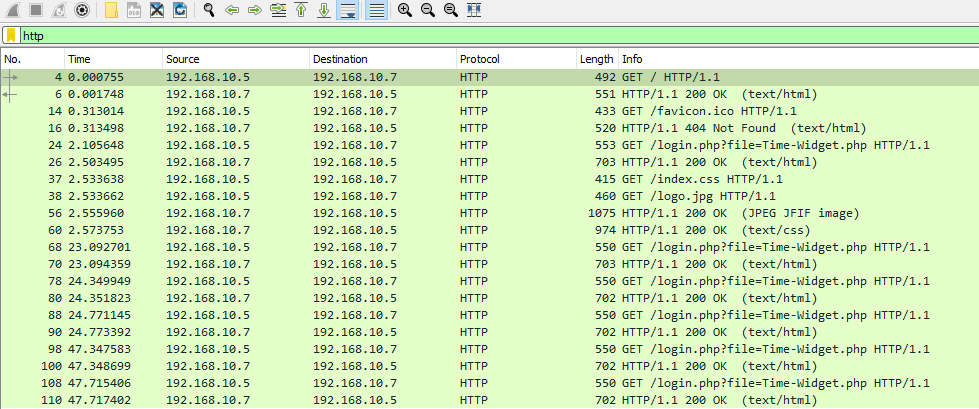
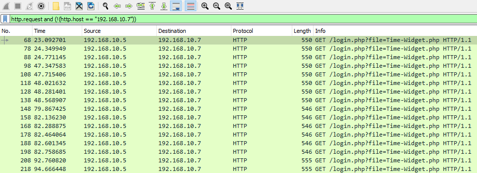
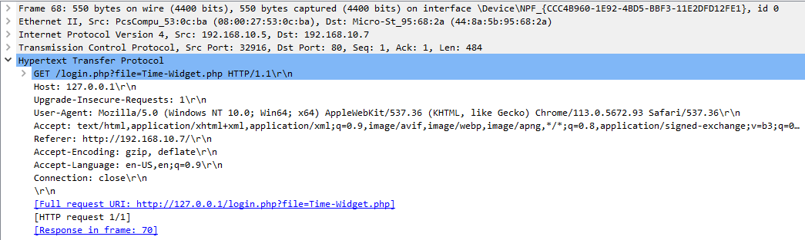
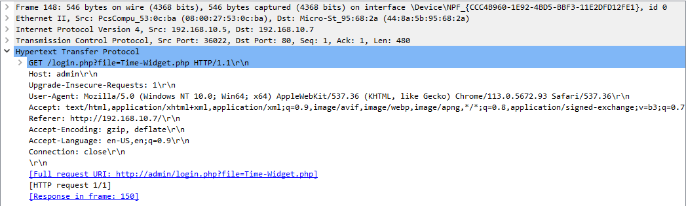
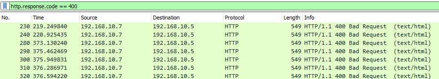
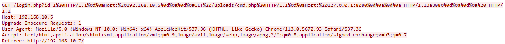

# Strange HTTP Headers (Các HTTP header bất thường)

**File PCAP liên quan**:
* `CRLF_and_host_header_manipulation.pcapng`

---

Khi phân tích traffic của web server, có thể ta không nhận ra ngay điều gì giống như fuzzing. Tuy nhiên, điều này không phải lúc nào cũng có nghĩa là không có chuyện gì xấu đang xảy ra. Thay vào đó, ta luôn có thể nhìn sâu hơn một chút. Để làm vậy, ta có thể tìm các hành vi lạ trong các HTTP request. Một số trong đó là các header kỳ lạ như

1. `Weird Hosts (Host: )` (Host lạ)
2. `Unusual HTTP Verbs` (HTTP verb bất thường)
3. `Changed User Agents` (User agent bị thay đổi)

## Tìm các Host header bất thường

Để bắt đầu, như thường lệ, ta có thể giới hạn khung nhìn trong Wireshark chỉ còn các reply và request http.

- `http`



Sau đó, ta có thể tìm mọi Host header bất thường bằng lệnh sau. Ta chỉ định địa chỉ IP thật của web server để loại trừ mọi entry dùng header thật này. Nếu làm việc này với một web server public bên ngoài, ta có thể chỉ định tên miền ở đây.

- `http.request and (!(http.host == "192.168.10.7"))`



Giả sử ta nhận thấy filter này trả về một số kết quả, ta có thể đào sâu hơn vào các HTTP request đó để tìm xem những kẻ xấu này có thể đã cố dùng những host nào. Ta thường có thể thấy `127.0.0.1`.



Hoặc thay vào đó là thứ gì đó như admin.



Kẻ tấn công sẽ cố dùng các host header khác nhau để giành được mức truy cập mà bình thường chúng không đạt được qua host hợp lệ. Chúng có thể dùng các công cụ proxy như burp suite hoặc công cụ khác để sửa các header này trước khi gửi tới server. Để ngăn việc khai thác thành công, chứ không chỉ dừng ở việc phát hiện các event này, ta luôn nên làm những việc sau.

1. `Ensure that our virtualhosts or access configurations are setup correctly to prevent this form of access.` (Đảm bảo virtualhost hoặc cấu hình truy cập được thiết lập đúng để ngăn kiểu truy cập này.)
2. `Ensure that our web server is up to date.` (Đảm bảo web server luôn được cập nhật.)

## Phân tích các response code 400 và Request Smuggling

Ta cũng có thể nhận thấy một số response xấu từ web server, như code 400. Các code này cho biết client đã gửi một request sai (bad request), nên đây có thể là điểm khởi đầu tốt khi phát hiện các hành động độc hại qua http/https. Để lọc các response này, ta có thể dùng filter sau

- `http.response.code == 400`



Giả sử ta follow một trong các HTTP stream này, ta có thể thấy nội dung sau từ phía client.



Kỹ thuật này thường được gọi là HTTP request smuggling hoặc CRLF (Carriage Return Line Feed). Về cơ bản, kẻ tấn công sẽ thử như sau.

- `GET%20%2flogin.php%3fid%3d1%20HTTP%2f1.1%0d%0aHost%3a%20192.168.10.5%0d%0a%0d%0aGET%20%2fuploads%2fcmd2.php%20HTTP%2f1.1%0d%0aHost%3a%20127.0.0.1%3a8080%0d%0a%0d%0a%20HTTP%2f1.1
Host: 192.168.10.5`

Chuỗi này sẽ được server của ta decode như sau.

```url-decoded
GET /login.php?id=1 HTTP/1.1
Host: 192.168.10.5

GET /uploads/cmd2.php HTTP/1.1
Host: 127.0.0.1:8080

 HTTP/1.1
Host: 192.168.10.5
```

Về cơ bản, trong trường hợp cấu hình của ta có lỗ hổng, request đầu tiên sẽ được xử lý, và ngay sau đó request thứ hai cũng vậy. Điều này có thể cho kẻ tấn công mức truy cập mà bình thường ta sẽ cấm. Nguyên nhân là do cấu hình của ta trông như sau.

## Cấu hình Apache
```txt
<VirtualHost *:80>

    RewriteEngine on
    RewriteRule "^/categories/(.*)" "http://192.168.10.100:8080/categories.php?id=$1" [P]
    ProxyPassReverse "/categories/" "http://192.168.10.100:8080/"

</VirtualHost>
```

[CVE-2023-25690](https://github.com/dhmosfunk/CVE-2023-25690-POC)

Vì vậy, việc theo dõi các response code 400 này có thể cho dấu hiệu rõ ràng về các hành động thù địch trong quá trình phân tích traffic. Ngoài ra, ta sẽ nhận biết được kẻ tấn công có thành công với kiểu tấn công này hay không bằng cách tìm code `200` (`success`) trả về cho một trong các request trông giống như thế này.
