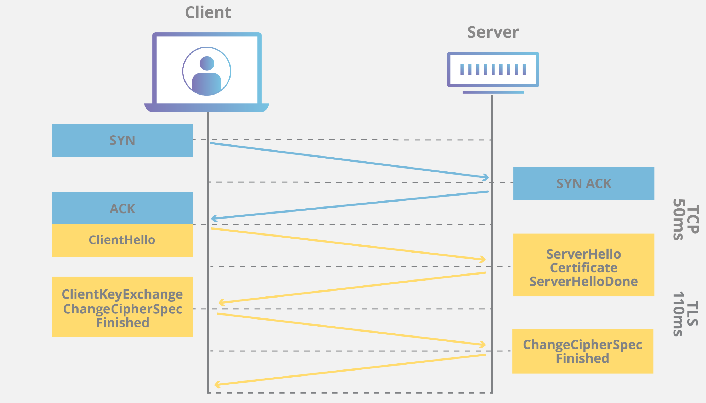
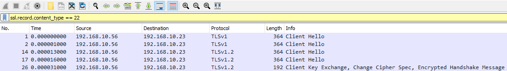

# SSL Renegotiation Attacks (Tấn công SSL Renegotiation)

**File PCAP liên quan**:
* `SSL_renegotiation_edited.pcapng`

---

Dù traffic HTTP không được mã hoá, đôi khi ta sẽ gặp traffic HTTPs đã được mã hoá. Vì vậy, nắm được các indicator và dấu hiệu của traffic HTTPs độc hại là điều cốt yếu trong công việc phân tích traffic của ta.

## Phân tích HTTPs

Khác với HTTP, vốn là một giao thức stateless (không lưu trạng thái), HTTPs tích hợp mã hoá để bảo đảm an toàn cho web server và client. Nó làm điều đó bằng những thành phần sau.

1. `Transport Layer Security (Transport Layer Security)`
2. `Secure Sockets Layer (SSL)`

Nói chung, khi một client thiết lập kết nối HTTPs với server, nó thực hiện các bước sau.

1. `Handshake:` Server và client thực hiện một handshake (bắt tay) khi thiết lập kết nối HTTPs. Trong handshake này, client và server thống nhất sẽ dùng thuật toán mã hoá nào, và trao đổi certificate của chúng.

2. `Encryption`: Khi handshake hoàn tất, client và server dùng thuật toán mã hoá đã thống nhất trước đó để mã hoá dữ liệu trao đổi tiếp theo giữa chúng. 

3. `Further Data Exchange:` Khi kết nối mã hoá đã được thiết lập, client và server sẽ tiếp tục trao đổi dữ liệu với nhau. Dữ liệu này có thể là trang web, hình ảnh hoặc các tài nguyên web khác.

4. `Decryption:` Khi client truyền tới server, hoặc server truyền tới client, chúng phải giải mã dữ liệu này bằng private key và public key.

Vì thế, một trong những kiểu tấn công phổ biến hơn dựa trên HTTPs là SSL renegotiation (đàm phán lại SSL), trong đó kẻ tấn công sẽ đàm phán phiên làm việc xuống chuẩn mã hoá thấp nhất có thể.

Tuy nhiên, còn có những kiểu tấn công mã hoá khác mà ta nên biết, như `heartbleed vulnerability`

[The Heartbleed Vulnerability CVE-2014-0160](https://heartbleed.com/)

----

## Handshake TLS và SSL

Để thiết lập một kết nối mã hoá, client và server phải trải qua quá trình handshake. May mắn cho ta là các bước handshake của TLS và SSL phần lớn giống nhau.

Chia nhỏ hơn nữa, ta có thể quan sát thấy các bước sau diễn ra khi phân tích traffic.

1. `Client Hello` - Bước đầu tiên là client gửi thông điệp hello tới server. Thông điệp này chứa các thông tin như những phiên bản TLS/SSL mà client hỗ trợ, danh sách cipher suite (hay thuật toán mã hoá), và dữ liệu ngẫu nhiên (nonce) dùng trong các bước tiếp theo.

2. `Server Hello` - Đáp lại Client Hello, server sẽ gửi một thông điệp Server Hello. Thông điệp này gồm phiên bản TLS/SSL mà server chọn, cipher suite mà server chọn trong số các lựa chọn của client, và một nonce bổ sung.

3. `Certificate Exchange` - Sau đó server gửi digital certificate (chứng chỉ số) của nó tới client để chứng minh danh tính. Certificate này chứa public key của server, thứ mà client sẽ dùng để thực hiện quá trình trao đổi khoá.

4. `Key Exchange` - Tiếp theo client tạo ra thứ được gọi là premaster secret. Sau đó nó mã hoá secret này bằng public key của server lấy từ certificate và gửi tới server.

5. `Session Key Derivation` - Rồi cả client và server dùng các nonce đã trao đổi ở hai bước đầu, cùng với premaster secret, để tính ra các session key. Các session key này được dùng để mã hoá và giải mã đối xứng dữ liệu trong suốt kết nối an toàn.

6. `Finished Messages` - Để xác minh handshake đã hoàn tất và thành công, đồng thời cả hai bên đều đã tính ra cùng các session key, client và server trao đổi các thông điệp finished. Thông điệp này chứa hash của tất cả các thông điệp handshake trước đó và được mã hoá bằng các session key.

7. `Secure Data Exchange` - Giờ handshake đã hoàn tất, client và server có thể trao đổi dữ liệu qua kênh đã được mã hoá.

Ta cũng có thể nhìn điều này từ góc độ thuật toán tổng quát.

| **Bước handshake** | **Các phép tính liên quan** |
| ----------- | ----------- | 
| `Client Hello` | `ClientHello = { ClientVersion, ClientRandom, Ciphersuites, CompressionMethods }` | 
| `Server Hello` | `ServerHello = { ServerVersion, ServerRandom, Ciphersuite, CompressionMethod` } |
| `Certificate Exchange` | `ServerCertificate = { ServerPublicCertificate }` |
| `Key Exchange` | <ul><li>`ClientDHPrivateKey`</li><li>`ClientDHPublicKey = DH_KeyGeneration(ClientDHPrivateKey)`</li><li>`ClientKeyExchange = { ClientDHPublicKey }`</li><li>`ServerDHPrivateKey`</li><li>`ServerDHPublicKey = DH_KeyGeneration(ServerDHPrivateKey)`</li><li>`ServerKeyExchange = { ServerDHPublicKey }`</li></ul> |
| `Premaster Secret` | <ul><li>`PremasterSecret = DH_KeyAgreement(ServerDHPublicKey, ClientDHPrivateKey)`</li><li>`PremasterSecret = DH_KeyAgreement(ClientDHPublicKey, ServerDHPrivateKey)`</li></ul> |
| `Session Key Derivation` | `MasterSecret = PRF(PremasterSecret, "master secret", ClientNonce + ServerNonce`) |
| | `KeyBlock = PRF(MasterSecret, "key expansion", ServerNonce + ClientNonce)` |
| `Extraction of Session Keys` | <ul><li>`ClientWriteMACKey = First N bytes of KeyBlock`</li><li>`ServerWriteMACKey = Next N bytes of KeyBlock`</li><li>`ClientWriteKey = Next N bytes of KeyBlock`</li><li>`ServerWriteKey = Next N bytes of KeyBlock`</li><li>`ClientWriteIV = Next N bytes of KeyBlock`</li><li>`ServerWriteIV = Next N bytes of KeyBlock`</li></ul> |
| `Finished Messages` | `FinishedMessage = PRF(MasterSecret, "finished", Hash(ClientHello + ServerHello))` |

## Đi sâu vào tấn công SSL Renegotiation

Để tìm các điểm bất thường trong handshake, ta có thể dùng TCP dump và Wireshark như đã làm trước đây. Để chỉ lọc ra các thông điệp handshake, ta có thể dùng filter này trong Wireshark.

- `ssl.record.content_type == 22`

Content type 22 chỉ định riêng các thông điệp handshake. Khi áp dụng filter này, ta sẽ có khung nhìn như sau.

Khi tìm kiếm các vụ tấn công SSL renegotiation, ta có thể để ý những dấu hiệu sau.

1. `Multiple Client Hellos` - Đây là dấu hiệu rõ ràng nhất của tấn công SSL renegotiation. Ta sẽ thấy nhiều client hello từ cùng một client trong một khoảng thời gian ngắn như ở trên. Kẻ tấn công lặp lại thông điệp này để kích hoạt renegotiation và hy vọng có được cipher suite thấp hơn.

2. `Out of Order Handshake Messages` - Nói đơn giản, đôi khi ta sẽ thấy một số traffic sai thứ tự do mất gói và các nguyên nhân khác, nhưng trong trường hợp SSL renegotiation, một số dấu hiệu rõ ràng là server nhận được client hello sau khi handshake đã hoàn tất.

Kẻ tấn công có thể thực hiện kiểu tấn công này nhắm vào ta vì những lý do sau

1. `Denial of Service` - Tấn công SSL renegotiation tiêu tốn rất nhiều tài nguyên phía server, do đó có thể làm server quá tải và không còn phản hồi.

2. `SSL/TLS Weakness Exploitation` - Kẻ tấn công có thể thử renegotiation để tìm cách khai thác các lỗ hổng trong cách triển khai cipher suite hiện tại của ta.

3. `Cryptanalysis` - Kẻ tấn công có thể dùng renegotiation như một phần của chiến lược tổng thể nhằm phân tích các pattern SSL/TLS của ta để áp dụng cho các hệ thống khác.
