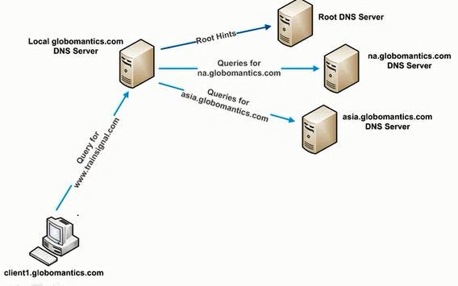
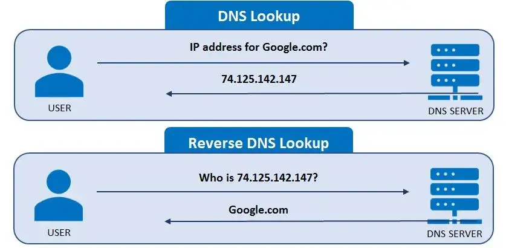
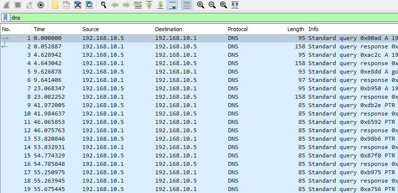
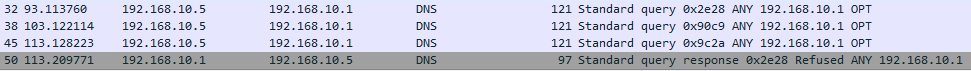
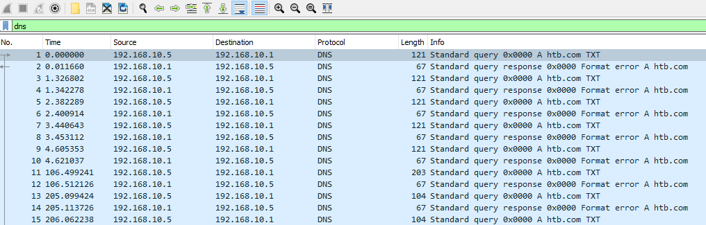
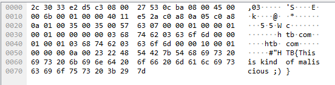
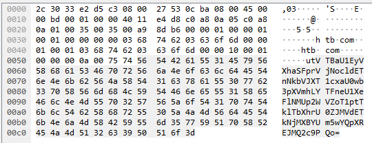
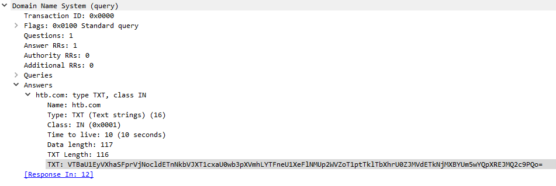

# Peculiar DNS Traffic (Traffic DNS bất thường)


Traffic DNS có thể khá vất vả để kiểm tra, vì nhiều khi các client của ta tạo ra rất nhiều traffic loại này, và những điểm bất thường đôi khi bị chôn vùi trong khối lượng khổng lồ đó. Tuy nhiên, hiểu về DNS và một số dấu hiệu trực tiếp của hành động độc hại là điều quan trọng trong công việc phân tích traffic của ta.

## DNS Query

DNS query được dùng khi client muốn phân giải một tên miền ra địa chỉ IP, hoặc ngược lại. Trước tiên, ta có thể tìm hiểu loại query phổ biến nhất, đó là forward lookup (tra cứu xuôi).



Nói chung, khi client khởi tạo một DNS forward lookup query, nó thực hiện các bước sau.

- Request:
	- `Where is academy.hackthebox.com?` (academy.hackthebox.com ở đâu?)

- Response:
	- `Well its at 192.168.10.6 ` (À, nó ở 192.168.10.6)


|**Bước**|**Mô tả**|
|-|-|
| `1. Query Initiation` | Khi người dùng muốn truy cập một địa chỉ như academy.hackthebox.com, nó khởi tạo một DNS forward query.| 
| `2. Local Cache Check` | Sau đó client kiểm tra DNS cache cục bộ xem đã từng phân giải tên miền này ra địa chỉ IP chưa. Nếu chưa, nó tiếp tục với các bước sau.| 
| `3. Recursive Query` | Sau đó client gửi recursive query (truy vấn đệ quy) tới DNS server đã được cấu hình cho nó (cục bộ hoặc từ xa).| 
| `4. Root Servers` | Nếu cần, DNS resolver bắt đầu bằng việc query các root name server để tìm các authoritative name server cho top-level domain (TLD). Có 13 root server phân bố trên toàn thế giới.| 
| `5. TLD Servers` | Sau đó root server trả về các authoritative name server cho TLD (ví dụ .com hoặc .org)| 
| `6. Authoritative Servers` | Tiếp theo DNS resolver query các authoritative name server của TLD để tìm second-level domain (ví dụ hackthebox.com).| 
| `7. Domain Name's Authoritative Servers` | Cuối cùng, DNS resolver query các authoritative name server của tên miền để lấy địa chỉ IP gắn với tên miền được yêu cầu (ví dụ academy.hackthebox.com).| 
| `8. Response` | Sau đó DNS resolver nhận được địa chỉ IP (bản ghi A hoặc AAAA) và gửi lại cho client đã khởi tạo query.| 

#### DNS Reverse Lookup/Query

Ở chiều ngược lại, ta có Reverse Lookup (tra cứu ngược). Chúng xảy ra khi client đã biết địa chỉ IP và muốn tìm FQDN (Fully Qualified Domain Name – tên miền đầy đủ) tương ứng.

- Request:
	- `What is your name 192.168.10.6?` (Tên bạn là gì, 192.168.10.6?)

- Response:
	- `Well its academy.hackthebox.com :)` (À, là academy.hackthebox.com :))

Trong trường hợp này, các bước ít phức tạp hơn một chút.

|**Bước**|**Mô tả**|
|-|-|
|`1. Query Initiation` | Client gửi một DNS reverse query tới DNS resolver (server) đã được cấu hình cho nó, kèm địa chỉ IP mà nó muốn tìm tên miền.|
|`2. Reverse Lookup Zones` | DNS resolver kiểm tra xem nó có phải là authoritative cho reverse lookup zone tương ứng với dải IP được xác định từ địa chỉ IP nhận được hay không. Ví dụ với 192.0.2.1, reverse zone sẽ là 1.2.0.192.in-addr.arpa|
|`3. PTR Record Query` | Sau đó DNS resolver tìm bản ghi PTR trong reverse lookup zone tương ứng với địa chỉ IP được cung cấp.|
|`4. Response` | Nếu tìm thấy PTR khớp, DNS server (resolver) sẽ trả về FQDN của IP đó cho client.|



## Các loại bản ghi DNS

DNS có nhiều loại bản ghi (record type) khác nhau, mỗi loại chịu trách nhiệm lưu một loại thông tin khác nhau. Ta nên nắm rõ chúng, đặc biệt khi giám sát traffic DNS.

| **Loại bản ghi** | **Mô tả** |
|    ----   |    ----   |
| `A` (Address) | Bản ghi này ánh xạ tên miền tới địa chỉ IPv4 |
| `AAAA` (Ipv6 Address) | Bản ghi này ánh xạ tên miền tới địa chỉ IPv6 |
| `CNAME` (Canonical Name) | Bản ghi này tạo một bí danh (alias) cho tên miền. Ví dụ hello.com = world.com |
| `MX` (Mail Exchange) | Bản ghi này chỉ định mail server chịu trách nhiệm nhận email thay mặt cho tên miền. |
| `NS` (Name Server) | Bản ghi này chỉ định các authoritative name server cho một tên miền. |
| `PTR` (Pointer) | Bản ghi này dùng trong reverse query để ánh xạ IP tới tên miền |
| `TXT` (Text) | Bản ghi này dùng để chỉ định văn bản gắn với tên miền |
| `SOA` (Start of Authority) | Bản ghi này chứa thông tin quản trị về zone |

## Tìm các nỗ lực DNS Enumeration

**File PCAP liên quan**:
* `dns_enum_detection.pcapng`

Ta có thể thấy một lượng lớn traffic DNS từ một host khi bắt đầu xem output thô trong Wireshark. 

- `dns`



Ta thậm chí có thể thấy traffic này kết thúc bằng thứ gì đó như `ANY`:



Đây sẽ là dấu hiệu rõ ràng của DNS enumeration (liệt kê DNS), thậm chí có thể là subdomain enumeration từ phía kẻ tấn công.

## Tìm DNS Tunneling

**File PCAP liên quan**:
* `dns_tunneling.pcapng`

Mặt khác, ta có thể thấy khá nhiều bản ghi text từ một host. Điều này có thể cho thấy DNS tunneling. Giống như ICMP tunneling, kẻ tấn công có thể và đã từng dùng các DNS forward và reverse lookup query để thực hiện data exfiltration (tuồn dữ liệu ra ngoài). Chúng làm vậy bằng cách gắn dữ liệu muốn exfiltrate vào làm một phần của field TXT. 

Nếu việc này đang diễn ra, nó có thể trông như sau.



Nếu đào sâu hơn một chút, ta có thể thấy một đoạn text lạc lõng ở phía dưới bên phải màn hình.



Tuy nhiên, trong nhiều trường hợp, dữ liệu này có thể được encode hoặc mã hoá, và ta có thể thấy như sau.



Ta có thể lấy giá trị này từ wireshark bằng cách định vị nó như sau và chuột phải vào giá trị để chọn copy.



Sau đó, nếu chuyển sang máy Linux, trong trường hợp này ta có thể dùng thứ như `base64 -d` để lấy ra giá trị thật.

```shell-session
[!bash!]$ echo 'VTBaU1EyVXhaSFprVjNocldETnNkbVJXT1cxaU0wb3pXVmhLYTFneU1XeFlNMUp2WVZoT1ptTklTbXhrU0ZJMVdETkNjMXBYUm5wYQpXREJMQ2c9PQo=' | base64 -d 

U0ZSQ2UxZHZkV3hrWDNsdmRWOW1iM0ozWVhKa1gyMWxYM1JvYVhOZmNISmxkSFI1WDNCc1pXRnpaWDBLCg==
```

Tuy nhiên, trong một số trường hợp, kẻ tấn công sẽ encode hai lần, thậm chí ba lần giá trị mà chúng đang cố exfiltrate qua DNS tunneling, nên ta có thể cần làm như sau.

```shell-session
[!bash!]$ echo 'VTBaU1EyVXhaSFprVjNocldETnNkbVJXT1cxaU0wb3pXVmhLYTFneU1XeFlNMUp2WVZoT1ptTklTbXhrU0ZJMVdETkNjMXBYUm5wYQpXREJMQ2c9PQo=' | base64 -d | base64 -d | base64 -d
```

Tuy nhiên, có thể ta cần làm nhiều hơn là chỉ base64 decode các giá trị này, vì như đã nói, trong nhiều trường hợp các giá trị này có thể đã bị mã hoá.

Kẻ tấn công có thể thực hiện DNS tunneling vì những lý do sau:


|**Bước**|**Mô tả**|
|-|-|
|`1. Data Exfiltration` | Như đã thấy ở trên, DNS tunneling có thể hữu ích cho kẻ tấn công đang cố đưa dữ liệu ra khỏi mạng của ta mà không bị phát hiện.|
|`2. Command and Control` | Một số malware và agent độc hại sẽ dùng DNS tunneling trên các hệ thống bị xâm nhập để liên lạc ngược về command and control server của chúng. Đáng chú ý, ta có thể thấy cách dùng này ở các botnet.|
|`3. Bypassing Firewalls and Proxies` | DNS tunneling cho phép kẻ tấn công vượt qua các firewall và web proxy chỉ giám sát traffic HTTP/HTTPs. Theo truyền thống, traffic DNS được phép đi qua ranh giới mạng. Vì vậy, điều quan trọng là ta phải giám sát và kiểm soát traffic này.|
|`4. Domain Generation Algorithms (DGAs)` | Một số malware tinh vi hơn sẽ dùng DNS tunnel để liên lạc ngược về các command and control server dùng tên miền được tạo động thông qua DGA. Điều này khiến ta khó phát hiện và chặn các tên miền này hơn nhiều.|

## Interplanetary File System và DNS Tunneling

Trong những năm gần đây, người ta đã quan sát thấy các threat actor tinh vi dùng Interplanetary File System để lưu trữ và kéo về các file độc hại. Vì vậy, ta luôn nên để ý traffic DNS và HTTP/HTTPs tới các URI như sau:

- `https://cloudflare-ipfs.com/ipfs/QmS6eyoGjENZTMxM7UdqBk6Z3U3TZPAVeJXdgp9VK4o1Sz`

Các dạng tấn công này có thể đặc biệt khó phát hiện vì bản chất IPFS hoạt động theo mô hình peer to peer (ngang hàng). Để tìm hiểu thêm, ta có thể nghiên cứu về IPFS.

[Interplanetary File System](https://developers.cloudflare.com/web3/ipfs-gateway/concepts/ipfs/)
