# Strange Telnet & UDP Connections (Các kết nối Telnet và UDP bất thường)

Khi tìm kiếm traffic lạ, ta luôn nên xem xét traffic telnet và UDP. Suy cho cùng, chúng có thể bị bỏ qua, nhưng lại có thể đặc biệt hữu ích trong việc phát hiện vấn đề khi phân tích traffic.

---
## Telnet

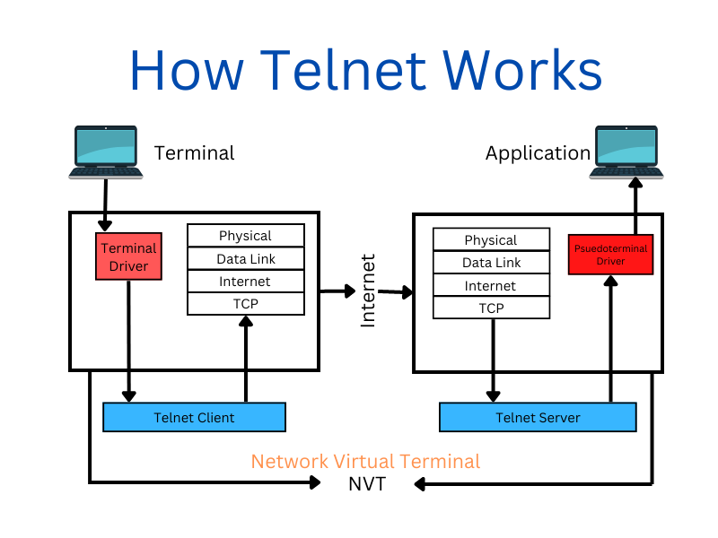

Telnet là một giao thức mạng cho phép thiết lập phiên giao tiếp tương tác hai chiều giữa hai thiết bị qua mạng. Giao thức này được phát triển vào những năm 1970 và được định nghĩa trong RFC 854. Những năm gần đây, mức độ sử dụng nó đã giảm đáng kể so với SSH. 

Trong nhiều trường hợp cũ hơn, chẳng hạn các máy kiểu Windows NT, chúng vẫn có thể dùng telnet để cung cấp khả năng điều khiển lệnh từ xa (remote command and control) cho microsoft terminal services.

Tuy nhiên, ta luôn nên để ý các giao tiếp telnet kỳ lạ, bất thường, vì kẻ tấn công cũng có thể dùng nó cho mục đích độc hại như data exfiltration và tunneling.

## Tìm traffic Telnet truyền thống trên cổng 23

**File PCAP liên quan**:
* `telnet_tunneling_23.pcapng`

Giả sử mở Wireshark, ta có thể thấy một số giao tiếp telnet xuất phát từ cổng 23. Trong trường hợp này, ta luôn có thể kiểm tra kỹ hơn traffic này.

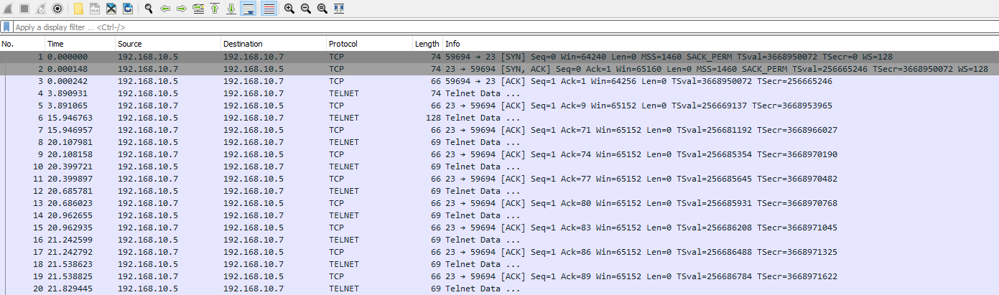

May mắn cho ta là traffic telnet thường ở dạng không mã hoá và dễ kiểm tra, nhưng giống như ICMP, DNS và các phương thức tunneling khác, kẻ tấn công có thể mã hoá, encode hoặc làm rối (obfuscate) đoạn text này. Vì vậy ta luôn nên cẩn thận.

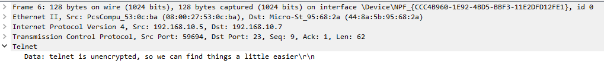

## TCP Telnet không được nhận diện trong Wireshark

**File PCAP liên quan**:
* `telnet_tunneling_9999.pcapng`

Telnet chỉ là một giao thức giao tiếp, vì thế kẻ tấn công có thể dễ dàng chuyển nó sang một cổng khác. Để mắt tới các giao tiếp trên cổng lạ này có thể giúp ta tìm ra các hành động có khả năng độc hại. Hãy xem ví dụ sau.

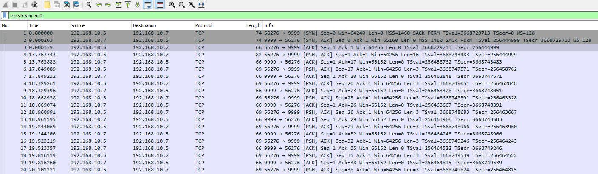

Ta có thể thấy rất nhiều giao tiếp từ một client trên cổng 9999. Ta có thể đi sâu hơn một chút bằng cách xem nội dung của các giao tiếp này.

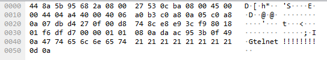

Nếu thấy thứ gì đó như ở trên, ta sẽ muốn follow TCP stream này. 

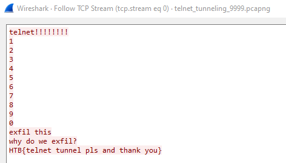

Làm vậy có thể giúp ta kiểm tra các hành động có khả năng độc hại.

---
## Giao thức Telnet qua IPv6

**File PCAP liên quan**:
* `telnet_tunneling_ipv6.pcapng`

Suy cho cùng, trừ khi mạng cục bộ của ta được cấu hình để dùng IPv6, việc quan sát thấy traffic IPv6 có thể là một indicator cho thấy có hành động xấu trong môi trường của ta. Ta có thể thấy việc dùng địa chỉ IPv6 cho telnet như sau.

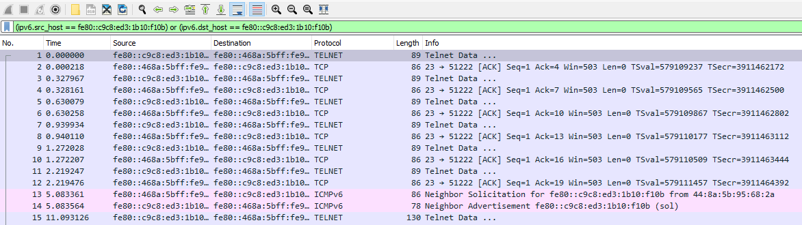

Ta có thể thu hẹp filter trong Wireshark để chỉ hiển thị traffic telnet từ các địa chỉ này bằng filter sau.

- `((ipv6.src_host == fe80::c9c8:ed3:1b10:f10b) or (ipv6.dst_host == fe80::c9c8:ed3:1b10:f10b)) and telnet`

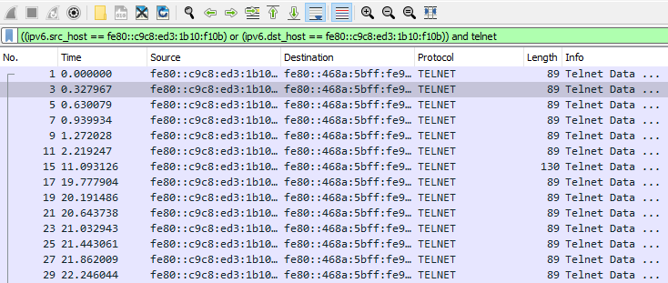

Tương tự, ta có thể kiểm tra nội dung các gói tin này qua field data của chúng, hoặc bằng cách follow TCP stream.

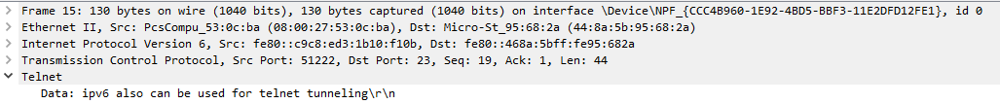

## Theo dõi các giao tiếp UDP

**File PCAP liên quan**:
* `udp_tunneling.pcapng`

Mặt khác, kẻ tấn công có thể chọn dùng kết nối UDP thay vì TCP trong các nỗ lực exfiltration.

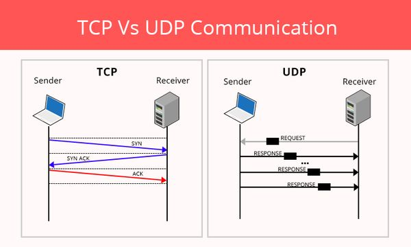

Một trong những điểm khác biệt lớn nhất giữa TCP và UDP là UDP không cần kết nối (connectionless) và truyền nhanh. Hãy xem traffic sau làm ví dụ.

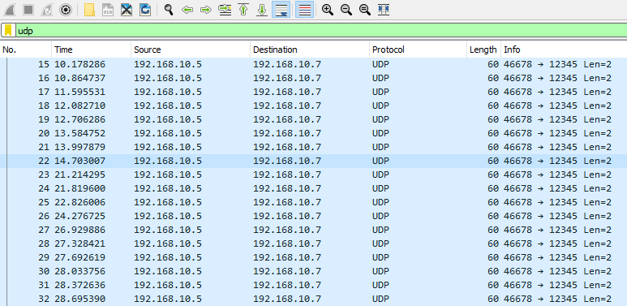

Ta sẽ thấy rằng thay vì chuỗi SYN, SYN/ACK, ACK, các giao tiếp được gửi ngay tới bên nhận. Giống như TCP, ta có thể follow traffic UDP trong Wireshark và kiểm tra nội dung của nó.

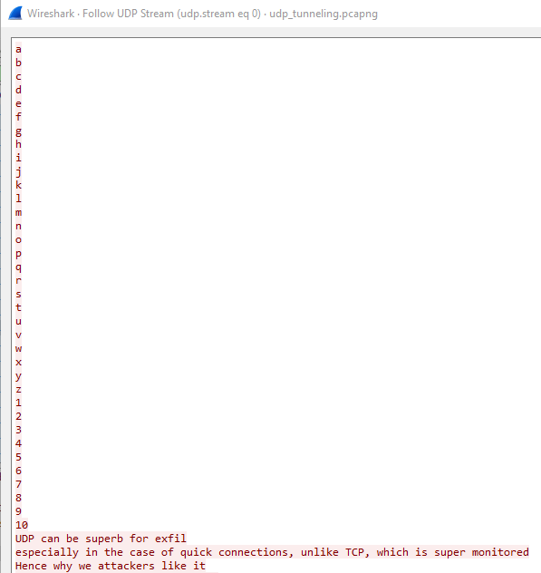

## Các cách dùng phổ biến của UDP

UDP, dù kém tin cậy hơn TCP, lại cung cấp kết nối nhanh hơn nhờ trạng thái connectionless của nó. Vì vậy, ta có thể gặp traffic hợp lệ dùng UDP như sau:

|**Bước**|**Mô tả**|
|-|-|
|`1. Real-time Applications` | Các ứng dụng như streaming media, game online, giao tiếp thoại và video thời gian thực|
|`2. DNS (Domain Name System)` | DNS query và response dùng UDP |
|`3. DHCP (Dynamic Host Configuration Protocol)` | DHCP dùng UDP để cấp phát địa chỉ IP và thông tin cấu hình cho các thiết bị mạng.|
|`4. SNMP (Simple Network Management Protocol)` | SNMP dùng UDP để giám sát và quản lý mạng|
|`5. TFTP (Trivial File Transfer Protocol)` | TFTP dùng UDP cho việc truyền file đơn giản, thường được các hệ thống Windows cũ và một số hệ thống khác sử dụng.|
