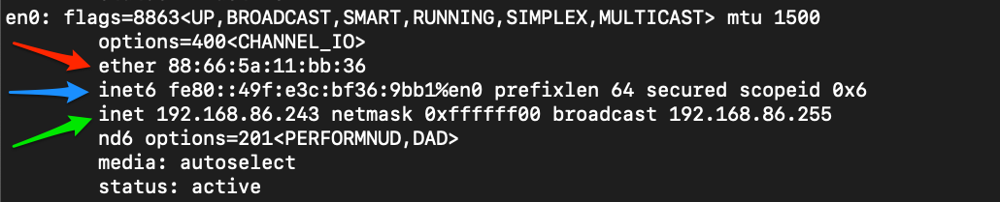
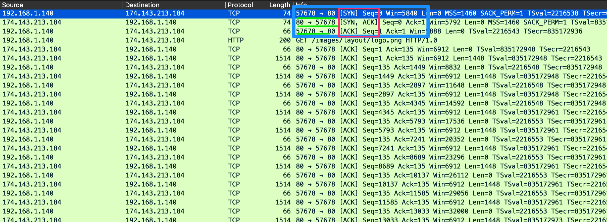
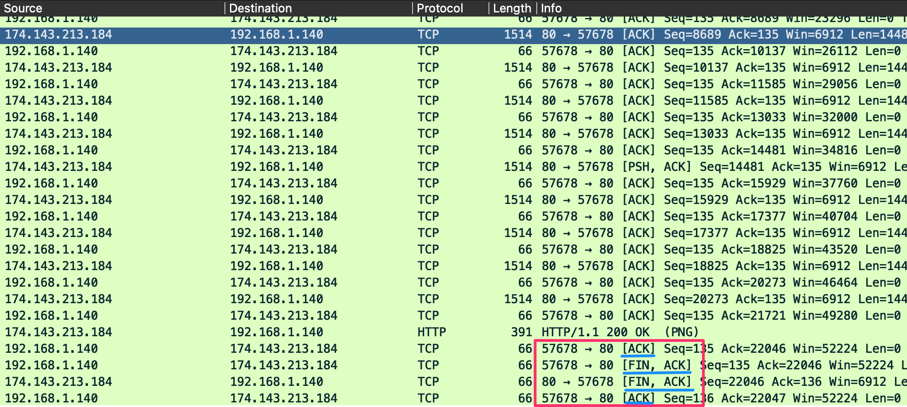

# Networking Primer - Layers 1-4 (Kiến thức mạng cơ bản - Tầng 1-4)

Phần này đóng vai trò ôn tập nhanh về mạng và cách một số protocol tiêu chuẩn mà ta có thể thấy khi capture lưu lượng hoạt động. Những khái niệm này là cốt lõi của việc capture và dissect (mổ xẻ) lưu lượng. Nếu không có hiểu biết nền tảng về luồng mạng (network flow) điển hình và các port, protocol đang được sử dụng, ta không thể phân tích chính xác bất kỳ lưu lượng nào ta capture được. Nếu đây là lần đầu bạn gặp một số thuật ngữ hoặc khái niệm này, chúng tôi khuyên bạn nên hoàn thành Module [Introduction to Networking](https://academy.hackthebox.com/course/preview/introduction-to-networking) trước.

---
## Mô hình OSI / TCP-IP 

#### Các mô hình mạng
   
  
Hình trên cho ta cái nhìn rất rõ về mô hình Open Systems Interconnect (`OSI`) và mô hình Transmission Control Protocol - Internet Protocol (`TCP-IP`) đặt cạnh nhau. Các mô hình này là cách biểu diễn bằng hình ảnh về cách việc giao tiếp được xử lý giữa các máy tính nối mạng. Hãy dành chút thời gian so sánh hai mô hình:  
  
#### So sánh đặc điểm của hai mô hình.
|Đặc điểm   |OSI   |TCP-IP   |  
|---|---|---|  
|Số tầng   |Bảy   |Bốn   |  
|Tính linh hoạt   |Chặt chẽ   |Lỏng   |  
|Sự phụ thuộc   |Độc lập với protocol & mang tính tổng quát   |Dựa trên các protocol giao tiếp phổ biến   |  

Khi xem xét hai mô hình này, ta có thể nhận thấy mô hình OSI được phân đoạn nhiều hơn mô hình TCP-IP. Đó là vì nó được chia nhỏ thành các khối chức năng nhỏ. Các tầng từ một tới bốn của mô hình OSI tập trung vào việc kiểm soát việc vận chuyển dữ liệu giữa các host. Sự kiểm soát này bao gồm mọi thứ, từ môi trường vật lý dùng để truyền dẫn tới protocol dùng để quản lý cuộc hội thoại (hoặc việc không có hội thoại) khi vận chuyển dữ liệu. Các tầng từ năm tới bảy đảm nhận việc diễn giải, quản lý và trình bày dữ liệu đã được đóng gói (encapsulated) tới người dùng cuối. Hãy coi mô hình OSI là lý thuyết đằng sau cách mọi thứ hoạt động, còn mô hình TCP-IP thì gắn sát hơn với chức năng thực tế của mạng. Mô hình TCP-IP pha trộn hơn một chút và các quy tắc linh hoạt hơn. Mô hình TCP-IP gồm bốn tầng, trong đó các tầng năm, sáu và bảy của mô hình OSI tương ứng với tầng bốn của mô hình TCP-IP. Tầng ba xử lý việc vận chuyển, tầng hai là tầng internet tương ứng với tầng network trong OSI, và tầng một là link-layer bao gồm tầng hai và tầng một của mô hình OSI. 

Xuyên suốt module này, ta sẽ xem xét nhiều Protocol Data Unit (`PDU`) khác nhau, nên cần có hiểu biết đủ để vận dụng về cách nó xuất hiện trên lý thuyết lẫn trên đường truyền. PDU là một gói dữ liệu được tạo thành từ thông tin điều khiển và dữ liệu được đóng gói từ mỗi tầng của mô hình OSI. Phần phân tích dưới đây sẽ cho thấy các tầng trong hai mô hình tương ứng với một PDU như thế nào.

#### Ví dụ về PDU
  
  
Khi kiểm tra một PDU, ta cần ghi nhớ khái niệm encapsulation (đóng gói). Khi dữ liệu di chuyển xuống dưới protocol stack, mỗi tầng sẽ bọc dữ liệu của các tầng trước trong một "bong bóng" mới mà ta gọi là encapsulation. Bong bóng này thêm thông tin cần thiết của tầng đó vào header của PDU. Thông tin này có thể khác nhau tuỳ tầng, nhưng bao gồm những gì tầng trước đó đang chứa, các flag vận hành, bất kỳ option nào cần thiết để thương lượng việc giao tiếp, địa chỉ IP nguồn và đích, port, các protocol ở tầng transport và tầng application.

#### Phân tích chi tiết gói tin PDU

Hình trên cho ta thấy cấu tạo của một PDU đặt cạnh phần phân tích gói tin từ khung Packet Details của Wireshark. Hãy lưu ý rằng khi ta xem phần phân tích trong Wireshark, nó theo thứ tự ngược lại. Wireshark hiển thị PDU theo thứ tự ngược vì đó là thứ tự mà nó được gỡ đóng gói (unencapsulated).  

---
## Cơ chế định địa chỉ

Giờ ta đã điểm qua các khái niệm cơ bản chi phối hoạt động của mạng, hãy dành chút thời gian thảo luận về các cơ chế định địa chỉ (addressing mechanism) giúp gói tin được chuyển tới đúng host. Ta sẽ bắt đầu với địa chỉ Media Access Control trước.

#### MAC-Addressing (Định địa chỉ MAC)
Mỗi interface logic hoặc vật lý gắn với một host đều có một địa chỉ Media Access Control (`MAC`). Địa chỉ này là địa chỉ 48-bit `six octet` được biểu diễn ở dạng hexadecimal (thập lục phân). Nếu nhìn vào hình dưới đây, ta có thể thấy một ví dụ được chỉ bởi mũi tên màu `red`.  
   
#### Mac-Address (Địa chỉ MAC)
  

MAC-addressing được dùng trong giao tiếp ở Tầng hai ( `the data-link or link-layer depending on which model you look at` ) giữa các host. Việc này hoạt động thông qua giao tiếp host-to-host trong một broadcast domain. Nếu lưu lượng tầng hai cần đi qua một interface tầng ba, PDU đó sẽ được gửi tới egress interface (interface chiều ra) ở tầng ba và được định tuyến (route) tới đúng mạng. Ở tầng hai, điều này trông như thể PDU được gửi tới interface của router, và router sẽ xem xét địa chỉ tầng ba khi xác định nơi gửi tiếp theo. Khi đã đưa ra lựa chọn, router sẽ gỡ bỏ phần encapsulation ở tầng hai và thay bằng thông tin mới cho biết địa chỉ vật lý kế tiếp trên tuyến đường. 

---
## Định địa chỉ IP

Internet Protocol (`IP`) được phát triển để chuyển dữ liệu từ host này sang host khác vượt qua ranh giới mạng. IP chịu trách nhiệm định tuyến gói tin, đóng gói dữ liệu, cũng như phân mảnh (fragmentation) và tái hợp (reassembly) datagram khi chúng tới host đích. Về bản chất, IP là một protocol connectionless (phi kết nối), không đảm bảo dữ liệu sẽ tới được người nhận mong muốn. Để có độ tin cậy và xác thực việc chuyển dữ liệu, IP dựa vào các protocol ở tầng trên như TCP. Hiện tại có hai phiên bản IP chính: IPv4, là tiêu chuẩn đang chiếm ưu thế hiện nay, và IPv6, được dự định là phiên bản kế nhiệm của IPv4.

#### IPv4

Cơ chế định địa chỉ phổ biến nhất mà hầu hết mọi người đều quen thuộc là địa chỉ Internet Protocol phiên bản 4 (`IPv4`). Định địa chỉ IPv4 là phương thức cốt lõi để định tuyến gói tin qua các mạng tới những host nằm ngoài vùng lân cận trực tiếp của ta. Hình dưới đây cho ta thấy một ví dụ về địa chỉ IPv4 được chỉ bởi mũi tên màu `green`.     

#### Địa chỉ IP

Một địa chỉ IPv4 được tạo thành từ một số 32-bit `four octet` được biểu diễn ở dạng thập phân. Trong ví dụ của ta, có thể thấy địa chỉ `192.168.86.243`. Mỗi octet của địa chỉ IP có thể được biểu diễn bằng một số trong khoảng từ `0` tới `255`. Khi kiểm tra một PDU, ta sẽ thấy địa chỉ IP ở tầng ba (`Network`) của mô hình OSI và tầng hai (`internet`) của mô hình TCP-IP. Ta sẽ không đi sâu vào IPv4 ở đây, nhưng trong phạm vi module này, hãy hiểu các địa chỉ này là gì, chúng làm gì cho ta và chúng được dùng ở tầng nào.
  
#### IPv6

Sau hơn một thập kỷ sử dụng IPv4, người ta nhận ra rằng chúng ta đã nhanh chóng dùng cạn kho địa chỉ IP khả dụng. Với những khối lớn được tách riêng cho mục đích đặc biệt hoặc định địa chỉ private, thế giới đã nhanh chóng dùng hết không gian khả dụng. Để giúp giải quyết vấn đề này, có hai việc đã được thực hiện. Thứ nhất là triển khai variable-length subnet mask (`VLSM`) và Classless Inter-Domain Routing (`CIDR`). Điều này cho phép ta định nghĩa lại các địa chỉ IP khả dụng ở định dạng v4, thay đổi cách địa chỉ được cấp cho người dùng. Thứ hai là việc tạo ra và tiếp tục phát triển `IPv6` làm phiên bản kế nhiệm cho IPv4. 

IPv6 cung cấp cho ta một không gian địa chỉ lớn hơn nhiều, có thể dùng cho bất kỳ mục đích nối mạng nào. IPv6 là địa chỉ 128-bit `16 octets` được biểu diễn ở dạng Hexadecimal. Ta có thể thấy một ví dụ về địa chỉ IPv6 dạng rút gọn trong hình dưới đây, được chỉ bởi mũi tên màu xanh dương. 

#### Địa chỉ IPv6

Bên cạnh không gian địa chỉ lớn hơn nhiều, IPv6 còn mang lại:
Hỗ trợ tốt hơn cho Multicasting (gửi lưu lượng từ một tới nhiều)
Định địa chỉ toàn cầu (global) cho từng thiết bị
Bảo mật ngay trong protocol dưới dạng IPSec
Header gói tin được đơn giản hoá giúp xử lý dễ hơn và có thể chuyển từ kết nối này sang kết nối khác mà không cần được cấp lại địa chỉ.

IPv6 sử dụng bốn loại địa chỉ chính trong lược đồ của nó:  
  
#### Các loại địa chỉ IPv6
|**Loại**|**Mô tả**|  
|--|--|  
| `Unicast` | Địa chỉ cho một interface duy nhất. |  
| `Anycast` | Địa chỉ cho nhiều interface, trong đó chỉ một interface nhận được gói tin. |  
| `Multicast` | Địa chỉ cho nhiều interface, trong đó tất cả đều nhận được cùng một gói tin. |  
| `Broadcast` | Không tồn tại và được hiện thực bằng địa chỉ multicast. |  

Khi nghĩ về từng loại địa chỉ, sẽ hữu ích nếu nhớ rằng lưu lượng Unicast là từ host tới host, trong khi Multicast là từ một tới nhiều, còn Anycast là từ một tới nhiều trong một nhóm mà chỉ một thành viên sẽ trả lời gói tin. (hãy nghĩ tới load balancing).

Dù ở trạng thái hiện tại đã mang lại nhiều lợi thế so với IPv4, việc áp dụng IPv6 vẫn diễn ra chậm chạp. 

#### Mức độ áp dụng IPv6

Tại thời điểm viết bài, theo số liệu thống kê do Google công bố, tỷ lệ áp dụng chỉ vào khoảng 40 phần trăm trên toàn cầu. 

---
## TCP / UDP, cơ chế vận chuyển

Tầng Transport có một số cơ chế giúp đảm bảo dữ liệu được chuyển liền mạch từ nguồn tới đích. Hãy coi tầng Transport như một trung tâm điều khiển. Dữ liệu ứng dụng từ các tầng cao hơn phải đi xuống stack tới tầng Transport. Tầng này điều phối cách lưu lượng sẽ được đóng gói và chuyển xuống các protocol tầng dưới ( IP và MAC ). Khi dữ liệu tới được người nhận mong muốn, tầng Transport, phối hợp với các protocol tầng Network / Internet, chịu trách nhiệm tái hợp dữ liệu đã đóng gói theo đúng thứ tự. Hai cơ chế được dùng để thực hiện nhiệm vụ này là Transmission Control  (`TCP`) và User Datagram Protocol (`UDP`).   

#### TCP và UDP

Hãy dành chút thời gian xem xét hai protocol này đặt cạnh nhau.  
  
#### TCP VS. UDP
|**Đặc điểm**|**TCP**|**UDP**|  
|--|--|--|  
| `Transmission` | Connection-oriented (hướng kết nối) | Connectionless (phi kết nối). Fire and forget (gửi rồi quên). |  
| `Connection Establishment` | TCP dùng three-way handshake (bắt tay ba bước) để đảm bảo một kết nối được thiết lập. | UDP không đảm bảo bên đích đang lắng nghe. |  
| `Data Delivery` | Hội thoại dựa trên stream (luồng) | Từng gói tin một, bên nguồn không quan tâm bên đích có đang hoạt động hay không |  
| `Receipt of data` | Sequence number và Acknowledgement number được dùng để theo dõi dữ liệu. |  UDP không quan tâm. |  
| `Speed` | TCP có nhiều overhead hơn và chậm hơn do các chức năng tích hợp sẵn. | UDP nhanh nhưng không đáng tin cậy. |  
  
Nhìn vào bảng trên, ta thấy TCP và UDP cung cấp hai phương thức truyền dữ liệu rất khác nhau. TCP được coi là protocol đáng tin cậy hơn vì nó cho phép kiểm tra lỗi và xác nhận (acknowledgment) dữ liệu như một chức năng bình thường. Ngược lại, UDP là một protocol nhanh, kiểu "fire and forget", phù hợp nhất khi ta coi trọng tốc độ hơn chất lượng và việc xác thực. 

Để dễ hình dung, TCP được dùng khi chuyển dữ liệu đòi hỏi tính trọn vẹn hơn là tốc độ. Ví dụ, khi ta dùng Secure Shell (`SSH`) để kết nối từ host này sang host khác, một kết nối được mở và duy trì trong khi bạn gõ lệnh và thực hiện các thao tác. Đây là một chức năng của TCP, đảm bảo cuộc hội thoại của ta với host ở xa không bị gián đoạn. Nếu vì lý do nào đó nó bị gián đoạn, TCP sẽ không tái hợp một mảnh gói tin không hoàn chỉnh rồi gửi nó tới ứng dụng. Nhờ vậy ta có thể tránh được lỗi. Điều gì sẽ xảy ra nếu ta gõ một lệnh như `sudo passwd user` để đổi mật khẩu của user trên một host ở xa, và trong lúc đổi, một phần thông điệp bị rớt? Nếu việc này diễn ra qua UDP, ta sẽ không có cách nào biết phần còn lại của thông điệp đã ra sao, và có thể làm hỏng mật khẩu của user hoặc tệ hơn. TCP giúp ngăn chặn điều này bằng cách xác nhận từng gói tin đã nhận, nhằm đảm bảo host đích đã nhận được mọi gói tin trước khi ghép lại thành lệnh và gửi nó tới ứng dụng để thực thi.

Mặt khác, khi ta cần phản hồi nhanh hoặc dùng các ứng dụng đòi hỏi tốc độ hơn tính trọn vẹn, UDP là câu trả lời. Lấy ví dụ việc stream một video. Người dùng sẽ không nhận ra một hai pixel bị rớt khỏi video đang stream. Ta quan tâm hơn tới việc xem video mà không phải liên tục dừng lại để buffer phần tiếp theo. Một ví dụ khác là DNS. Khi một host yêu cầu một bản ghi (record) cho inlanefreight.com, host đó đang chờ một phản hồi nhanh để tiếp tục quy trình đang thực hiện. Điều tệ nhất xảy ra nếu một DNS request bị rớt là nó sẽ được gửi lại. Không hại gì cả. Người dùng sẽ không nhận phải dữ liệu bị hỏng vì lần rớt gói này. 

Lưu lượng UDP trông giống lưu lượng thông thường; nó là một gói tin đơn lẻ, không có phản hồi hay xác nhận rằng nó đã được gửi hoặc nhận, nên không có nhiều thứ để minh hoạ ở đây. Tuy nhiên, ta có thể xem xét TCP và cách nó thiết lập kết nối.  

---
## TCP Three-way Handshake (Bắt tay ba bước của TCP)

Một trong những cách TCP đảm bảo việc chuyển dữ liệu từ server tới client là sử dụng session (phiên). Các session này được thiết lập thông qua cái gọi là three-way handshake. Để làm được điều này, TCP sử dụng một option trong TCP header gọi là flag. Ta sẽ không đi sâu vào các TCP flag lúc này; chỉ cần biết rằng các flag phổ biến ta sẽ thấy trong một three-way handshake là Synchronization (`SYN`) và acknowledgment (`ACK`). Khi một host yêu cầu hội thoại với một server qua TCP;  

 1. `client` gửi một gói tin có flag SYN được bật, kèm theo các option có thể thương lượng khác trong TCP header. 
    1. Đây là gói tin đồng bộ hoá (synchronization). Flag này chỉ được bật trong gói tin đầu tiên từ host và server, và giúp thiết lập session bằng cách cho phép cả hai đầu thống nhất một sequence number để bắt đầu giao tiếp. 
    2. Điều này rất quan trọng cho việc theo dõi gói tin. Cùng với việc đồng bộ sequence number, nhiều option khác cũng được thương lượng trong giai đoạn này, bao gồm window size, maximum segment size và selective acknowledgment. 
	
 2. `server` sẽ phản hồi bằng một gói tin TCP có flag SYN được bật để thương lượng sequence number và flag ACK được bật để xác nhận gói SYN trước đó mà host đã gửi.
    1. Server cũng sẽ đưa vào bất kỳ thay đổi nào đối với các TCP option mà nó yêu cầu, đặt trong các trường option của TCP header.
	
 3. `client` sẽ phản hồi bằng một gói tin TCP có flag ACK được bật, đồng ý với kết quả thương lượng.
    1. Gói tin này kết thúc three-way handshake và thiết lập kết nối giữa client và server.

Hãy xem nhanh quá trình này trong thực tế để quen với nó khi nó xuất hiện trong output gói tin ở phần sau của module.

#### TCP Three-way Handshake

Khi xem xét output này, ta thấy handshake bắt đầu ở dòng một. Nhìn vào thông tin được đánh dấu trong `red box`, ta thấy flag Syn ban đầu được bật. Nếu nhìn vào các số port được gạch chân màu `green`, ta thấy hai số, `57678` và `80`. Số thứ nhất là port cao ngẫu nhiên mà client đang dùng, và số thứ hai là port well-known của HTTP mà server dùng để lắng nghe các kết nối web request gửi tới. Ở dòng 2, ta thấy phản hồi của server tới client bằng một gói `SYN / ACK` gửi tới cùng các port đó. Ở dòng 3, ta thấy client xác nhận gói đồng bộ hoá của server để thiết lập kết nối.

Gói tin 4 cho thấy HTTP request đã được gửi, và một session được thiết lập để stream dữ liệu cho hình ảnh được yêu cầu. Ta có thể thấy khi stream tiếp diễn, TCP gửi acknowledgment cho từng khối dữ liệu được gửi. Đây là một ví dụ về giao tiếp TCP điển hình.

Ta đã thấy cách một session được thiết lập với TCP; giờ hãy xem xét cách một session được kết thúc.

#### Kết thúc TCP Session (TCP Session Teardown)

Trong hình trên, có một tập các gói tin tương tự three-way handshake của ta xuất hiện ở cuối output. Đây là cách TCP đóng kết nối một cách êm thấm (gracefully). Một flag khác ta sẽ thấy với TCP là flag `FIN`. Nó được dùng để báo hiệu rằng việc truyền dữ liệu đã kết thúc và bên gửi đang yêu cầu chấm dứt kết nối. Client xác nhận đã nhận dữ liệu rồi gửi `FIN` và `ACK` để bắt đầu chấm dứt session. Server phản hồi bằng một acknowledgment cho FIN và gửi lại FIN của chính nó. Cuối cùng, client xác nhận session đã hoàn tất và đóng kết nối. Trước khi session chấm dứt, ta sẽ thấy một mẫu gói tin như sau:

1. `FIN, ACK` 
2. `FIN, ACK`, 
3. `ACK`

Nếu nhìn vào hình trên mô tả chi tiết một session, ta sẽ thấy đúng là như vậy. Một output tương tự như thế này được coi là một kết nối đã được chấm dứt đúng cách.
