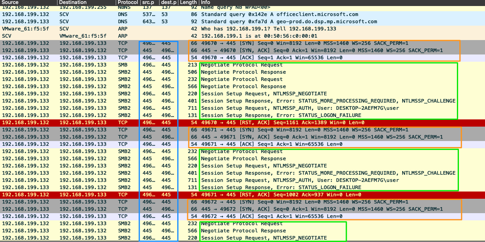

# Networking Primer - Layers 5-7 (Kiến thức mạng cơ bản - Tầng 5-7)
----

Ta đã thấy cách mạng hoạt động ở các tầng thấp, giờ hãy xem xét một số protocol tầng trên đảm nhận việc xử lý các ứng dụng của ta. Cần rất nhiều ứng dụng và dịch vụ khác nhau để duy trì một kết nối mạng và đảm bảo dữ liệu có thể được truyền giữa các host. Phần này sẽ chỉ điểm qua một vài protocol quan trọng.

---
## HTTP

Hypertext Transfer Protocol (`HTTP`) là một protocol stateless (không lưu trạng thái) ở Tầng Application, được sử dụng từ năm 1990. HTTP cho phép truyền dữ liệu dạng clear text (văn bản rõ) giữa client và server qua TCP. Client sẽ gửi một HTTP request tới server để yêu cầu một tài nguyên. Một session được thiết lập, và server phản hồi bằng nội dung được yêu cầu (HTML, hình ảnh, hyperlink, video). Trong hoạt động bình thường, HTTP dùng port 80 hoặc 8000 qua TCP. Trong những trường hợp đặc biệt, nó có thể được điều chỉnh để dùng các port khác, hoặc thậm chí đôi khi dùng UDP.  

#### Các HTTP Method

Để thực hiện các thao tác như tải trang web, yêu cầu tải xuống một mục nào đó hay đăng tweet mới nhất của bạn, tất cả đều đòi hỏi dùng các method cụ thể. Các method này xác định hành động được thực hiện khi yêu cầu một URI.
Các method:  

|**Method**|**Mô tả**|  
|--|--|  
| `HEAD` |`required` là một method an toàn, yêu cầu server phản hồi tương tự một Get request, ngoại trừ việc message body không được đưa vào. Đây là một cách tuyệt vời để thu thập thêm thông tin về server và trạng thái hoạt động của nó.|  
| `GET` |`required` Get là method được dùng phổ biến nhất. Nó yêu cầu thông tin và nội dung từ server. Ví dụ, `GET http://10.1.1.1/Webserver/index.html` yêu cầu trang index.html từ server dựa trên URI mà ta cung cấp.|    
| `POST` | `optional` Post là cách gửi thông tin tới server dựa trên các trường trong request. Ví dụ, gửi một bình luận vào bài đăng Facebook hoặc diễn đàn website là một hành động POST. Hành động thực tế có thể khác nhau tuỳ server, và ta nên chú ý tới các response code được gửi về để xác thực hành động.|    
| `PUT` | `optional` Put sẽ lấy dữ liệu được gắn kèm trong message và đặt nó dưới URI được yêu cầu. Nếu chưa có mục nào tồn tại ở đó, nó sẽ tạo một mục mới với dữ liệu được cung cấp. Nếu một object đã tồn tại, lần PUT mới sẽ được coi là bản cập nhật mới nhất, và object sẽ được sửa đổi cho khớp. Cách dễ nhất để hình dung sự khác biệt giữa PUT và POST là nghĩ như sau: PUT sẽ tạo hoặc cập nhật một object tại URI được cung cấp, trong khi POST sẽ tạo các thực thể con (child entity) tại URI được cung cấp. Hành động này có thể được so sánh với sự khác biệt giữa việc tạo một file mới và việc viết bình luận về file đó trên cùng một trang.|    
| `DELETE` | `optional` Delete làm đúng như tên gọi. Nó sẽ xoá object tại URI được chỉ định. |       
| `TRACE` | `optional` Cho phép chẩn đoán server từ xa.  Server từ xa sẽ phản hồi lại (echo) đúng request đã được gửi nếu method TRACE được bật. |     
| `OPTIONS` | `optional` Method Options có thể thu thập thông tin về các HTTP method được hỗ trợ mà server nhận diện. Bằng cách này, ta có thể xác định các yêu cầu để tương tác với một tài nguyên hoặc server cụ thể mà không thực sự yêu cầu dữ liệu hay object từ nó. |    
| `CONNECT` | `optional` Connect được dành riêng để dùng với Proxy hoặc các thiết bị bảo mật khác như firewall. Connect cho phép tunneling (tạo đường hầm) qua HTTP. (`SSL tunnels`) |     

Hãy để ý rằng có `required` hoặc `optional` được ghi bên cạnh mỗi method. Theo yêu cầu của tiêu chuẩn, GET và HEAD phải luôn hoạt động và tồn tại trong các bản hiện thực HTTP tiêu chuẩn. Điều này chỉ đúng với hai method đó. Các method trace, options, delete, put và post là các chức năng tuỳ chọn có thể cho phép. Một ví dụ là trang web chỉ đọc (read-only) như một bài blog. Máy client có thể yêu cầu một tài nguyên từ trang nhưng không thể sửa đổi, thêm hoặc xoá tài nguyên đó.

Để biết thêm về HTTP với tư cách một protocol hoặc cách nó hoạt động, xem `RFC:2616`.

---
## HTTPS

HTTP Secure (`HTTPS`) là một bản sửa đổi của protocol HTTP, được thiết kế để sử dụng Transport Layer Security (`TLS`), hoặc Secure Sockets Layer (`SSL`) với các ứng dụng cũ hơn, nhằm bảo mật dữ liệu. TLS được dùng như một cơ chế mã hoá để bảo vệ giao tiếp giữa client và server. TLS có thể bọc lưu lượng HTTP thông thường bên trong TLS, nghĩa là ta có thể mã hoá toàn bộ cuộc hội thoại, chứ không chỉ dữ liệu được gửi hoặc yêu cầu. Trước khi có cơ chế TLS, ta dễ bị tấn công Man-in-the-middle và các kiểu trinh sát (reconnaissance) hoặc chiếm quyền (hijacking) khác, nghĩa là bất kỳ ai trong cùng mạng LAN với client hoặc server đều có thể xem lưu lượng web nếu họ đang nghe trên đường truyền. Giờ đây ta có thể có bảo mật được triển khai ngay trong trình duyệt, giúp mọi người mã hoá thói quen duyệt web, các truy vấn tìm kiếm, session hoặc việc truyền dữ liệu, giao dịch ngân hàng và nhiều thứ khác. 

Dù về cơ bản vẫn là HTTP, HTTPS dùng port 443 và 8443 thay cho port tiêu chuẩn 80. Đây là một cách đơn giản để client báo cho server biết nó muốn thiết lập một kết nối bảo mật. Hãy dành một phút xem một output của lưu lượng HTTPS và tìm hiểu cách một `TLS handshake` hoạt động.

#### TLS Handshake qua HTTPS

Trong vài gói tin đầu tiên, ta thấy client thiết lập session tới server bằng port 443 `boxed in blue`. Điều này báo cho server biết client muốn dùng HTTPS làm protocol giao tiếp ở tầng ứng dụng.

Khi session đã được khởi tạo qua TCP, một TLS ClientHello sẽ được gửi tiếp theo để bắt đầu TLS handshake. Trong quá trình handshake, một số tham số được thống nhất, bao gồm session identifier, chứng chỉ x509 của bên kia (peer), thuật toán nén sẽ dùng, thuật toán mã hoá cipher spec, session có thể được nối lại (resumable) hay không, và một master secret dài 48 byte được chia sẻ giữa client và server để xác thực session.

Khi session đã được thiết lập, mọi dữ liệu và method sẽ được gửi qua kết nối TLS và xuất hiện dưới dạng TLS Application Data `as seen in the red box`. TLS vẫn dùng TCP làm protocol vận chuyển, nên ta vẫn sẽ thấy các gói acknowledgment từ stream đi qua port 443.

Tóm tắt quá trình handshake:
1. Client và server trao đổi các hello message để thống nhất các tham số kết nối.
2. Client và server trao đổi các tham số mật mã cần thiết để thiết lập một premaster secret.
3. Client và server sẽ trao đổi chứng chỉ x.509 và thông tin mật mã, cho phép xác thực trong session.
4. Sinh master secret từ premaster secret và các giá trị ngẫu nhiên đã trao đổi.
5. Client và server đưa các tham số bảo mật đã thương lượng xuống phần record layer của protocol TLS.
6. Client và server xác minh rằng bên kia đã tính ra cùng các tham số bảo mật và handshake diễn ra mà không bị kẻ tấn công can thiệp (tampering).

Bản thân mã hoá là một chủ đề phức tạp và dài, xứng đáng có một module riêng. Phần này chỉ là bản tóm tắt đơn giản về cách HTTP và TLS mang lại bảo mật trong protocol ứng dụng HTTPS. Để biết thêm về cách HTTPS hoạt động và cách TLS thực hiện các thao tác bảo mật, xem `RFC:2246`.

---
## FTP

File Transfer Protocol (`FTP`) là một protocol ở Tầng Application cho phép truyền dữ liệu nhanh giữa các thiết bị tính toán. FTP có thể được dùng từ command-line, trình duyệt web hoặc qua một FTP client có giao diện đồ hoạ như FileZilla. Bản thân FTP được xác định là một protocol không an toàn, và hầu hết người dùng đã chuyển sang dùng các công cụ như SFTP để truyền file qua kênh bảo mật. Lưu ý cho tương lai: từ năm 2020, hầu hết các trình duyệt web hiện đại đã dần loại bỏ hỗ trợ FTP. 

Khi nghĩ về giao tiếp giữa các host, ta thường nghĩ tới một client và server nói chuyện qua một socket duy nhất. Qua socket này, cả client và server gửi lệnh và dữ liệu trên cùng một đường link. Ở khía cạnh này, FTP là trường hợp đặc biệt vì nó dùng nhiều port cùng lúc. FTP dùng port 20 và 21 qua TCP. Port 20 được dùng để truyền dữ liệu, còn port 21 được dùng để gửi các lệnh điều khiển FTP session. Về xác thực, FTP hỗ trợ xác thực người dùng cũng như cho phép truy cập ẩn danh (anonymous) nếu được cấu hình.

FTP có thể chạy ở hai chế độ khác nhau, `active` hoặc `passive`. Active là phương thức hoạt động mặc định của FTP, nghĩa là server lắng nghe lệnh điều khiển `PORT` từ client, cho biết port nào sẽ dùng để truyền dữ liệu. Chế độ Passive cho phép ta truy cập các FTP server nằm sau firewall hoặc một đường link có bật NAT, khiến việc kết nối TCP trực tiếp là không thể. Trong trường hợp này, client sẽ gửi lệnh `PASV` và chờ server phản hồi, cho client biết IP và port nào sẽ dùng cho kết nối kênh truyền dữ liệu.  

#### Ví dụ về lệnh & phản hồi FTP  

  
Hình trên cho thấy một số ví dụ về các request được gửi qua kênh lệnh FTP `green arrows`, và các phản hồi được FTP server gửi về `blue arrows`. Tất cả đều khá tiêu chuẩn. Để xem danh sách từng lệnh và chức năng của nó, hãy xem bảng dưới đây.

Khi xem lưu lượng FTP, một số lệnh phổ biến mà ta có thể thấy được truyền qua port 21 bao gồm:

#### Các lệnh FTP   

|**Lệnh**|**Mô tả**|  
|--|--|  
| `USER` | chỉ định user để đăng nhập. |  
| `PASS` | gửi mật khẩu của user đang cố đăng nhập. |  
| `PORT` | khi ở chế độ active, lệnh này sẽ thay đổi port dữ liệu được dùng. |  
| `PASV` | chuyển kết nối tới server từ chế độ active sang passive. | 
| `LIST` | hiển thị danh sách các file trong thư mục hiện tại. |
| `CWD` | sẽ đổi thư mục làm việc hiện tại sang thư mục được chỉ định.  |
| `PWD` | in ra thư mục bạn đang làm việc. |
| `SIZE` | sẽ trả về kích thước của một file được chỉ định.  |
| `RETR` | lấy (tải) file từ FTP server. | 
| `QUIT` | kết thúc session. | 

Đây không phải là danh sách đầy đủ các lệnh điều khiển FTP có thể gặp. Chúng có thể khác nhau tuỳ ứng dụng FTP hoặc shell đang dùng. Để biết thêm về FTP, xem `RFC:959`.  

----
## SMB

Server Message Block (`SMB`) là một protocol thường thấy nhất trong các môi trường doanh nghiệp Windows, cho phép chia sẻ tài nguyên giữa các host trên các kiến trúc mạng phổ biến. SMB là một protocol connection-oriented (hướng kết nối), yêu cầu xác thực người dùng từ host tới tài nguyên để đảm bảo người dùng có đúng quyền để sử dụng tài nguyên đó hoặc thực hiện các hành động. Trước đây, SMB dùng NetBIOS làm cơ chế vận chuyển qua UDP port 137 và 138. Sau những thay đổi hiện đại, SMB nay hỗ trợ vận chuyển trực tiếp qua TCP port 445, NetBIOS qua TCP port 139, và thậm chí cả protocol QUIC.

Với tư cách người dùng, SMB cho ta truy cập dễ dàng và tiện lợi vào các tài nguyên như máy in, ổ đĩa chia sẻ (shared drive), server xác thực và nhiều thứ khác. Cũng vì lý do này, SMB rất hấp dẫn đối với những kẻ tấn công tiềm năng. 

Giống như bất kỳ ứng dụng nào khác dùng TCP làm cơ chế vận chuyển, nó sẽ thực hiện các chức năng tiêu chuẩn như three-way handshake và xác nhận các gói tin đã nhận. Hãy dành chút thời gian xem một ít lưu lượng SMB để làm quen.

#### SMB trên đường truyền

Nhìn vào hình trên, ta thấy nó thực hiện TCP handshake mỗi lần thiết lập một session `orange boxes`. Khi nhìn vào port nguồn và port đích `blue box`, port 445 đang được sử dụng, cho thấy đây là lưu lượng SMB qua TCP. Nếu nhìn vào `green boxes,` trường info cho ta biết đôi chút về những gì đang diễn ra trong giao tiếp SMB. Trong ví dụ này có rất nhiều lỗi, đây là một ví dụ về thứ cần đào sâu thêm. Một hai lần xác thực thất bại (auth failure) từ một user là khá bình thường, nhưng một cụm lớn các lần thất bại lặp đi lặp lại có thể là dấu hiệu của một cá nhân không được phép đang cố truy cập tài khoản của user hoặc dùng credential của họ để di chuyển trong mạng. Đây là một tactic phổ biến của kẻ tấn công: chiếm một user đã xác thực, đánh cắp credential của họ, dùng chúng để lateral movement (di chuyển ngang), hoặc truy cập các tài nguyên mà bình thường chúng sẽ bị từ chối truy cập. 

Đây chỉ là một ví dụ về việc sử dụng SMB. Một điều phổ biến khác mà ta sẽ thấy là việc truy cập file share giữa các server và host. Phần lớn đây là giao tiếp bình thường. Tuy nhiên, nếu ta thấy một host truy cập file share trên các host khác, thì điều này không phổ biến. Hãy chú ý xem ai đang yêu cầu kết nối, tới đâu, và họ đang làm gì.
