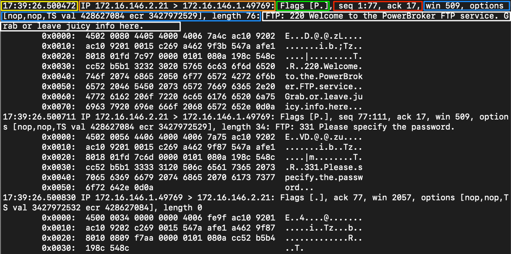

# Tcpdump Fundamentals (Kiến thức cơ bản về Tcpdump)
----
  
`Tcpdump` là một packet sniffer (công cụ bắt gói tin) dạng command-line, có thể trực tiếp capture và diễn giải các data frame từ một file hoặc từ một network interface. Nó được xây dựng để dùng trên mọi hệ điều hành tương tự Unix (Unix-like) và từng có một phiên bản "song sinh" trên Windows tên là `WinDump`. Đây là một công cụ mạnh mẽ và dễ dùng trên hầu hết các hệ thống dựa trên Unix. Nó không cần GUI và có thể dùng qua bất kỳ terminal hay kết nối từ xa nào, chẳng hạn SSH. Tuy vậy, ban đầu công cụ này có thể khiến ta thấy choáng ngợp vì có quá nhiều chức năng và filter khác nhau. Nhưng một khi đã nắm được các chức năng thiết yếu, ta sẽ thấy dùng công cụ này hiệu quả dễ hơn nhiều. Để capture network traffic "off the wire" (trực tiếp trên đường truyền), nó dùng các thư viện `pcap` và `libpcap`, kết hợp với một interface ở promiscuous mode để lắng nghe dữ liệu. Điều này cho phép chương trình thấy và capture các packet xuất phát từ hoặc hướng tới bất kỳ thiết bị nào trong mạng cục bộ (LAN), chứ không chỉ các packet gửi tới chính ta.

TCPDump có sẵn cho hầu hết các hệ thống Unix và các dẫn xuất của Unix, như AIX, BSD, Linux, Solaris, và được nhiều nhà sản xuất cài sẵn trong hệ thống. Do truy cập trực tiếp vào phần cứng, ta cần quyền `root` hoặc quyền `administrator's` (quản trị viên) để chạy công cụ này. Với chúng ta, điều đó có nghĩa là phải dùng `sudo` để chạy TCPDump, như trong các ví dụ bên dưới. `TCPDump` thường được cài sẵn trên phần lớn các hệ điều hành Linux.   


<div class="card bg-light">
    <div class="card-body">
                 <p class="mb-0">Cần lưu ý rằng Windows từng có một bản port của TCPDump tên là Windump. Windump đã ngừng được hỗ trợ. Một giải pháp thay thế là chạy một bản phân phối Linux như Parrot hoặc Ubuntu trong Windows Subsystem for Linux — đây có thể là cách dễ dàng để có một máy ảo Linux ngay trên máy tính của mình, cho phép dùng TCPDump và nhiều công cụ được xây dựng cho Linux khác.</p>
    </div>
</div>


#### Tìm vị trí Tcpdump

Để kiểm tra package có tồn tại trên host hay không, dùng lệnh sau:
   
```shell-session
[!bash!]$ which tcpdump
``` 
  
Thường thì nó nằm ở `/usr/sbin/tcpdump`. Tuy nhiên, nếu package chưa có, ta có thể cài đặt bằng:  

#### Cài đặt Tcpdump
```shell-session
[!bash!]$ sudo apt install tcpdump 
```

Ta có thể chạy tcpdump với switch `--version` để kiểm tra bản cài đặt và phiên bản hiện tại của package, qua đó xác nhận việc cài đặt.

#### Kiểm tra phiên bản Tcpdump
```shell-session
[!bash!]$ sudo tcpdump --version

tcpdump version 4.9.3
libpcap version 1.9.1 (with TPACKET_V3)
OpenSSL 1.1.1f  31 Mar 2020
```
    
---
## Capture traffic với Tcpdump  

Vì có rất nhiều chức năng và filter khác nhau, trước tiên ta nên làm quen với các tính năng thiết yếu của công cụ. Hãy cùng bàn về một số tuỳ chọn cơ bản của TCPDump, chạy thử vài lệnh, và xem cách lưu traffic vào file `PCAP` cũng như đọc từ các file này. 
  
#### Các tuỳ chọn capture cơ bản  
Dưới đây là bảng các switch cơ bản của Tcpdump mà ta có thể dùng để điều chỉnh cách capture chạy. Các switch này có thể được xâu chuỗi (chain) với nhau để tuỳ chỉnh output của công cụ hiển thị cho ta trên STDOUT và những gì được lưu vào file capture. Đây không phải danh sách đầy đủ, còn rất nhiều switch khác ta có thể dùng, nhưng đây là những switch phổ biến và hữu ích nhất.  

| **Switch Command**    | **Kết quả**    |
|:--------------:   |--------   |
|         D         | Hiển thị mọi interface có thể dùng để capture.       |
|         i         | Chọn một interface để capture. vd: -i eth0         |
|         n         | Không chuyển đổi địa chỉ (tức là địa chỉ host, số port, v.v.) thành tên.    |
|         e         | Lấy cả ethernet header cùng với dữ liệu của tầng trên.       |
|         X         | Hiển thị nội dung packet ở dạng hex và ASCII.        |
|         XX        | Giống X, nhưng hiển thị thêm cả ethernet header. (giống như dùng Xe)        |
|        v, vv, vvv | Tăng mức độ chi tiết (verbosity) của output được hiển thị và lưu lại.         |
|         c         | Lấy một số lượng packet cụ thể rồi thoát chương trình.          |
|         s         | Xác định lấy bao nhiêu phần của một packet.         |
|         S         | Đổi sequence number tương đối (relative) trong phần hiển thị capture thành sequence number tuyệt đối (absolute). (13248765839 thay vì 101)        |
|         q         | In ra ít thông tin về giao thức hơn.          |
|         r file.pcap           | Đọc từ một file.         |
|         w file.pcap        | Ghi vào một file     |

#### Sử dụng man page
Để xem danh sách switch đầy đủ, ta có thể dùng man page:

#### Man page của Tcpdump
```shell-session
[!bash!]$ man tcpdump
```  

Dưới đây là một số ví dụ về cách dùng các switch cơ bản của Tcpdump, kèm mô tả những gì đang diễn ra:

#### Liệt kê các interface khả dụng
```shell-session
[!bash!]$ sudo tcpdump -D

1.eth0 [Up, Running, Connected]
2.any (Pseudo-device that captures on all interfaces) [Up, Running]
3.lo [Up, Running, Loopback]
4.bluetooth0 (Bluetooth adapter number 0) [Wireless, Association status unknown]
5.bluetooth-monitor (Bluetooth Linux Monitor) [Wireless]
6.nflog (Linux netfilter log (NFLOG) interface) [none]
7.nfqueue (Linux netfilter queue (NFQUEUE) interface) [none]
8.dbus-system (D-Bus system bus) [none]
9.dbus-session (D-Bus session bus) [none]
```

Lệnh trên gọi tcpdump với quyền sudo và liệt kê các network interface có thể dùng. Ta có thể chọn một trong các network interface này và chỉ cho tcpdump biết nó nên lắng nghe trên interface nào.

#### Chọn interface để capture
```shell-session
[!bash!]$ sudo tcpdump -i eth0

tcpdump: verbose output suppressed, use -v[v]... for full protocol decode
listening on eth0, link-type EN10MB (Ethernet), snapshot length 262144 bytes
10:58:33.719241 IP 172.16.146.2.55260 > 172.67.1.1.https: Flags [P.], seq 1953742992:1953743073, ack 2034210498, win 501, length 81
10:58:33.747853 IP 172.67.1.1.https > 172.16.146.2.55260: Flags [.], ack 81, win 158, length 0
10:58:33.750393 IP 172.16.146.2.52195 > 172.16.146.1.domain: 7579+ PTR? 1.1.67.172.in-addr.arpa. (41)
```

Trong terminal này, ta gọi tcpdump và chọn interface eth0 để capture traffic. Khi chạy lệnh, tcpdump sẽ bắt đầu sniff (nghe lén) traffic và ta thấy được vài packet đầu tiên đi qua interface. Bằng cách dùng switch `-nn` như bên dưới, ta yêu cầu TCPDump không phân giải địa chỉ IP và số port thành hostname và tên port thông dụng. Trong cách biểu diễn này, octet cuối cùng là port mà kết nối đi ra hoặc đi tới.

#### Tắt phân giải tên
```shell-session
[!bash!]$ sudo tcpdump -i eth0 -nn

tcpdump: verbose output suppressed, use -v[v]... for full protocol decode
listening on eth0, link-type EN10MB (Ethernet), snapshot length 262144 bytes
11:02:35.580449 IP 172.16.146.2.48402 > 52.31.199.148.443: Flags [P.], seq 988167196:988167233, ack 1512376150, win 501, options [nop,nop,TS val 214282239 ecr 77421665], length 37
11:02:35.588695 IP 172.16.146.2.55272 > 172.67.1.1.443: Flags [P.], seq 940648841:940648916, ack 4248406693, win 501, length 75
11:02:35.654368 IP 172.67.1.1.443 > 172.16.146.2.55272: Flags [.], ack 75, win 70, length 0
11:02:35.728889 IP 52.31.199.148.443 > 172.16.146.2.48402: Flags [P.], seq 1:34, ack 37, win 118, options [nop,nop,TS val 77434740 ecr 214282239], length 33
11:02:35.728988 IP 172.16.146.2.48402 > 52.31.199.148.443: Flags [.], ack 34, win 501, options [nop,nop,TS val 214282388 ecr 77434740], length 0
11:02:35.729073 IP 52.31.199.148.443 > 172.16.146.2.48402: Flags [P.], seq 34:65, ack 37, win 118, options [nop,nop,TS val 77434740 ecr 214282239], length 31
11:02:35.729081 IP 172.16.146.2.48402 > 52.31.199.148.443: Flags [.], ack 65, win 501, options [nop,nop,TS val 214282388 ecr 77434740], length 0
11:02:35.729348 IP 52.31.199.148.443 > 172.16.146.2.48402: Flags [F.], seq 65, ack 37, win 118, options [nop,nop,TS val 77434740 ecr 214282239], length 0
```

Khi dùng switch `-e`, ta yêu cầu tcpdump đưa cả ethernet header vào output của capture, cùng với nội dung thông thường. Ta có thể thấy điều này đã có tác dụng khi xem output. Thông thường, trường thứ nhất và thứ hai gồm Timestamp rồi đến phần đầu của IP header. Giờ thì chúng gồm Timestamp và địa chỉ MAC nguồn của host.

#### Hiển thị Ethernet header 
```shell-session
[!bash!]$ sudo tcpdump -i eth0 -e

tcpdump: verbose output suppressed, use -v[v]... for full protocol decode
listening on eth0, link-type EN10MB (Ethernet), snapshot length 262144 bytes
11:05:45.982115 00:0c:29:97:52:65 (oui Unknown) > 8a:66:5a:11:8d:64 (oui Unknown), ethertype IPv4 (0x0800), length 103: 172.16.146.2.57142 > ec2-99-80-22-207.eu-west-1.compute.amazonaws.com.https: Flags [P.], seq 922951468:922951505, ack 1842875143, win 501, options [nop,nop,TS val 1368272062 ecr 65637925], length 37
11:05:45.989652 00:0c:29:97:52:65 (oui Unknown) > 8a:66:5a:11:8d:64 (oui Unknown), ethertype IPv4 (0x0800), length 129: 172.16.146.2.55272 > 172.67.1.1.https: Flags [P.], seq 940656124:940656199, ack 4248413119, win 501, length 75
11:05:46.047731 00:0c:29:97:52:65 (oui Unknown) > 8a:66:5a:11:8d:64 (oui Unknown), ethertype IPv4 (0x0800), length 85: 172.16.146.2.54006 > 172.16.146.1.domain: 31772+ PTR? 207.22.80.99.in-addr.arpa. (43)
11:05:46.049134 8a:66:5a:11:8d:64 (oui Unknown) > 00:0c:29:97:52:65 (oui Unknown), ethertype IPv4 (0x0800), length 147: 172.16.146.1.domain > 172.16.146.2.54006: 31772 1/0/0 PTR ec2-99-80-22-207.eu-west-1.compute.amazonaws.com. (105)
```

Khi dùng switch `-X`, giờ ta có thể thấy packet rõ ràng hơn một chút. Ta có output dạng ASCII ở bên phải để diễn giải bất cứ thứ gì ở dạng cleartext tương ứng với output dạng hexa ở bên trái.

#### Kèm output dạng ASCII và Hex
```shell-session
[!bash!]$ sudo tcpdump -i eth0 -X

tcpdump: verbose output suppressed, use -v[v]... for full protocol decode
listening on eth0, link-type EN10MB (Ethernet), snapshot length 262144 bytes
11:10:34.972248 IP 172.16.146.2.57170 > ec2-99-80-22-207.eu-west-1.compute.amazonaws.com.https: Flags [P.], seq 2612172989:2612173026, ack 3165195759, win 501, options [nop,nop,TS val 1368561052 ecr 65712142], length 37
    0x0000:  4500 0059 4352 4000 4006 3f1b ac10 9202  E..YCR@.@.?.....
    0x0010:  6350 16cf df52 01bb 9bb2 98bd bca9 0def  cP...R..........
    0x0020:  8018 01f5 b87d 0000 0101 080a 5192 959c  .....}......Q...
    0x0030:  03ea b00e 1703 0300 2000 0000 0000 0000  ................
    0x0040:  0adb 84ac 34b4 910a 0fb4 2f49 9865 eb45  ....4...../I.e.E
    0x0050:  883c eafd 8266 3e23 88                   .<...f>#.
11:10:34.984582 IP 172.16.146.2.38732 > 172.16.146.1.domain: 22938+ A? app.hackthebox.eu. (35)
    0x0000:  4500 003f 2e6b 4000 4011 901e ac10 9202  E..?.k@.@.......
    0x0010:  ac10 9201 974c 0035 002b 7c61 599a 0100  .....L.5.+|aY...
    0x0020:  0001 0000 0000 0000 0361 7070 0a68 6163  .........app.hac
    0x0030:  6b74 6865 626f 7802 6575 0000 0100 01    kthebox.eu.....
11:10:35.055497 IP 172.16.146.2.43116 > 172.16.146.1.domain: 6524+ PTR? 207.22.80.99.in-addr.arpa. (43)
    0x0000:  4500 0047 2e72 4000 4011 900f ac10 9202  E..G.r@.@.......
    0x0010:  ac10 9201 a86c 0035 0033 7c69 197c 0100  .....l.5.3|i.|..
    0x0020:  0001 0000 0000 0000 0332 3037 0232 3202  .........207.22.
    0x0030:  3830 0239 3907 696e 2d61 6464 7204 6172  80.99.in-addr.ar
    0x0040:  7061 0000 0c00 01                        pa.....
```

Hãy chú ý mức độ chi tiết trong output ở trên. Ta sẽ nhận thấy mình có thông tin về các tuỳ chọn của IP header như time to live, offset, các flag khác, và nhiều chi tiết hơn về các giao thức tầng trên. Dưới đây, ta kết hợp các switch để tuỳ chỉnh output theo ý mình. 

#### Kết hợp các switch của Tcpdump
```shell-session
[!bash!]$ sudo tcpdump -i eth0 -nnvXX

tcpdump: listening on eth0, link-type EN10MB (Ethernet), snapshot length 262144 bytes
11:13:59.149599 IP (tos 0x0, ttl 64, id 24075, offset 0, flags [DF], proto TCP (6), length 89)
    172.16.146.2.42454 > 54.77.251.34.443: Flags [P.], cksum 0x6fce (incorrect -> 0xb042), seq 671020720:671020757, ack 3699222968, win 501, options [nop,nop,TS val 1154433101 ecr 1116647414], length 37
    0x0000:  8a66 5a11 8d64 000c 2997 5265 0800 4500  .fZ..d..).Re..E.
    0x0010:  0059 5e0b 4000 4006 6d11 ac10 9202 364d  .Y^.@.@.m.....6M
    0x0020:  fb22 a5d6 01bb 27fe f6b0 dc7d a9b8 8018  ."....'....}....
    0x0030:  01f5 6fce 0000 0101 080a 44cf 404d 428e  ..o.......D.@MB.
    0x0040:  aff6 1703 0300 2000 0000 0000 0000 09bb  ................
    0x0050:  38d9 d89a 2d70 73d5 a01e 9df7 2c48 5b8a  8...-ps.....,H[.
    0x0060:  d64d 8e42 2ccc 43                        .M.B,.C
11:13:59.157113 IP (tos 0x0, ttl 64, id 31823, offset 0, flags [DF], proto UDP (17), length 63)
    172.16.146.2.55351 > 172.16.146.1.53: 26460+ A? app.hackthebox.eu. (35)
    0x0000:  8a66 5a11 8d64 000c 2997 5265 0800 4500  .fZ..d..).Re..E.
    0x0010:  003f 7c4f 4000 4011 423a ac10 9202 ac10  .?|O@.@.B:......
    0x0020:  9201 d837 0035 002b 7c61 675c 0100 0001  ...7.5.+|ag\....
    0x0030:  0000 0000 0000 0361 7070 0a68 6163 6b74  .......app.hackt
    0x0040:  6865 626f 7802 6575 0000 0100 01         hebox.eu.....
11:13:59.158029 IP (tos 0x0, ttl 64, id 20784, offset 0, flags [none], proto UDP (17), length 111)
    172.16.146.1.53 > 172.16.146.2.55351: 26460 3/0/0 app.hackthebox.eu. A 104.20.55.68, app.hackthebox.eu. A 172.67.1.1, app.hackthebox.eu. A 104.20.66.68 (83)
    0x0000:  000c 2997 5265 8a66 5a11 8d64 0800 4500  ..).Re.fZ..d..E.
    0x0010:  006f 5130 0000 4011 ad29 ac10 9201 ac10  .oQ0..@..)......
    0x0020:  9202 0035 d837 005b 9d2e 675c 8180 0001  ...5.7.[..g\....
    0x0030:  0003 0000 0000 0361 7070 0a68 6163 6b74  .......app.hackt
    0x0040:  6865 626f 7802 6575 0000 0100 01c0 0c00  hebox.eu........
    0x0050:  0100 0100 0000 ab00 0468 1437 44c0 0c00  .........h.7D...
    0x0060:  0100 0100 0000 ab00 04ac 4301 01c0 0c00  ..........C.....
    0x0070:  0100 0100 0000 ab00 0468 1442 44         .........h.BD
11:13:59.158335 IP (tos 0x0, ttl 64, id 20242, offset 0, flags [DF], proto TCP (6), length 60)
    172.16.146.2.55416 > 172.67.1.1.443: Flags [S], cksum 0xeb85 (incorrect -> 0x72f7), seq 3766489491, win 64240, options [mss 1460,sackOK,TS val 508232750 ecr 0,nop,wscale 7], length 0
    0x0000:  8a66 5a11 8d64 000c 2997 5265 0800 4500  .fZ..d..).Re..E.
    0x0010:  003c 4f12 4000 4006 0053 ac10 9202 ac43  .<O.@.@..S.....C
    0x0020:  0101 d878 01bb e080 1193 0000 0000 a002  ...x............
    0x0030:  faf0 eb85 0000 0204 05b4 0402 080a 1e4b  ...............K
    0x0040:  042e 0000 0000 0103 0307                 ..........
```

Khi dùng các switch, xâu chuỗi chúng lại với nhau như trong ví dụ `above` (ở trên) là best practice (cách làm tốt nhất). 


----  
## Output của Tcpdump

Khi xem output của TCPDump, ta có thể thấy hơi choáng ngợp. Chạy thử qua các switch cơ bản này đã cho ta thấy nhiều kiểu hiển thị khác nhau. Ta sẽ dành một chút thời gian mổ xẻ output đó và giải thích những gì ta đang thấy. Hình và bảng dưới đây sẽ định nghĩa từng trường (field). Lưu ý rằng ta dùng filter càng chi tiết (verbose) thì càng có nhiều chi tiết từ mỗi header được hiển thị. 

#### Phân tích output Tcpdump trên shell
    
  
|**Trường**     |**Kết quả**     |  
|---  |---  |  
|Timestamp  | `Yellow` Trường timestamp đứng đầu tiên và có thể cấu hình để hiển thị ngày giờ theo định dạng mà ta dễ tiếp nhận.    |
|Protocol   | `Orange` Phần này cho ta biết header của tầng trên là gì. Trong ví dụ của ta, nó hiển thị IP.  |  
|Source & Destination IP.Port | `Orange` Phần này cho ta thấy nguồn và đích của packet, kèm theo số port dùng để kết nối. Định dạng == `IP.port == 172.16.146.2.21`  |  
|Flags   | `Green`  Phần này hiển thị mọi flag được sử dụng.  |  
|Sequence and Acknowledgement Numbers  | `Red`  Phần này hiển thị sequence number và acknowledgment number dùng để theo dõi TCP segment. Ví dụ của ta dùng các số nhỏ, nên có thể giả định rằng sequence number và ack number tương đối (relative) đang được hiển thị. |  
|Protocol Options | `Blue`  Ở đây, ta sẽ thấy mọi giá trị TCP đã được thương lượng và thiết lập giữa client và server, như window size, selective acknowledgment, window scale factor, và nhiều giá trị khác.  |  
|Notes / Next Header | `White`  Các ghi chú khác mà dissector (bộ phân tích giao thức) tìm thấy sẽ nằm ở đây. Vì traffic mà ta đang xem được đóng gói (encapsulate), ta có thể thấy thêm thông tin header của các giao thức khác. Trong ví dụ của ta, có thể thấy dissector của TCPDump nhận diện được FTP traffic bên trong phần đóng gói và hiển thị nó cho ta.  |  
 
Còn rất nhiều tuỳ chọn và thông tin khác có thể được hiển thị. Thông tin này thay đổi tuỳ theo mức verbosity được bật. 
Để hiểu chi tiết hơn về IP header và header của các giao thức khác, hãy xem `Networking Primer` ở section hai hoặc module `Networking Foundations`.  

Biết được cách một mạng hoạt động và cách dùng các filter mà TCPDump cung cấp mang lại lợi thế rất lớn. Với chúng, ta có thể xem network traffic, phân tích (parse) nó để tìm vấn đề, và nhanh chóng xác định các tương tác mạng đáng ngờ. Về lý thuyết, ta có thể dùng `tcpdump ` để tạo một hệ thống IDS/IPS bằng cách cho một Bash script phân tích các packet bắt được theo một pattern cụ thể. Sau đó ta có thể đặt điều kiện, chẳng hạn chặn (ban) một địa chỉ IP cụ thể đã gửi quá nhiều ICMP echo request trong một khoảng thời gian nhất định.

---
## File Input/Output với Tcpdump
  
Dùng `-w` sẽ ghi bản capture của ta vào một file. Lưu ý rằng khi capture traffic trực tiếp trên đường truyền, ta có thể nhanh chóng dùng hết dung lượng đĩa còn trống và gặp vấn đề về lưu trữ nếu không cẩn thận. Network segment càng lớn thì ta càng nhanh hết dung lượng lưu trữ. Dùng các switch đã minh hoạ ở trên có thể giúp điều chỉnh lượng dữ liệu được lưu trong các file PCAP.

#### Lưu output PCAP vào file

```shell-session
[!bash!]$ sudo tcpdump -i eth0 -w ~/output.pcap

tcpdump: listening on eth0, link-type EN10MB (Ethernet), snapshot length 262144 bytes
10 packets captured
131 packets received by filter
0 packets dropped by kernel
```

Bản capture ở trên sẽ ghi output vào một file tên là `output.pcap`. Khi chạy tcpdump theo cách này, output sẽ không cuộn trên terminal như bình thường. Toàn bộ output của tcpdump được chuyển hướng (redirect) vào file mà ta chỉ định cho bản capture.

#### Đọc output từ file

```shell-session
[!bash!]$ sudo tcpdump -r ~/output.pcap

reading from file /home/trey/output.pcap, link-type EN10MB (Ethernet), snapshot length 262144
11:15:40.321509 IP 172.16.146.2.57236 > ec2-99-80-22-207.eu-west-1.compute.amazonaws.com.https: Flags [P.], seq 2751910362:2751910399, ack 946558143, win 501, options [nop,nop,TS val 1368866401 ecr 65790024], length 37
11:15:40.337302 IP 172.16.146.2.55416 > 172.67.1.1.https: Flags [P.], seq 3766493458:3766493533, ack 4098207917, win 501, length 75
11:15:40.398103 IP 172.67.1.1.https > 172.16.146.2.55416: Flags [.], ack 75, win 73, length 0
11:15:40.457416 IP ec2-99-80-22-207.eu-west-1.compute.amazonaws.com.https > 172.16.146.2.57236: Flags [.], ack 37, win 118, options [nop,nop,TS val 65799068 ecr 1368866401], length 0
11:15:40.458582 IP ec2-99-80-22-207.eu-west-1.compute.amazonaws.com.https > 172.16.146.2.57236: Flags [P.], seq 34:65, ack 37, win 118, options [nop,nop,TS val 65799068 ecr 1368866401], length 31
11:15:40.458599 IP 172.16.146.2.57236 > ec2-99-80-22-207.eu-west-1.compute.amazonaws.com.https: Flags [.], ack 1, win 501, options [nop,nop,TS val 1368866538 ecr 65799068,nop,nop,sack 1 {34:65}], length 0
11:15:40.458643 IP ec2-99-80-22-207.eu-west-1.compute.amazonaws.com.https > 172.16.146.2.57236: Flags [P.], seq 1:34, ack 37, win 118, options [nop,nop,TS val 65799068 ecr 1368866401], length 33
11:15:40.458655 IP 172.16.146.2.57236 > ec2-99-80-22-207.eu-west-1.compute.amazonaws.com.https: Flags [.], ack 65, win 501, options [nop,nop,TS val 1368866538 ecr 65799068], length 0
11:15:40.458915 IP 172.16.146.2.57236 > ec2-99-80-22-207.eu-west-1.compute.amazonaws.com.https: Flags [P.], seq 37:68, ack 65, win 501, options [nop,nop,TS val 1368866539 ecr 65799068], length 31
11:15:40.458964 IP 172.16.146.2.57236 > ec2-99-80-22-207.eu-west-1.compute.amazonaws.com.https: Flags [F.], seq 68, ack 65, win 501, options [nop,nop,TS val 1368866539 ecr 65799068], length 0
```

Lệnh này sẽ đọc bản capture được lưu trong `output.pcap`. Để ý rằng output đã trở lại dạng hiển thị cơ bản. Để lấy thông tin chi tiết hơn từ file capture, hãy áp dụng lại các switch của ta.
