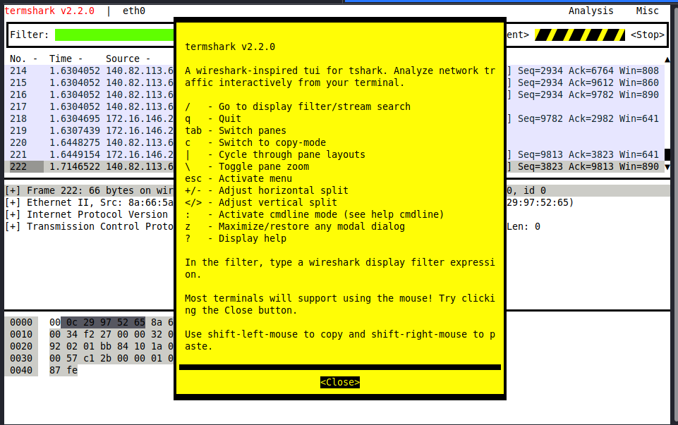
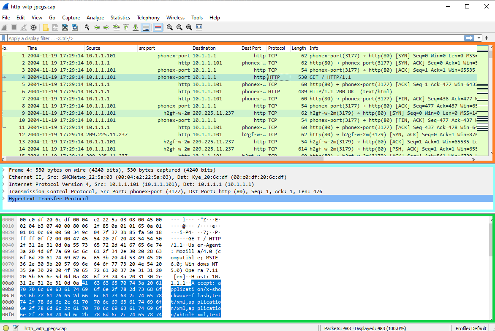
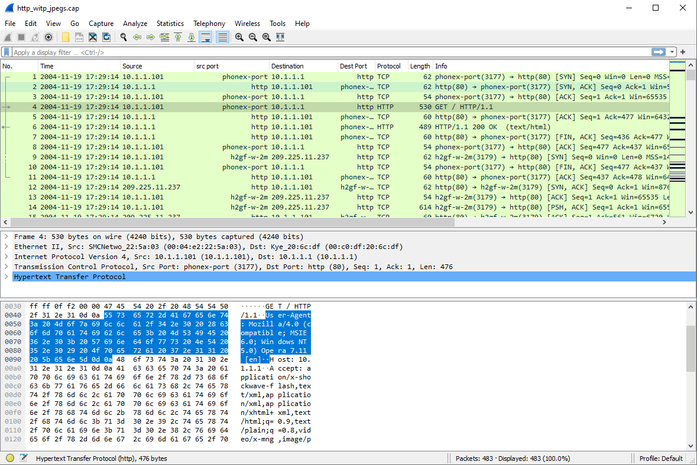
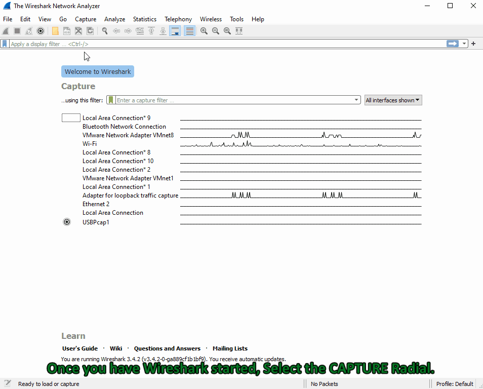
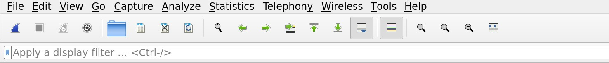
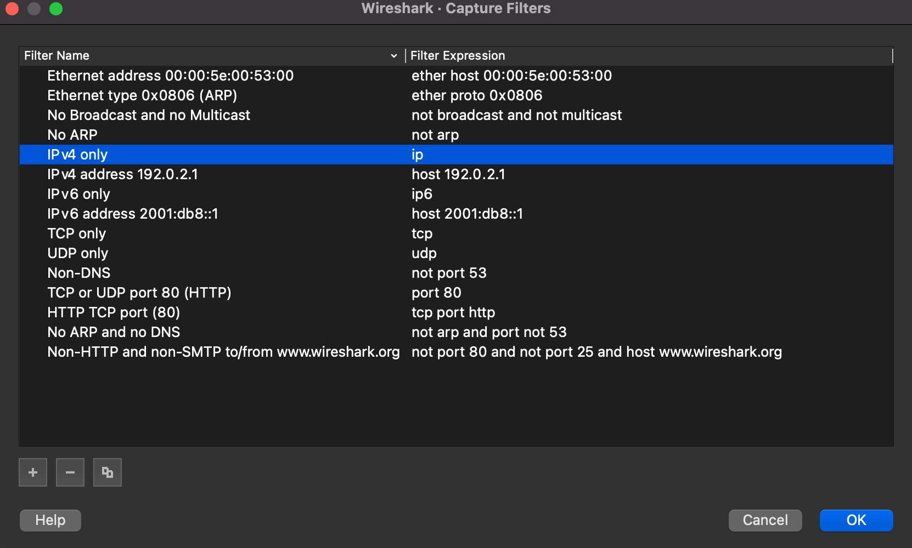
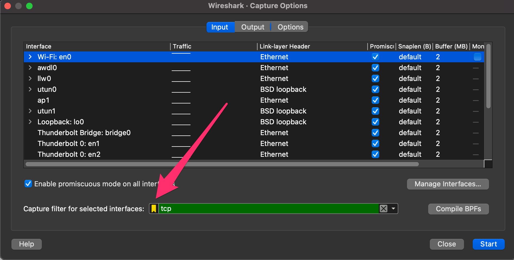
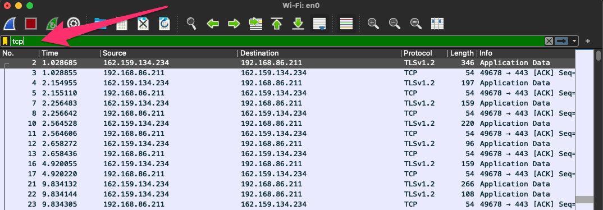

# Analysis with Wireshark (Phân tích với Wireshark)


`Wireshark` là một công cụ phân tích lưu lượng mạng (network traffic analyzer) miễn phí và mã nguồn mở, khá giống tcpdump nhưng có giao diện đồ họa. 
Wireshark đa nền tảng, có thể capture dữ liệu trực tiếp (live) từ nhiều loại interface khác nhau (bao gồm WiFi, USB và Bluetooth) và lưu traffic ra nhiều định dạng khác nhau. Wireshark cho phép người dùng đi sâu hơn nhiều vào việc kiểm tra network packet so với các công cụ khác. Điều làm Wireshark thực sự mạnh mẽ là khả năng phân tích mà nó cung cấp, mang lại cái nhìn chi tiết về traffic.

Tùy vào host đang dùng, không phải lúc nào ta cũng có GUI để dùng Wireshark truyền thống. May mắn là có một số biến thể cho phép ta dùng nó từ command line.
    
#### Tính năng và khả năng:
   
* Deep packet inspection (kiểm tra gói tin chuyên sâu) cho hàng trăm giao thức khác nhau
* Giao diện đồ họa và TTY
* Chạy được trên hầu hết các hệ điều hành
* Ethernet, IEEE 802.11, PPP/HDLC, ATM, Bluetooth, USB, Token Ring, Frame Relay, FDDI, cùng nhiều loại khác
* Khả năng giải mã (decryption) cho IPsec, ISAKMP, Kerberos, SNMPv3, SSL/TLS, WEP và WPA/WPA2
* Và còn rất rất nhiều nữa...  
 
---
## Yêu cầu khi sử dụng

Để sử dụng, Wireshark cần những thứ sau:  
  
#### Windows:
* Universal C Runtime. Thành phần này có sẵn trong Windows 10 và Windows Server 2019, và được cài tự động trên các phiên bản cũ hơn nếu bật Microsoft Windows Update. Nếu không, phải cài KB2999226 hoặc KB3118401.  
* Bất kỳ bộ xử lý 64-bit AMD64/x86-64 hoặc 32-bit x86 hiện đại nào.  
* 500 MB RAM trống. File capture càng lớn càng cần nhiều RAM.  
* 500 MB dung lượng đĩa trống. File capture cần thêm dung lượng đĩa.  
* Bất kỳ màn hình hiện đại nào. Khuyến nghị độ phân giải 1280 × 1024 trở lên. Wireshark sẽ tận dụng độ phân giải HiDPI hoặc Retina nếu có. Người dùng chuyên sâu sẽ thấy dùng nhiều màn hình rất hữu ích.  
* Một card mạng được hỗ trợ để capture:  
    - Ethernet. Bất kỳ card nào được Windows hỗ trợ đều dùng được.  
    - 802.11. Xem trang wiki của Wireshark. Capture thông tin 802.11 thô (raw) có thể khó nếu không có thiết bị chuyên dụng.  
* Để cài đặt, tải file thực thi từ wireshark.org, kiểm tra hash rồi cài đặt.  
  
#### Linux: ####  
* Wireshark chạy trên hầu hết các nền tảng UNIX và tương tự UNIX (UNIX-like), bao gồm Linux và hầu hết các biến thể BSD. Yêu cầu hệ thống tương đương với cấu hình đã liệt kê ở trên cho Windows.  
* Có sẵn gói binary cho hầu hết các bản phân phối Unix và Linux.  
* Để kiểm tra xem gói đã có trên host hay chưa, dùng lệnh sau:  
  
#### Tìm vị trí Wireshark
```shell-session
[!bash!]$ which wireshark
``` 
  
Nếu gói chưa tồn tại (thường có thể tìm thấy nó ở `/usr/sbin/wireshark`), bạn có thể cài bằng:  
  
#### Cài đặt Wireshark trên Linux  
```shell-session
[!bash!]$ sudo apt install wireshark 
```

---
## TShark VS. Wireshark (Terminal vs. GUI)

Cả hai lựa chọn đều có ưu điểm riêng. TShark là công cụ terminal được xây dựng chuyên biệt dựa trên Wireshark. TShark có nhiều tính năng giống Wireshark, thậm chí dùng chung cú pháp và tùy chọn. TShark rất phù hợp cho các máy có ít hoặc không có môi trường desktop, và có thể dễ dàng chuyển thông tin capture nhận được sang một công cụ khác qua command line. Wireshark là lựa chọn GUI giàu tính năng cho việc capture và phân tích traffic. Nếu bạn muốn trải nghiệm đầy đủ tính năng và làm việc trên máy có môi trường desktop, Wireshark GUI là lựa chọn phù hợp.  

  
#### Các switch cơ bản của TShark   
|**Switch lệnh**| **Kết quả**  |  
|:--------------:   |--------   |  
|         D         | Hiển thị mọi interface có thể capture rồi thoát.          |  
|         L         | Liệt kê các loại môi trường Link-layer (link-layer medium) có thể capture rồi thoát. (ví dụ ethernet)         |  
|         i         | chọn interface để capture. (-i eth0)        |  
|         f         | packet filter theo cú pháp libpcap. Dùng trong lúc capture.         |   
|         c         | Lấy một số lượng packet nhất định rồi thoát chương trình. Định nghĩa một điều kiện dừng.        |  
|         a         | Định nghĩa điều kiện tự dừng (autostop). Có thể là sau một khoảng thời gian, khi đạt kích thước file nhất định, hoặc sau một số lượng packet nhất định.         |    
|         r (pcap-file)         | Đọc từ file.         |  
|         W (pcap-file)        | Ghi vào file theo định dạng pcapng.     |  
|         P         | In tóm tắt packet trong khi ghi vào file (-W)     |  
|         x         | thêm output Hex và ASCII vào capture.     |  
|         h         | Xem menu trợ giúp     |   

`To see the full list of switches you can utilize:`

#### Trợ giúp TShark
```shell-session
[!bash!]$ tshark -h
```  

#### Cách dùng TShark cơ bản  
  
TShark có thể dùng filter cho giao thức, cho các thành phần thông dụng như host và port, và thậm chí có thể đào sâu hơn vào packet để tách (dissect) từng field riêng lẻ của packet.

#### Tìm vị trí TShark

```shell-session
[!bash!]$ which tshark

/usr/local/bin/tshark

[!bash!]$ tshark -D

1. en0 (Wi-Fi)
2. awdl0
3. llw0
4. utun0
5. utun1
6. lo0 (Loopback)
7. bridge0 (Thunderbolt Bridge)
8. en1 (Thunderbolt 0)
9. en2 (Thunderbolt 0)
10. en3 (Thunderbolt 1)
11. en4 (Thunderbolt 2)
12. gif0
13. stf0
14. ap1
15. ciscodump (Cisco remote capture)
16. randpkt (Random packet generator)
17. sshdump (SSH remote capture)
18. udpdump (UDP Listener remote capture)

[!bash!]$ tshark -i 1 -w /tmp/test.pcap

Capturing on 'Wi-Fi: en0'
484
```  
Với chuỗi lệnh cơ bản ở trên, ta dùng TShark để capture trên en0, được chỉ định bằng flag `-i`, và dùng tùy chọn `-w` để lưu capture vào file output chỉ định.
Dùng TShark rất giống TCPDump về các filter và switch có thể dùng. Cả hai công cụ đều dùng cú pháp BPF. Để đọc capture, có thể truyền switch `-r` cho tshark giống như với TCPDump, hoặc truyền switch `-P` để tshark in tóm tắt các packet trong khi ghi ra file. Ví dụ dưới đây bắt đầu một live capture trên `eth0` và lưu vào `/tmp/test.pcap`:

#### Chọn interface và ghi ra file
```shell-session
[!bash!]$ sudo tshark -i eth0 -w /tmp/test.pcap
```  

#### Áp dụng filter    
```shell-session
[!bash!]$ sudo tshark -i eth0 -f "host 172.16.146.2"

Capturing on 'eth0'
    1 0.000000000 172.16.146.2 → 172.16.146.1 DNS 70 Standard query 0x0804 A github.com
    2 0.258861645 172.16.146.1 → 172.16.146.2 DNS 86 Standard query response 0x0804 A github.com A 140.82.113.4
    3 0.259866711 172.16.146.2 → 140.82.113.4 TCP 74 48256 → 443 [SYN] Seq=0 Win=64240 Len=0 MSS=1460 SACK_PERM=1 TSval=1321417850 TSecr=0 WS=128
    4 0.299681376 140.82.113.4 → 172.16.146.2 TCP 74 443 → 48256 [SYN, ACK] Seq=0 Ack=1 Win=65535 Len=0 MSS=1436 SACK_PERM=1 TSval=3885991869 TSecr=1321417850 WS=1024
    5 0.299771728 172.16.146.2 → 140.82.113.4 TCP 66 48256 → 443 [ACK] Seq=1 Ack=1 Win=64256 Len=0 TSval=1321417889 TSecr=3885991869
    6 0.306888828 172.16.146.2 → 140.82.113.4 TLSv1 579 Client Hello
    7 0.347570701 140.82.113.4 → 172.16.146.2 TLSv1.3 2785 Server Hello, Change Cipher Spec, Application Data, Application Data, Application Data, Application Data
    8 0.347653593 172.16.146.2 → 140.82.113.4 TCP 66 48256 → 443 [ACK] Seq=514 Ack=2720 Win=63488 Len=0 TSval=1321417937 TSecr=3885991916
    9 0.358887130 172.16.146.2 → 140.82.113.4 TLSv1.3 130 Change Cipher Spec, Application Data
   10 0.359781588 172.16.146.2 → 140.82.113.4 TLSv1.3 236 Application Data
   11 0.360037927 172.16.146.2 → 140.82.113.4 TLSv1.3 758 Application Data
   12 0.360482668 172.16.146.2 → 140.82.113.4 TLSv1.3 258 Application Data
   13 0.397331368 140.82.113.4 → 172.16.146.2 TLSv1.3 145 Application Data 
``` 
`-f` cho phép ta áp dụng filter vào capture. Trong ví dụ, ta dùng `host`, nhưng bạn có thể dùng gần như bất kỳ filter nào mà Wireshark nhận diện được. 
Ta đã điểm qua TShark một chút. Giờ hãy xem một công cụ tiện lợi tên là Termshark.

---
## Termshark

Termshark là một ứng dụng giao diện người dùng dạng văn bản (Text-based User Interface – TUI), cung cấp cho người dùng giao diện giống Wireshark ngay trong cửa sổ terminal.  
  
#### Termshark
  
  
Có thể tìm Termshark tại [Termshark](https://github.com/gcla/termshark). Có thể build từ source bằng cách clone repo, hoặc tải một trong các bản release ổn định hiện tại từ https://github.com/gcla/termshark/releases , giải nén file và dùng được ngay.

Để được hướng dẫn cách điều hướng trong TUI này, xem hình dưới đây.
  
#### Trợ giúp Termshark
  

Để khởi động Termshark, gõ các chuỗi lệnh tương tự như với TShark hoặc tcpdump. Ta có thể chỉ định interface để capture, filter và các thiết lập khác từ terminal. Cửa sổ Termshark sẽ chưa mở cho đến khi nó phát hiện traffic khớp với capture filter. Vì vậy hãy đợi một chút nếu chưa thấy gì xảy ra. 

---
## Tìm hiểu giao diện Wireshark GUI

Giờ ta đã dành thời gian học cách capture packet từ command line, hãy chuyển sang làm việc với Wireshark. Ta sẽ dành vài phút xem xét những gì đang thấy trong output dưới đây. Hãy cùng mổ xẻ giao diện Wireshark GUI này.

#### Wireshark GUI
   
  
Ba pane chính: `See Figure above`
1. Packet List: `Orange`
    * Trong cửa sổ này, ta thấy một dòng tóm tắt cho mỗi packet, mặc định gồm các field liệt kê bên dưới. Ta có thể thêm hoặc bớt cột để thay đổi thông tin được hiển thị.
        * Number- Thứ tự packet đến Wireshark
        * Time- Định dạng thời gian Unix
        * Source- IP nguồn
        * Destination- IP đích
        * Protocol- Giao thức được dùng (TCP, UDP, DNS, v.v.)
        * Information- Thông tin về packet. Field này có thể thay đổi tùy theo loại giao thức bên trong. Ví dụ, với packet DNS, nó sẽ cho biết đó là loại query gì.

2. Packet Details: `Blue`
    * Cửa sổ Packet Details cho phép ta đi sâu vào packet để kiểm tra các giao thức chi tiết hơn. Nó chia packet thành các phần đúng như ta mong đợi theo mô hình tham chiếu OSI thông thường. `The packet is dissected into different encapsulation layers for inspection.` 
    * Lưu ý, Wireshark hiển thị phần encapsulation (đóng gói) này theo thứ tự ngược: encapsulation của tầng thấp nằm ở trên cùng cửa sổ và các tầng cao hơn ở dưới cùng.

3. Packet Bytes: `Green`
    * Cửa sổ Packet Bytes cho phép ta xem nội dung packet dưới dạng ASCII hoặc hex. Khi ta chọn một field ở các cửa sổ phía trên, field đó sẽ được highlight trong cửa sổ Packet Bytes và cho ta thấy bit hoặc byte đó nằm ở đâu trong toàn bộ packet.
    * Đây là cách rất tốt để kiểm chứng rằng những gì ta thấy trong pane Details là chính xác và cách Wireshark diễn giải khớp với output của packet.
    * Mỗi dòng trong output gồm offset của dữ liệu, mười sáu byte dạng hexa và mười sáu byte ASCII. Các byte không in được (non-printable) được thay bằng dấu chấm trong định dạng ASCII.

#### Các tính năng đáng chú ý khác

Khi nhìn vào giao diện Wireshark, ta sẽ thấy một vài vùng tùy chọn và nút radial khác nhau. Các vùng này là điểm điều khiển, nơi ta có thể chỉnh giao diện và cách hiển thị các packet trong capture hiện tại. `See Figure below`

#### Menu của Wireshark
  

## Thực hiện capture đầu tiên trong Wireshark
Bắt đầu một capture với Wireshark rất đơn giản. Ảnh gif dưới đây sẽ minh họa các bước.

#### Các bước bắt đầu một capture
  

Lưu ý, mỗi khi ta thay đổi tùy chọn capture, Wireshark sẽ khởi động lại trace. Giống như TCPDump, Wireshark có các tùy chọn capture filter và display filter để sử dụng.

----  
## Kiến thức cơ bản  

#### Thanh công cụ (Toolbar)  


Toolbar của Wireshark là nơi trung tâm để quản lý rất nhiều tính năng của Wireshark. Từ đây, ta có thể bắt đầu và dừng capture, đổi interface, mở và lưu file .pcap, cũng như áp dụng các filter hoặc add-in phân tích khác nhau.


#### Cách lưu một capture  
Giả sử ta cần lưu lại những gì đang có trong cửa sổ để troubleshoot sau này. Lưu capture cực kỳ đơn giản:
* Chọn File  ⇢ save
HOẶC
* Từ toolbar, chọn tùy chọn file rồi chọn nơi lưu file và định dạng lưu.

Lưu ý rằng Wireshark có thể lưu capture ra nhiều định dạng. Hãy chọn định dạng phù hợp với tình huống, nhưng hiện tại ta sẽ dùng định dạng `.pcap`.

---
## Xử lý và lọc trước và sau khi capture

Khi capture traffic bằng Wireshark, ta có nhiều lựa chọn về cách thức và thời điểm lọc traffic. Việc này được thực hiện bằng Capture filter và Display filter. Loại đầu được thiết lập trước khi bắt đầu capture, còn loại sau được dùng trong khi hoặc sau khi capture hoàn tất. Dù Wireshark có sẵn rất nhiều chức năng hữu ích, cũng cần nói rằng nó hơi gặp khó khăn khi xử lý các capture lớn. Càng capture nhiều packet, Wireshark càng mất nhiều thời gian để chạy display filter hoặc analysis filter trên đó. Có thể mất từ vài giây đến vài phút, nếu nó hoàn tất được. Nếu đang làm việc với một file pcap lớn, tốt nhất nên chia nó thành các phần nhỏ hơn trước. 

#### Capture Filters
`Capture Filters-` được nhập trước khi bắt đầu capture. Chúng dùng cú pháp BPF như `host 214.15.2.30`, theo cách khá giống TCPDump. Theo cách này ta có ít tùy chọn filter hơn, và capture filter sẽ loại bỏ toàn bộ traffic khác không đáp ứng rõ ràng tiêu chí đã đặt. Đây là cách tuyệt vời để giảm lượng dữ liệu ghi xuống đĩa khi troubleshoot một kết nối, chẳng hạn khi capture các conversation giữa hai host.

Dưới đây là bảng các capture filter phổ biến và hữu ích kèm mô tả cho từng filter:  

| **Capture Filters**  | **Kết quả**  |  
|:--------------:   |--------   |  
|   host x.x.x.x    | Chỉ capture traffic liên quan đến một host nhất định         |  
|   net x.x.x.x/24  | Capture traffic đến hoặc đi từ một mạng cụ thể (dùng ký hiệu gạch chéo để chỉ định mask)          |  
|src/dst net x.x.x.x/24 | Dùng src hoặc dst net sẽ chỉ capture traffic xuất phát từ mạng chỉ định hoặc đi tới mạng đích          |  
|       port #      | lọc bỏ toàn bộ traffic ngoại trừ port bạn chỉ định           |  
|      not port #  | capture mọi thứ ngoại trừ port được chỉ định          |  
|port # and # | AND sẽ nối các port bạn chỉ định lại với nhau           |  
|     portrange x-x | portrange chỉ lấy traffic từ các port nằm trong khoảng đó          |  
|ip / ether / tcp   | Các filter này chỉ lấy traffic theo header của giao thức được chỉ định.     |  
|broadcast / multicast / unicast| Lấy một loại traffic cụ thể: một-một, một-nhiều, hoặc một-tất cả.         |  

#### Áp dụng capture filter

Trước khi áp dụng capture filter, hãy xem qua các filter có sẵn. Để làm vậy:
  Bấm vào radial capture ở đầu cửa sổ Wireshark → rồi chọn capture filters từ menu thả xuống.

#### Danh sách filter
  

Từ đây, ta có thể sửa các filter có sẵn hoặc thêm filter của riêng mình.

Để áp dụng filter vào một capture, ta sẽ:
Bấm vào radial capture ở đầu cửa sổ Wireshark → rồi chọn Options từ menu thả xuống → trong cửa sổ mới, chọn menu thả xuống ở mục Capture filter for selected interfaces hoặc gõ filter muốn dùng. `below the red arrow in the picture below` 
  
#### Áp dụng một capture filter
  


#### Display Filters
`Display Filters-` được dùng trong khi capture đang chạy và sau khi capture đã dừng. Display filter là cú pháp riêng của Wireshark, cung cấp nhiều tùy chọn khác nhau cho hầu như mọi giao thức.

Dưới đây là bảng các display filter phổ biến và hữu ích kèm mô tả cho từng filter:

| **Display Filters**   | **Kết quả**    |  
|:--------------:   |--------   |  
|ip.addr == x.x.x.x | Chỉ capture traffic liên quan đến một host nhất định. Đây là một mệnh đề OR.           |  
|ip.addr == x.x.x.x/24 | Capture traffic liên quan đến một mạng cụ thể. Đây là một mệnh đề OR. |  
|   ip.src/dst == x.x.x.x  | Capture traffic đến hoặc đi từ một host cụ thể |  
|dns / tcp / ftp / arp / ip | lọc traffic theo một giao thức cụ thể. Còn nhiều tùy chọn khác nữa.           |  
|       tcp.port == x       | lọc theo một tcp port cụ thể.        |  
|     tcp.port / udp.port != x  | capture mọi thứ ngoại trừ port được chỉ định         |  
|and / or / not | AND sẽ nối các điều kiện, OR sẽ tìm một trong hai lựa chọn, NOT sẽ loại trừ lựa chọn bạn nhập vào.         |  


<div class="alert alert-primary fade show" role="alert">
    <i class="mdi mdi-information-outline mr-2"></i>
Lưu ý, khi dùng Display filter, traffic được xử lý để chỉ hiển thị những gì được yêu cầu, nhưng phần còn lại của file capture sẽ không bị ghi đè. Việc áp dụng Display filter và các tùy chọn phân tích sẽ khiến Wireshark phải xử lý lại dữ liệu pcap để áp dụng.
</div>

#### Áp dụng display filter 

Áp dụng display filter còn dễ hơn capture filter. Từ cửa sổ capture chính của Wireshark, ta chỉ cần:
chọn bookmark trên Toolbar → , rồi chọn một tùy chọn từ menu thả xuống. Hoặc, đặt con trỏ vào ô nhập văn bản (text radial) → và gõ filter muốn dùng. Nếu ô này chuyển sang màu xanh lá, filter là đúng. `Just like in the image below.`  

#### Áp dụng các display filter
  

Khi dùng capture filter và display filter, hãy nhớ rằng những gì ta chỉ định sẽ được hiểu theo đúng nghĩa đen. Ví dụ, filter traffic port 80 không giống với filter HTTP. Hãy coi port và giao thức như những hướng dẫn mang tính quy ước hơn là quy tắc cứng nhắc. Port có thể được bind và dùng cho các mục đích khác với mục đích ban đầu. Ví dụ, filter HTTP sẽ tìm các dấu hiệu đặc trưng mà giao thức này dùng, như các request GET/POST, và hiển thị kết quả từ đó. Filter port 80 sẽ hiển thị mọi thứ được gửi hoặc nhận qua port đó, bất kể giao thức transport là gì.  

Ở phần tiếp theo, ta sẽ làm việc với một số tính năng nâng cao hơn của Wireshark.
