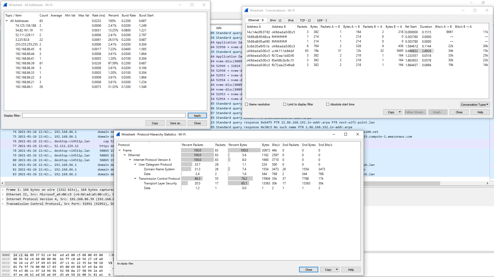
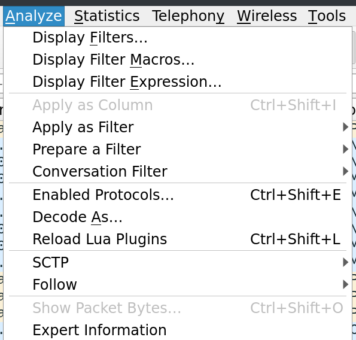
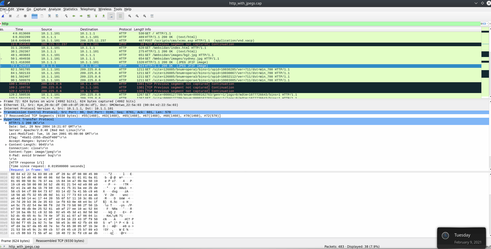
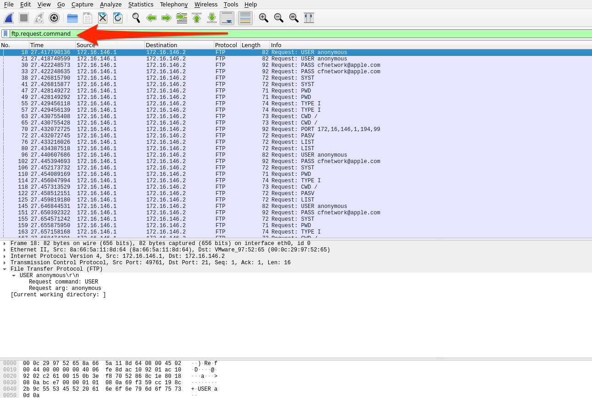
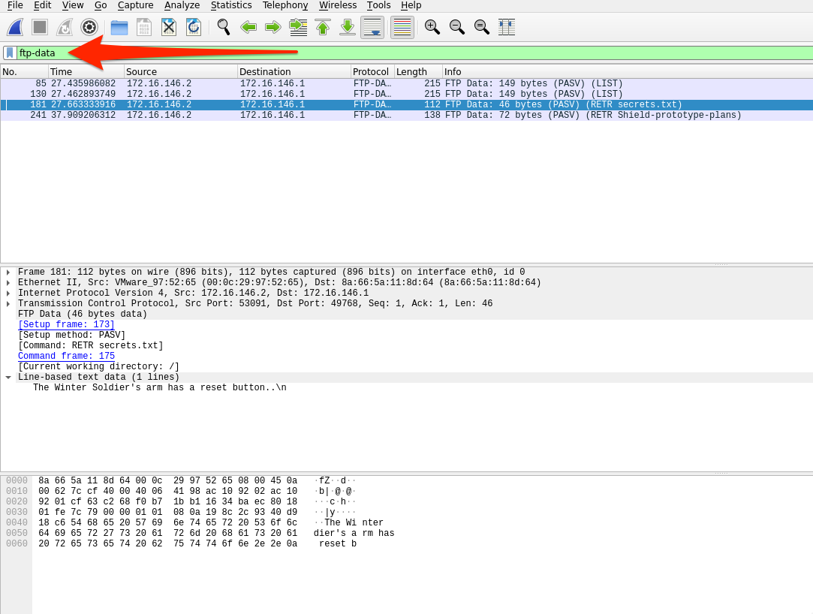

# Wireshark Advanced Usage (Sử dụng Wireshark nâng cao)

Trong phần này, ta sẽ tìm hiểu một số cách dùng Wireshark nâng cao. Các nhà phát triển dự án đã đưa vào rất nhiều tính năng khác nhau, từ theo dõi TCP conversation cho tới crack thông tin đăng nhập mạng không dây. Việc tích hợp nhiều plugin khác nhau khiến Wireshark trở thành một trong những công cụ phân tích lưu lượng tốt nhất.

---
## Plugins 

Các mục Analyze và Statistics cung cấp vô số plugin để chạy trên bản capture. Trong phần này, ta sẽ đi qua một vài plugin trong số đó. Lẽ ra ta sẽ tìm hiểu hết mọi thứ Wireshark cung cấp, nhưng tiếc là điều đó đơn giản là không thể làm được trong một module nhập môn. Tôi khuyến khích mọi người tự thử nghiệm và khám phá trong suốt hành trình này.

#### Tab Statistics và Analyze  
Tab Statistics và Analyze có thể cho ta cái nhìn sâu sắc về dữ liệu đang xem xét. Từ đây, ta có thể dùng nhiều plugin tích hợp sẵn mà Wireshark cung cấp. 

Các plugin ở đây có thể cung cấp báo cáo chi tiết về lưu lượng mạng đang được sử dụng. Chúng có thể cho ta thấy mọi thứ, từ các top talker (các host trao đổi nhiều lưu lượng nhất) trong môi trường, tới các conversation cụ thể, thậm chí cả phân tách theo IP và giao thức.  
  
#### Tab Statistics

  
#### Analyze
Từ tab Analyze, ta có thể dùng các plugin cho phép làm những việc như follow TCP stream, lọc theo loại conversation, chuẩn bị packet filter mới và xem expert info mà Wireshark tạo ra về lưu lượng. Dưới đây là một vài ví dụ về cách dùng các plugin này.  
  
#### Tab Analyze

  
#### Follow TCP Stream  
Wireshark có thể ghép các packet TCP lại với nhau để tái tạo toàn bộ stream ở định dạng dễ đọc. Khả năng này cũng cho phép ta lấy dữ liệu (`images, files, etc.`) ra khỏi bản capture. Cách này dùng được với gần như mọi giao thức sử dụng TCP làm cơ chế truyền tải. 

Để dùng tính năng này:   
* nhấp chuột phải vào một packet thuộc stream mà ta muốn tái tạo.
* chọn follow → TCP
* thao tác này sẽ mở một cửa sổ mới với stream đã được ghép lại.
Từ đây, ta có thể xem toàn bộ conversation.

#### Follow một stream qua GUI

Ngoài ra, ta có thể dùng filter `tcp.stream eq #` để tìm và theo dõi các conversation được capture trong file pcap.  
  

## Lọc một TCP stream cụ thể

    
Để ý rằng ba packet đầu tiên trong hình trên là một TCP handshake đầy đủ. Sau các packet đó, ta có thể thấy stream đang truyền dữ liệu. Nhờ dùng filter, ta đã loại khỏi tầm nhìn mọi thứ không liên quan, và giờ có thể xem conversation theo đúng thứ tự.

#### Trích xuất dữ liệu và file từ bản capture  
Wireshark có thể khôi phục nhiều loại dữ liệu khác nhau từ các stream. Điều này đòi hỏi bạn phải capture được toàn bộ conversation. Nếu không, tính năng này sẽ không thể ghép lại một datagram chưa hoàn chỉnh.
Nếu muốn hiểu sâu hơn về cách tính năng này hoạt động, hãy xem Module `Network Foundations` hoặc tìm hiểu về fragmentation (phân mảnh) TCP/IP.

Để trích xuất file từ một stream:
* dừng capture.
* Chọn mục File → Export → , rồi chọn định dạng giao thức muốn trích xuất.
* (DICOM, HTTP, SMB, v.v.)
  
#### Trích xuất file từ GUI

Một cách thú vị khác để lấy dữ liệu ra khỏi file pcap đến từ FTP. File Transfer Protocol di chuyển dữ liệu giữa server và host, nhờ đó ta có thể kéo dữ liệu ra khỏi các byte thô và tái tạo lại file. (hình ảnh, tài liệu văn bản, v.v.)
FTP dùng TCP làm giao thức truyền tải và dùng các cổng `20 & 21` để hoạt động. Cổng TCP 20 dùng để truyền dữ liệu giữa server và host, còn cổng 21 dùng làm cổng điều khiển (control port) của FTP. Mọi lệnh như đăng nhập, liệt kê file và thực hiện tải xuống hay tải lên đều diễn ra qua cổng này. Để làm được điều đó, ta cần xem các display filter `FTP` khác nhau trong Wireshark. Danh sách đầy đủ có thể xem [tại đây](https://www.wireshark.org/docs/dfref/f/ftp.html).
Hiện tại, ta sẽ xem ba filter:
* `ftp` - Sẽ hiển thị mọi thứ liên quan tới giao thức FTP.
  * Ta có thể dùng filter này để nắm sơ bộ những host/server nào đang truyền dữ liệu qua FTP.  

#### FTP Disector

* `ftp.request.command` - Sẽ hiển thị mọi lệnh được gửi qua kênh ftp-control ( cổng 21 )
  * Ta có thể tìm các thông tin như username và password bằng filter này. Nó cũng có thể cho ta thấy tên file của bất cứ thứ gì được yêu cầu.  

#### Filter FTP-Request-Command

* `ftp-data` - Sẽ hiển thị mọi dữ liệu được truyền qua kênh dữ liệu ( cổng 20 )
  * Nếu ta lọc theo một conversation và dùng `ftp-data`, ta có thể thu được mọi thứ được gửi trong conversation đó. Ta có thể tái tạo bất cứ thứ gì đã được truyền bằng cách đặt dữ liệu thô vào một file mới và đặt tên phù hợp.  

#### Filter FTP-Data

Vì FTP dùng TCP làm cơ chế truyền tải, ta có thể dùng chức năng `follow tcp stream` đã dùng ở phần trước để gom bất kỳ conversation nào ta muốn khám phá. Các bước cơ bản để mổ xẻ (dissect) dữ liệu FTP từ một pcap như sau:
1. Xác định mọi lưu lượng FTP bằng display filter `ftp`.
2. Xem các lệnh điều khiển được gửi giữa server và các host để xác định có gì được truyền hay không và ai đã làm việc đó, bằng filter `ftp.request.command`.
3. Chọn một file, rồi lọc theo `ftp-data`. Chọn một packet tương ứng với file ta quan tâm và follow TCP stream liên quan tới nó.
4. Khi xong, đổi "`Show and save data as`" thành "`Raw`" và lưu nội dung với tên file gốc.
5. Xác minh việc trích xuất bằng cách kiểm tra loại file.
