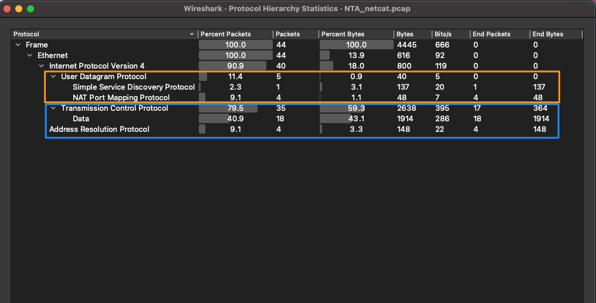
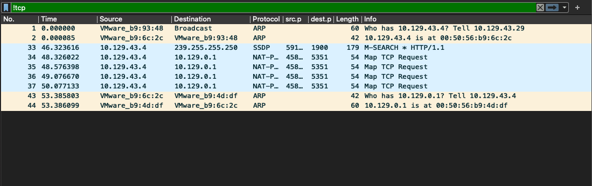
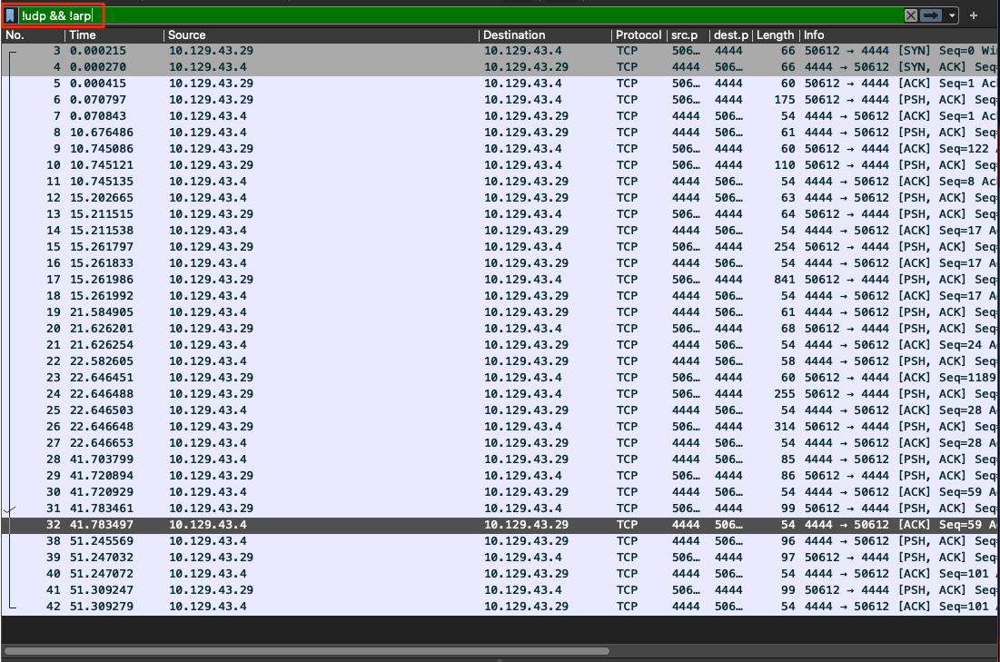
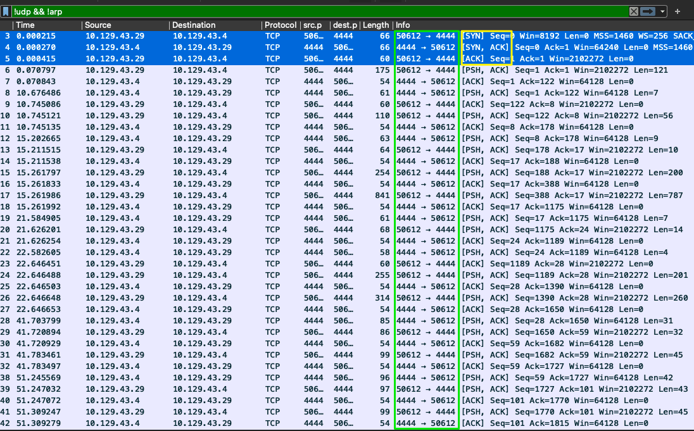

# Guided Lab: Traffic Analysis Workflow (Lab có hướng dẫn: Quy trình phân tích lưu lượng)


Một đồng nghiệp admin của ta nhận thấy một kết nối lạ từ host của Bob `IP = 172.16.10.90` khi phân tích các bản capture baseline mà ta đã thu thập. Anh ấy nhờ ta kiểm tra và xem ta nghĩ điều gì đang diễn ra. 

Hãy cố gắng vận dụng các khái niệm từ các phần Analysis Process để hoàn thành việc phân tích file guided-analysis.zip được cung cấp trong optional resources và lưu lượng trực tiếp từ mạng của academy. Khi xong, trong file zip có kèm một bản đáp án có hướng dẫn cùng với PCAP để bạn kiểm tra bài làm. 

----  
## Các nhiệm vụ (Tasks):

#### Task #1 

`Connect to the live host for capture.`


`Connection Instructions`: 
Việc truy cập môi trường lab để hoàn thành các task sau sẽ cần dùng [XfreeRDP](https://manpages.ubuntu.com/manpages/trusty/man1/xfreerdp.1.html) để có quyền truy cập GUI vào máy ảo, nhờ đó ta có thể sử dụng Wireshark từ bên trong môi trường. 

Ta sẽ kết nối tới lab của Academy như bình thường, dùng VM của riêng bạn với VPN key của HTB Academy hoặc Pwnbox tích hợp sẵn trong phần module. Bạn có thể khởi động FreeRDP client trên Pwnbox bằng cách gõ lệnh sau vào shell khi target đã được khởi tạo (spawn):

```bash
xfreerdp /v:<target IP> /u:htb-student /p:HTB_@cademy_stdnt!
```  

Bạn có thể tìm `target IP`, `Username` và `Password` cần thiết ở bên dưới:

* Nhấp vào phần Questions bên dưới để spawn target host và lấy địa chỉ IP.
  * `IP` == <span class="targetIp"></span>
  * `Username` ==  htb-student
  * `Password` == HTB_@cademy_stdnt!

Khi đã kết nối, mở Wireshark và bắt đầu capture trên interface ENS224.

----  
### Phân tích

Làm theo template quy trình (workflow) này và xem xét lưu lượng đáng ngờ. Mục tiêu là xác định điều gì đang xảy ra với host đang bị nghi vấn. 

1. vấn đề là gì?
   1. tóm tắt ngắn gọn về vấn đề.
2. xác định phạm vi (scope) và mục tiêu (ta đang tìm gì? trong khoảng thời gian nào?)
   1. Scope: ta đang tìm gì, ở đâu?
   2. vấn đề bắt đầu khi nào: 
   3. thông tin hỗ trợ: File, nguồn dữ liệu, bất cứ thứ gì hữu ích.
3. xác định (các) target (net / host(s) / protocol)
   1. Target host: Mạng hoặc địa chỉ của các host.
4. capture lưu lượng mạng / đọc từ PCAP đã capture trước đó.
   1. Thực hiện các thao tác cần thiết để phân tích lưu lượng nhằm tìm dấu hiệu xâm nhập.
5. xác định các thành phần lưu lượng mạng cần thiết (filtering)
   1. khi đã có lưu lượng, lọc bỏ mọi lưu lượng không cần thiết cho cuộc điều tra này, bao gồm: mọi lưu lượng khớp với baseline thông thường, và giữ lại mọi thứ liên quan tới phạm vi điều tra. 
6. Hiểu lưu lượng mạng đã capture
   1. Khi đã lọc bỏ nhiễu, đã đến lúc đào sâu tìm các target. Bắt đầu từ phạm vi rộng rồi thu hẹp dần quanh scope của ta. 
7. ghi chép / lập mind map các kết quả tìm được.  
   1. Ghi chú lại mọi thứ ta làm, thấy hoặc tìm được trong suốt cuộc điều tra là cực kỳ quan trọng. Hãy đảm bảo bạn ghi chép đầy đủ, bao gồm:
   * Các khung thời gian mà ta đã capture lưu lượng.
   * Các host/cổng đáng ngờ trong mạng.
   * Các conversation chứa bất cứ thứ gì đáng ngờ. ( bao gồm timestamp, số thứ tự packet, file, v.v.)
8. tóm tắt kết quả phân tích (ta đã tìm thấy gì?)
   1. Cuối cùng, tóm tắt những gì đã tìm được, giải thích các chi tiết liên quan để cấp trên có thể quyết định cách ly (quarantine) các host bị ảnh hưởng hoặc tiến hành một nhiệm vụ incident response quan trọng hơn. 
   2. Kết quả phân tích của ta sẽ ảnh hưởng tới các quyết định được đưa ra, vì vậy điều cốt yếu là phải rõ ràng và súc tích nhất có thể. 

`Complete an attempt on your own first to examine and follow the workflow, then look below for a guided walkthrough of the lab.`

<details>
  <summary><b>Nhấn để xem hướng dẫn giải</b></summary>

Task này được hoàn thành tốt nhất khi dùng file PCAP được cung cấp cho bài học. 
Làm theo các bước trong quy trình, ta đã điền thông tin và thực hiện phân tích.  
  
1. vấn đề là gì?
   1. Lưu lượng đáng ngờ xuất phát từ bên trong mạng. 
2. xác định phạm vi và mục tiêu (ta đang tìm gì? trong khoảng thời gian nào?)
   1. target: lưu lượng xuất phát từ 10.129.43.4
   2. khi nào: trong vòng 48 giờ qua. Capture lưu lượng để xác định nó có còn đang diễn ra không.
   3. thông tin hỗ trợ: file: NTA-guided.pcap
3. xác định (các) target (net / host(s) / protocol)
   1. scope: 10.129.43.4 và bất kỳ ai có kết nối tới nó. Giao thức không xác định qua cổng 4444.
4. capture lưu lượng mạng
   1. cắm vào một đường link có quyền truy cập mạng 10.129.43.0/24 để capture lưu lượng trực tiếp, nhằm xem có điều gì đang diễn ra không. 
   2. Ta đã được cung cấp một PCAP chứa dữ liệu lịch sử, trong đó có một phần lưu lượng đáng ngờ. Ta sẽ xem xét nó để phân tích vấn đề.
5. xác định các thành phần lưu lượng mạng cần thiết (filtering)
   1. Đầu tiên, ta sẽ lọc bỏ mọi thứ không có kết nối tới 10.129.43.4, vì đây là target đáng ngờ chính của ta lúc này.

#### Conversations


Sau khi xem plugin conversations như hình trên, ta có thể thấy chỉ có ba conversation được capture trong file pcap này, và tất cả đều liên quan tới host đáng ngờ của ta. Tiếp theo, ta sẽ xem plugin `protocol hierarchy` để biết lưu lượng của ta là gì. 

#### Thống kê giao thức (Protocol Statistics)


Ở đây ta có thể thấy PCAP này chủ yếu là lưu lượng TCP, với một ít lưu lượng UDP. Vì lưu lượng UDP ít hơn TCP, hãy xem xét nó trước. 

   2. Khi đã lọc bỏ nhiễu, đã đến lúc đào tìm bất cứ điều gì bất thường. Ta sẽ lọc bỏ mọi thứ trừ `lưu lượng UDP trước tiên.

#### UDP


Khi chỉ lọc lưu lượng UDP, ta chỉ thấy chín packet. Bốn packet arp, bốn packet Network Address Translation `NAT`, và một packet Simple Sevice Discovery Protocol `SSDP`. Dựa trên loại packet và thông tin chúng chứa, ta có thể xác định lưu lượng này là lưu lượng mạng bình thường và không có gì đáng lo ngại. 

   3. Giờ hãy chuyển sang xem lưu lượng `TCP`. Ở đây chắc chắn sẽ có nhiều thứ hơn để sàng lọc. Ta sẽ dùng display filter `!udp && !arp`. Filter này sẽ loại bỏ mọi thứ ta đã phân tích. 

#### TCP


   4. Giờ khung nhìn đã gọn hơn một chút, ta có thể thấy các packet còn lại đều là TCP, và tất cả dường như thuộc cùng một conversation giữa hai host `10.129.43.4` và `10.129.43.29`. Ta xác định được điều này vì có thể thấy việc thiết lập phiên qua three-way handshake ở packet 3, và các cổng giống nhau được dùng trong suốt các packet còn lại trong output bên dưới.
   
#### Thiết lập phiên TCP
   
   
   5. Điều có vẻ đáng chú ý là ta không thấy TCP session teardown (đóng phiên) trong file PCAP này. Điều này có thể có nghĩa là phiên vẫn còn hoạt động và chưa bị kết thúc. Ta tin điều này là đúng vì cũng không thấy packet Reset nào.
   6. Ta cũng có thể xem xét conversation bằng cách follow `TCP stream` từ packet 3 để xác định nó bao gồm những gì.
   
#### Follow TCP Stream


Giờ khi đã follow TCP stream, hồi chuông cảnh báo hẳn đã vang lên với ta. Ta có thể thấy toàn bộ conversation giữa hai host ở dạng plain text, và có vẻ như ai đó đã thực hiện nhiều hành động khác nhau trên host.

   7. Nhìn vào hình trên, có vẻ ai đó đang thực hiện recon (trinh sát) cơ bản trên host. Họ chạy các lệnh như `whoami`, `ipconfig`, `dir`. Có vẻ họ đang cố nắm bắt tình hình và tìm hiểu xem mình đã vào host với user nào. `highlighted in orange in the image above.`
   8. Điều thực sự đáng báo động là giờ ta có thể thấy ai đó đã tạo tài khoản `hacker` và gán nó vào `administrators group` trên host này. Hoặc đây là trò đùa của một admin tồi. Hoặc ai đó đã xâm nhập vào hạ tầng của công ty. 
6. ghi chép / lập mind map các kết quả tìm được.  
   1. Ghi chú lại mọi thứ ta làm, thấy hoặc tìm được trong suốt cuộc điều tra là cực kỳ quan trọng. Nếu cần, hãy vẽ một hình để mô tả luồng hành động.
   2. Với quy trình mẫu này, ta đã ghi lại các hành động của mình và đính kèm ảnh chụp màn hình của mọi thứ đưa vào phân tích. Những thứ này sẽ góp phần định hướng quyết định phản ứng được đưa ra.
7. tóm tắt kết quả phân tích (ta đã tìm thấy gì?)
   1. Dựa trên phân tích, ta xác định rằng một tác nhân độc hại đã xâm nhập ít nhất một host trong mạng. Host 10.129.43.29 cho thấy dấu hiệu ai đó thực thi các lệnh, bao gồm tạo user và gán quyền local administrator thông qua các lệnh `net`. Có vẻ như tác nhân này đã dùng host của Bob để thực hiện các hành động nói trên. Vì Bob trước đó đã bị điều tra về việc tuồn (exfil) bí mật công ty ra ngoài và ngụy trang nó thành lưu lượng web, tôi nghĩ có thể khẳng định rằng vấn đề đã lan rộng hơn. Các ảnh chụp màn hình đi kèm tài liệu này cho thấy luồng lưu lượng và các lệnh đã được sử dụng.
   2. Theo ý kiến của chúng tôi, cần tiến hành một quy trình Incident Response `IR` đầy đủ để đảm bảo mối đe doạ bị ngăn không lan rộng thêm. Ta có thể dành nguồn lực để loại bỏ sự hiện diện độc hại và làm sạch các host bị ảnh hưởng.

</details>
  
---- 
## Tóm tắt 
Sau khi phân tích các hành động đã diễn ra, đội IR xác định rằng tác nhân đã trở nên lười biếng và quyết định dùng một Netcat shell để tương tác trực tiếp với host của Bob trong khi thu thập thêm thông tin. Trong lúc đó, hắn đã dùng RDP từ host của Bob sang một máy Windows desktop khác trong môi trường để cố gắng thiết lập thêm một foothold (chỗ đứng). May mắn là đội IR đã capture được một phần PCAP của lưu lượng RDP. Host của Bob đã bị cách ly (quarantine), và quy trình incident response đã được khởi động để xác định những gì đã bị lấy đi và những host nào khác có khả năng đã bị xâm nhập. Làm tốt lắm khi phát hiện ra vụ xâm nhập.
