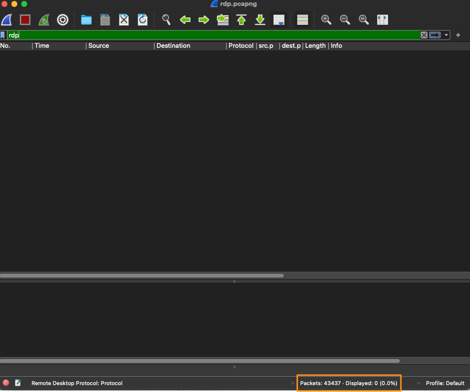
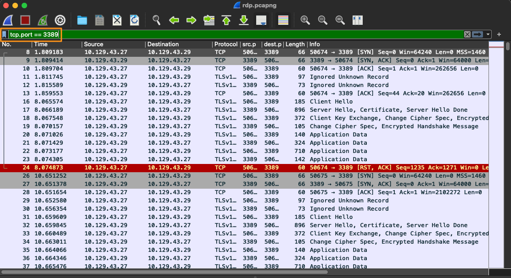
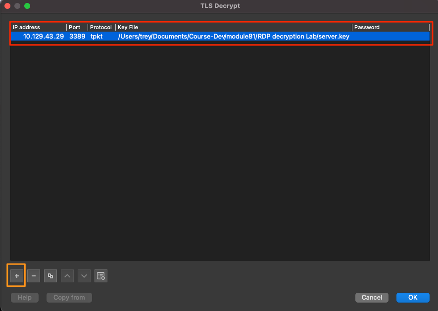
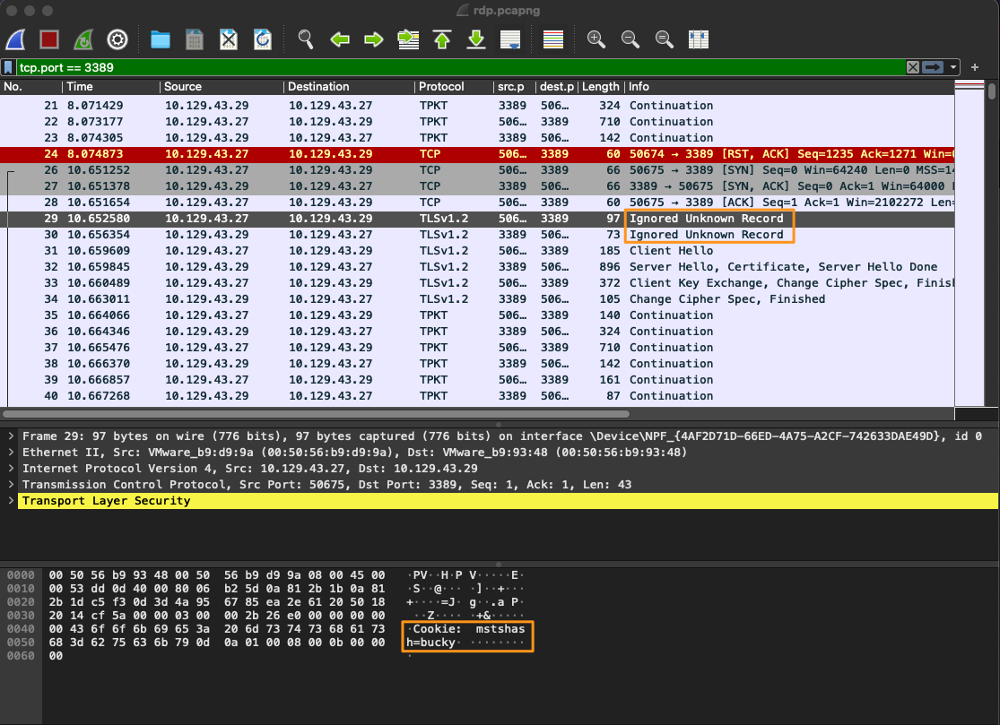

# Decrypting RDP connections (Giải mã kết nối RDP)

Mục đích của bài lab này là giúp ta nếm thử sức mạnh của Wireshark. Trong lab này, ta sẽ làm việc với lưu lượng RDP. Nếu có được key cần thiết mà hai host dùng để mã hoá lưu lượng, Wireshark có thể giải mã (deobfuscate) lưu lượng đó cho ta.

Khi thực hiện IR và phân tích trên máy của Bob, đội IR đã capture được một phần PCAP của lưu lượng RDP mà họ nhận thấy từ host của Bob tới một host khác trong mạng. Trưởng nhóm đã giao cho ta điều tra sự việc này. Trong khi rà soát host của Bob để tìm thêm bằng chứng, bạn đã tìm thấy một RDP-key được giấu trong một folder hive trên host của Bob. Sau một hồi tìm hiểu, ta nhận ra rằng có thể dùng key đó để giải mã lưu lượng RDP nhằm kiểm tra nó.

Hãy cố gắng vận dụng các khái niệm từ các phần Analysis Process để hoàn thành việc phân tích file RDP-analysis.zip được cung cấp.  

---  
## Các nhiệm vụ (Tasks):

#### Task #1 

`Open the rdp.pcapng file in Wireshark.`

Giải nén file zip có trong optional resources và mở nó trong Wireshark. 

#### Task #2 

`Analyze the traffic included.`

Hãy dành một phút xem lưu lượng. Để ý rằng có rất nhiều thông tin ở đây. Ta biết trọng tâm của mình là RDP, vậy hãy dành chút thời gian lọc theo `rdp` và xem kết quả trả về.

#### Filter RDP

Như hiện tại, không thấy được gì nhiều, đúng không? Đó là vì RDP mặc định dùng TLS để mã hoá dữ liệu, nên ta sẽ không thể thấy bất cứ điều gì đã diễn ra trong lưu lượng RDP. Làm sao ta xác minh được sự tồn tại của nó trong file này? Một cách là lọc theo cổng well-known mà RDP thường dùng. 

`Filter on port 3389 to determine if any RDP traffic encrypted or otherwise exists.`

  
<b>Nhấn để xem đáp án</b>

dùng display filter `tcp.port == 3389`. 

#### Lọc theo cổng TCP 3389

Ít nhất ta cũng xác minh được rằng một phiên đã được thiết lập giữa hai host qua cổng TCP 3389. 

#### Task #3 

`Provide the RDP-key to Wireshark so it can decrypt the traffic.`

Giờ hãy tiến thêm một bước và dùng key đã tìm được để thử giải mã lưu lượng. 

Để áp dụng key trong Wireshark:
  1. vào Edit → Preferences → Protocols → TLS
  2. Trên trang TLS, chọn Edit ở mục RSA keys list → một cửa sổ mới sẽ mở ra.
  
  3. Làm theo các bước dưới đây để import RSA server key.
  
#### Import một RDP key
|**Các bước**|  
|--|
| Nhấp vào dấu + để thêm key mới|
| Nhập địa chỉ IP của RDP server `10.129.43.29`|
| Nhập cổng được dùng `3389`|
| Trường Protocol bằng `tpkt` hoặc `blank`.|
| Duyệt tới file `server.key` và thêm nó vào mục key file.|
| Lưu và làm mới (refresh) file pcap.|
  
#### Các bước import

Khi lọc lại theo RDP, ta sẽ thấy có lưu lượng hiển thị. 

#### RDP ở dạng rõ (In The Clear)

Từ đây, ta có thể thực hiện phân tích lưu lượng RDP. Giờ ta có thể follow TCP stream, export mọi object tìm thấy, và bất cứ việc gì khác ta thấy cần thiết cho cuộc điều tra. Cách này hiệu quả vì ta đã có được RSA key dùng để mã hoá phiên RDP. Các bước để lấy key hơi dài dòng, nhưng tóm lại là nếu lấy được RDP certificate từ server, `OpenSSL` có thể trích xuất private key từ đó. 

----
## Phân tích lưu lượng đã giải mã

Giờ ta đã đưa RDP ra khỏi TLS tunnel, ta có thể tìm thấy gì? Hãy thực hiện các bước phân tích và cố gắng trả lời các câu hỏi dưới đây.

#### Câu hỏi:

Host nào đã khởi tạo phiên RDP với server của ta?

  
<b>Nhấn để xem đáp án</b>

Nếu chú ý tới packet đầu tiên, `packet # 8` của three-way handshake, ta có thể thấy host khởi tạo kết nối là 10.129.43.27.

User account nào đã được dùng để khởi tạo kết nối RDP?  

  
<b>Nhấn để xem đáp án</b>

Khi lọc theo `tcp.port == 3389`, ta có thể thấy một record có nhãn Ignored Unknown Record. Nếu xem phần ASCII, nó sẽ cho ta thấy một username. 

#### User

----  
## Tóm tắt: 

Bài lab này nhằm làm ví dụ cho những gì Wireshark có thể làm với dữ liệu đã capture và các plugin của nó. Khả năng tiếp nhận thông tin và làm sáng tỏ những điều khó thấy của Wireshark rất mạnh mẽ. Khả năng giải mã dữ liệu sau khi tiếp nhận là một tính năng mạnh. Khái niệm này có thể áp dụng cho bất kỳ giao thức nào sử dụng mã hoá, miễn là ta có key sẽ được dùng để thiết lập các kết nối.
