# Evidence Acquisition Techniques & Tools (Kỹ thuật và công cụ thu thập bằng chứng)

`Evidence acquisition` là một giai đoạn then chốt trong digital forensics, bao gồm việc thu thập các artifact và dữ liệu số từ nhiều nguồn khác nhau nhằm bảo quản các bằng chứng tiềm năng phục vụ phân tích. Quá trình này đòi hỏi các công cụ và kỹ thuật chuyên dụng để đảm bảo tính toàn vẹn (integrity), tính xác thực (authenticity) và khả năng được chấp nhận về mặt pháp lý (admissibility) của bằng chứng thu được. Dưới đây là tổng quan các kỹ thuật thu thập bằng chứng thường dùng trong digital forensics:
- Forensic Imaging
- Trích xuất bằng chứng trên host (Host-based Evidence) & Rapid Triage
- Trích xuất bằng chứng mạng (Network Evidence)

## Forensic Imaging

Forensic imaging là một quy trình nền tảng trong digital forensics, bao gồm việc tạo một bản sao chính xác, từng bit một (bit-by-bit), của phương tiện lưu trữ số như ổ cứng, ổ SSD, ổ USB và thẻ nhớ. Quy trình này rất quan trọng để bảo toàn trạng thái gốc của dữ liệu, đảm bảo tính toàn vẹn dữ liệu và duy trì khả năng được chấp nhận của bằng chứng trong các thủ tục pháp lý. Forensic imaging đóng vai trò then chốt trong điều tra vì cho phép analyst kiểm tra bằng chứng mà không làm thay đổi hay ảnh hưởng tới dữ liệu gốc.

Dưới đây là một số công cụ và giải pháp forensic imaging:
- [FTK Imager](https://www.exterro.com/digital-forensics-software/ftk-imager): Được phát triển bởi AccessData (nay đã được Exterro mua lại), FTK Imager là một trong những công cụ tạo disk image được dùng rộng rãi nhất trong lĩnh vực an ninh mạng. Nó cho phép ta tạo các bản sao hoàn hảo (hay image) của ổ đĩa máy tính để phân tích, đồng thời bảo toàn tính toàn vẹn của bằng chứng. Nó cũng cho phép ta xem và phân tích nội dung của thiết bị lưu trữ dữ liệu mà không làm thay đổi dữ liệu.
- [AFF4 Imager](https://github.com/Velocidex/c-aff4): Một công cụ miễn phí, mã nguồn mở, được xây dựng để tạo và nhân bản forensic disk image. Công cụ dễ dùng và tương thích với nhiều hệ thống file. Một ưu điểm của AFF4 Imager là khả năng trích xuất file dựa trên thời gian tạo, phân đoạn volume và rút ngắn thời gian tạo image nhờ nén.
- `DD and DCFLDD`: Cả hai đều là tiện ích dòng lệnh có trên các hệ thống Unix-based (bao gồm Linux và MacOS). DD là công cụ đa năng có sẵn mặc định trên hầu hết các hệ thống Unix-based, còn DCFLDD là phiên bản nâng cấp của DD với các tính năng đặc biệt hữu ích cho forensics, chẳng hạn như tính hash.
- `Virtualization Tools`: Do ảo hoá được dùng phổ biến trong các hệ thống hiện đại, người làm incident response thường cần thu thập bằng chứng từ môi trường ảo. Tuỳ giải pháp ảo hoá cụ thể, bằng chứng có thể được thu thập bằng cách tạm dừng hệ thống và sao chép thư mục chứa nó. Một cách khác là dùng tính năng snapshot có trong nhiều phần mềm ảo hoá.

---

**Ví dụ 1: Forensic Imaging với FTK Imager**

Giờ hãy xem minh hoạ cách dùng `FTK Imager` để tạo disk image. Lưu ý rằng bạn sẽ cần một phương tiện lưu trữ phụ, như ổ cứng gắn ngoài hoặc USB flash, để lưu disk image tạo ra.

- Chọn `File` -> `Create Disk Image`.
	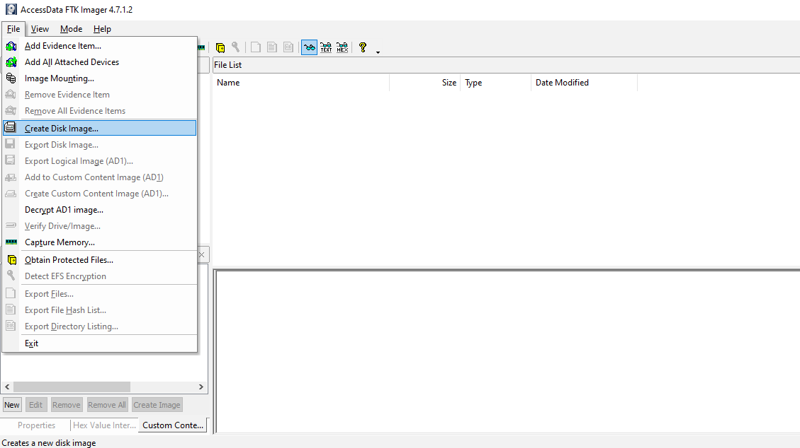
- Tiếp theo, chọn nguồn media. Thông thường là `Physical Drive` hoặc `Logical Drive`.
	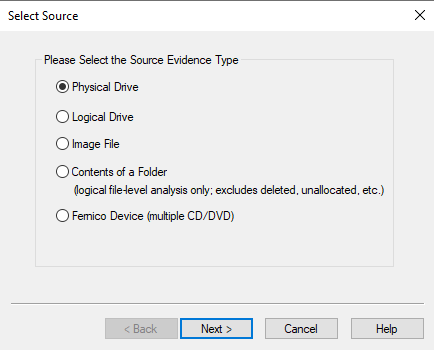
- Chọn ổ đĩa mà bạn muốn tạo image.
	![Hộp thoại 'Select Drive' với dropdown hiển thị 'PHYSICALDRIVE0 - VMware Virtual NVMe Disk [64GB SCSI]' và nút 'Finish' được tô sáng.](https://academy.hackthebox.com/storage/modules/237/image3.png)
- Chỉ định nơi lưu image.
	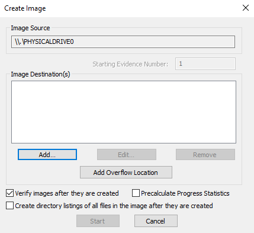
- Chọn loại image mong muốn.
	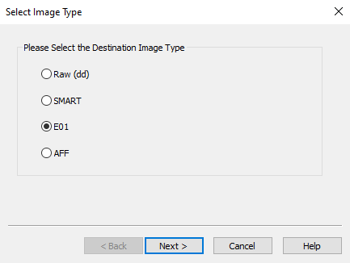
- Nhập thông tin chi tiết về bằng chứng.
	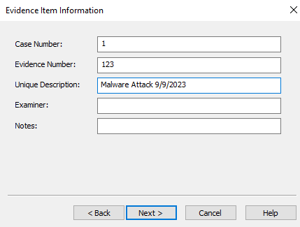
- Chọn thư mục đích và tên file cho image. Ở bước này, bạn cũng có thể điều chỉnh thiết lập phân mảnh (fragmentation) và nén (compression) image.
	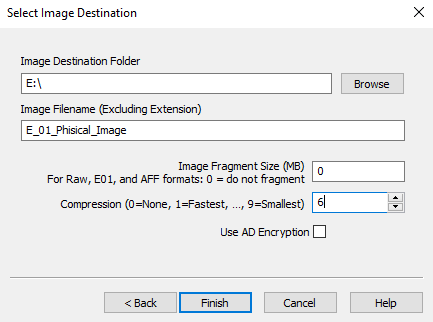
- Khi đã xác nhận mọi thiết lập, nhấn `Start`.
	![Hộp thoại 'Create Image' với nguồn '\PHYSICALDRIVE0', đích 'E:\E_01_Physical_Image [E01]', và các tuỳ chọn verify image và tính tiến độ.](https://academy.hackthebox.com/storage/modules/237/image2.png)
- Bạn sẽ thấy tiến độ tạo image.
	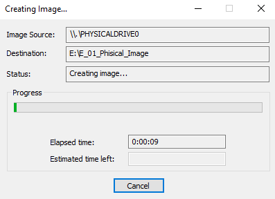
- Nếu bạn chọn verify image, bạn cũng sẽ thấy tiến độ verify.
	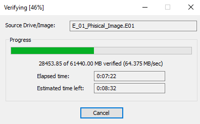
- Sau khi image được verify, bạn sẽ nhận được bản tóm tắt quá trình tạo image. Giờ bạn đã sẵn sàng phân tích bản dump này.
	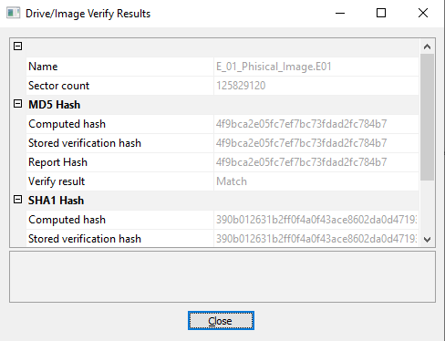
	
---

**Ví dụ 2: Mount disk image bằng Arsenal Image Mounter**

Giờ hãy xem một minh hoạ khác về cách dùng [Arsenal Image Mounter](https://arsenalrecon.com/downloads) để mount một disk image mà ta đã tạo trước đó (không phải image nhắc tới ở trên) từ một máy ảo (VM) bị xâm nhập chạy trên VMWare. Ổ cứng ảo của VM được lưu dưới dạng `HTBVM01-000003.vmdk`.

Sau khi cài đặt Arsenal Image Mounter, hãy đảm bảo khởi chạy nó với `administrative rights`. Trong cửa sổ chính của Arsenal Image Mounter, nhấn nút `Mount disk image`. Từ đó, ta điều hướng tới vị trí file `.VMDK` và chọn nó.

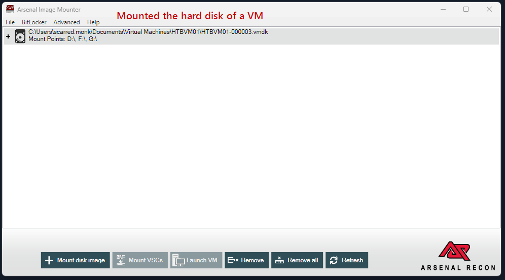

Arsenal Image Mounter sẽ bắt đầu phân tích file VMDK. Ta cũng có thể chọn mount ổ đĩa ở chế độ `read-only` hay `read-write`, tuỳ theo yêu cầu cụ thể.

*Chọn mount disk image ở chế độ read-only là bước nền tảng trong digital forensics và incident response. Cách làm này rất quan trọng để bảo toàn trạng thái gốc của bằng chứng, đảm bảo tính xác thực và tính toàn vẹn của nó được giữ nguyên vẹn.*

Sau khi mount, image sẽ xuất hiện như một ổ đĩa, được gán ký tự `D:\`.
	
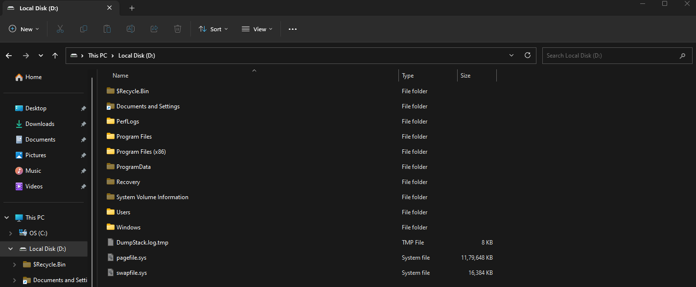

---

## Trích xuất Host-based Evidence & Rapid Triage

#### Host-based Evidence (Bằng chứng trên host)

Các hệ điều hành hiện đại, mà Microsoft Windows là ví dụ điển hình, sinh ra rất nhiều artifact có giá trị làm bằng chứng. Chúng có thể phát sinh từ việc thực thi ứng dụng, sửa đổi file, hay thậm chí việc tạo tài khoản người dùng. Mỗi hành động này đều để lại dấu vết, cung cấp thông tin vô giá cho các analyst incident response.

Bằng chứng trên một hệ thống host có bản chất khác nhau. Thuật ngữ `volatility` (tính khả biến) chỉ mức độ tồn tại lâu dài của dữ liệu trên hệ thống host; dữ liệu volatile là thông tin sẽ biến mất sau các sự kiện như logoff hoặc tắt nguồn. Một loại bằng chứng volatile quan trọng là bộ nhớ đang hoạt động (active memory) của hệ thống. Trong quá trình điều tra, đặc biệt là các vụ liên quan đến nhiễm malware, bộ nhớ của hệ thống đang chạy (live system memory) trở nên không thể thiếu. Malware thường để lại dấu vết trong bộ nhớ hệ thống, và việc mất bằng chứng này có thể cản trở cuộc điều tra của analyst. Để thu bộ nhớ, các công cụ như [FTK Imager](https://www.exterro.com/ftk-imager) thường được sử dụng.

Một số giải pháp thu thập bộ nhớ (memory acquisition) khác:
- [WinPmem](https://github.com/Velocidex/WinPmem): WinPmem từ lâu đã là driver memory acquisition mã nguồn mở mặc định cho Windows. Nó từng nằm trong dự án Rekall, nhưng gần đây đã được tách ra thành repository riêng.
- [DumpIt](https://www.magnetforensics.com/resources/magnet-dumpit-for-windows/): Một tiện ích đơn giản tạo bản dump bộ nhớ vật lý (physical memory dump) của máy Windows và Linux. Trên Windows, nó ghép bộ nhớ vật lý của hệ thống 32-bit và 64-bit vào một file output duy nhất, nên cực kỳ dễ dùng.
- [MemDump](http://www.nirsoft.net/utils/nircmd.html): MemDump là một tiện ích dòng lệnh miễn phí, đơn giản, cho phép ta thu nội dung RAM của hệ thống. Nó khá hữu ích trong điều tra forensics hoặc khi phân tích một hệ thống để tìm hoạt động độc hại. Sự đơn giản và dễ dùng khiến nó trở thành lựa chọn phổ biến cho memory acquisition.
- [Belkasoft RAM Capturer](https://belkasoft.com/ram-capturer): Đây là một công cụ mạnh khác dùng cho memory acquisition, được Belkasoft cung cấp miễn phí. Nó có thể thu RAM của một máy Windows đang chạy, kể cả khi có cơ chế bảo vệ anti-debugging hoặc anti-dumping đang hoạt động. Điều này khiến nó trở thành công cụ rất hiệu quả để trích xuất càng nhiều dữ liệu càng tốt trong một cuộc điều tra live forensics.
- [Magnet RAM Capture](https://www.magnetforensics.com/resources/magnet-ram-capture/): Được phát triển bởi Magnet Forensics, công cụ này cung cấp một cách miễn phí và đơn giản để thu bộ nhớ volatile của hệ thống.
- [LiME (Linux Memory Extractor)](https://github.com/504ensicsLabs/LiME): LiME là một Loadable Kernel Module (LKM) cho phép thu thập bộ nhớ volatile. Điểm độc đáo của LiME là được thiết kế để "trong suốt" (transparent) đối với hệ thống mục tiêu, né được nhiều biện pháp anti-forensic phổ biến.

---

**Ví dụ 1: Thu bộ nhớ bằng WinPmem**

Giờ hãy xem minh hoạ cách dùng `WinPmem` để thu bộ nhớ (memory acquisition).

Để tạo memory dump, chỉ cần chạy lệnh dưới đây với quyền Administrator.

```cmd-session
C:\Users\X\Downloads> winpmem_mini_x64_rc2.exe memdump.raw
```

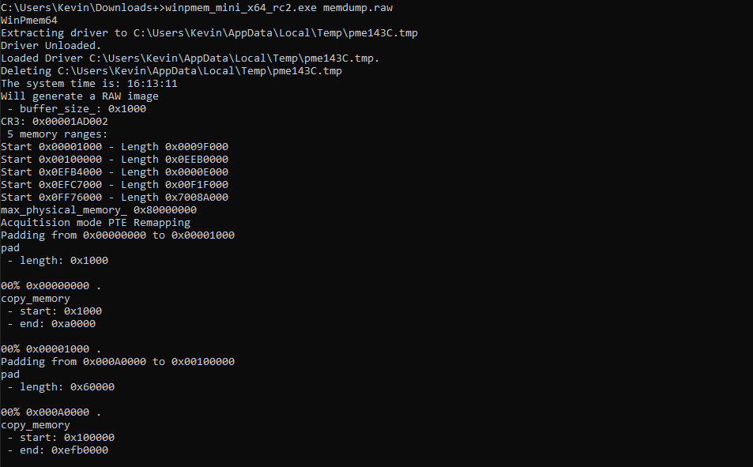

---

**Ví dụ 2: Thu bộ nhớ của VM**

Dưới đây là các bước để thu bộ nhớ từ một máy ảo (VM).

1. Mở phần tuỳ chọn của VM đang chạy
2. Suspend VM đang chạy
3. Tìm file `.vmem` bên trong thư mục của VM.

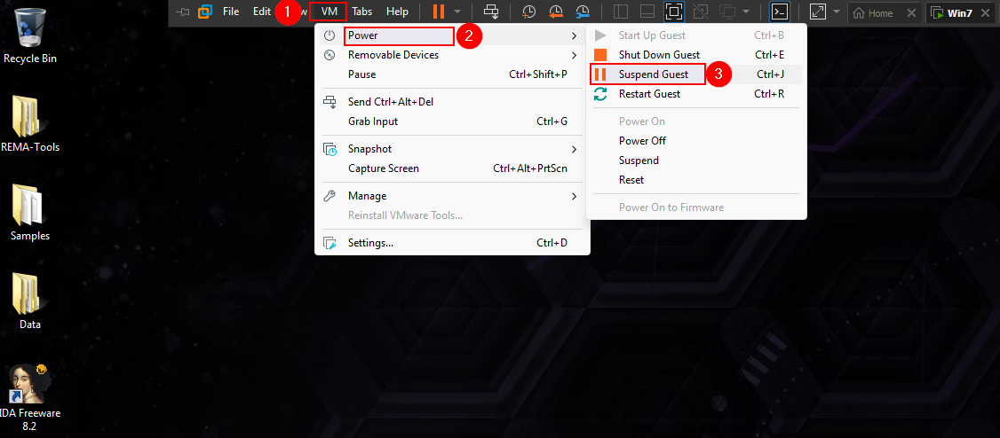
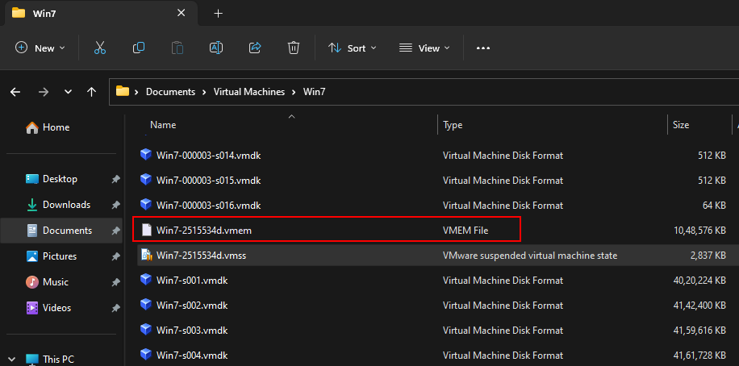

---

Mặt khác, dữ liệu non-volatile (không khả biến) vẫn nằm trên ổ cứng, thường tồn tại qua các lần tắt máy. Nhóm này bao gồm các artifact như:
- Registry
- Windows Event Log
- Các artifact liên quan đến hệ thống (vd: Prefetch, Amcache)
- Các artifact riêng của ứng dụng (vd: IIS logs, Browser history)

#### Rapid Triage

Cách tiếp cận này chú trọng thu thập dữ liệu từ các hệ thống có khả năng đã bị xâm nhập. Mục tiêu là tập trung dữ liệu giá trị cao về một chỗ, giúp việc đánh index và phân tích được thuận lợi hơn. Khi tập trung dữ liệu này, analyst có thể triển khai công cụ và kỹ thuật hiệu quả hơn, nhắm vào những hệ thống có giá trị bằng chứng cao nhất. Cách tiếp cận có mục tiêu này cho phép đi sâu hơn vào digital forensics, mang lại bức tranh rõ ràng hơn về hành động của kẻ tấn công.

Một trong những giải pháp parse và trích xuất artifact nhanh tốt nhất, nếu không muốn nói là tốt nhất, là [KAPE (Kroll Artifact Parser and Extractor)](https://www.kroll.com/en/services/cyber-risk/incident-response-litigation-support/kroll-artifact-parser-extractor-kape). Hãy xem cách dùng `KAPE` để lấy dữ liệu forensic có giá trị từ image mà ta đã mount trước đó với Arsenal Image Mounter (`D:\`).

`KAPE` là một công cụ mạnh trong lĩnh vực digital forensics và incident response. Được thiết kế để hỗ trợ các chuyên gia forensic và điều tra viên, KAPE giúp thu thập và phân tích bằng chứng số từ các hệ thống Windows. Được phát triển và duy trì bởi `Kroll`, KAPE nổi tiếng với các tính năng thu thập toàn diện, khả năng tuỳ biến và giao diện trực quan. Sơ đồ dưới đây minh hoạ luồng hoạt động của KAPE.

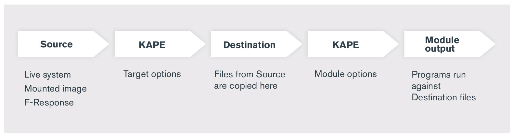

Nguồn hình: [https://ericzimmerman.github.io/KapeDocs/#!index.md](https://ericzimmerman.github.io/KapeDocs/#!index.md)

KAPE hoạt động dựa trên hai khái niệm `Targets` và `Modules`. Các thành phần này định hướng cách công cụ xử lý dữ liệu và trích xuất forensic artifact. Khi ta đưa một nguồn (source) vào KAPE, nó sẽ sao chép các file cụ thể liên quan đến forensic sang một thư mục output được chỉ định, đồng thời giữ nguyên metadata của từng file.

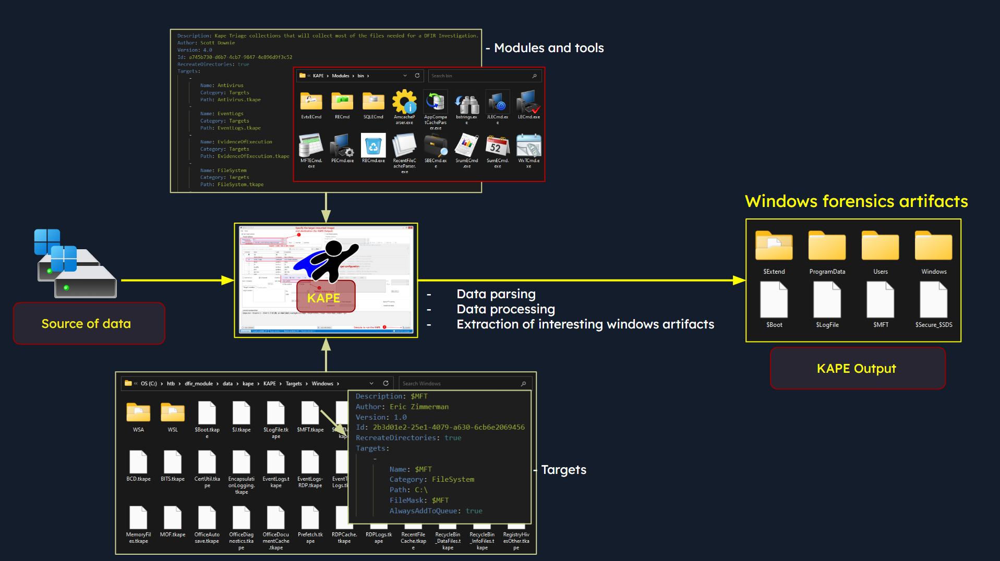

Sau khi tải về, hãy giải nén file và khởi chạy KAPE. Trong thư mục KAPE, ta sẽ thấy hai file thực thi: `gkape.exe` và `kape.exe`. KAPE cung cấp cho người dùng hai chế độ: CLI (`kape.exe`) và GUI (`gkape.exe`).

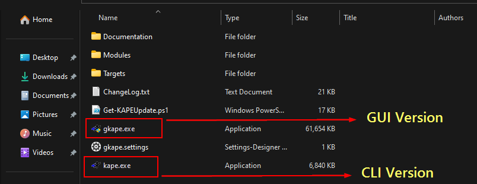

Hãy chọn bản GUI để khám phá các tuỳ chọn có sẵn một cách trực quan hơn.

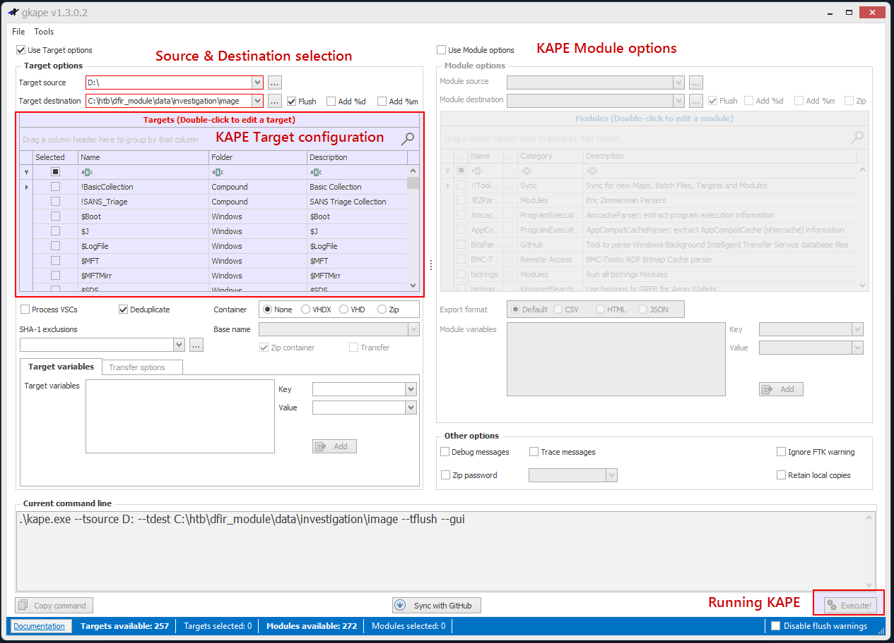

Mấu chốt của quy trình nằm ở việc chọn đúng cấu hình target.

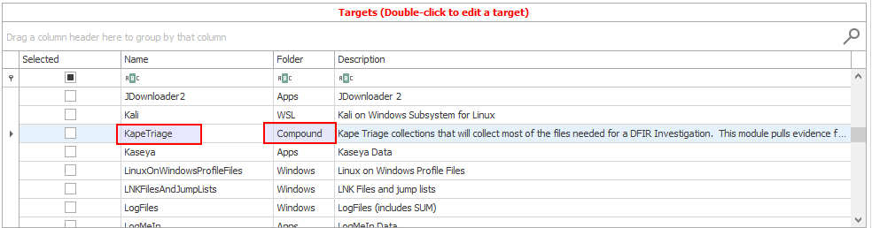

Theo thuật ngữ của KAPE, `Targets` là các artifact cụ thể mà ta muốn trích xuất từ một image hoặc hệ thống. Chúng sau đó được sao chép sang thư mục output.

Các file target của KAPE có phần mở rộng `.tkape` và nằm trong thư mục `<path to kape>\KAPE\Targets`. Ví dụ, target `RegistryHivesSystem.tkape` trong ảnh chụp màn hình dưới đây chỉ định các vị trí và file mask liên quan đến các registry hive của hệ thống. Trong cấu hình target này, `RegistryHivesSystem.tkape` chứa thông tin để thu thập các file có file mask `SAM.LOG*` từ thư mục `C:\Windows\System32\config`. 

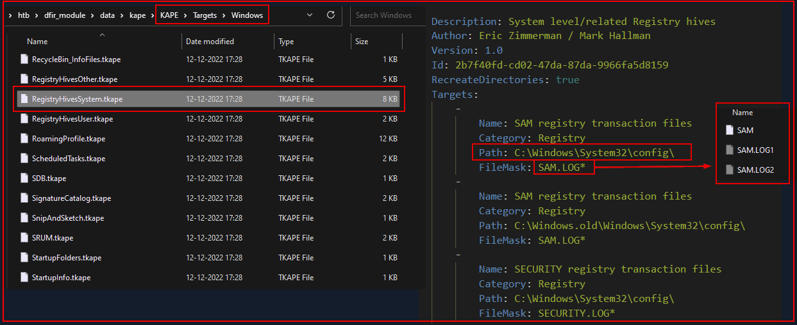

KAPE cũng cung cấp `Compound Targets`, về cơ bản là tổ hợp của nhiều target. Tính năng này đẩy nhanh quá trình thu thập bằng cách gom nhiều file được định nghĩa trong các target khác nhau chỉ trong một lần chạy. File `KapeTriage` trong thư mục `Compound` cho thấy tổng quan nội dung của compound target này.

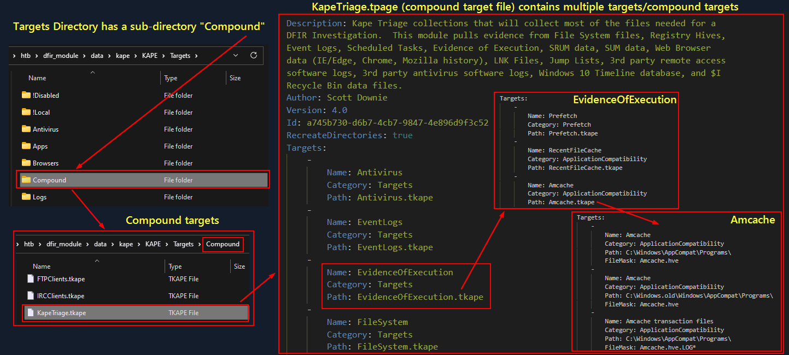

Hãy chỉ định source (trong kịch bản của ta là `D:\`) và chọn một vị trí để lưu dữ liệu thu được. Ta cũng có thể chỉ định một thư mục output để chứa dữ liệu đã được KAPE xử lý.

Sau khi cấu hình các tuỳ chọn, nhấn nút `Execute` để bắt đầu thu thập dữ liệu.

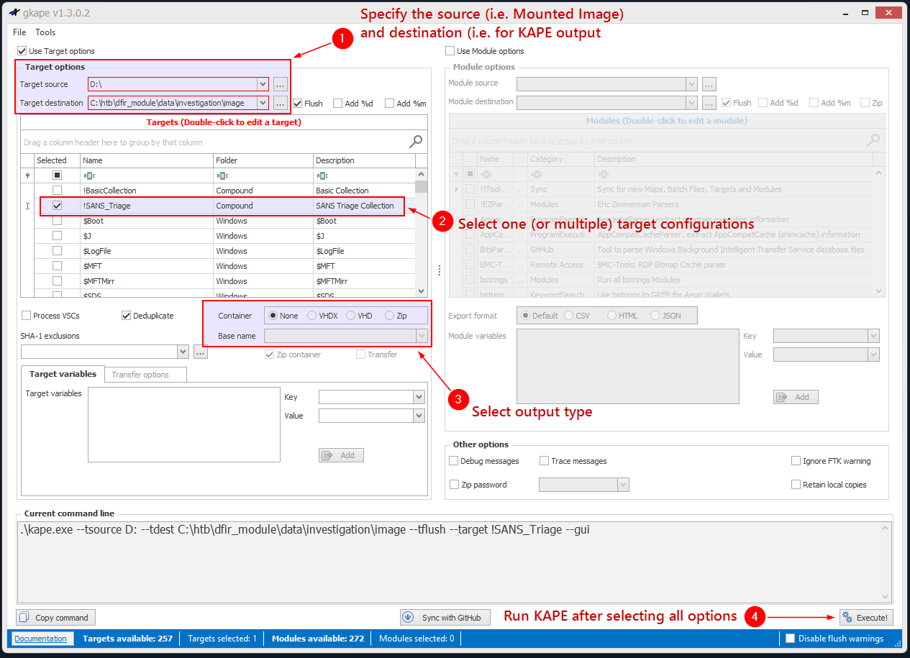

Khi thực thi, KAPE sẽ bắt đầu thu thập và lưu kết quả vào đích đã định trước.

```shell-session
KAPE version 1.3.0.2, Author: Eric Zimmerman, Contact: https://www.kroll.com/kape (kape@kroll.com)

KAPE directory: C:\htb\dfir_module\data\kape\KAPE
Command line:   --tsource D: --tdest C:\htb\dfir_module\data\investigation\image --target !SANS_Triage --gui

System info: Machine name: REDACTED, 64-bit: True, User: REDACTED OS: Windows10 (10.0.22621)

Using Target operations
Found 18 targets. Expanding targets to file list...
Target ApplicationEvents with Id 2da16dbf-ea47-448e-a00f-fc442c3109ba already processed. Skipping!
Target ApplicationEvents with Id 2da16dbf-ea47-448e-a00f-fc442c3109ba already processed. Skipping!
Target ApplicationEvents with Id 2da16dbf-ea47-448e-a00f-fc442c3109ba already processed. Skipping!
Target ApplicationEvents with Id 2da16dbf-ea47-448e-a00f-fc442c3109ba already processed. Skipping!
Target ApplicationEvents with Id 2da16dbf-ea47-448e-a00f-fc442c3109ba already processed. Skipping!
Found 639 files in 4.032 seconds. Beginning copy...
  Deferring D:\Windows\System32\LogFiles\WMI\RtBackup\EtwRTDefenderApiLogger.etl due to UnauthorizedAccessException...
  Deferring D:\Windows\System32\LogFiles\WMI\RtBackup\EtwRTDefenderAuditLogger.etl due to UnauthorizedAccessException...
  Deferring D:\Windows\System32\LogFiles\WMI\RtBackup\EtwRTDiagLog.etl due to UnauthorizedAccessException...
  Deferring D:\Windows\System32\LogFiles\WMI\RtBackup\EtwRTDiagtrack-Listener.etl due to UnauthorizedAccessException...
  Deferring D:\Windows\System32\LogFiles\WMI\RtBackup\EtwRTEventLog-Application.etl due to UnauthorizedAccessException...
  Deferring D:\Windows\System32\LogFiles\WMI\RtBackup\EtwRTEventlog-Security.etl due to UnauthorizedAccessException...
  Deferring D:\Windows\System32\LogFiles\WMI\RtBackup\EtwRTEventLog-System.etl due to UnauthorizedAccessException...
  Deferring D:\Windows\System32\LogFiles\WMI\RtBackup\EtwRTSgrmEtwSession.etl due to UnauthorizedAccessException...
  Deferring D:\Windows\System32\LogFiles\WMI\RtBackup\EtwRTUBPM.etl due to UnauthorizedAccessException...
  Deferring D:\Windows\System32\LogFiles\WMI\RtBackup\EtwRTWFP-IPsec Diagnostics.etl due to UnauthorizedAccessException...
  Deferring D:\$MFT due to UnauthorizedAccessException...
  Deferring D:\$LogFile due to UnauthorizedAccessException...
  Deferring D:\$Extend\$UsnJrnl:$J due to NotSupportedException...
  Deferring D:\$Extend\$UsnJrnl:$Max due to NotSupportedException...
  Deferring D:\$Secure:$SDS due to NotSupportedException...
  Deferring D:\$Boot due to UnauthorizedAccessException...
  Deferring D:\$Extend\$RmMetadata\$TxfLog\$Tops:$T due to NotSupportedException...
Deferred file count: 17. Copying locked files...
  Copied deferred file D:\Windows\System32\LogFiles\WMI\RtBackup\EtwRTDefenderApiLogger.etl to C:\htb\dfir_module\data\investigation\image\D\Windows\System32\LogFiles\WMI\RtBackup\EtwRTDefenderApiLogger.etl. Hashing source file...
  Copied deferred file D:\Windows\System32\LogFiles\WMI\RtBackup\EtwRTDiagLog.etl to C:\htb\dfir_module\data\investigation\image\D\Windows\System32\LogFiles\WMI\RtBackup\EtwRTDiagLog.etl. Hashing source file...
  Copied deferred file D:\Windows\System32\LogFiles\WMI\RtBackup\EtwRTDiagtrack-Listener.etl to C:\htb\dfir_module\data\investigation\image\D\Windows\System32\LogFiles\WMI\RtBackup\EtwRTDiagtrack-Listener.etl. Hashing source file...
  Copied deferred file D:\Windows\System32\LogFiles\WMI\RtBackup\EtwRTEventLog-Application.etl to C:\htb\dfir_module\data\investigation\image\D\Windows\System32\LogFiles\WMI\RtBackup\EtwRTEventLog-Application.etl. Hashing source file...
  Copied deferred file D:\Windows\System32\LogFiles\WMI\RtBackup\EtwRTEventLog-System.etl to C:\htb\dfir_module\data\investigation\image\D\Windows\System32\LogFiles\WMI\RtBackup\EtwRTEventLog-System.etl. Hashing source file...
  Copied deferred file D:\$MFT to C:\htb\dfir_module\data\investigation\image\D\$MFT. Hashing source file...
  Copied deferred file D:\$LogFile to C:\htb\dfir_module\data\investigation\image\D\$LogFile. Hashing source file...
  Copied deferred file D:\$Extend\$UsnJrnl:$J to C:\htb\dfir_module\data\investigation\image\D\$Extend\$J. Hashing source file...
  Copied deferred file D:\$Extend\$UsnJrnl:$Max to C:\htb\dfir_module\data\investigation\image\D\$Extend\$Max. Hashing source file...
  Copied deferred file D:\$Secure:$SDS to C:\htb\dfir_module\data\investigation\image\D\$Secure_$SDS. Hashing source file...
  Copied deferred file D:\$Boot to C:\htb\dfir_module\data\investigation\image\D\$Boot. Hashing source file...
```

Thư mục output của KAPE chứa thành quả của quá trình thu thập và xử lý artifact. Nội dung chính xác của thư mục này có thể khác nhau tuỳ các artifact được chọn và cấu hình đã đặt. Trong minh hoạ của ta, ta chọn cấu hình collection target `!SANS_Triage`. Hãy vào thư mục output của KAPE để xem dữ liệu thu được.

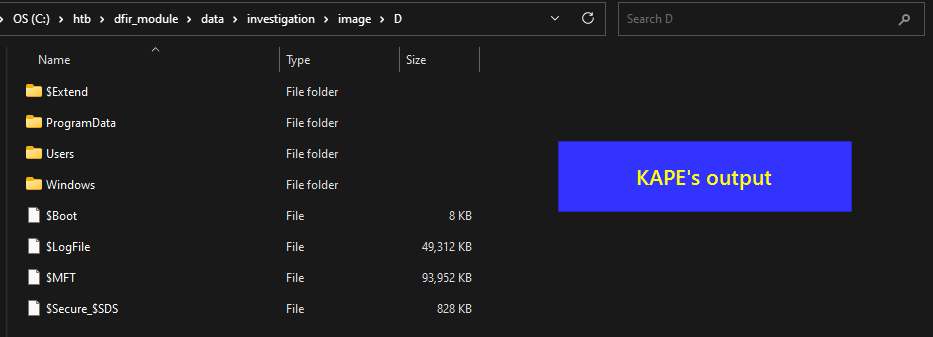

Từ kết quả hiển thị, có thể thấy rõ file `$MFT` đã được thu thập, cùng với các thư mục `Users` và `Windows`.

Đáng chú ý là KAPE cũng đã thu thập `Windows event logs`, nằm trong các thư mục con của thư mục Windows.

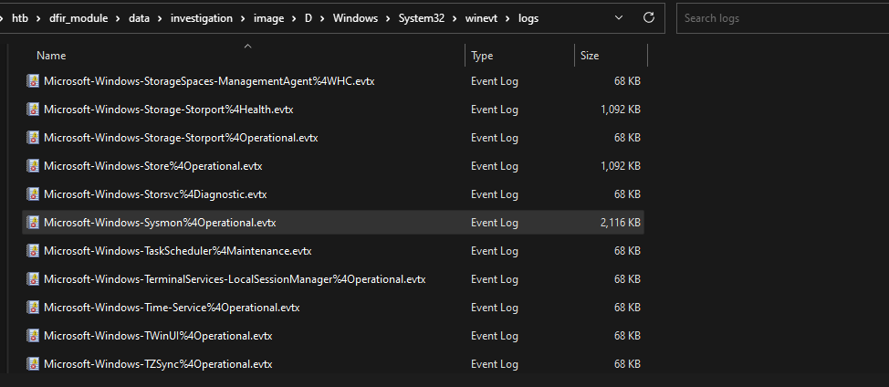

---

Nếu ta muốn thu thập artifact từ xa và trên diện rộng thì sao? Đây là lúc các giải pháp EDR và [Velociraptor](https://github.com/Velocidex/velociraptor) phát huy tác dụng.

Các nền tảng Endpoint Detection and Response (EDR) mang lại lợi thế đáng kể cho analyst incident response. Chúng cho phép thu thập và phân tích bằng chứng số từ xa. Ví dụ, nền tảng EDR có thể hiển thị các binary được thực thi gần đây hoặc các file mới được thêm vào. Thay vì rà soát từng hệ thống riêng lẻ, analyst có thể tìm kiếm các indicator như vậy trên toàn mạng. Một lợi ích khác là khả năng thu thập bằng chứng, dù là các file cụ thể hay các gói forensic toàn diện. Chức năng này đẩy nhanh việc thu thập bằng chứng và hỗ trợ tìm kiếm, thu thập trên quy mô lớn.

[Velociraptor](https://github.com/Velocidex/velociraptor) là một công cụ mạnh để thu thập thông tin trên host bằng các truy vấn Velociraptor Query Language (VQL). Ngoài ra, Velociraptor có thể thực thi các `Hunts` để thu thập nhiều loại artifact. Một artifact thường được sử dụng là `Windows.KapeFiles.Targets`. Tuy bản thân KAPE (Kroll Artifact Parser and Extractor) không phải mã nguồn mở, logic thu thập file của nó, được mã hoá dưới dạng YAML, lại có thể truy cập qua [KapeFiles project](https://github.com/EricZimmerman/KapeFiles). Cách tiếp cận này là một phần không thể thiếu trong Rapid Triage.

Để dùng Velociraptor thu thập các artifact KapeFiles:

- Khởi tạo một Hunt mới.
	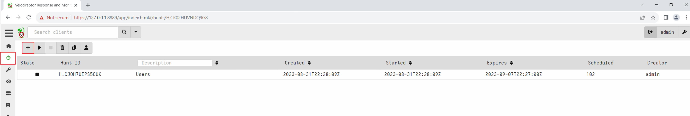
	
	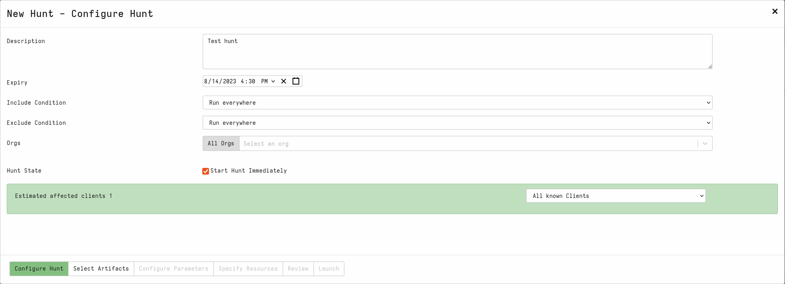
- Chọn `Windows.KapeFiles.Targets` làm artifact cần thu thập.
	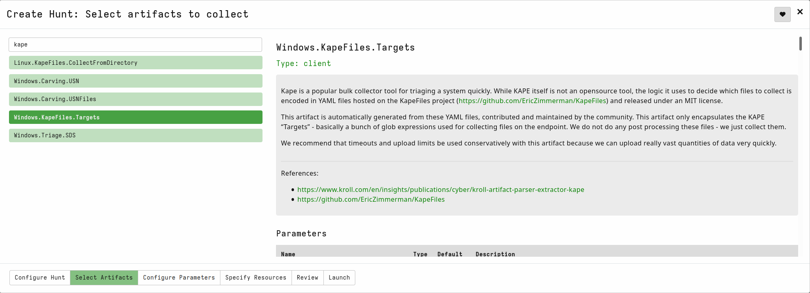
- Chỉ định collection sẽ dùng.
	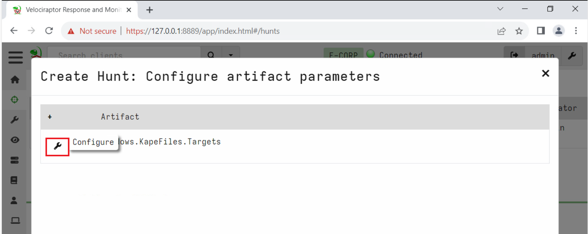

	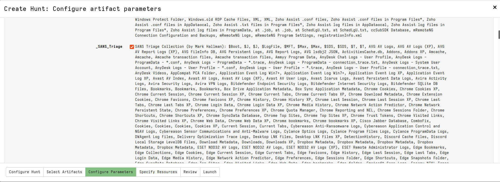
- Nhấn `Launch` để bắt đầu hunt.
	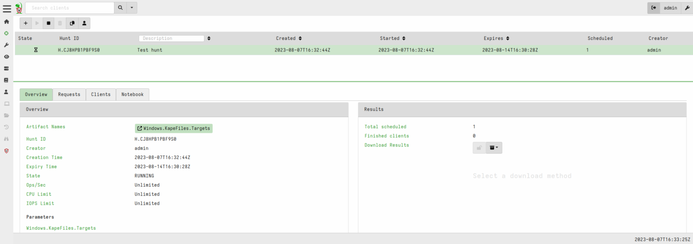
- Khi hoàn tất, tải kết quả về.
	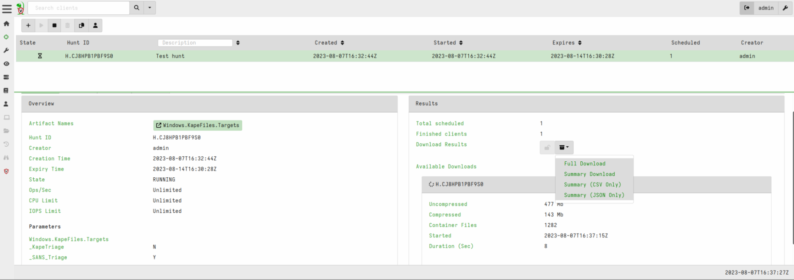

Giải nén archive sẽ thấy các file liên quan đến artifact đã thu thập và toàn bộ các file thu được.

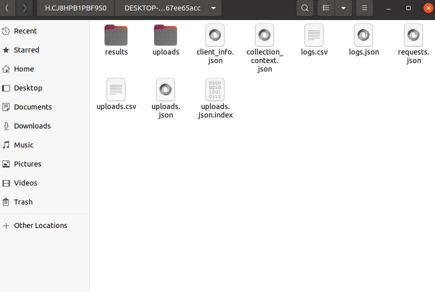

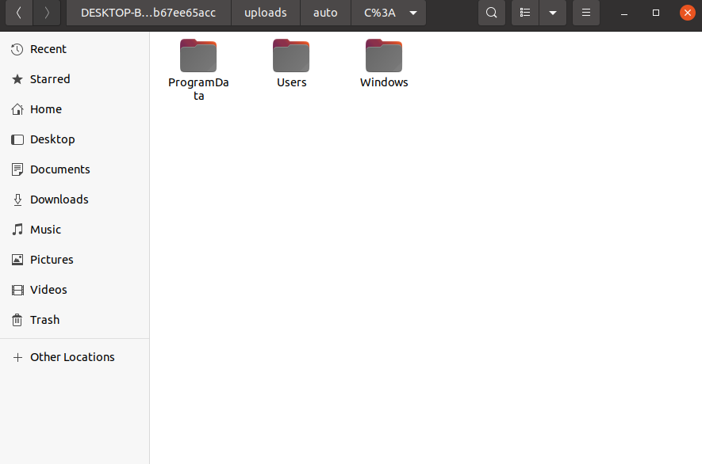

Để thu memory dump từ xa bằng Velociraptor:

- Bắt đầu một Hunt mới, nhưng lần này chọn artifact `Windows.Memory.Acquisition`.
	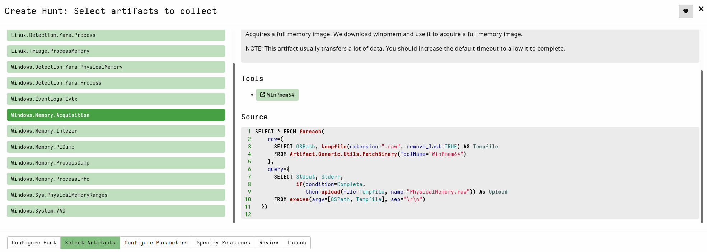
- Sau khi Hunt kết thúc, tải archive kết quả về. Bên trong, bạn sẽ thấy một file tên `PhysicalMemory.raw` chứa memory dump.
	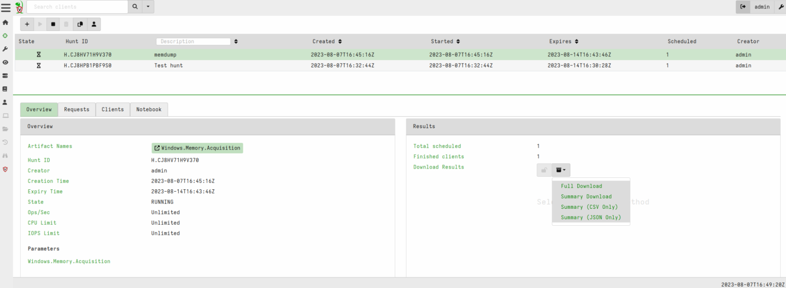
	
## Trích xuất Network Evidence

Trong suốt quá trình học các module thuộc path `SOC Analyst`, ta đã đi sâu vào lĩnh vực bằng chứng mạng (network evidence) — một khía cạnh nền tảng đối với bất kỳ SOC analyst nào.

- Đầu tiên, các module `Intro to Network Traffic Analysis` và `Intermediate Network Traffic Analysis` đã đề cập đến `traffic capture analysis`. Hãy hình dung traffic capture như một bản chụp nhanh (snapshot) của mọi cuộc hội thoại số diễn ra trong mạng. Các công cụ như `Wireshark` hay `tcpdump` cho phép ta bắt và mổ xẻ các packet này, mang lại góc nhìn chi tiết về dữ liệu đang truyền.

- Tiếp theo, các module `Working with IDS/IPS` và `Detecting Windows Attacks with Splunk` đã đề cập đến việc sử dụng dữ liệu từ IDS/IPS. `Intrusion Detection Systems (IDS)` là những người lính gác cảnh giác, liên tục giám sát lưu lượng mạng để tìm dấu hiệu hoạt động độc hại. Khi phát hiện điều gì bất thường, chúng sẽ cảnh báo ta. Mặt khác, `Intrusion Prevention Systems (IPS)` còn tiến thêm một bước: không chỉ phát hiện, chúng còn thực hiện các hành động định sẵn để chặn hoặc ngăn chặn các hoạt động độc hại đó. 

- Dữ liệu `Traffic flow`, thường lấy từ các công cụ như `NetFlow` hoặc `sFlow`, cho ta góc nhìn rộng hơn về hành vi của mạng. Tuy không cung cấp chi tiết tỉ mỉ của từng packet, nó mang lại cái nhìn tổng quan ở mức cao về các mẫu lưu lượng (traffic pattern).

- Cuối cùng là các `firewalls` đáng tin cậy của ta. Chúng không chỉ là rào chắn chặn hoặc cho phép lưu lượng dựa trên các rule định sẵn. Firewall hiện đại là những "cỗ máy" thông minh. Chúng có thể nhận diện ứng dụng, người dùng, và thậm chí phát hiện và chặn mối đe doạ. Bằng cách phân tích log firewall, ta có thể phát hiện các nỗ lực khai thác lỗ hổng, các nỗ lực truy cập trái phép và các hoạt động độc hại khác.
