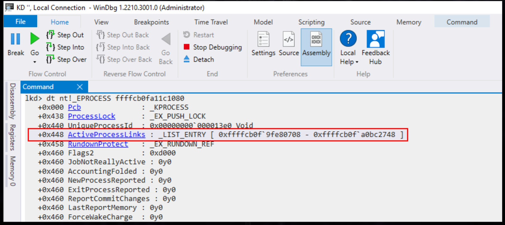
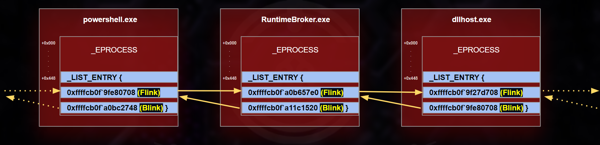
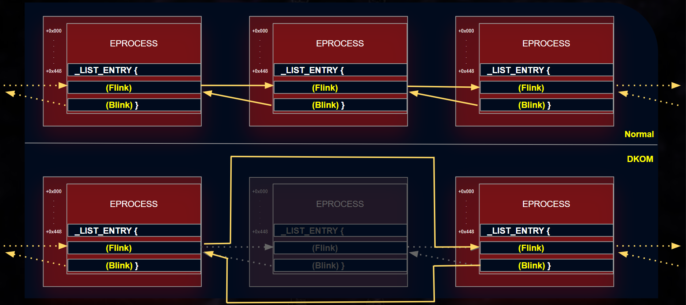

# Memory Forensics (Điều tra bộ nhớ)

## Định nghĩa và quy trình Memory Forensics

`Memory forensics`, còn gọi là phân tích bộ nhớ khả biến (volatile memory analysis), là một nhánh chuyên biệt của digital forensics (điều tra số), tập trung vào việc kiểm tra và phân tích bộ nhớ khả biến (RAM) của máy tính hoặc thiết bị số. Khác với digital forensics truyền thống — vốn phân tích dữ liệu lưu trên các phương tiện lưu trữ bất biến (non-volatile) như ổ cứng hay ổ SSD — memory forensics làm việc với trạng thái đang chạy (live state) của hệ thống tại một thời điểm cụ thể.

Dưới đây là một số loại dữ liệu trong RAM có giá trị cho việc điều tra sự cố:

- `Network connections` (các kết nối mạng)
- `File handles and open Files` (file handle và các file đang mở)
- `Open registry keys` (các registry key đang mở)
- `Running processes on the system` (các process đang chạy trên hệ thống)
- `Loaded modules` (các module đã được nạp)
- `Loaded device drivers` (các driver thiết bị đã được nạp)
- `Command history and console sessions` (lịch sử lệnh và các phiên console)
- `Kernel data structures` (các cấu trúc dữ liệu của kernel)
- `User and credential information` (thông tin người dùng và thông tin đăng nhập)
- `Malware artifacts` (dấu vết do malware để lại)
- `System configuration` (cấu hình hệ thống)
- `Process memory regions` (các vùng nhớ của process)

Như đã bàn ở cả section trước lẫn trong module `YARA & Sigma for SOC Analysts`, khi malware hoạt động, nó thường để lại dấu vết trong bộ nhớ đang hoạt động của hệ thống. Bằng cách phân tích vùng nhớ này, người điều tra có thể phát hiện các process độc hại, xác định các indicator of compromise (IOC – dấu hiệu xâm nhập) và tái dựng lại các hành động của malware. 

Cần lưu ý rằng trong một số trường hợp, dữ liệu quan trọng hoặc khoá mã hoá (encryption key) có thể nằm trong bộ nhớ. Memory forensics có thể giúp khôi phục những dữ liệu này, vốn có thể mang tính then chốt cho cuộc điều tra.

Phần dưới đây trình bày một cách tiếp cận có hệ thống cho memory forensics, được xây dựng để hỗ trợ việc điều tra trong bộ nhớ, lấy cảm hứng từ phương pháp memory forensics sáu bước của [SANS](https://www.sans.org/).

1. `Process Identification and Verification` (xác định và xác minh process):
Hãy bắt đầu bằng việc xác định tất cả các process đang hoạt động. Phần mềm độc hại thường giả dạng các process hợp lệ, đôi khi với tên chỉ khác biệt rất nhỏ để tránh bị phát hiện. Ta cần:
	- Liệt kê tất cả các process đang chạy.
	- Xác định nguồn gốc của chúng trong hệ điều hành.
	- Đối chiếu với các process hợp lệ đã biết.
	- Làm nổi bật mọi điểm bất thường hoặc cách đặt tên đáng ngờ.

2. `Deep Dive into Process Components` (đi sâu vào các thành phần của process):
Khi đã đánh dấu được các process có khả năng là giả mạo (rogue), bước tiếp theo là xem xét kỹ các Dynamic Link Library (DLL) và handle liên quan. Malware thường lợi dụng DLL để che giấu hoạt động của nó. Ta nên:
	- Kiểm tra các DLL liên kết với process đáng ngờ.
	- Kiểm tra xem có DLL trái phép hoặc độc hại nào không.
	- Điều tra mọi dấu hiệu của DLL injection hoặc DLL hijacking.

3. `Network Activity Analysis` (phân tích hoạt động mạng):
Nhiều dòng malware, đặc biệt là những loại hoạt động theo nhiều giai đoạn (stage), cần có kết nối internet. Chúng có thể gửi beacon tới các server Command and Control (C2) hoặc tuồn (exfiltrate) dữ liệu ra ngoài. Để phát hiện những hoạt động này:
	- Rà soát các kết nối mạng chủ động và thụ động (active và passive) trong bộ nhớ của hệ thống.
	- Xác định và ghi lại các địa chỉ IP bên ngoài cùng các tên miền liên quan.
	- Xác định bản chất và mục đích của việc giao tiếp.
		- Xác minh tính hợp lệ của process.
		- Đánh giá xem process đó thông thường có cần giao tiếp mạng hay không.
		- Lần ngược về process cha (parent process).
		- Đánh giá hành vi và mức độ cần thiết của nó.

4. `Code Injection Detection` (phát hiện code injection):
Các kẻ tấn công cao cấp thường dùng những kỹ thuật như process hollowing hoặc tận dụng các vùng nhớ không được ánh xạ (unmapped memory section). Để đối phó, ta nên:
	- Dùng các công cụ phân tích bộ nhớ để phát hiện bất thường hoặc dấu hiệu của các kỹ thuật này.
	- Xác định mọi process có vẻ chiếm những vùng nhớ bất thường hoặc thể hiện hành vi không mong đợi.

5. `Rootkit Discovery` (phát hiện rootkit):
Đạt được khả năng ẩn mình (stealth) và duy trì (persistence) là mục tiêu phổ biến của kẻ tấn công. Rootkit — loại cắm rễ sâu bên trong hệ điều hành — cho phép threat actor truy cập hệ thống liên tục, thường với quyền cao, trong khi né tránh bị phát hiện. Để xử lý điều này:
	- Quét tìm dấu hiệu hoạt động của rootkit hoặc các thay đổi sâu trong hệ điều hành.
	- Xác định mọi process hoặc driver đang chạy với quyền cao bất thường hoặc có hành vi ẩn mình.

6. `Extraction of Suspicious Elements` (trích xuất các thành phần đáng ngờ):
Sau khi xác định chính xác các process, driver hoặc file thực thi đáng ngờ, ta cần cô lập chúng để phân tích chuyên sâu. Việc này bao gồm:
	- Dump các thành phần đáng ngờ từ bộ nhớ.
	- Lưu trữ chúng an toàn để kiểm tra tiếp bằng các công cụ forensic chuyên dụng.
	
---

## Volatility Framework

Công cụ được ưa chuộng để thực hiện memory forensics là [Volatility](https://www.volatilityfoundation.org/releases). Volatility là framework memory forensics mã nguồn mở hàng đầu. Trung tâm của framework này là script Python Volatility. Script này khai thác rất nhiều plugin, cho phép nó mổ xẻ các memory image (ảnh bộ nhớ) một cách chính xác. Vì được xây dựng trên nền Python, ta có thể chạy Volatility trên bất kỳ nền tảng nào tương thích với Python. Hơn nữa, đội của chúng ta có thể tận dụng Volatility để phân tích kỹ các file memory image từ rất nhiều hệ điều hành phổ biến. Trong đó có Windows (từ Windows XP đến Windows Server 2016), macOS và tất nhiên cả các bản phân phối Linux thông dụng.

Module hay plugin của Volatility là các phần mở rộng (extension hoặc add-on) giúp tăng cường chức năng của Volatility Framework bằng cách trích xuất thông tin cụ thể hoặc thực hiện các tác vụ phân tích cụ thể trên memory image.

Một số module thường dùng gồm:
- **`pslist`**: Liệt kê các process đang chạy.
- **`cmdline`**: Hiển thị các tham số dòng lệnh (command-line argument) của process
- **`netscan`**: Quét tìm các kết nối mạng và các cổng đang mở.
- **`malfind`**: Quét tìm code có khả năng độc hại đã bị inject vào process.
- **`handles`**: Quét tìm các handle đang mở
- **`svcscan`**: Liệt kê các Windows service.
- **`dlllist`**: Liệt kê các DLL (Dynamic-link Library) đã được nạp trong một process.
- **`hivelist`**: Liệt kê các registry hive trong bộ nhớ.

Volatility có tài liệu rất đầy đủ. Bạn có thể tìm các module và tài liệu liên quan qua các link sau:
- **Volatility v2**:
[https://github.com/volatilityfoundation/volatility/wiki/Command-Reference](https://github.com/volatilityfoundation/volatility/wiki/Command-Reference)
- **Volatility v3**:
[https://volatility3.readthedocs.io/en/latest/index.html](https://volatility3.readthedocs.io/en/latest/index.html)

Một cheatsheet Volatility (v2 & v3) hữu ích có thể tìm thấy tại đây: [https://blog.onfvp.com/post/volatility-cheatsheet/](https://blog.onfvp.com/post/volatility-cheatsheet/)

---

#### Kiến thức cơ bản về Volatility v2

<div class="card bg-light">
    <div class="card-body">
				 <p class="mb-0">Bây giờ hãy kéo xuống cuối section này và bấm vào "Click here to spawn the target system!". Sau đó, SSH vào Target IP bằng thông tin đăng nhập được cung cấp. Phần lớn các thao tác/lệnh được trình bày từ đây đến cuối section này đều có thể thực hiện lại bên trong target, giúp nắm bắt các chủ đề được trình bày một cách toàn diện hơn. </p>
    </div>
</div>

Bây giờ hãy xem phần minh hoạ cách dùng `Volatility v2` để phân tích một memory dump được lưu với tên `Win7-2515534d.vmem` trong thư mục `/home/htb-student/MemoryDumps` của target ở section này.

Phần `help` và các `available plugins` (plugin khả dụng) của Volatility có thể xem như sau.

```shell-session
[!bash!]$ vol.py --help
Volatility Foundation Volatility Framework 2.6.1
/usr/local/lib/python2.7/dist-packages/volatility/plugins/community/YingLi/ssh_agent_key.py:12: CryptographyDeprecationWarning: Python 2 is no longer supported by the Python core team. Support for it is now deprecated in cryptography, and will be removed in the next release.
  from cryptography.hazmat.backends.openssl import backend
Usage: Volatility - A memory forensics analysis platform.

Options:
  -h, --help            list all available options and their default values.
                        Default values may be set in the configuration file
                        (/etc/volatilityrc)
  --conf-file=/home/htb-student/.volatilityrc
                        User based configuration file
  -d, --debug           Debug volatility
  --plugins=PLUGINS     Additional plugin directories to use (colon separated)
  --info                Print information about all registered objects
  --cache-directory=/home/htb-student/.cache/volatility
                        Directory where cache files are stored
  --cache               Use caching
  --tz=TZ               Sets the (Olson) timezone for displaying timestamps
                        using pytz (if installed) or tzset
  -C 190000, --confsize=190000
                        Config data size
  -Y YARAOFFSET, --yaraoffset=YARAOFFSET
                        YARA start offset
  -f FILENAME, --filename=FILENAME
                        Filename to use when opening an image
  --profile=WinXPSP2x86
                        Name of the profile to load (use --info to see a list
                        of supported profiles)
  -l LOCATION, --location=LOCATION
                        A URN location from which to load an address space
  -w, --write           Enable write support
  --dtb=DTB             DTB Address
  --physical_shift=PHYSICAL_SHIFT
                        Linux kernel physical shift address
  --virtual_shift=VIRTUAL_SHIFT
                        Linux kernel virtual shift address
  --shift=SHIFT         Mac KASLR shift address
  --output=text         Output in this format (support is module specific, see
                        the Module Output Options below)
  --output-file=OUTPUT_FILE
                        Write output in this file
  -v, --verbose         Verbose information
  -g KDBG, --kdbg=KDBG  Specify a KDBG virtual address (Note: for 64-bit
                        Windows 8 and above this is the address of
                        KdCopyDataBlock)
  --force               Force utilization of suspect profile
  -k KPCR, --kpcr=KPCR  Specify a specific KPCR address
  --cookie=COOKIE       Specify the address of nt!ObHeaderCookie (valid for
                        Windows 10 only)

        Supported Plugin Commands:

                agtidconfig     Parse the Agtid configuration
                amcache         Print AmCache information
                antianalysis
                apifinder
                apihooks        Detect API hooks in process and kernel memory
                apihooksdeep    Detect API hooks in process and kernel memory, with ssdeep for whitelisting
                apt17scan       Detect processes infected with APT17 malware
                atoms           Print session and window station atom tables
                atomscan        Pool scanner for atom tables
                attributeht     Find Hacking Team implants and attempt to attribute them using a watermark.
                auditpol        Prints out the Audit Policies from HKLM\SECURITY\Policy\PolAdtEv
                autoruns        Searches the registry and memory space for applications running at system startup and maps them to running processes
                bigpools        Dump the big page pools using BigPagePoolScanner
                bioskbd         Reads the keyboard buffer from Real Mode memory
                bitlocker       Extract Bitlocker FVEK. Supports Windows 7 - 10.
                cachedump       Dumps cached domain hashes from memory
                callbacks       Print system-wide notification routines
                callstacks      this is the plugin class for callstacks
                chromecookies   Scans for and parses potential Chrome cookie data
                chromedownloadchains    Scans for and parses potential Chrome download chain records
                chromedownloads Scans for and parses potential Chrome download records
                chromehistory   Scans for and parses potential Chrome url history
                chromesearchterms       Scans for and parses potential Chrome keyword search terms
                chromevisits    Scans for and parses potential Chrome url visits data -- VERY SLOW, see -Q option
                clipboard       Extract the contents of the windows clipboard
                cmdline         Display process command-line arguments
                cmdscan         Extract command history by scanning for _COMMAND_HISTORY
                connections     Print list of open connections [Windows XP and 2003 Only]
                connscan        Pool scanner for tcp connections
                consoles        Extract command history by scanning for _CONSOLE_INFORMATION
                crashinfo       Dump crash-dump information
                derusbiconfig   Parse the Derusbi configuration
                deskscan        Poolscaner for tagDESKTOP (desktops)
                devicetree      Show device tree
                directoryenumerator     Enumerates all unique directories from FileScan
                dlldump         Dump DLLs from a process address space
                dlllist         Print list of loaded dlls for each process
                driverbl        Scans memory for driver objects and compares the results with the baseline image
                driverirp       Driver IRP hook detection
                driveritem
                drivermodule    Associate driver objects to kernel modules
                driverscan      Pool scanner for driver objects
                dumpcerts       Dump RSA private and public SSL keys
                dumpfiles       Extract memory mapped and cached files
                dumpregistry    Dumps registry files out to disk
                dyrescan        Extract Dyre Configuration from processes
                editbox         Displays information about Edit controls. (Listbox experimental.)
                envars          Display process environment variables
                eventhooks      Print details on windows event hooks
                evtlogs         Extract Windows Event Logs (XP/2003 only)
                facebook        Retrieve facebook artifacts from a memory image
                facebookcontacts        Finds possible Facebook contacts
                facebookgrabinfo        Carves the memory dump for Owner's personal info JSON struct.
                facebookmessages        Carves the memory for every message exchanged between the Owner and another contact
                fileitem
                filescan        Pool scanner for file objects
                firefoxcookies  Scans for and parses potential Firefox cookies (cookies.sqlite moz_cookies table
                firefoxdownloads        Scans for and parses potential Firefox download records -- downloads.sqlite moz_downloads table pre FF26 only
                firefoxhistory  Scans for and parses potential Firefox url history (places.sqlite moz_places table)
                fwhooks         Enumerates modules which are using Firewall Hook Drivers on Windows 2000/XP/2003
                gahti           Dump the USER handle type information
                gditimers       Print installed GDI timers and callbacks
                gdt             Display Global Descriptor Table
                getservicesids  Get the names of services in the Registry and return Calculated SID
                getsids         Print the SIDs owning each process
                ghostrat        Detects and decrypts Gh0stRat communication
                handles         Print list of open handles for each process
                hashdump        Dumps passwords hashes (LM/NTLM) from memory
                hibinfo         Dump hibernation file information
                hikitconfig     Parse the Hikit configuration
                hivedump        Prints out a hive
                hivelist        Print list of registry hives.
                hivescan        Pool scanner for registry hives
                hollowfind      Detects different types of Process Hollowing
                hookitem
                hpakextract     Extract physical memory from an HPAK file
                hpakinfo        Info on an HPAK file
                hpv_clipboard   Dump Virtual Machine Clipboard data
                hpv_vmconnect   Virtual Machine Console data
                hpv_vmwp        Display the Virtual Machine Process GUID for each running vm
                idt             Display Interrupt Descriptor Table
                idxparser       Scans for and parses Java IDX files
                iehistory       Reconstruct Internet Explorer cache / history
                imagecopy       Copies a physical address space out as a raw DD image
                imageinfo       Identify information for the image
                impscan         Scan for calls to imported functions
                indx            Scans for and parses potential INDX entries
                joblinks        Print process job link information
                kdbgscan        Search for and dump potential KDBG values
                kpcrscan        Search for and dump potential KPCR values
                lastpass        Extract lastpass data from process.
                ldrmodules      Detect unlinked DLLs
                linuxgetprofile Scan to try to determine the Linux profile
                logfile         Scans for and parses potential $Logfile entries
                lsadump         Dump (decrypted) LSA secrets from the registry
                machoinfo       Dump Mach-O file format information
                malfind         Find hidden and injected code
                malfinddeep     Find hidden and injected code, whitelist with ssdeep hashes
                malfofind       Find indications of process hollowing/RunPE injections
                malprocfind     Finds malicious processes based on discrepancies from observed, normal behavior and properties
                malthfind       Find malicious threads by analyzing their callstack
                mbrparser       Scans for and parses potential Master Boot Records (MBRs)
                memdump         Dump the addressable memory for a process
                memmap          Print the memory map
                messagehooks    List desktop and thread window message hooks
                mftparser       Scans for and parses potential MFT entries
                mimikatz        mimikatz offline
                moddump         Dump a kernel driver to an executable file sample
                modscan         Pool scanner for kernel modules
                modules         Print list of loaded modules
                msdecompress    Carves and dumps Lznt1, Xpress and Xpress huffman Compressioned data blocks in a processes pagespace
                multiscan       Scan for various objects at once
                mutantscan      Pool scanner for mutex objects
                ndispktscan     Extract the packets from memory
                networkpackets  Carve and analyze ARP/IPv4 network packets from memory
                notepad         List currently displayed notepad text
                objtypescan     Scan for Windows object type objects
                openioc_scan    Scan OpenIOC 1.1 based indicators
                openvpn         Extract OpenVPN client credentials (username, password) cached in memory.
                osint           Check Url/ip extracted from memory against opensource intelligence platforms
                patcher         Patches memory based on page scans
                plugxconfig     Locate and parse the PlugX configuration
                plugxscan       Detect processes infected with PlugX
                poolpeek        Configurable pool scanner plugin
                prefetchparser  Scans for and parses potential Prefetch files
                printkey        Print a registry key, and its subkeys and values
                privs           Display process privileges
                procdump        Dump a process to an executable file sample
                processbl       Scans memory for processes and loaded DLLs and compares the results with the baseline
                profilescan     Scan for executables to try to determine the underlying OS
                psinfo          Displays process related information and suspicious memory regions
                pslist          Print all running processes by following the EPROCESS lists
                psscan          Pool scanner for process objects
                pstotal         Combination of pslist,psscan & pstree --output=dot gives graphical representation
                pstree          Print process list as a tree
                psxview         Find hidden processes with various process listings
                qemuinfo        Dump Qemu information
                raw2dmp         Converts a physical memory sample to a windbg crash dump
                registryitem
                rsakey          Extract base64/PEM encoded private RSA keys from physical memory.
                screenshot      Save a pseudo-screenshot based on GDI windows
                servicebl       Scans memory for service objects and compares the results with the baseline image
                servicediff     List Windows services (ala Plugx)
                serviceitem
                sessions        List details on _MM_SESSION_SPACE (user logon sessions)
                shellbags       Prints ShellBags info
                shimcache       Parses the Application Compatibility Shim Cache registry key
                shimcachemem    Parses the Application Compatibility Shim Cache stored in kernel memory
                shutdowntime    Print ShutdownTime of machine from registry
                sockets         Print list of open sockets
                sockscan        Pool scanner for tcp socket objects
                ssdeepscan      Scan process or kernel memory with SSDeep signatures
                ssdt            Display SSDT entries
                strings         Match physical offsets to virtual addresses (may take a while, VERY verbose)
                svcscan         Scan for Windows services
                symlinkscan     Pool scanner for symlink objects
                systeminfo      Print common system details of machine from registry
                thrdscan        Pool scanner for thread objects
                threads         Investigate _ETHREAD and _KTHREADs
                timeliner       Creates a timeline from various artifacts in memory
                timers          Print kernel timers and associated module DPCs
                truecryptmaster Recover TrueCrypt 7.1a Master Keys
                truecryptpassphrase     TrueCrypt Cached Passphrase Finder
                truecryptsummary        TrueCrypt Summary
                trustrecords    Extract MS Office TrustRecords from the Registry
                twitter         Retrieve twitter artifacts from a memory image
                uninstallinfo   Extract installed software info from Uninstall registry key
                unloadedmodules Print list of unloaded modules
                usbstor         Parse USB Data from the Registry
                userassist      Print userassist registry keys and information
                userhandles     Dump the USER handle tables
                usnjrnl         Scans for and parses potential USNJRNL entries
                usnparser       Scans for and parses USN journal records
                vaddump         Dumps out the vad sections to a file
                vadinfo         Dump the VAD info
                vadtree         Walk the VAD tree and display in tree format
                vadwalk         Walk the VAD tree
                vboxinfo        Dump virtualbox information
                verinfo         Prints out the version information from PE images
                vmwareinfo      Dump VMware VMSS/VMSN information
                volshell        Shell in the memory image
                windows         Print Desktop Windows (verbose details)
                wintree         Print Z-Order Desktop Windows Tree
                wndscan         Pool scanner for window stations
                yarascan        Scan process or kernel memory with Yara signatures 
```

#### Xác định profile

Profile là thành phần thiết yếu để Volatility v2 diễn giải đúng dữ liệu bộ nhớ (việc xác định profile đã được cải thiện ở v3). Để xác định profile khớp với hệ điều hành của memory dump, ta có thể dùng plugin `imageinfo` như sau.

```shell-session
[!bash!]$ vol.py -f /home/htb-student/MemoryDumps/Win7-2515534d.vmem imageinfo                                                                   Volatility Foundation Volatility Framework 2.6.1
/usr/local/lib/python2.7/dist-packages/volatility/plugins/community/YingLi/ssh_agent_key.py:12: CryptographyDeprecationWarning: Python 2 is no longer supported by the Python core team. Support for it is now deprecated in cryptography, and will be removed in the next release.
  from cryptography.hazmat.backends.openssl import backend
INFO    : volatility.debug    : Determining profile based on KDBG search...
          Suggested Profile(s) : Win7SP1x64, Win7SP0x64, Win2008R2SP0x64, Win2008R2SP1x64_24000, Win2008R2SP1x64_23418, Win2008R2SP1x64, Win7SP1x64_24000, Win7SP1x64_23418
                     AS Layer1 : WindowsAMD64PagedMemory (Kernel AS)
                     AS Layer2 : FileAddressSpace (/home/htb-student/MemoryDumps/Win7-2515534d.vmem)
                      PAE type : No PAE
                           DTB : 0x187000L
                          KDBG : 0xf80002be9120L
          Number of Processors : 1
     Image Type (Service Pack) : 1
                KPCR for CPU 0 : 0xfffff80002beb000L
             KUSER_SHARED_DATA : 0xfffff78000000000L
           Image date and time : 2023-06-22 12:34:03 UTC+0000
     Image local date and time : 2023-06-22 18:04:03 +0530
```

#### Xác định các process đang chạy

Hãy kiểm tra xem profile `Win7SP1x64` được gợi ý có đúng không bằng cách thử liệt kê các process đang chạy qua plugin `pslist`. 

```shell-session
[!bash!]$ vol.py -f /home/htb-student/MemoryDumps/Win7-2515534d.vmem --profile=Win7SP1x64 pslist
Volatility Foundation Volatility Framework 2.6.1
/usr/local/lib/python2.7/dist-packages/volatility/plugins/community/YingLi/ssh_agent_key.py:12: CryptographyDeprecationWarning: Python 2 is no longer supported by the Python core team. Support for it is now deprecated in cryptography, and will be removed in the next release.
  from cryptography.hazmat.backends.openssl import backend
Offset(V)          Name                    PID   PPID   Thds     Hnds   Sess  Wow64 Start                          Exit
------------------ -------------------- ------ ------ ------ -------- ------ ------ ------------------------------ ------------------------------
0xfffffa8000ca8860 System                    4      0     97      446 ------      0 2023-06-22 12:04:39 UTC+0000
0xfffffa8001a64920 smss.exe                264      4      2       29 ------      0 2023-06-22 12:04:39 UTC+0000
0xfffffa80028a39a0 csrss.exe               352    344      8      626      0      0 2023-06-22 12:04:40 UTC+0000
0xfffffa8002a51730 wininit.exe             404    344      3       76      0      0 2023-06-22 12:04:41 UTC+0000
0xfffffa800291eb00 csrss.exe               416    396      9      307      1      0 2023-06-22 12:04:41 UTC+0000
0xfffffa8002a86340 winlogon.exe            464    396      3      113      1      0 2023-06-22 12:04:41 UTC+0000
0xfffffa8002ad8b00 services.exe            508    404      8      226      0      0 2023-06-22 12:04:41 UTC+0000
0xfffffa8002adbb00 lsass.exe               516    404      6      585      0      0 2023-06-22 12:04:41 UTC+0000
0xfffffa8002ae6b00 lsm.exe                 524    404      9      149      0      0 2023-06-22 12:04:41 UTC+0000
0xfffffa8002b4f720 svchost.exe             628    508     10      366      0      0 2023-06-22 12:04:42 UTC+0000
0xfffffa8002b7bb00 svchost.exe             696    508      7      288      0      0 2023-06-22 12:04:42 UTC+0000
0xfffffa8002ba0b00 svchost.exe             744    508     18      455      0      0 2023-06-22 12:04:42 UTC+0000
0xfffffa8002c00280 svchost.exe             868    508     19      443      0      0 2023-06-22 12:04:43 UTC+0000
0xfffffa8002c52710 svchost.exe             920    508     17      599      0      0 2023-06-22 12:04:43 UTC+0000
0xfffffa8002c5c680 svchost.exe             964    508     28      838      0      0 2023-06-22 12:04:43 UTC+0000
0xfffffa80022679b0 svchost.exe            1000    508     13      365      0      0 2023-06-22 12:04:44 UTC+0000
0xfffffa8002d15b00 spoolsv.exe            1120    508     13      273      0      0 2023-06-22 12:04:45 UTC+0000
0xfffffa8002d4f9b0 svchost.exe            1156    508     18      308      0      0 2023-06-22 12:04:45 UTC+0000
0xfffffa8002d2f060 svchost.exe            1268    508     11      165      0      0 2023-06-22 12:04:45 UTC+0000
0xfffffa8002d2d060 svchost.exe            1348    508     15      258      0      0 2023-06-22 12:04:45 UTC+0000
0xfffffa8000d78b00 VGAuthService.         1412    508      4       96      0      0 2023-06-22 12:04:45 UTC+0000
0xfffffa8002db6b00 vm3dservice.ex         1440    508      4       61      0      0 2023-06-22 12:04:46 UTC+0000
0xfffffa8002e2e9b0 vmtoolsd.exe           1468    508     13      299      0      0 2023-06-22 12:04:46 UTC+0000
0xfffffa8002e45a70 vm3dservice.ex         1488   1440      2       45      1      0 2023-06-22 12:04:46 UTC+0000
0xfffffa8002f58b00 svchost.exe            1724    508      6       92      0      0 2023-06-22 12:04:47 UTC+0000
0xfffffa8002fa2b00 WmiPrvSE.exe           1908    628      9      197      0      0 2023-06-22 12:04:47 UTC+0000
0xfffffa8002f8fb00 dllhost.exe            1968    508     13      190      0      0 2023-06-22 12:04:47 UTC+0000
0xfffffa8003007b00 msdtc.exe              1960    508     12      145      0      0 2023-06-22 12:04:51 UTC+0000
0xfffffa8001bfbb00 taskhost.exe           2432    508      9      241      1      0 2023-06-22 12:05:13 UTC+0000
0xfffffa80027ca970 dwm.exe                2484    868      5      152      1      0 2023-06-22 12:05:13 UTC+0000
0xfffffa8001d27b00 explorer.exe           2508   2472     24      843      1      0 2023-06-22 12:05:13 UTC+0000
0xfffffa80123fc590 vmtoolsd.exe           2600   2508      8      182      1      0 2023-06-22 12:05:14 UTC+0000
0xfffffa80027edb00 SearchIndexer.         2756    508     17      800      0      0 2023-06-22 12:05:22 UTC+0000
0xfffffa80023e7750 cmd.exe                3040   2508      1       21      1      0 2023-06-22 12:05:39 UTC+0000
0xfffffa8001d19060 conhost.exe            3048    416      2       53      1      0 2023-06-22 12:05:39 UTC+0000
0xfffffa8002d95870 taskmgr.exe            2648    464      6      113      1      0 2023-06-22 12:05:59 UTC+0000
0xfffffa8000e0fb00 ProcessHacker.          716   2508      9      476      1      0 2023-06-22 12:06:29 UTC+0000
0xfffffa8000eee060 sppsvc.exe             1080    508      4      146      0      0 2023-06-22 12:06:47 UTC+0000
0xfffffa8000ea6a00 svchost.exe             608    508     15      431      0      0 2023-06-22 12:06:47 UTC+0000
0xfffffa8000e2e620 wmpnetwk.exe           2968    508     18      442      0      0 2023-06-22 12:06:48 UTC+0000
0xfffffa80022af430 ida64.exe              2248   2508      7      340      1      0 2023-06-22 12:16:18 UTC+0000
0xfffffa8001420300 x32dbg.exe             2820   2508     20      480      1      1 2023-06-22 12:23:34 UTC+0000
0xfffffa8000ee96d0 Ransomware.wan         1512   2820     11      167      1      1 2023-06-22 12:23:41 UTC+0000
0xfffffa8002ca4240 Ransomware.wan         2320    508    117      497      0      1 2023-06-22 12:30:19 UTC+0000
0xfffffa8002ad9560 dllhost.exe            1876    628      4       79      1      0 2023-06-22 12:30:20 UTC+0000
0xfffffa8001d0f8b0 tasksche.exe           2972   1512      0 --------      1      0 2023-06-22 12:31:13 UTC+0000   2023-06-22 12:31:43 UTC+0000
0xfffffa8001d22b00 tasksche.exe           1792   1044      8       82      0      1 2023-06-22 12:31:13 UTC+0000
0xfffffa8002fa3060 SearchProtocol          852   2756      8      289      0      0 2023-06-22 12:31:15 UTC+0000
0xfffffa8002572060 @WanaDecryptor         1060   1792      2       71      0      1 2023-06-22 12:31:27 UTC+0000
0xfffffa8001568060 taskhsvc.exe           3012   1060      4      101      0      1 2023-06-22 12:31:29 UTC+0000
0xfffffa8001ddb060 conhost.exe            2348    352      1       32      0      0 2023-06-22 12:31:29 UTC+0000
0xfffffa8000df81b0 VSSVC.exe               288    508      6      116      0      0 2023-06-22 12:31:43 UTC+0000
0xfffffa800141e9a0 @WanaDecryptor         3252   3212      1       75      1      1 2023-06-22 12:31:45 UTC+0000
0xfffffa80014e4a70 MpCmdRun.exe           3436   3412      5      116      0      0 2023-06-22 12:32:12 UTC+0000
0xfffffa80014c12c0 SearchFilterHo         3904   2756      6      109      0      0 2023-06-22 12:33:18 UTC+0000
0xfffffa8000f2f1c0 audiodg.exe            4048    744      6      128      0      0 2023-06-22 12:33:33 UTC+0000
0xfffffa8000dbc5a0 cmd.exe                2080   1468      0 --------      0      0 2023-06-22 12:34:03 UTC+0000   2023-06-22 12:34:03 UTC+0000
0xfffffa8000f90b00 conhost.exe            3292    352      0 --------      0      0 2023-06-22 12:34:03 UTC+0000   2023-06-22 12:34:03 UTC+0000
0xfffffa8000f7b790 ipconfig.exe           2360   2080      0 --------      0      0 2023-06-22 12:34:03 UTC+0000   2023-06-22 12:34:03 UTC+0000
```

Cần lưu ý rằng kể cả khi ta chỉ định một profile khác trong danh sách gợi ý, Volatility vẫn có thể cho ra kết quả đúng.

#### Xác định các artifact mạng

Plugin `netscan` có thể dùng để quét tìm các artifact mạng như sau.

```shell-session
[!bash!]$ vol.py -f /home/htb-student/MemoryDumps/Win7-2515534d.vmem --profile=Win7SP1x64 netscan
Volatility Foundation Volatility Framework 2.6.1
/usr/local/lib/python2.7/dist-packages/volatility/plugins/community/YingLi/ssh_agent_key.py:12: CryptographyDeprecationWarning: Python 2 is no longer supported by the Python core team. Support for it is now deprecated in cryptography, and will be removed in the next release.
  from cryptography.hazmat.backends.openssl import backend
Offset(P)          Proto    Local Address                  Foreign Address      State            Pid      Owner          Created
0x1a15caa0         UDPv4    0.0.0.0:3702                   *:*                                   1348     svchost.exe    2023-06-22 12:05:10 UTC+0000
0x1a15caa0         UDPv6    :::3702                        *:*                                   1348     svchost.exe    2023-06-22 12:05:10 UTC+0000
0x1fd7cac0         TCPv4    0.0.0.0:49155                  0.0.0.0:0            LISTENING        508      services.exe
0x1fd7cac0         TCPv6    :::49155                       :::0                 LISTENING        508      services.exe
0x3da01a70         UDPv4    0.0.0.0:3702                   *:*                                   1348     svchost.exe    2023-06-22 12:05:10 UTC+0000
0x3da0b130         UDPv4    0.0.0.0:0                      *:*                                   1000     svchost.exe    2023-06-22 12:05:02 UTC+0000
0x3da0b130         UDPv6    :::0                           *:*                                   1000     svchost.exe    2023-06-22 12:05:02 UTC+0000
0x3dcf1010         UDPv4    0.0.0.0:62718                  *:*                                   1348     svchost.exe    2023-06-22 12:04:46 UTC+0000
0x3dcf15b0         UDPv4    0.0.0.0:62719                  *:*                                   1348     svchost.exe    2023-06-22 12:04:46 UTC+0000
0x3dcf15b0         UDPv6    :::62719                       *:*                                   1348     svchost.exe    2023-06-22 12:04:46 UTC+0000
0x3da15010         TCPv4    0.0.0.0:49156                  0.0.0.0:0            LISTENING        516      lsass.exe
0x3da15010         TCPv6    :::49156                       :::0                 LISTENING        516      lsass.exe
0x3dc69860         TCPv4    0.0.0.0:5357                   0.0.0.0:0            LISTENING        4        System
0x3dc69860         TCPv6    :::5357                        :::0                 LISTENING        4        System
0x3dca3ee0         TCPv4    0.0.0.0:49154                  0.0.0.0:0            LISTENING        964      svchost.exe
0x3dca3ee0         TCPv6    :::49154                       :::0                 LISTENING        964      svchost.exe
0x3dcf7280         TCPv4    0.0.0.0:49155                  0.0.0.0:0            LISTENING        508      services.exe
0x3dd07540         TCPv4    0.0.0.0:445                    0.0.0.0:0            LISTENING        4        System
0x3dd07540         TCPv6    :::445                         :::0                 LISTENING        4        System
0x3e5f7cd0         UDPv4    0.0.0.0:3702                   *:*                                   1348     svchost.exe    2023-06-22 12:05:10 UTC+0000
0x3e5f7cd0         UDPv6    :::3702                        *:*                                   1348     svchost.exe    2023-06-22 12:05:10 UTC+0000
0x3deff8d0         TCPv4    0.0.0.0:10243                  0.0.0.0:0            LISTENING        4        System
0x3deff8d0         TCPv6    :::10243                       :::0                 LISTENING        4        System
0x3df01ba0         TCPv4    0.0.0.0:49154                  0.0.0.0:0            LISTENING        964      svchost.exe
0x3e194410         TCPv4    0.0.0.0:135                    0.0.0.0:0            LISTENING        696      svchost.exe
0x3e195840         TCPv4    0.0.0.0:135                    0.0.0.0:0            LISTENING        696      svchost.exe
0x3e195840         TCPv6    :::135                         :::0                 LISTENING        696      svchost.exe
0x3e1ab8f0         TCPv4    0.0.0.0:49152                  0.0.0.0:0            LISTENING        404      wininit.exe
0x3e1fe300         TCPv4    0.0.0.0:49153                  0.0.0.0:0            LISTENING        744      svchost.exe
0x3e1fe300         TCPv6    :::49153                       :::0                 LISTENING        744      svchost.exe
0x3e1fecd0         TCPv4    0.0.0.0:49153                  0.0.0.0:0            LISTENING        744      svchost.exe
0x3e963ad0         TCPv4    127.0.0.1:9050                 0.0.0.0:0            LISTENING        3012     taskhsvc.exe
0x3ec4f620         TCPv4    0.0.0.0:49152                  0.0.0.0:0            LISTENING        404      wininit.exe
0x3ec4f620         TCPv6    :::49152                       :::0                 LISTENING        404      wininit.exe
0x3f1fd6f0         TCPv4    0.0.0.0:554                    0.0.0.0:0            LISTENING        2968     wmpnetwk.exe
0x3f1fd6f0         TCPv6    :::554                         :::0                 LISTENING        2968     wmpnetwk.exe
0x3ec2d010         TCPv4    127.0.0.1:50313                127.0.0.1:50314      ESTABLISHED      -1
0x3ecb1220         TCPv4    127.0.0.1:50314                127.0.0.1:50313      ESTABLISHED      -1
0x3f3ced90         UDPv4    0.0.0.0:3702                   *:*                                   1348     svchost.exe    2023-06-22 12:05:10 UTC+0000
0x3f2284c0         TCPv4    0.0.0.0:49156                  0.0.0.0:0            LISTENING        516      lsass.exe
0x3fcfd930         UDPv4    127.0.0.1:1900                 *:*                                   1348     svchost.exe    2023-06-22 12:06:48 UTC+0000
0x3fd1bbf0         UDPv6    ::1:61543                      *:*                                   1348     svchost.exe    2023-06-22 12:06:48 UTC+0000
0x3fd28310         UDPv4    127.0.0.1:61544                *:*                                   1348     svchost.exe    2023-06-22 12:06:48 UTC+0000
0x3fd2b420         UDPv6    ::1:1900                       *:*                                   1348     svchost.exe    2023-06-22 12:06:48 UTC+0000
0x3fd4a4a0         UDPv4    0.0.0.0:5004                   *:*                                   2968     wmpnetwk.exe   2023-06-22 12:06:48 UTC+0000
0x3fd4a4a0         UDPv6    :::5004                        *:*                                   2968     wmpnetwk.exe   2023-06-22 12:06:48 UTC+0000
0x3fd4aa90         UDPv4    0.0.0.0:5005                   *:*                                   2968     wmpnetwk.exe   2023-06-22 12:06:48 UTC+0000
0x3fd4adb0         UDPv4    0.0.0.0:5004                   *:*                                   2968     wmpnetwk.exe   2023-06-22 12:06:48 UTC+0000
0x3fd5fec0         UDPv4    0.0.0.0:5005                   *:*                                   2968     wmpnetwk.exe   2023-06-22 12:06:48 UTC+0000
0x3fd5fec0         UDPv6    :::5005                        *:*                                   2968     wmpnetwk.exe   2023-06-22 12:06:48 UTC+0000
0x3fc02ca0         TCPv4    0.0.0.0:554                    0.0.0.0:0            LISTENING        2968     wmpnetwk.exe
0x3fca6010         TCPv4    0.0.0.0:2869                   0.0.0.0:0            LISTENING        4        System
0x3fca6010         TCPv6    :::2869                        :::0                 LISTENING        4        System
0x3fc4f600         TCPv4    127.0.0.1:55206                127.0.0.1:9050       ESTABLISHED      -1
0x3fe604f0         TCPv4    127.0.0.1:9050                 127.0.0.1:55206      ESTABLISHED      -1
```

Để tìm các cấu trúc `_TCPT_OBJECT` bằng kỹ thuật pool tag scanning, hãy dùng lệnh `connscan`. Lệnh này có thể tìm thấy artifact của các kết nối trước đó đã bị đóng, bên cạnh các kết nối đang hoạt động.

#### Xác định code bị inject

Plugin `malfind` có thể dùng để xác định và trích xuất code bị inject cùng các payload độc hại từ bộ nhớ của một process đang chạy như sau.

```shell-session
[!bash!]$ vol.py -f /home/htb-student/MemoryDumps/Win7-2515534d.vmem --profile=Win7SP1x64 malfind --pid=608
Volatility Foundation Volatility Framework 2.6.1
/usr/local/lib/python2.7/dist-packages/volatility/plugins/community/YingLi/ssh_agent_key.py:12: CryptographyDeprecationWarning: Python 2 is no longer supported by the Python core team. Support for it is now deprecated in cryptography, and will be removed in the next release.
  from cryptography.hazmat.backends.openssl import backend
Process: svchost.exe Pid: 608 Address: 0x12350000
Vad Tag: VadS Protection: PAGE_EXECUTE_READWRITE
Flags: CommitCharge: 128, MemCommit: 1, PrivateMemory: 1, Protection: 6

0x0000000012350000  00 00 00 00 00 00 00 00 00 00 00 00 00 00 00 00   ................
0x0000000012350010  00 00 00 00 00 00 00 00 00 00 00 00 00 00 00 00   ................
0x0000000012350020  00 00 00 00 00 00 00 00 00 00 00 00 00 00 00 00   ................
0x0000000012350030  00 00 00 00 00 00 00 00 00 00 00 00 00 00 00 00   ................

0x0000000012350000 0000             ADD [EAX], AL
0x0000000012350002 0000             ADD [EAX], AL
0x0000000012350004 0000             ADD [EAX], AL
0x0000000012350006 0000             ADD [EAX], AL
0x0000000012350008 0000             ADD [EAX], AL
0x000000001235000a 0000             ADD [EAX], AL
0x000000001235000c 0000             ADD [EAX], AL
0x000000001235000e 0000             ADD [EAX], AL
0x0000000012350010 0000             ADD [EAX], AL
0x0000000012350012 0000             ADD [EAX], AL
0x0000000012350014 0000             ADD [EAX], AL
0x0000000012350016 0000             ADD [EAX], AL
0x0000000012350018 0000             ADD [EAX], AL
0x000000001235001a 0000             ADD [EAX], AL
0x000000001235001c 0000             ADD [EAX], AL
0x000000001235001e 0000             ADD [EAX], AL
0x0000000012350020 0000             ADD [EAX], AL
0x0000000012350022 0000             ADD [EAX], AL
0x0000000012350024 0000             ADD [EAX], AL
0x0000000012350026 0000             ADD [EAX], AL
0x0000000012350028 0000             ADD [EAX], AL
0x000000001235002a 0000             ADD [EAX], AL
0x000000001235002c 0000             ADD [EAX], AL
0x000000001235002e 0000             ADD [EAX], AL
0x0000000012350030 0000             ADD [EAX], AL
0x0000000012350032 0000             ADD [EAX], AL
0x0000000012350034 0000             ADD [EAX], AL
0x0000000012350036 0000             ADD [EAX], AL
0x0000000012350038 0000             ADD [EAX], AL
0x000000001235003a 0000             ADD [EAX], AL
0x000000001235003c 0000             ADD [EAX], AL
0x000000001235003e 0000             ADD [EAX], AL
```

#### Xác định handle

Plugin `handles` trong Volatility được dùng để phân tích các handle (tham chiếu tới file và object) mà một process cụ thể đang nắm giữ trong memory dump. Hiểu được các handle gắn với một process có thể mang lại thông tin giá trị trong quá trình incident response và điều tra digital forensics, vì nó cho thấy những tài nguyên và object mà process đang tương tác. Dưới đây là cách dùng plugin handles.

```shell-session
[!bash!]$ vol.py -f /home/htb-student/MemoryDumps/Win7-2515534d.vmem --profile=Win7SP1x64 handles -p 1512 --object-type=Key
Volatility Foundation Volatility Framework 2.6.1
/usr/local/lib/python2.7/dist-packages/volatility/plugins/community/YingLi/ssh_agent_key.py:12: CryptographyDeprecationWarning: Python 2 is no longer supported by the Python core team. Support for it is now deprecated in cryptography, and will be removed in the next release.
  from cryptography.hazmat.backends.openssl import backend
Offset(V)             Pid             Handle             Access Type             Details
------------------ ------ ------------------ ------------------ ---------------- -------
0xfffff8a001628ee0   1512                0x4                0x9 Key              MACHINE\SOFTWARE\MICROSOFT\WINDOWS NT\CURRENTVERSION\IMAGE FILE EXECUTION OPTIONS
0xfffff8a00221e7e0   1512               0x14                0x9 Key              MACHINE\SOFTWARE\MICROSOFT\WINDOWS NT\CURRENTVERSION\IMAGE FILE EXECUTION OPTIONS
0xfffff8a0023b3490   1512               0x20            0x20019 Key              MACHINE\SYSTEM\CONTROLSET001\CONTROL\NLS\SORTING\VERSIONS
0xfffff8a001f1e300   1512               0x38            0xf003f Key              MACHINE
0xfffff8a001f3b410   1512               0x40                0x1 Key              MACHINE\SYSTEM\CONTROLSET001\CONTROL\SESSION MANAGER
0xfffff8a001f35280   1512               0x58                0x1 Key              MACHINE\SYSTEM\CONTROLSET001\CONTROL\NLS\CUSTOMLOCALE
0xfffff8a001f18440   1512               0x9c            0xf003f Key              USER\S-1-5-21-3232251811-3497904625-37069028-1001
0xfffff8a001d4e1f0   1512               0xa0            0x2001f Key              USER\S-1-5-21-3232251811-3497904625-37069028-1001\SOFTWARE\MICROSOFT\WINDOWS\CURRENTVERSION\INTERNET SETTINGS
0xfffff8a00080e8a0   1512               0xc0            0xf003f Key              USER
0xfffff8a00237dc10   1512               0xe0                0x1 Key              USER\S-1-5-21-3232251811-3497904625-37069028-1001\SOFTWARE\MICROSOFT\WINDOWS\CURRENTVERSION\EXPLORER
0xfffff8a001f63a80   1512              0x120                0x1 Key              MACHINE\SOFTWARE\WOW6432NODE\MICROSOFT\INTERNET EXPLORER\MAIN\FEATURECONTROL
0xfffff8a00208b750   1512              0x124            0x20019 Key              MACHINE\SOFTWARE\POLICIES\MICROSOFT\WINDOWS\CURRENTVERSION\INTERNET SETTINGS
0xfffff8a0022b6850   1512              0x128            0x20019 Key              USER\S-1-5-21-3232251811-3497904625-37069028-1001\SOFTWARE\POLICIES\MICROSOFT\WINDOWS\CURRENTVERSION\INTERNET SETTINGS
0xfffff8a000d807b0   1512              0x12c            0x20019 Key              USER\S-1-5-21-3232251811-3497904625-37069028-1001\SOFTWARE\MICROSOFT\WINDOWS\CURRENTVERSION\INTERNET SETTINGS
0xfffff8a0013b2920   1512              0x130            0x20019 Key              MACHINE\SOFTWARE\POLICIES
0xfffff8a001f7b610   1512              0x134            0x20019 Key              USER\S-1-5-21-3232251811-3497904625-37069028-1001\SOFTWARE\POLICIES
0xfffff8a0022f8ad0   1512              0x138            0x20019 Key              USER\S-1-5-21-3232251811-3497904625-37069028-1001\SOFTWARE
0xfffff8a0026778a0   1512              0x13c            0x20019 Key              MACHINE\SOFTWARE\WOW6432NODE
0xfffff8a000f4fb00   1512              0x140            0x20019 Key              MACHINE\SOFTWARE\WOW6432NODE\MICROSOFT\WINDOWS\CURRENTVERSION\INTERNET SETTINGS
0xfffff8a001efb870   1512              0x154            0xf003f Key              MACHINE\SYSTEM\CONTROLSET001\SERVICES\WINSOCK2\PARAMETERS\PROTOCOL_CATALOG9
0xfffff8a001f683c0   1512              0x15c            0xf003f Key              MACHINE\SYSTEM\CONTROLSET001\SERVICES\WINSOCK2\PARAMETERS\NAMESPACE_CATALOG5
0xfffff8a001f17660   1512              0x164            0x20019 Key              USER\S-1-5-21-3232251811-3497904625-37069028-1001\SOFTWARE\MICROSOFT\INTERNET EXPLORER\MAIN
0xfffff8a0012cbe90   1512              0x168            0x20019 Key              MACHINE\SOFTWARE\WOW6432NODE\MICROSOFT\INTERNET EXPLORER\MAIN
0xfffff8a00000c610   1512              0x1b8            0x2001f Key              USER\S-1-5-21-3232251811-3497904625-37069028-1001\SOFTWARE\MICROSOFT\WINDOWS\CURRENTVERSION\INTERNET SETTINGS\ZONEMAP
0xfffff8a0025cf4c0   1512              0x1bc            0x20019 Key              MACHINE\SOFTWARE\WOW6432NODE\MICROSOFT\WINDOWS\CURRENTVERSION\INTERNET SETTINGS\ZONEMAP
0xfffff8a00125d610   1512              0x1d0                0xf Key              USER\S-1-5-21-3232251811-3497904625-37069028-1001\SOFTWARE\MICROSOFT\WINDOWS\CURRENTVERSION\INTERNET SETTINGS\5.0\CACHE
0xfffff8a0023dcdd0   1512              0x22c            0xf003f Key              MACHINE\SOFTWARE\CLASSES
```

```shell-session
[!bash!]$ vol.py -f /home/htb-student/MemoryDumps/Win7-2515534d.vmem --profile=Win7SP1x64 handles -p 1512 --object-type=File
Volatility Foundation Volatility Framework 2.6.1
/usr/local/lib/python2.7/dist-packages/volatility/plugins/community/YingLi/ssh_agent_key.py:12: CryptographyDeprecationWarning: Python 2 is no longer supported by the Python core team. Support for it is now deprecated in cryptography, and will be removed in the next release.
  from cryptography.hazmat.backends.openssl import backend
Offset(V)             Pid             Handle             Access Type             Details
------------------ ------ ------------------ ------------------ ---------------- -------
0xfffffa8001d162e0   1512               0x10           0x100020 File             \Device\HarddiskVolume2\Windows
0xfffffa800228adc0   1512               0x1c           0x100020 File             \Device\HarddiskVolume2\Users\Analyst\Desktop\Samples
0xfffffa8000df8070   1512              0x110           0x12019f File             \Device\HarddiskVolume2\Users\Analyst\AppData\Local\Microsoft\Windows\Temporary Internet Files\counters.dat
0xfffffa8002210cd0   1512              0x170           0x100080 File             \Device\Nsi
0xfffffa8000dedf20   1512              0x1e4           0x100001 File             \Device\KsecDD
0xfffffa8002f70700   1512              0x23c           0x120089 File             \Device\HarddiskVolume2\Windows\Registration\R000000000006.clb
```

```shell-session
[!bash!]$ vol.py -f /home/htb-student/MemoryDumps/Win7-2515534d.vmem --profile=Win7SP1x64 handles -p 1512 --object-type=Process
Volatility Foundation Volatility Framework 2.6.1
/usr/local/lib/python2.7/dist-packages/volatility/plugins/community/YingLi/ssh_agent_key.py:12: CryptographyDeprecationWarning: Python 2 is no longer supported by the Python core team. Support for it is now deprecated in cryptography, and will be removed in the next release.
  from cryptography.hazmat.backends.openssl import backend
Offset(V)             Pid             Handle             Access Type             Details
------------------ ------ ------------------ ------------------ ---------------- -------
0xfffffa8001d0f8b0   1512              0x29c           0x1fffff Process          tasksche.exe(2972)
```

#### Xác định Windows service

Plugin `svcscan` trong Volatility được dùng để liệt kê và phân tích các Windows service đang chạy trên hệ thống trong memory dump. Dưới đây là cách dùng plugin `svcscan`.

```shell-session
[!bash!]$ vol.py -f /home/htb-student/MemoryDumps/Win7-2515534d.vmem --profile=Win7SP1x64 svcscan | more
Volatility Foundation Volatility Framework 2.6.1
/usr/local/lib/python2.7/dist-packages/volatility/plugins/community/YingLi/ssh_agent_key.py:12: CryptographyDeprecationWarning: Python 2 is no longer supported by the Python core team. Support for it is now deprecated in cryptography, and will be removed in the next release.
  from cryptography.hazmat.backends.openssl import backend
Offset: 0xb755a0
Order: 71
Start: SERVICE_AUTO_START
Process ID: 628
Service Name: DcomLaunch
Display Name: DCOM Server Process Launcher
Service Type: SERVICE_WIN32_SHARE_PROCESS
Service State: SERVICE_RUNNING
Binary Path: C:\Windows\system32\svchost.exe -k DcomLaunch

Offset: 0xb754b0
Order: 70
Start: SERVICE_DEMAND_START
Process ID: -
Service Name: dc21x4vm
Display Name: dc21x4vm
Service Type: SERVICE_KERNEL_DRIVER
Service State: SERVICE_STOPPED
Binary Path: -

Offset: 0xb753c0
Order: 69
Start: SERVICE_AUTO_START
Process ID: 868
Service Name: CscService
Display Name: Offline Files
Service Type: SERVICE_WIN32_SHARE_PROCESS
Service State: SERVICE_RUNNING
Binary Path: C:\Windows\System32\svchost.exe -k LocalSystemNetworkRestricted

Offset: 0xb770d0
Order: 68
Start: SERVICE_SYSTEM_START
Process ID: -
Service Name: CSC
Display Name: Offline Files Driver
Service Type: SERVICE_KERNEL_DRIVER
Service State: SERVICE_RUNNING
Binary Path: \Driver\CSC
---SNIP---
```

#### Xác định các DLL đã được nạp

Plugin `dlllist` trong Volatility được dùng để liệt kê các dynamic link library (DLL) được nạp vào không gian địa chỉ (address space) của một process cụ thể trong memory dump. Dưới đây là cách dùng plugin `dlllist`.

```shell-session
[!bash!]$ vol.py -f /home/htb-student/MemoryDumps/Win7-2515534d.vmem --profile=Win7SP1x64 dlllist -p 1512
Volatility Foundation Volatility Framework 2.6.1
/usr/local/lib/python2.7/dist-packages/volatility/plugins/community/YingLi/ssh_agent_key.py:12: CryptographyDeprecationWarning: Python 2 is no longer supported by the Python core team. Support for it is now deprecated in cryptography, and will be removed in the next release.
  from cryptography.hazmat.backends.openssl import backend
************************************************************************
Ransomware.wan pid:   1512
Command line : "C:\Users\Analyst\Desktop\Samples\Ransomware.wannacry.exe"


Base                             Size          LoadCount LoadTime                       Path
------------------ ------------------ ------------------ ------------------------------ ----
0x0000000000400000           0x66b000             0xffff 1970-01-01 00:00:00 UTC+0000   C:\Users\Analyst\Desktop\Samples\Ransomware.wannacry.exe
0x00000000773f0000           0x19f000             0xffff 1970-01-01 00:00:00 UTC+0000   C:\Windows\SYSTEM32\ntdll.dll
0x00000000739d0000            0x3f000                0x3 2023-06-22 12:23:42 UTC+0000   C:\Windows\SYSTEM32\wow64.dll
0x0000000073970000            0x5c000                0x1 2023-06-22 12:23:42 UTC+0000   C:\Windows\SYSTEM32\wow64win.dll
0x0000000073960000             0x8000                0x1 2023-06-22 12:23:42 UTC+0000   C:\Windows\SYSTEM32\wow64cpu.dll
0x0000000000400000           0x66b000             0xffff 1970-01-01 00:00:00 UTC+0000   C:\Users\Analyst\Desktop\Samples\Ransomware.wannacry.exe
0x00000000775b0000           0x180000             0xffff 1970-01-01 00:00:00 UTC+0000   C:\Windows\SysWOW64\ntdll.dll
0x0000000075b50000           0x110000             0xffff 2023-06-22 12:23:42 UTC+0000   C:\Windows\syswow64\kernel32.dll
0x00000000770c0000            0x47000             0xffff 2023-06-22 12:23:42 UTC+0000   C:\Windows\syswow64\KERNELBASE.dll
0x0000000074d30000            0xa1000             0xffff 2023-06-22 12:23:42 UTC+0000   C:\Windows\syswow64\ADVAPI32.dll
0x0000000077110000            0xac000             0xffff 2023-06-22 12:23:42 UTC+0000   C:\Windows\syswow64\msvcrt.dll
0x0000000075b30000            0x19000             0xffff 2023-06-22 12:23:42 UTC+0000   C:\Windows\SysWOW64\sechost.dll
0x0000000074de0000            0xf0000             0xffff 2023-06-22 12:23:42 UTC+0000   C:\Windows\syswow64\RPCRT4.dll
0x0000000074cd0000            0x60000             0xffff 2023-06-22 12:23:42 UTC+0000   C:\Windows\syswow64\SspiCli.dll
0x0000000074cc0000             0xc000             0xffff 2023-06-22 12:23:42 UTC+0000   C:\Windows\syswow64\CRYPTBASE.dll
0x00000000755f0000            0x35000             0xffff 2023-06-22 12:23:42 UTC+0000   C:\Windows\syswow64\WS2_32.dll
0x0000000074f70000             0x6000             0xffff 2023-06-22 12:23:42 UTC+0000   C:\Windows\syswow64\NSI.dll
0x000000006bb70000            0x66000             0xffff 2023-06-22 12:23:42 UTC+0000   C:\Windows\system32\MSVCP60.dll
0x00000000738f0000            0x1c000             0xffff 2023-06-22 12:23:42 UTC+0000   C:\Windows\system32\iphlpapi.dll
0x00000000737c0000             0x7000             0xffff 2023-06-22 12:23:42 UTC+0000   C:\Windows\system32\WINNSI.DLL
0x0000000075160000           0x437000             0xffff 2023-06-22 12:23:42 UTC+0000   C:\Windows\syswow64\WININET.dll
0x0000000076050000             0x4000             0xffff 2023-06-22 12:23:42 UTC+0000   C:\Windows\syswow64\api-ms-win-downlevel-user32-l1-1-0.dll
0x0000000075e60000           0x100000             0xffff 2023-06-22 12:23:42 UTC+0000   C:\Windows\syswow64\user32.DLL
0x0000000074ee0000            0x90000             0xffff 2023-06-22 12:23:42 UTC+0000   C:\Windows\syswow64\GDI32.dll
0x00000000770a0000             0xa000             0xffff 2023-06-22 12:23:42 UTC+0000   C:\Windows\syswow64\LPK.dll
0x00000000750c0000            0x9d000             0xffff 2023-06-22 12:23:42 UTC+0000   C:\Windows\syswow64\USP10.dll
0x00000000770b0000             0x4000             0xffff 2023-06-22 12:23:42 UTC+0000   C:\Windows\syswow64\api-ms-win-downlevel-shlwapi-l1-1-0.dll
0x0000000075c60000            0x57000             0xffff 2023-06-22 12:23:42 UTC+0000   C:\Windows\syswow64\shlwapi.DLL
0x0000000074f80000             0x4000             0xffff 2023-06-22 12:23:42 UTC+0000   C:\Windows\syswow64\api-ms-win-downlevel-version-l1-1-0.dll
0x00000000737b0000             0x9000             0xffff 2023-06-22 12:23:42 UTC+0000   C:\Windows\system32\version.DLL
0x0000000075f60000             0x3000             0xffff 2023-06-22 12:23:42 UTC+0000   C:\Windows\syswow64\api-ms-win-downlevel-normaliz-l1-1-0.dll
0x0000000075630000             0x3000             0xffff 2023-06-22 12:23:42 UTC+0000   C:\Windows\syswow64\normaliz.DLL
0x0000000076210000           0x236000             0xffff 2023-06-22 12:23:42 UTC+0000   C:\Windows\syswow64\iertutil.dll
0x0000000075fa0000             0x5000             0xffff 2023-06-22 12:23:42 UTC+0000   C:\Windows\syswow64\api-ms-win-downlevel-advapi32-l1-1-0.dll
0x00000000756d0000            0x17000             0xffff 2023-06-22 12:23:42 UTC+0000   C:\Windows\syswow64\USERENV.dll
0x0000000075fb0000             0xb000             0xffff 2023-06-22 12:23:42 UTC+0000   C:\Windows\syswow64\profapi.dll
0x0000000075ad0000            0x60000                0x2 2023-06-22 12:28:02 UTC+0000   C:\Windows\system32\IMM32.DLL
0x00000000760b0000            0xcd000                0x1 2023-06-22 12:28:02 UTC+0000   C:\Windows\syswow64\MSCTF.dll
0x000000006cd90000             0x8000                0x2 2023-06-22 12:28:06 UTC+0000   C:\Windows\system32\Secur32.dll
0x0000000076450000           0xc4c000                0x1 2023-06-22 12:28:06 UTC+0000   C:\Windows\syswow64\SHELL32.dll
0x0000000075850000           0x15f000               0x22 2023-06-22 12:28:06 UTC+0000   C:\Windows\syswow64\ole32.dll
0x000000006cc30000             0x4000                0x1 2023-06-22 12:28:06 UTC+0000   C:\Windows\system32\api-ms-win-downlevel-advapi32-l2-1-0.dll
0x00000000771c0000             0x4000                0x2 2023-06-22 12:28:06 UTC+0000   C:\Windows\syswow64\api-ms-win-downlevel-ole32-l1-1-0.dll
0x000000006cc10000            0x12000                0x1 2023-06-22 12:28:06 UTC+0000   C:\Windows\system32\dhcpcsvc.DLL
0x000000006cc00000             0xd000                0x1 2023-06-22 12:28:06 UTC+0000   C:\Windows\system32\dhcpcsvc6.DLL
0x000000006cbc0000            0x3c000                0x4 2023-06-22 12:28:06 UTC+0000   C:\Windows\system32\mswsock.dll
0x000000006cbb0000             0x6000                0x1 2023-06-22 12:28:06 UTC+0000   C:\Windows\System32\wship6.dll
0x000000006cd80000             0x4000                0x1 2023-06-22 12:28:06 UTC+0000   C:\Windows\system32\api-ms-win-downlevel-shlwapi-l2-1-0.dll
0x00000000737d0000            0x44000                0x2 2023-06-22 12:28:06 UTC+0000   C:\Windows\system32\DNSAPI.dll
0x00000000756f0000           0x150000                0x1 2023-06-22 12:28:06 UTC+0000   C:\Windows\syswow64\urlmon.dll
0x0000000075a30000            0x91000                0x4 2023-06-22 12:28:06 UTC+0000   C:\Windows\syswow64\OLEAUT32.dll
0x000000006cba0000             0x5000                0x1 2023-06-22 12:28:06 UTC+0000   C:\Windows\System32\wshtcpip.dll
0x0000000075640000            0x83000                0x1 2023-06-22 12:28:06 UTC+0000   C:\Windows\syswow64\CLBCatQ.DLL
0x000000006bb10000            0x5a000                0x1 2023-06-22 12:28:06 UTC+0000   C:\Windows\System32\netprofm.dll
0x000000006bb00000            0x10000                0x1 2023-06-22 12:28:06 UTC+0000   C:\Windows\System32\nlaapi.dll
0x000000006baf0000             0x6000                0x1 2023-06-22 12:28:06 UTC+0000   C:\Windows\system32\rasadhlp.dll
0x0000000071ac0000            0x17000                0x1 2023-06-22 12:30:20 UTC+0000   C:\Windows\system32\CRYPTSP.dll
0x000000006d420000            0x3b000                0x1 2023-06-22 12:30:20 UTC+0000   C:\Windows\system32\rsaenh.dll
0x0000000071ab0000             0xe000                0x1 2023-06-22 12:30:20 UTC+0000   C:\Windows\system32\RpcRtRemote.dll
0x000000006bae0000             0x8000                0x1 2023-06-22 12:30:20 UTC+0000   C:\Windows\System32\npmproxy.dll
0x000000006ced0000            0x4c000             0xffff 2023-06-22 12:31:13 UTC+0000   C:\Windows\system32\apphelp.dll
```

#### Xác định hive

Plugin `hivelist` trong Volatility được dùng để liệt kê các hive (file registry) có trong memory dump của một hệ thống Windows. Dưới đây là cách dùng plugin hivelist.

```shell-session
[!bash!]$ vol.py -f /home/htb-student/MemoryDumps/Win7-2515534d.vmem --profile=Win7SP1x64 hivelist
Volatility Foundation Volatility Framework 2.6.1
/usr/local/lib/python2.7/dist-packages/volatility/plugins/community/YingLi/ssh_agent_key.py:12: CryptographyDeprecationWarning: Python 2 is no longer supported by the Python core team. Support for it is now deprecated in cryptography, and will be removed in the next release.
  from cryptography.hazmat.backends.openssl import backend
Virtual            Physical           Name
------------------ ------------------ ----
0xfffff8a001710010 0x000000002c2e4010 \??\C:\Users\Analyst\AppData\Local\Microsoft\Windows\UsrClass.dat
0xfffff8a001d4b410 0x000000001651f410 \??\C:\System Volume Information\Syscache.hve
0xfffff8a00000f010 0x0000000026de8010 [no name]
0xfffff8a000024010 0x00000000273f3010 \REGISTRY\MACHINE\SYSTEM
0xfffff8a000058010 0x0000000026727010 \REGISTRY\MACHINE\HARDWARE
0xfffff8a0000f7410 0x0000000019824410 \SystemRoot\System32\Config\DEFAULT
0xfffff8a000844010 0x000000001a979010 \Device\HarddiskVolume1\Boot\BCD
0xfffff8a0009d6010 0x000000001998d010 \SystemRoot\System32\Config\SOFTWARE
0xfffff8a000e0a010 0x000000000724e010 \SystemRoot\System32\Config\SAM
0xfffff8a000e36010 0x0000000012f0e010 \SystemRoot\System32\Config\SECURITY
0xfffff8a000f7e010 0x0000000012f7b010 \??\C:\Windows\ServiceProfiles\NetworkService\NTUSER.DAT
0xfffff8a00100c410 0x0000000006de7410 \??\C:\Windows\ServiceProfiles\LocalService\NTUSER.DAT
0xfffff8a0016a8010 0x000000002aecd010 \??\C:\Users\Analyst\ntuser.dat
```

---

## Phân tích rootkit với Volatility v2

Bây giờ hãy xem phần minh hoạ cách dùng `Volatility v2` để phân tích một memory dump được lưu với tên `rootkit.vmem` trong thư mục `/home/htb-student/MemoryDumps` của target ở section này.

#### Tìm hiểu cấu trúc EPROCESS

[EPROCESS](https://www.nirsoft.net/kernel_struct/vista/EPROCESS.html) là một cấu trúc dữ liệu trong Windows kernel, đại diện cho một process. Mỗi process đang chạy trong hệ điều hành Windows đều có một khối `EPROCESS` tương ứng trong bộ nhớ kernel. Trong quá trình phân tích bộ nhớ, việc kiểm tra các cấu trúc `EPROCESS` rất quan trọng để hiểu các process đang chạy trên hệ thống, xác định quan hệ cha–con (parent-child) giữa các process và xác định những process nào đang hoạt động tại thời điểm chụp bộ nhớ.



#### FLINK và BLINK

Danh sách liên kết đôi (doubly-linked list) là một cấu trúc dữ liệu cơ bản trong khoa học máy tính và lập trình. Đây là một loại danh sách liên kết (linked list) trong đó mỗi node (bản ghi) chứa hai tham chiếu hay con trỏ (pointer):
- **Next Pointer**: Trỏ tới node tiếp theo trong danh sách, cho phép duyệt danh sách theo chiều tiến.
- **Previous Pointer**: Trỏ tới node phía trước trong danh sách, cho phép duyệt danh sách theo chiều lùi.

Bên trong cấu trúc `EPROCESS`, ta có `ActiveProcessLinks` là danh sách liên kết đôi chứa trường `flink` và trường `blink`.
- **flink**: Là con trỏ tiến (forward pointer), trỏ tới list entry `ActiveProcessLinks` của cấu trúc `_next_ EPROCESS` (EPROCESS kế tiếp) trong danh sách các process đang hoạt động.
- **blink**: Là con trỏ lùi (backward pointer) bên trong cấu trúc `EPROCESS`, trỏ tới list entry `ActiveProcessLinks` của cấu trúc `_previous_ EPROCESS` (EPROCESS liền trước) trong danh sách các process đang hoạt động. 

Windows kernel dùng các danh sách liên kết gồm các cấu trúc EPROCESS này để nhanh chóng duyệt qua tất cả các process đang chạy trên hệ thống. Sơ đồ dưới đây cho thấy danh sách liên kết này trông như thế nào. 



#### Xác định dấu hiệu rootkit

`Direct Kernel Object Manipulation (DKOM)` là một kỹ thuật tinh vi được rootkit và malware cao cấp sử dụng để thao túng các cấu trúc dữ liệu kernel của hệ điều hành Windows, nhằm che giấu process, driver, file độc hại và các artifact khác khỏi sự phát hiện của các công cụ và tiện ích bảo mật chạy ở userland (tức là ở user mode). 

Ví dụ, nếu một công cụ giám sát phụ thuộc vào cấu trúc `EPROCESS` để liệt kê các process đang chạy, và trên hệ thống có một rootkit đang chạy, thao túng trực tiếp cấu trúc `EPROCESS` trong bộ nhớ kernel bằng cách sửa đổi cấu trúc `EPROCESS` hoặc gỡ liên kết (unlink) một process khỏi các danh sách, thì công cụ giám sát sẽ không thể thấy process bị ẩn trong danh sách các process đang chạy. 

Ảnh chụp dưới đây minh hoạ trực quan cách việc gỡ liên kết này thực sự diễn ra.



Plugin `psscan` được dùng để liệt kê các process đang chạy. Nó quét các memory pool tag gắn với cấu trúc `EPROCESS` của từng process. Kỹ thuật này có thể giúp xác định các process có thể đã bị rootkit ẩn đi hoặc gỡ liên kết, cũng như các process đã kết thúc nhưng chưa bị xoá khỏi bộ nhớ. Plugin này có thể dùng như sau. 

```shell-session
[!bash!]$ vol.py -f /home/htb-student/MemoryDumps/rootkit.vmem psscan
Volatility Foundation Volatility Framework 2.6.1
/usr/local/lib/python2.7/dist-packages/volatility/plugins/community/YingLi/ssh_agent_key.py:12: CryptographyDeprecationWarning: Python 2 is no longer supported by the Python core team. Support for it is now deprecated in cryptography, and will be removed in the next release.
  from cryptography.hazmat.backends.openssl import backend
Offset(P)          Name                PID   PPID PDB        Time created                   Time exited
------------------ ---------------- ------ ------ ---------- ------------------------------ ------------------------------
0x0000000001a404b8 ipconfig.exe       2988   2980 0x091403c0 2023-06-24 07:31:16 UTC+0000   2023-06-24 07:31:17 UTC+0000
0x0000000001a63138 cmd.exe            2980   2004 0x091401c0 2023-06-24 07:31:16 UTC+0000   2023-06-24 07:31:17 UTC+0000
0x0000000001b24888 explorer.exe       1444    624 0x09140320 2023-06-23 16:34:38 UTC+0000
0x0000000001bc62a8 tasksche.exe       1084   1684 0x091403e0 2023-06-24 07:28:16 UTC+0000
0x0000000001c3d2d8 @WanaDecryptor@    2248   1084 0x091403a0 2023-06-24 07:29:20 UTC+0000
0x0000000001c4e020 cmd.exe            1932   1444 0x09140380 2023-06-24 07:27:16 UTC+0000
0x0000000001c54da0 cmd.exe            2396   2264 0x091401c0 2023-06-24 07:29:30 UTC+0000   2023-06-24 07:29:37 UTC+0000
0x0000000001c8a020 @WanaDecryptor@    2324   2284 0x09140440 2023-06-24 07:29:20 UTC+0000
0x0000000001cb7628 test.exe           1344    668 0x09140360 2023-06-24 07:28:15 UTC+0000
0x0000000002063ab8 svchost.exe        1220    668 0x09140160 2023-06-23 16:14:54 UTC+0000
0x0000000002093020 services.exe        668    624 0x09140080 2023-06-23 16:14:53 UTC+0000
0x0000000002094da0 ctfmon.exe          564    232 0x09140240 2023-06-23 16:15:09 UTC+0000
0x0000000002095020 csrss.exe           600    368 0x09140040 2023-06-23 16:14:51 UTC+0000
0x000000000209fa78 vmtoolsd.exe       2004    668 0x091402a0 2023-06-23 16:15:24 UTC+0000
0x00000000020a2a90 spoolsv.exe        1556    668 0x091401a0 2023-06-23 16:14:59 UTC+0000
0x00000000020ceb40 alg.exe            1520    668 0x091402c0 2023-06-23 16:15:26 UTC+0000
0x00000000020ff870 wmiprvse.exe        560    880 0x09140300 2023-06-23 16:15:26 UTC+0000
0x000000000216a650 taskhsvc.exe       2340   2248 0x09140340 2023-06-24 07:29:22 UTC+0000
0x0000000002172da0 winlogon.exe        624    368 0x09140060 2023-06-23 16:14:52 UTC+0000
0x00000000021adda0 msmsgs.exe          548    232 0x09140220 2023-06-23 16:15:09 UTC+0000
0x000000000224b128 svchost.exe         992    668 0x09140100 2023-06-23 16:14:53 UTC+0000
0x000000000225cda0 VGAuthService.e    1832    668 0x09140280 2023-06-23 16:15:16 UTC+0000
0x0000000002269490 vmacthlp.exe        848    668 0x091400c0 2023-06-23 16:14:53 UTC+0000
0x0000000002288770 wmic.exe           2416   2396 0x09140400 2023-06-24 07:29:30 UTC+0000   2023-06-24 07:29:37 UTC+0000
0x00000000022ee020 cmd.exe            1628   1444 0x091402e0 2023-06-24 07:25:01 UTC+0000
0x0000000002346990 svchost.exe         880    668 0x091400e0 2023-06-23 16:14:53 UTC+0000
0x00000000023c7618 taskmgr.exe         260   1444 0x091401e0 2023-06-24 07:27:55 UTC+0000
0x0000000002419850 svchost.exe        1136    668 0x09140120 2023-06-23 16:14:53 UTC+0000
0x000000000248c020 smss.exe            368      4 0x09140020 2023-06-23 16:14:49 UTC+0000
0x000000000248f020 svchost.exe        1176    668 0x09140140 2023-06-23 16:14:53 UTC+0000
0x000000000249fda0 vmtoolsd.exe        540    232 0x09140180 2023-06-23 16:15:09 UTC+0000
0x00000000024a57a8 lsass.exe           680    624 0x091400a0 2023-06-23 16:14:53 UTC+0000
0x00000000024cb928 svchost.exe        1708    668 0x09140260 2023-06-23 16:15:16 UTC+0000
0x000000000250e020 rundll32.exe        532    232 0x09140200 2023-06-23 16:15:09 UTC+0000
0x00000000025c8830 System                4      0 0x0031c000
```

Trong output dưới đây, ta thấy plugin `pslist` không tìm được `test.exe` — process đã bị rootkit ẩn đi — nhưng plugin `psscan` thì tìm được.


```shell-session
[!bash!]$ vol.py -f /home/htb-student/MemoryDumps/rootkit.vmem pslist
Volatility Foundation Volatility Framework 2.6.1
/usr/local/lib/python2.7/dist-packages/volatility/plugins/community/YingLi/ssh_agent_key.py:12: CryptographyDeprecationWarning: Python 2 is no longer supported by the Python core team. Support for it is now deprecated in cryptography, and will be removed in the next release.
  from cryptography.hazmat.backends.openssl import backend
Offset(V)  Name                    PID   PPID   Thds     Hnds   Sess  Wow64 Start                          Exit
---------- -------------------- ------ ------ ------ -------- ------ ------ ------------------------------ ------------------------------
0x823c8830 System                    4      0     58      476 ------      0     
0x8228c020 smss.exe                368      4      3       19 ------      0 2023-06-23 16:14:49 UTC+0000
0x81e95020 csrss.exe               600    368     14      544      0      0 2023-06-23 16:14:51 UTC+0000
0x81f72da0 winlogon.exe            624    368     19      514      0      0 2023-06-23 16:14:52 UTC+0000
0x81e93020 services.exe            668    624     16      277      0      0 2023-06-23 16:14:53 UTC+0000
0x822a57a8 lsass.exe               680    624     23      358      0      0 2023-06-23 16:14:53 UTC+0000
0x82069490 vmacthlp.exe            848    668      1       25      0      0 2023-06-23 16:14:53 UTC+0000
0x82146990 svchost.exe             880    668     18      202      0      0 2023-06-23 16:14:53 UTC+0000
0x8204b128 svchost.exe             992    668     11      272      0      0 2023-06-23 16:14:53 UTC+0000
0x82219850 svchost.exe            1136    668     84     1614      0      0 2023-06-23 16:14:53 UTC+0000
0x8228f020 svchost.exe            1176    668      5       77      0      0 2023-06-23 16:14:53 UTC+0000
0x81e63ab8 svchost.exe            1220    668     15      218      0      0 2023-06-23 16:14:54 UTC+0000
0x81ea2a90 spoolsv.exe            1556    668     11      129      0      0 2023-06-23 16:14:59 UTC+0000
0x8230e020 rundll32.exe            532    232      4       78      0      0 2023-06-23 16:15:09 UTC+0000
0x8229fda0 vmtoolsd.exe            540    232      6      247      0      0 2023-06-23 16:15:09 UTC+0000
0x81fadda0 msmsgs.exe              548    232      2      190      0      0 2023-06-23 16:15:09 UTC+0000
0x81e94da0 ctfmon.exe              564    232      1       75      0      0 2023-06-23 16:15:09 UTC+0000
0x822cb928 svchost.exe            1708    668      5       87      0      0 2023-06-23 16:15:16 UTC+0000
0x8205cda0 VGAuthService.e        1832    668      2       60      0      0 2023-06-23 16:15:16 UTC+0000
0x81e9fa78 vmtoolsd.exe           2004    668      7      278      0      0 2023-06-23 16:15:24 UTC+0000
0x81eff870 wmiprvse.exe            560    880     12      236      0      0 2023-06-23 16:15:26 UTC+0000
0x81eceb40 alg.exe                1520    668      6      107      0      0 2023-06-23 16:15:26 UTC+0000
0x81924888 explorer.exe           1444    624     17      524      0      0 2023-06-23 16:34:38 UTC+0000
0x821c7618 taskmgr.exe             260   1444      3       75      0      0 2023-06-24 07:27:55 UTC+0000
0x81a3d2d8 @WanaDecryptor@        2248   1084      3       57      0      0 2023-06-24 07:29:20 UTC+0000
0x81a8a020 @WanaDecryptor@        2324   2284      2       56      0      0 2023-06-24 07:29:20 UTC+0000
0x81f6a650 taskhsvc.exe           2340   2248      2       60      0      0 2023-06-24 07:29:22 UTC+0000
0x81863138 cmd.exe                2980   2004      0 --------      0      0 2023-06-24 07:31:16 UTC+0000   2023-06-24 07:31:17 UTC+0000
0x818404b8 ipconfig.exe           2988   2980      0 --------      0      0 2023-06-24 07:31:16 UTC+0000   2023-06-24 07:31:17 UTC+0000
```

---

## Phân tích bộ nhớ bằng strings

Phân tích các chuỗi ký tự (string) trong memory dump là một kỹ thuật có giá trị trong memory forensics và incident response. String thường chứa thông tin mà con người đọc được, chẳng hạn như tin nhắn văn bản, đường dẫn file, địa chỉ IP và thậm chí cả mật khẩu.

Ta có thể dùng công cụ [Strings](https://learn.microsoft.com/en-us/sysinternals/downloads/strings) trong bộ Sysinternals nếu hệ thống của ta chạy Windows, hoặc lệnh `strings` trong `Binutils` nếu hệ thống chạy Linux.

Hãy xem một số ví dụ trên memory dump tên `Win7-2515534d.vmem` nằm trong thư mục `/home/htb-student/MemoryDumps` của target ở section này.

#### Xác định địa chỉ IPv4

```shell-session
[!bash!]$ strings /home/htb-student/MemoryDumps/Win7-2515534d.vmem | grep -E "\b([0-9]{1,3}\.){3}[0-9]{1,3}\b"
---SNIP---
127.192.0.0/10
212.83.154.33
directory server at 10.10.10.1:52860
127.192.0.0/10
0.0.0.0
192.168.182.254
---SNIP---
```

#### Xác định địa chỉ email

```shell-session
[!bash!]$ strings /home/htb-student/MemoryDumps/Win7-2515534d.vmem | grep -oE "\b[A-Za-z0-9._%+-]+@[A-Za-z0-9.-]+\.[A-Za-z]{2,4}\b"
CPS-requests@verisign.com
silver-certs@saunalahti.fi
joe@freebsd.org
info@netlock.net
UtV@UtV.UtT
acrse@economia.gob
acrse@economia.gob
CPS-requests@verisign.com
dl@comres.dll
info@globaltrust.info
info@globaltrust.info
info@globaltrust.info
ll@tzres.dll
am@tzres.dll
sy@tzres.dll
d@tzres.dll
5@tzres.dll
ic@tzres.dll
ll@tzres.dll
oo@tzres.dll
N@tzres.dll
1@tzres.dll
Mi@tzres.dll
le@tzres.dll
UtV@UtV.UtT
ssupport@hex-rays.com
ssupport@hex-rays.com
CPS-requests@verisign.com
info@aadobetech.com
CPS-requests@verisign.com
noreply@vmware.com
noreply@vmware.com
noreply@vmware.com
appro@openssl.org
appro@openssl.org
support@hex-rays.com
WanaDecryptor@.exe.lnk
1istrstream@stayer.exe
iVq0xhg@p.yRg
appro@openssl.org
appro@openssl.org
support@hex-rays.com
T@..AA
appro@openssl.org
em@provsvc.dll
support@hex-rays.com
support@hex-rays.com
support@hex-rays.com
WanaDecryptor@.exe.lnk
appro@openssl.org
now@bitwi.se
Bram@vim.org
support@hex-rays.com
support@hex-rays.com
---SNIP---
```

#### Xác định artifact của Command Prompt hoặc PowerShell

```shell-session
[!bash!]$ strings /home/htb-student/MemoryDumps/Win7-2515534d.vmem | grep -E "(cmd|powershell|bash)[^\s]+"
---SNIP---
ComSpec=C:\WINDOWS\system32\cmd.exe
ComSpec=C:\WINDOWS\system32\cmd.exe
cmd.exe
cmd.exe
cmd.exe
cmd.exe
C:\WINDOWS\system32\cmd.exe
cmd.exe /c "C:\Intel\ueqzlhmlwuxdg271\tasksche.exe"
ComSpec=C:\WINDOWS\system32\cmd.exe
cmd.exe /c "%s"
cmd.exe /c start /b @WanaDecryptor@.exe vs
cmd /c ""C:\Program Files\VMware\VMware Tools\suspend-vm-default.bat""
---SNIP---
```

Đây chỉ là một vài ví dụ về các tìm kiếm string phổ biến trong memory forensics và incident response. Bạn có thể điều chỉnh và tuỳ biến các tìm kiếm này dựa trên nhu cầu cụ thể của cuộc điều tra và loại thông tin bạn đang tìm trong memory dump. Biểu thức chính quy (regular expression) có thể là công cụ mạnh để so khớp mẫu (pattern matching) và trích xuất dữ liệu trong quá trình phân tích forensic.
